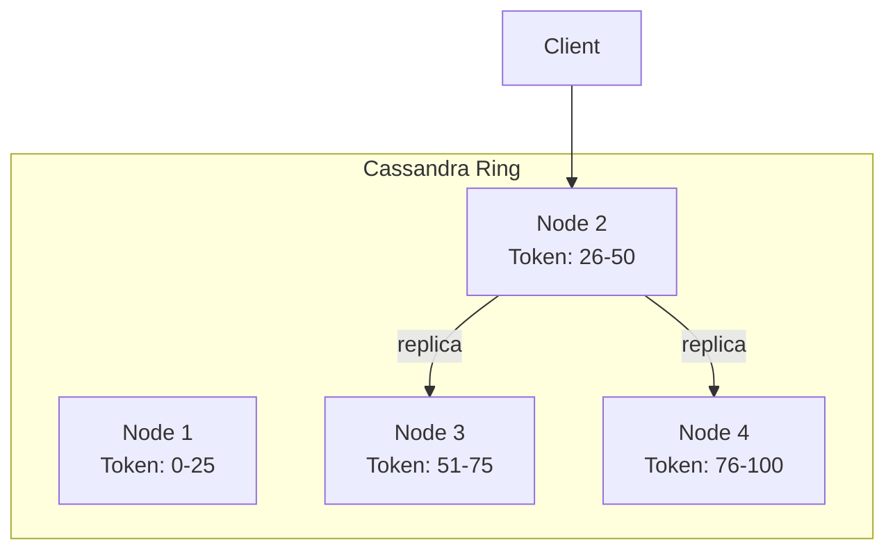

# Apache Cassandra

## Mental Model

Cassandra is a **distributed wide-column store** designed for massive write throughput with predictable low latency. Think of it as a distributed hash map of sorted maps:

```
HashMap<PartitionKey, SortedMap<ClusteringKey, Row>>
```

Each partition is an independent sorted data structure that lives on a subset of nodes. Queries that hit a single partition are fast. Queries that span partitions are expensive.

## Problem Being Solved

Traditional SQL databases hit limits when:
- Write throughput exceeds what a single master can handle
- Data volume exceeds single-node storage
- You need multi-region replication with low latency
- You can't afford downtime for a primary failover

Cassandra trades away joins, transactions, and strong consistency for **linear horizontal scalability** and **always-on availability**.

## Core Mechanism

### Architecture: No Master

Every node is equal. No leader, no follower, no single point of failure.



- Data is distributed across nodes using **consistent hashing** on the partition key
- Each node owns a range of the token ring
- Data is replicated to N nodes (configurable replication factor, typically RF=3)
- Any node can serve any request (acts as coordinator)

### Data Model: Partition Key + Clustering Key

```sql
CREATE TABLE messages (
    chat_id     UUID,        -- partition key
    timestamp   TIMESTAMP,   -- clustering key
    sender_id   UUID,
    content     TEXT,
    PRIMARY KEY (chat_id, timestamp)
) WITH CLUSTERING ORDER BY (timestamp DESC);
```

- **Partition key** (`chat_id`): determines which node(s) store the data. All rows with the same partition key are co-located.
- **Clustering key** (`timestamp`): determines sort order within a partition. Enables efficient range queries.
- **One partition = one read** on the node that owns it. This is the fast path.

### Write Path

```
Client → Coordinator Node → Commit Log (append, sequential) → Memtable (in-memory)
                                                             → SSTable (flush to disk periodically)
```

1. Write goes to **commit log** (append-only, sequential I/O — fast)
2. Write goes to **memtable** (in-memory sorted structure)
3. When memtable is full, flushed to disk as an **SSTable** (Sorted String Table — immutable)
4. **No read-before-write** — writes don't check existing data. This is why writes are fast.

### Read Path

```
Client → Coordinator → Bloom Filter → Key Cache → SSTable(s) → Merge → Return
```

1. Check **bloom filter** — probabilistic "is this key in this SSTable?" (avoids unnecessary disk reads)
2. Check **key cache** — cached partition index positions
3. Read from relevant **SSTables** + memtable
4. **Merge** results (SSTables are immutable, so multiple versions may exist)
5. Return the latest version

### Compaction

SSTables are immutable. Updates and deletes create new entries, not in-place modifications. **Compaction** merges SSTables:

- Removes old versions of rows
- Removes tombstones (delete markers) that have expired
- Reduces the number of SSTables to read

**Compaction strategies:**

| Strategy | How It Works | Best For |
|----------|-------------|----------|
| **SizeTiered (STCS)** | Merges SSTables of similar size | Write-heavy workloads |
| **Leveled (LCS)** | Organizes SSTables into levels with size limits | Read-heavy workloads, fewer SSTables to check |
| **TimeWindow (TWCS)** | Groups SSTables by time window | Time-series data (messages!) |

## Consistency Model

Cassandra offers **tunable consistency** per query:

| Level | Meaning | Latency | Consistency |
|-------|---------|---------|-------------|
| `ONE` | Acknowledged by 1 replica | Fastest | Weakest — stale reads possible |
| `QUORUM` | Acknowledged by majority (2 of 3 for RF=3) | Medium | Strong enough for most use cases |
| `ALL` | Acknowledged by all replicas | Slowest | Strongest — but one node down = query fails |
| `LOCAL_QUORUM` | Quorum within the local datacenter | Fast + consistent | Best for multi-region deployments |

**Rule of thumb:** `QUORUM` reads + `QUORUM` writes = strong consistency (R + W > RF).

## The Tombstone Problem

When you delete a row in Cassandra, it doesn't remove data. It writes a **tombstone** — a marker that says "this row is deleted."

**Why?** Because SSTables are immutable and data is replicated. A delete must propagate to all replicas, and the tombstone prevents resurrected data during read-repair.

**The problem:** Tombstones accumulate until compaction removes them (default: 10 days gc_grace_seconds). High-churn tables (frequent insert + delete) accumulate millions of tombstones, degrading read performance.

```
Read query hits partition → scans 100K tombstones → finds 50 live rows → slow!
```

**This is why delete-heavy workloads are a bad fit for Cassandra.** Tables like Inbox (insert, read, delete in quick succession) create tombstone storms.

**Mitigations:**
- Reduce `gc_grace_seconds` (risky — must ensure all replicas have received the delete)
- Use TTL instead of explicit deletes (tombstone still created but with automatic expiry)
- Use TimeWindowCompaction for time-series data (entire SSTables dropped when window expires)
- **Don't use Cassandra for queue-like patterns** — use Redis or a dedicated queue

## Scaling

- **Add nodes** to the ring → automatic data rebalancing (virtual nodes help distribute evenly)
- **Linear scalability** — double the nodes, double the throughput
- **Multi-datacenter replication** built-in — `NetworkTopologyStrategy` with per-DC replication factor
- No downtime for scaling — nodes join/leave while serving traffic

## Failure Modes

| Failure | Impact | Mitigation |
|---------|--------|------------|
| Node crash | Replicas serve reads; hints stored for missed writes | Hinted handoff replays writes when node recovers |
| Network partition | Nodes in smaller partition may become unavailable at QUORUM | Tune consistency level; LOCAL_QUORUM for multi-DC |
| Tombstone accumulation | Read latency spikes, potential OOM on large scans | Monitor tombstone counts; avoid delete-heavy patterns |
| Hot partition | One partition gets disproportionate traffic → single node overloaded | Choose partition keys carefully; avoid time-bucketed keys that create hotspots |
| SSTable bloat | Disk fills up if compaction can't keep up | Monitor compaction lag; provision sufficient disk headroom |

## When to Use / When to Avoid

| Use Cassandra When | Avoid Cassandra When |
|--------------------|---------------------|
| Write throughput > 100K/sec | You need joins or complex queries |
| Data model fits partition key + clustering key | Delete-heavy workloads (tombstone problem) |
| Time-series or append-heavy data | Small dataset that fits in one PostgreSQL instance |
| Multi-region replication needed | Strong consistency is a hard requirement |
| Always-on availability required | You need ACID transactions |

## Real-World Usage

| Company | Use Case | Notes |
|---------|----------|-------|
| **Discord** | Message storage (migrated to ScyllaDB) | Hit tombstone issues at scale |
| **Netflix** | User activity, viewing history | Time-series data, massive write volume |
| **Instagram** | Feed storage, direct messages | Partition by userId |
| **Apple** | 75K+ nodes, 10+ PB | Largest known deployment |
| **Uber** | Driver/rider location, trip data | Write-heavy, geo-distributed |

## Related Concepts

- [SQL vs NoSQL](/decisions/sql-vs-nosql) — when to choose which
- [Redis](/building-blocks/redis) — alternative for ephemeral/transient data
- [WebSocket Connection Management](/building-blocks/websocket-connection-management) — uses Redis, not Cassandra, for connection state
