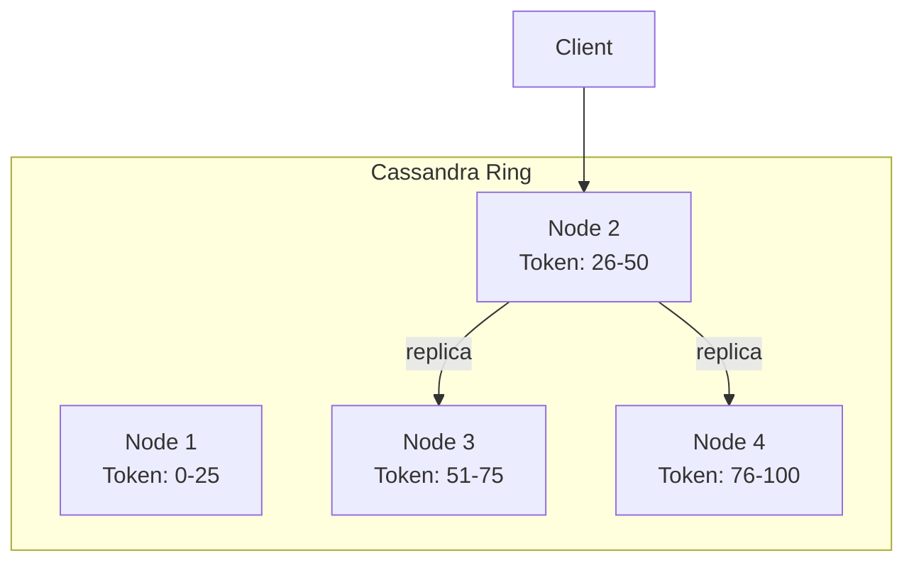
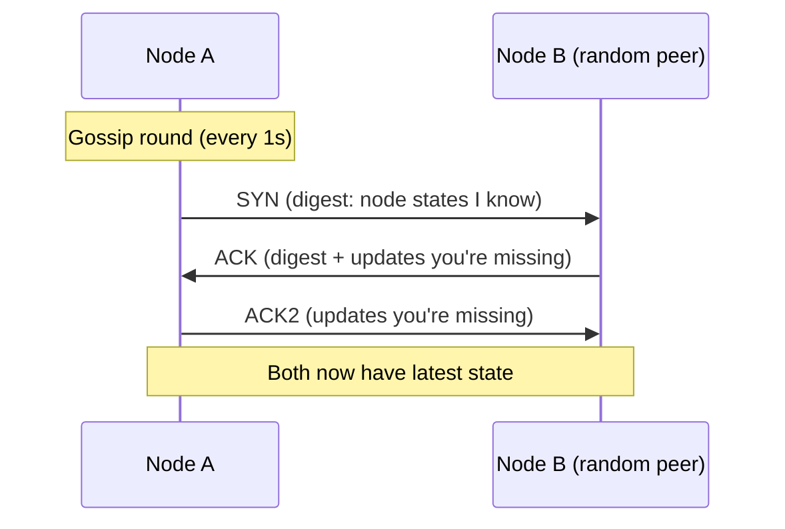
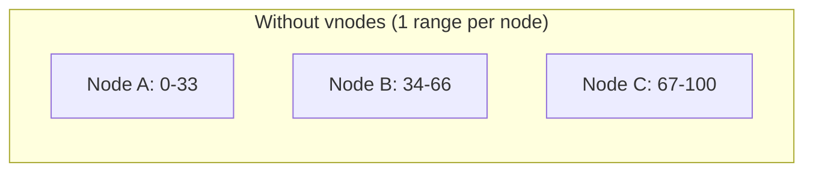
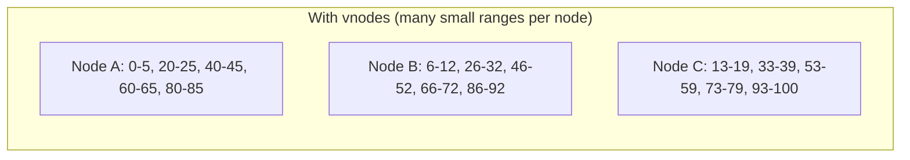
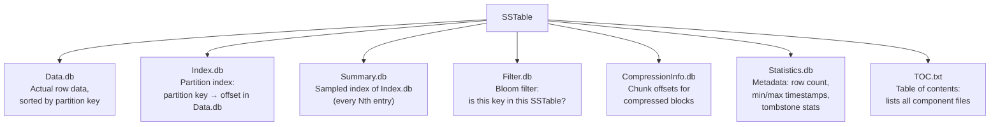
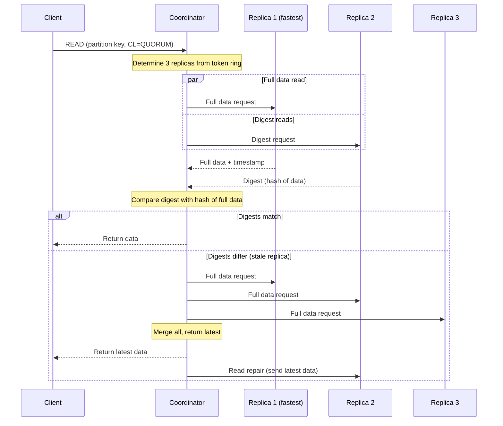
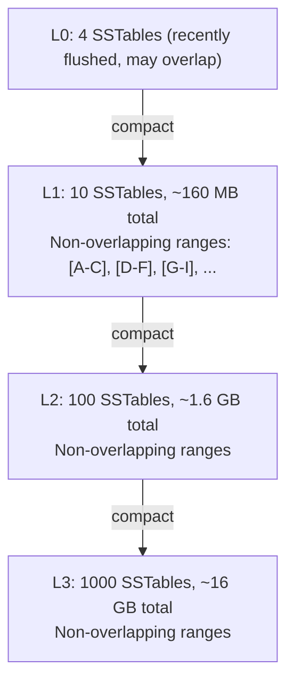

# Apache Cassandra

## Mental Model

Cassandra is a **distributed wide-column store** designed for massive write throughput with predictable low latency. Think of it as a distributed hash map of sorted maps:

```
HashMap<PartitionKey, SortedMap<ClusteringKey, Row>>
```

Each partition is an independent sorted data structure that lives on a subset of nodes. Queries that hit a single partition are fast. Queries that span partitions are expensive.

## Problem Being Solved

Traditional SQL databases hit limits when:
- Write throughput exceeds what a single master can handle
- Data volume exceeds single-node storage
- You need multi-region replication with low latency
- You can't afford downtime for a primary failover

Cassandra trades away joins, transactions, and strong consistency for **linear horizontal scalability** and **always-on availability**.

## Core Mechanism

### Architecture: No Master

Every node is equal. No leader, no follower, no single point of failure.



- Data is distributed across nodes using **consistent hashing** on the partition key
- Each node owns a range of the token ring
- Data is replicated to N nodes (configurable replication factor, typically RF=3)
- Any node can serve any request (acts as coordinator)

### No Leader Election

Unlike leader-based systems such as [Kafka](/building-blocks/kafka) (partition leaders), ZooKeeper, or Raft-based databases (etcd, CockroachDB), Cassandra has **no leader election at all**. Every node is a peer.

**How it works:**
- There is no "leader for a partition." All replicas for a given partition accept writes equally.
- The **coordinator** is chosen per-request: it is simply whichever node the client connects to (or the token-aware driver picks the node that owns the partition). The coordinator role carries no special authority -- it just routes the request to the correct replicas.
- **Conflict resolution** uses last-write-wins (LWW) based on the client-supplied or server-generated timestamp. If two clients write different values to the same column at the same time, the one with the higher timestamp wins.

**Why this matters:**
- **No single point of failure.** Leader-based systems must detect leader failure and elect a new one (seconds of unavailability). Cassandra has no such gap.
- **No fencing or split-brain concerns** at the replication layer (though network partitions still affect quorum-based consistency).
- **Trade-off:** Without a leader to serialize writes, Cassandra cannot provide strong consistency by default. Concurrent writes to the same row on different replicas will silently resolve via LWW, which can lose writes.

**Lightweight Transactions (LWT / Paxos) for CAS:**

For the rare cases that require compare-and-set semantics (e.g., "insert only if not exists"), Cassandra provides LWTs using a Paxos consensus protocol. These are slow because each LWT requires **4 network round trips** (prepare, promise, propose, accept) across replicas. Use LWTs sparingly -- they are 5-10x slower than normal writes.

| Aspect | Leader-Based (Kafka, Raft) | Leaderless (Cassandra) |
|--------|---------------------------|----------------------|
| Write routing | All writes go to leader | Any replica accepts writes |
| Failover | Election required (seconds) | No failover needed |
| Consistency | Strong (linearizable) | Tunable (eventual to quorum) |
| Conflict resolution | Leader serializes writes | Last-write-wins (timestamp) |
| CAS operations | Native (leader serializes) | LWT via Paxos (slow) |

### Data Model: Partition Key + Clustering Key

```sql
CREATE TABLE messages (
    chat_id     UUID,        -- partition key
    timestamp   TIMESTAMP,   -- clustering key
    sender_id   UUID,
    content     TEXT,
    PRIMARY KEY (chat_id, timestamp)
) WITH CLUSTERING ORDER BY (timestamp DESC);
```

- **Partition key** (`chat_id`): determines which node(s) store the data. All rows with the same partition key are co-located.
- **Clustering key** (`timestamp`): determines sort order within a partition. Enables efficient range queries.
- **One partition = one read** on the node that owns it. This is the fast path.

### Wide-Column Storage Model

Cassandra is often called a "wide-column store," but this label is frequently misunderstood. It is **not** a columnar database like Parquet or BigQuery that stores all values of a single column together for analytics aggregation. Cassandra is **partition-oriented**: data is grouped by partition key, and within each partition, rows are sorted by clustering columns.

**Internal storage layout:**

```
Partition Key → [ClusteringKey₁ → {col_a: val, col_b: val},
                 ClusteringKey₂ → {col_a: val, col_c: val},
                 ClusteringKey₃ → {col_b: val}]
```

Key properties:
- **Sparse columns:** Not every row needs every column. Missing columns consume zero storage. This is different from relational databases where every row has a slot for every column (even if NULL).
- **Each CQL row** maps to a set of cells in internal storage, keyed by `(partition_key, clustering_key, column_name)`.
- **Data within a partition** is stored contiguously on disk and sorted by clustering key, making range scans within a partition sequential I/O.
- **Data across partitions** is distributed to different nodes via consistent hashing, making cross-partition queries (scatter-gather) expensive.

**Comparison with other storage models:**

| Property | Relational (MySQL/[PostgreSQL](/building-blocks/postgresql)) | Columnar (Parquet/BigQuery) | Cassandra (Wide-Column) |
|----------|-------------------------------|----------------------------|------------------------|
| Storage unit | Row (all columns together) | Column (all values of one column) | Partition (all rows with same partition key) |
| Best for | OLTP, joins, transactions | OLAP, aggregations, analytics | High-throughput writes, range queries within partition |
| Sparse columns | NULL occupies space | Efficient (run-length encoding) | Zero cost (not stored) |
| Cross-entity queries | JOINs (fast with indexes) | Full-column scans (fast) | Scatter-gather (slow, avoid) |
| Sort order | Defined by query (`ORDER BY`) | N/A (aggregation-oriented) | Fixed at table creation (clustering key) |

### Gossip Protocol

Cassandra nodes discover each other and share cluster state using a **gossip protocol** -- a peer-to-peer epidemic communication mechanism.

**How gossip works:**
1. Every node runs a gossip round **once per second**.
2. Each round, the node picks **1-3 random peers** and exchanges state digests.
3. If a peer has newer information, a full state exchange follows.
4. Information spreads exponentially: after `O(log N)` rounds, all nodes converge.

**What is gossiped:**
- **Heartbeat state:** Generation (timestamp of node start) and version (monotonically increasing counter). Used to detect liveness.
- **Application state:** A set of key-value pairs including:
  - `LOAD` -- disk usage on the node
  - `SCHEMA` -- schema version hash (detects schema disagreements)
  - `DC` / `RACK` -- datacenter and rack placement
  - `STATUS` -- `NORMAL`, `LEAVING`, `JOINING`, `MOVING`
  - `SEVERITY` -- I/O pressure (used for dynamic snitch scoring)
  - `TOKENS` -- token ranges owned by the node



**Phi Accrual Failure Detector:**

Cassandra does NOT use a fixed timeout to declare a node dead. Instead, it uses a **Phi Accrual Failure Detector** that computes a suspicion level (`phi`) based on the statistical distribution of historical inter-arrival times of heartbeats.

- Each node tracks the arrival times of gossip heartbeats from every peer.
- `phi` increases as the silence interval grows relative to historical norms.
- When `phi` exceeds a configurable threshold (default: 8), the node is marked as down.
- **Advantage:** Adapts to network conditions. A node on a high-latency cross-DC link gets a more generous timeout than a node on the local rack.

**Seed nodes:**

When a new node joins the cluster, it needs at least one known contact point. **Seed nodes** are the bootstrap contacts. They are not special in any other way -- they are regular nodes that happen to be listed in the config as initial gossip targets. Best practice: 2-3 seed nodes per datacenter.

### Virtual Nodes (vnodes)

In the original Cassandra design, each node owned **one contiguous range** on the token ring. This created problems: uneven data distribution, slow rebalancing when nodes joined or left (the entire range had to move to one neighbor).

**Vnodes** solve this by assigning each physical node **many small token ranges** (default: 256 vnodes per node).





**Benefits:**
- **Even data distribution:** Small random ranges statistically balance out across nodes, avoiding hotspots.
- **Faster rebalancing:** When a node joins or leaves, only a small fraction of each existing node's data moves, and the work is spread across ALL nodes in the cluster (not just one neighbor).
- **Heterogeneous hardware support:** A more powerful node can be assigned more vnodes (e.g., 384 vs 256), receiving proportionally more data and traffic.

**Trade-offs:**
- More token ranges to manage increases Merkle tree repair complexity.
- Slightly more complex routing (the driver must maintain a larger token map).
- Repair operations touch more ranges, which can increase repair time unless parallelized.

:::tip
For most production clusters, vnodes are the default and recommended configuration. The main tuning knob is `num_tokens` -- lower values (e.g., 16) with a better initial token allocation algorithm (`allocate_tokens_for_local_replication_factor`) are used in newer Cassandra versions for improved repair efficiency.
:::

## How It Works

### Write Path (Deep Dive)

The write path is designed around one principle: **convert all writes to sequential I/O.** Random I/O on spinning disks is ~100x slower than sequential I/O. Even on SSDs, sequential writes avoid write amplification at the storage layer.


**Step-by-step:**

1. **Client sends write** to any node (the coordinator).
2. Coordinator determines the replicas for the partition key (via token ring) and forwards the write to each replica.
3. On each replica, the write is **appended to the commit log** (sequential I/O -- no seeking).
4. The write is then inserted into the **memtable** (in-memory sorted structure).
5. An acknowledgment is sent back immediately. The write is durable (commit log) and queryable (memtable).
6. When the memtable reaches a threshold, it is **flushed to disk** as an immutable SSTable.

**No read-before-write** -- writes don't check existing data. This is why writes are fast.

#### Commit Log (Write-Ahead Log) Deep Dive

The commit log is Cassandra's durability guarantee. It is a **write-ahead log (WAL)** -- data is written to the commit log BEFORE being applied to the memtable. If the node crashes, the commit log is replayed on restart to rebuild memtables.

**Sequential I/O vs random I/O:**
- The commit log is **append-only**. New writes are always added to the end of the current segment file. There is no seeking, no reading, no rewriting.
- On spinning disks, a sequential write can sustain ~100-200 MB/s, while random writes deliver only ~1-2 MB/s. Even on SSDs, sequential writes are 2-5x faster because they align with the flash translation layer and reduce write amplification.
- This design means Cassandra can absorb writes at the speed of sequential disk I/O, which is close to the theoretical maximum of the storage device.

**Commit log segments and recycling:**
- The commit log is divided into fixed-size **segment files** (default 32 MB).
- Writes fill one segment at a time. When a segment is full, a new one is allocated.
- A segment is **eligible for recycling** (deletion or reuse) only when ALL memtables that contain data from that segment have been flushed to SSTables. This means the commit log is self-cleaning -- no manual truncation needed.
- Cassandra tracks which memtables have been flushed using a replay position per table.

**`commitlog_sync` modes:**

| Mode | How it works | Durability | Latency |
|------|-------------|------------|---------|
| `periodic` (default) | Writes are buffered in OS page cache; `fsync` every `commitlog_sync_period_in_ms` (default 10s) | Up to 10s of data can be lost on power failure (not process crash -- OS page cache survives process crash) | Lowest latency (~0.1ms write) |
| `batch` | Writes are buffered until `commitlog_sync_batch_window_in_ms` (default 2ms), then `fsync` as a batch | At most 2ms of data loss on power failure | Higher latency (~2ms) but better durability |
| `group` (Cassandra 4.0+) | Similar to batch but with configurable group commit semantics | Configurable | Configurable |

**Crash recovery:**
1. On startup, Cassandra detects unflushed commit log segments.
2. It **replays** the commit log from the last known flush position.
3. Writes from the log are re-applied to new memtables.
4. Once replay is complete, the node is ready to serve traffic.
5. Replay is fast because the commit log is read sequentially and the memtable is an in-memory insert.

#### Memtable Deep Dive

The memtable is Cassandra's **in-memory write buffer** -- a sorted data structure that absorbs writes before they are flushed to disk.

**Internal structure:**
- Implemented as a `ConcurrentSkipListMap` in Java -- a lock-free, thread-safe sorted map.
- Each **table** (column family) has its own memtable. Writes to different tables go to different memtables.
- Data in the memtable is sorted by partition key and clustering key, which means the flush to SSTable is a simple sequential write of already-sorted data.

**Flush triggers:**
- **Size threshold:** When a memtable exceeds `memtable_heap_space` or `memtable_offheap_space` thresholds, the largest memtable is selected for flushing.
- **Commit log size:** When the total commit log size exceeds `commitlog_total_space`, the oldest memtables are flushed to allow commit log segments to be recycled.
- **Manual flush:** `nodetool flush` forces all memtables to disk. Useful before taking a snapshot or shutting down gracefully.
- **Table count:** When there are too many memtables across tables, Cassandra forces flushes to control memory.

**What happens during flush:**
1. The current memtable is **frozen** (no new writes accepted into it).
2. A **new empty memtable** is created immediately to accept incoming writes (zero downtime).
3. The frozen memtable is written to disk as a new SSTable. Because the memtable is already sorted, this flush is a **single sequential write** -- extremely fast.
4. Once the SSTable is fully written, the corresponding commit log segments can be recycled.

**Memory pressure and back-pressure:**
- If memtables consume too much heap, Cassandra triggers aggressive flushing and can block new writes temporarily until memory is freed.
- In extreme cases, `MemtableAllocationType` can use off-heap memory (`offheap_objects` or `offheap_buffers`) to reduce GC pressure on the JVM.
- Monitoring `MemtableFlushWriter` queue depth is critical: if flushes can't keep up with writes, memtable memory grows unboundedly until back-pressure kicks in.

#### SSTable Deep Dive

An SSTable (Sorted String Table) is the **immutable on-disk representation** of a flushed memtable. Immutability is the foundational design choice that enables Cassandra's write performance.

**SSTable components:**



| Component | Purpose | Accessed When |
|-----------|---------|---------------|
| `Data.db` | Row data, sorted by partition + clustering key | Every read that hits this SSTable |
| `Index.db` | Maps partition keys to byte offsets in Data.db | Read path (unless key cache hit) |
| `Summary.db` | Sampled subset of Index.db (every 128th entry by default) | Read path, checked before Index.db to narrow offset range |
| `Filter.db` | Bloom filter for partition keys in this SSTable | Read path, checked FIRST to avoid unnecessary I/O |
| `CompressionInfo.db` | Chunk boundaries for decompression | When reading compressed blocks |
| `Statistics.db` | Min/max clustering keys, timestamps, tombstone count, row count | Compaction decisions, query optimization |
| `TOC.txt` | Lists all component files for this SSTable | Startup, SSTable discovery |

**Immutability and its implications:**
- **No in-place updates.** When a row is updated, the new version is written to the current memtable and eventually flushed to a NEW SSTable. The old version remains in the old SSTable until compaction merges them.
- **Deletes create tombstones** -- a special marker that says "this row is deleted at timestamp T." The tombstone lives in a new SSTable; the original data remains in the old one until compaction.
- **Reads may need to merge multiple SSTables** to reconstruct the current state of a row. This is the primary cost of immutability.

**SSTable lifecycle:**

```
Write → Memtable → Flush → SSTable₁
More writes → ... → SSTable₂, SSTable₃, ...
Compaction merges SSTable₁ + SSTable₂ → SSTable_merged (new, larger)
Old SSTables deleted after merge
```

### Read Path (Deep Dive)

The read path is more complex than the write path because data may be spread across the memtable and multiple SSTables.



**Step-by-step on each replica:**

1. **Coordinator determines replicas** for the partition key using the token ring and replication strategy.
2. For `QUORUM` reads (RF=3), the coordinator sends a **full data request** to the fastest replica (determined by the dynamic snitch) and **digest requests** to enough additional replicas to meet quorum.
3. A digest is a hash of the data -- much cheaper to transmit than the full row.
4. If digests match, the coordinator returns the full data from the fastest replica.
5. If digests differ, the coordinator requests full data from all replicas, merges by timestamp, returns the latest to the client, and triggers **read repair** to fix stale replicas.

**On each individual replica, the local read path is:**

1. **Bloom filter check:** Each SSTable has a Bloom filter. The filter answers "is this partition key DEFINITELY NOT in this SSTable?" with certainty, or "MAYBE in this SSTable" with a configurable false positive rate (default ~1%). This avoids reading SSTables that don't contain the requested partition.
   - Bloom filter tuning: `bloom_filter_fp_chance` (default 0.01 = 1%). Lower values use more memory but reduce false positive reads. For read-heavy tables, set to 0.001.

2. **Partition summary (Summary.db):** A sampled in-memory index that narrows down the region of the partition index (Index.db) to search. Checking a sparse in-memory array is much faster than scanning the full on-disk index.

3. **Partition index (Index.db):** On-disk sorted index mapping partition keys to byte offsets in the Data.db file. If the key cache has the offset, this step is skipped entirely.

4. **Key cache:** An in-memory cache of `(partition_key → SSTable byte offset)`. If the key is in the cache, Cassandra jumps directly to the data in Data.db, skipping both the Summary and Index lookups. The key cache is **highly effective** -- even a small cache dramatically reduces disk reads.

5. **Row cache (optional):** Caches entire deserialized partitions in memory. **Rarely used** because:
   - It is invalidated on ANY write to the partition (even a different clustering key).
   - For write-heavy workloads (Cassandra's sweet spot), the cache hit rate is abysmal.
   - It competes with memtables for heap space.
   - The key cache + OS page cache usually provide sufficient performance.

6. **Read from SSTables + memtable:** Cassandra reads the relevant data from all SSTables that might contain the partition (those that passed the Bloom filter) plus the current memtable. Data is stored sorted, so reads within a partition are sequential.

7. **Merge and reconcile:** If the same cell exists in multiple SSTables (due to updates), the one with the highest timestamp wins. Tombstones suppress older versions of deleted data.

8. **Read repair:** If the coordinator detects that a replica returned stale data (via digest mismatch), it sends the latest data to the stale replica in the background. This is an **opportunistic consistency repair** that happens as a side effect of reads.

### Compaction (Deep Dive)

Compaction is the background process that merges multiple SSTables into fewer, larger ones. It is essential because:
- Without compaction, reads degrade linearly as more SSTables accumulate (each read must check all of them).
- Old versions of updated rows and expired tombstones waste disk space.
- Bloom filter memory grows with the number of SSTables.

#### Size-Tiered Compaction Strategy (STCS)

**How it works:**
- SSTables are grouped into **buckets** by size (within a configurable ratio, default 1.5x).
- When a bucket has `min_threshold` SSTables (default 4), they are merged into one larger SSTable.
- The resulting SSTable enters a higher size tier, eventually being compacted with other SSTables of similar size.

**Characteristics:**
- Favors write throughput -- fewer compaction operations overall.
- **Write amplification** is low: each byte is rewritten ~`log(N)` times over the SSTable's lifetime.
- **Space amplification** is high: during compaction, both the old SSTables and the new merged SSTable exist simultaneously. In the worst case, requires ~2x the data size in free disk space.
- **Read amplification** is moderate to high: many SSTables may exist at each size tier, and a read may need to check multiple SSTables.

#### Leveled Compaction Strategy (LCS)

**How it works:**
- SSTables are organized into **levels** (L0, L1, L2, ...).
- L0 is where freshly flushed SSTables land (like STCS).
- Each level above L0 is 10x the size of the previous level.
- **Key property:** Within each level (L1+), SSTables have **non-overlapping partition ranges**. This means a read for a given partition key needs to check AT MOST one SSTable per level.
- When a level exceeds its size target, one SSTable is picked and merged with the overlapping SSTables in the next level.



**Characteristics:**
- Read amplification is **bounded**: at most one SSTable per level, so a read checks at most ~`log₁₀(data_size / L1_size)` SSTables (plus L0). For most tables, this is 3-5 SSTables.
- Write amplification is **higher**: each byte may be rewritten up to 10x per level transition (because merging one L1 SSTable may overlap with up to 10 L2 SSTables).
- Space amplification is **low**: ~10% overhead, because compaction at each level only replaces a small number of SSTables.

#### Time-Window Compaction Strategy (TWCS)

**How it works:**
- SSTables are grouped by **time window** (e.g., 1 hour, 1 day).
- Within a window, STCS is used to merge SSTables.
- Once a window closes (no more writes expected for that time range), the SSTables for that window are compacted into a single SSTable and **never compacted again**.
- When TTL expires for all rows in a time window, the entire SSTable is **dropped** -- no compaction needed, just a file delete.

**Characteristics:**
- Ideal for time-series data with TTL (e.g., messages, logs, metrics).
- Dropping entire SSTables on TTL expiry is vastly more efficient than scanning and compacting away individual tombstones.
- **Do not** use TWCS for data that receives out-of-order writes or updates to old rows -- this creates data spread across multiple time windows, defeating the purpose.

#### Compaction Strategy Comparison

| Dimension | STCS | LCS | TWCS |
|-----------|------|-----|------|
| **Write amplification** | Low (~`log N`) | High (~10x per level) | Low (same as STCS within window) |
| **Read amplification** | High (many SSTables per size tier) | Low (1 SSTable per level) | Low (few SSTables per time window) |
| **Space amplification** | High (up to 2x during compaction) | Low (~10%) | Low (SSTables dropped entirely on TTL) |
| **Best for** | Write-heavy, few reads | Read-heavy, low latency reads | Time-series with TTL |
| **Worst for** | Read-heavy with many updates | Write-heavy (compaction overhead) | Out-of-order writes, updates to old data |

### Replication (Deep Dive)

Cassandra replicates data to multiple nodes for durability and availability. See [Replication](/distributed-systems/replication) for general concepts.

#### Replication Strategies

| Strategy | How replicas are chosen | When to use |
|----------|------------------------|-------------|
| `SimpleStrategy` | First replica at token owner, next replicas at clockwise-next nodes on the ring | Single datacenter, development only |
| `NetworkTopologyStrategy` | Specify RF per datacenter; replicas are placed clockwise on the ring but **rack-aware** -- Cassandra avoids placing two replicas in the same rack | **Production.** Always use this, even for single-DC deployments (allows future multi-DC expansion) |

**Example:**
```sql
CREATE KEYSPACE messaging WITH replication = {
    'class': 'NetworkTopologyStrategy',
    'us-east': 3,
    'eu-west': 3
};
```

This creates 3 replicas in `us-east` and 3 in `eu-west`. Within each DC, replicas are distributed across different racks.

**How rack-aware placement works:**
1. The first replica is placed at the node that owns the token for the partition key.
2. The next replica walks clockwise on the ring until it finds a node in a **different rack**.
3. Subsequent replicas continue clockwise, preferring nodes in racks not yet used.
4. This ensures that a single rack failure (power, switch) doesn't lose all replicas.

#### Hinted Handoff

When a write arrives but one of the target replicas is down:

1. The coordinator stores a **hint** -- a record of the write intended for the downed node.
2. Hints are stored locally on the coordinator node in a system table.
3. When the downed node recovers and is detected via gossip, the coordinator **replays** all stored hints to it.
4. Hints expire after `max_hint_window_in_ms` (default: 3 hours). If the node is down longer than this, hints are dropped and the node must be repaired via anti-entropy repair.

**Limitations:**
- Hints consume disk space on the coordinator. A long outage with high write volume can fill the coordinator's disk.
- Hints only cover writes that the coordinator received while the replica was down. Writes routed through other coordinators are not covered.
- Hinted handoff is a **best-effort** mechanism, not a guarantee. Always run regular repairs.

#### Anti-Entropy Repair

For long-term consistency, Cassandra provides `nodetool repair`, which uses **Merkle trees** to efficiently compare data across replicas.

**How it works:**
1. Each replica builds a **Merkle tree** (hash tree) of its data for a given token range.
2. Replicas exchange tree roots. If roots match, data is consistent.
3. If roots differ, they walk down the tree to identify exactly which partitions differ.
4. Only the differing partitions are streamed from the most up-to-date replica to the stale one.

**Best practice:** Run repair at least once every `gc_grace_seconds` (default 10 days) to ensure tombstones are propagated to all replicas before they are compacted away. Missing this window can cause deleted data to **resurrect** (zombie data).

See also: [Consistent Hashing](/distributed-systems/consistent-hashing), [Sharding](/distributed-systems/sharding), [Partitioning](/distributed-systems/partitioning).

## Consistency Model

Cassandra offers **tunable consistency** per query:

| Level | Meaning | Latency | Consistency |
|-------|---------|---------|-------------|
| `ONE` | Acknowledged by 1 replica | Fastest | Weakest -- stale reads possible |
| `QUORUM` | Acknowledged by majority (2 of 3 for RF=3) | Medium | Strong enough for most use cases |
| `ALL` | Acknowledged by all replicas | Slowest | Strongest -- but one node down = query fails |
| `LOCAL_QUORUM` | Quorum within the local datacenter | Fast + consistent | Best for multi-region deployments |

**Rule of thumb:** `QUORUM` reads + `QUORUM` writes = strong consistency (R + W &gt; RF).

## The Tombstone Problem

When you delete a row in Cassandra, it doesn't remove data. It writes a **tombstone** -- a marker that says "this row is deleted."

**Why?** Because SSTables are immutable and data is replicated. A delete must propagate to all replicas, and the tombstone prevents resurrected data during read-repair.

**The problem:** Tombstones accumulate until compaction removes them (default: 10 days gc_grace_seconds). High-churn tables (frequent insert + delete) accumulate millions of tombstones, degrading read performance.

```
Read query hits partition → scans 100K tombstones → finds 50 live rows → slow!
```

**This is why delete-heavy workloads are a bad fit for Cassandra.** Tables like Inbox (insert, read, delete in quick succession) create tombstone storms.

**Mitigations:**
- Reduce `gc_grace_seconds` (risky -- must ensure all replicas have received the delete)
- Use TTL instead of explicit deletes (tombstone still created but with automatic expiry)
- Use TimeWindowCompaction for time-series data (entire SSTables dropped when window expires)
- **Don't use Cassandra for queue-like patterns** -- use [Redis](/building-blocks/redis) or a dedicated queue

## Scaling Considerations

- **Add nodes** to the ring -- automatic data rebalancing (virtual nodes help distribute evenly)
- **Linear scalability** -- double the nodes, double the throughput
- **Multi-datacenter replication** built-in -- `NetworkTopologyStrategy` with per-DC replication factor
- No downtime for scaling -- nodes join/leave while serving traffic

See also: [Consistent Hashing](/distributed-systems/consistent-hashing) for how token ring rebalancing works, and [Sharding](/distributed-systems/sharding) for general partitioning strategies.

## Failure Modes

| Failure | Impact | Mitigation |
|---------|--------|------------|
| Node crash | Replicas serve reads; hints stored for missed writes | Hinted handoff replays writes when node recovers; commit log replay restores memtable on restart |
| Network partition | Nodes in smaller partition may become unavailable at QUORUM | Tune consistency level; `LOCAL_QUORUM` for multi-DC |
| Tombstone accumulation | Read latency spikes, potential OOM on large scans | Monitor tombstone counts; avoid delete-heavy patterns |
| Hot partition | One partition gets disproportionate traffic -- single node overloaded | Choose partition keys carefully; avoid time-bucketed keys that create hotspots |
| SSTable bloat | Disk fills up if compaction can't keep up | Monitor compaction lag; provision sufficient disk headroom |
| Commit log disk full | Writes blocked until memtables flush and segments recycle | Separate commit log onto dedicated disk; monitor disk usage |
| Gossip partition | Node falsely marked down; or split cluster with different state views | Phi Accrual Failure Detector reduces false positives; monitor gossip state |
| Hint accumulation | Coordinator disk fills with hints for long-downed node | Set `max_hint_window_in_ms` appropriately; monitor hint stores |
| Zombie data (tombstone missed repair) | Deleted data reappears after `gc_grace_seconds` | Run `nodetool repair` within `gc_grace_seconds` window |

## When to Use / When to Avoid

| Use Cassandra When | Avoid Cassandra When |
|--------------------|---------------------|
| Write throughput &gt; 100K/sec | You need joins or complex queries |
| Data model fits partition key + clustering key | Delete-heavy workloads (tombstone problem) |
| Time-series or append-heavy data | Small dataset that fits in one [PostgreSQL](/building-blocks/postgresql) instance |
| Multi-region replication needed | Strong consistency is a hard requirement |
| Always-on availability required | You need ACID transactions |

## Real-World Examples

| Company | Use Case | Notes |
|---------|----------|-------|
| **Discord** | Message storage (migrated to ScyllaDB) | Hit tombstone issues at scale |
| **Netflix** | User activity, viewing history | Time-series data, massive write volume |
| **Instagram** | Feed storage, direct messages | Partition by userId |
| **Apple** | 75K+ nodes, 10+ PB | Largest known deployment |
| **Uber** | Driver/rider location, trip data | Write-heavy, geo-distributed |

## Trade-offs

| Decision | What You Get | What You Give Up |
|----------|-------------|-----------------|
| No leader | No SPOF, no failover delay, any node accepts writes | No linearizable consistency without LWT (Paxos) |
| Immutable SSTables | Fast sequential writes, no write locks | Read amplification (merge multiple SSTables), tombstone accumulation |
| Tunable consistency | Flexible per-query trade-off (latency vs consistency) | Developer must understand implications; wrong CL = stale reads or unavailability |
| Last-write-wins conflict resolution | Simple, no coordination needed | Silent data loss if concurrent writes to same cell |
| Denormalized data model | Fast reads (no joins) | Data duplication, application-level consistency |
| Gossip protocol | Decentralized, no coordination bottleneck | Eventual convergence (seconds), schema changes propagate slowly |
| Vnodes | Even distribution, fast rebalancing | More Merkle trees for repair, larger token metadata |

## Related Concepts

- [Consistent Hashing](/distributed-systems/consistent-hashing) -- how data is distributed across the ring
- [Replication](/distributed-systems/replication) -- general replication strategies and trade-offs
- [Sharding](/distributed-systems/sharding) -- partitioning strategies for distributed databases
- [Partitioning](/distributed-systems/partitioning) -- partition key design and hot partition avoidance
- [SQL vs NoSQL](/decisions/sql-vs-nosql) -- when to choose which
- [PostgreSQL](/building-blocks/postgresql) -- relational alternative for ACID workloads
- [Redis](/building-blocks/redis) -- alternative for ephemeral/transient data
- [Kafka](/building-blocks/kafka) -- leader-based distributed log (contrast with Cassandra's leaderless design)
- [WebSocket Connection Management](/building-blocks/websocket-connection-management) -- uses Redis, not Cassandra, for connection state
