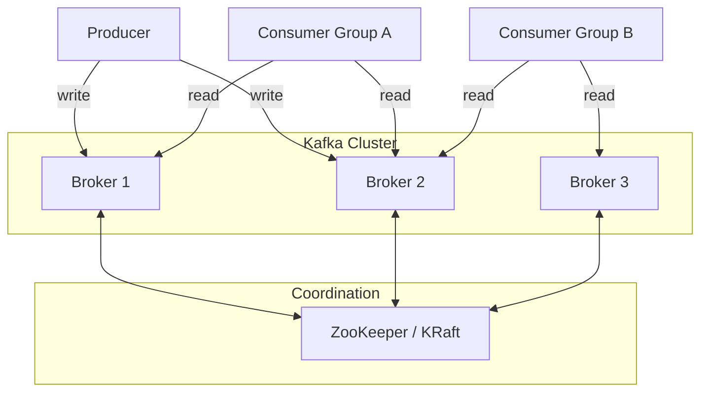

# Apache Kafka

## Mental Model

Kafka is a **distributed commit log**. Producers append events to the end of a log. Consumers read from any position in the log, at their own pace. The log is partitioned for parallelism and replicated for durability.

Think of it as a durable, distributed, ordered append-only file — where multiple readers can independently track their position.

```
Partition 0: [msg-1] [msg-2] [msg-3] [msg-4] [msg-5] → ...
                                        ↑ Consumer A     ↑ Consumer B
                                     (offset 3)       (offset 5)
```

## Problem Being Solved

Direct service-to-service communication (RPC, HTTP) creates tight coupling:
- If the receiver is down, the message is lost
- If the receiver is slow, the sender blocks or drops
- No replay — once consumed, gone

Kafka decouples producers from consumers in time, speed, and availability. The producer doesn't know or care who consumes, when, or how fast.

## Architecture

### Components



| Component | Role |
|-----------|------|
| **Broker** | A Kafka server that stores data and serves clients. A cluster has multiple brokers. |
| **Topic** | A named log/feed. Like a table name. E.g., `message-fanout`. |
| **Partition** | A topic is split into partitions for parallelism. Each partition is an ordered, immutable log. |
| **Producer** | Writes events to a topic. Chooses the partition (by key hash or round-robin). |
| **Consumer** | Reads events from partitions. Tracks its position (offset). |
| **Consumer Group** | A set of consumers that cooperate to consume a topic. Each partition is consumed by exactly one consumer in the group. |
| **ZooKeeper / KRaft** | Cluster coordination — broker registration, leader election, topic metadata. KRaft (Kafka Raft) replaces ZooKeeper in newer versions. |

### ZooKeeper vs KRaft

| | ZooKeeper | KRaft (Kafka 3.3+) |
|---|-----------|-------------------|
| Architecture | Separate ZooKeeper cluster | Built into Kafka brokers |
| Operational complexity | Two systems to manage | Single system |
| Metadata scaling | ZooKeeper bottleneck at ~200K partitions | Handles millions of partitions |
| Failover speed | Slower (ZK session timeout) | Faster (Raft consensus) |
| Status | Legacy, being deprecated | Production-ready, recommended for new clusters |

## Topics and Partitions

### Partitioning

A topic is divided into **partitions** — the unit of parallelism and ordering.

```
Topic: message-fanout (6 partitions)

Partition 0: [msg-A] [msg-D] [msg-G] → ...
Partition 1: [msg-B] [msg-E] [msg-H] → ...
Partition 2: [msg-C] [msg-F] [msg-I] → ...
Partition 3: ...
Partition 4: ...
Partition 5: ...
```

**Partition assignment:**
- **Key-based** (default): `partition = hash(key) % num_partitions`. Same key always goes to the same partition.
- **Round-robin**: No key — distribute evenly across partitions.
- **Custom partitioner**: Application-defined logic.

**Key design choice:** The partition key determines ordering guarantees. `partition_key = chatId` means all messages for a chat are in the same partition → **ordered processing per chat**.

### How Many Partitions?

| Factor | Guidance |
|--------|----------|
| Target throughput | Each partition handles ~10-30 MB/s write. Total throughput = partitions × per-partition throughput. |
| Consumer parallelism | Max consumers in a group = number of partitions. 100 partitions = max 100 parallel consumers. |
| End-to-end latency | More partitions = more replication overhead = slightly higher tail latency. |
| Broker memory | Each partition uses broker memory for indexes and buffers. |

**Rule of thumb:** Start with `max(target_throughput / per_partition_throughput, desired_consumer_count)`. Over-partitioning is better than under-partitioning (hard to repartition later).

## Producers

### Write Path

```
Producer → Serialize → Partition Selection → Batch → Compress → Send to Broker Leader → Replicate → ACK
```

### Producer Configs That Matter

| Config | What It Does | Trade-off |
|--------|-------------|-----------|
| `acks=0` | Don't wait for any acknowledgement | Fastest, but messages can be lost |
| `acks=1` | Wait for leader to write | Fast, but lost if leader crashes before replication |
| **`acks=all` (`-1`)** | Wait for all in-sync replicas (ISR) to write | **Slowest but safest — no data loss** |
| `retries` | Auto-retry on transient failure | Set high (e.g., `Integer.MAX_VALUE`) with idempotence |
| `enable.idempotence=true` | Exactly-once per partition (dedup retries) | Small overhead, prevents duplicate messages on retry |
| `batch.size` | Max bytes per batch before sending | Larger = higher throughput, higher latency |
| `linger.ms` | Wait up to N ms to fill a batch | 0 = send immediately. 5-10ms = better batching. |
| `compression.type` | Compress batches (snappy, lz4, zstd) | CPU for bandwidth. `lz4` is best balance. |
| `max.in.flight.requests.per.connection` | Unacknowledged requests in flight | Set to 5 with idempotence for max throughput + ordering |

**Recommended for guaranteed delivery:**
```
acks = all
enable.idempotence = true
retries = Integer.MAX_VALUE
max.in.flight.requests.per.connection = 5
```

## Consumers

### Consumer Groups

Multiple consumers form a **consumer group**. Kafka assigns partitions to consumers:

```
Topic: message-fanout (6 partitions)
Consumer Group: fanout-service

Consumer 1: Partition 0, Partition 1
Consumer 2: Partition 2, Partition 3
Consumer 3: Partition 4, Partition 5
```

**Rules:**
- Each partition is consumed by **exactly one consumer** in the group
- If a consumer dies, its partitions are **rebalanced** to surviving consumers
- Adding consumers (up to partition count) increases parallelism
- Consumers **beyond the partition count sit idle** — useless

### Offset Management

Each consumer tracks its **offset** — the position in the partition it has read up to.

```
Partition 0: [0] [1] [2] [3] [4] [5] [6]
                          ↑
                   committed offset = 3
                   (consumer has processed 0-3)
```

| Strategy | How It Works | Risk |
|----------|-------------|------|
| **Auto-commit** (`enable.auto.commit=true`) | Commits offset periodically (default 5s) | Messages processed but not committed → **reprocessed after crash** (at-least-once) |
| **Manual commit** | Application calls `commitSync()` after processing | More control, but must handle carefully |
| **Commit after processing** | Process message, then commit | At-least-once: crash before commit → reprocess |
| **Commit before processing** | Commit, then process | At-most-once: crash after commit → message lost |

**Recommended:** Manual commit after processing + idempotent consumers. Guarantees at-least-once; idempotency handles duplicates.

### Consumer Configs That Matter

| Config | What It Does | Trade-off |
|--------|-------------|-----------|
| `group.id` | Consumer group name | Consumers with same group.id share partitions |
| `auto.offset.reset` | Where to start if no committed offset | `earliest` = replay all; `latest` = skip to new |
| `max.poll.records` | Max records per poll() call | Higher = better throughput; lower = lower latency |
| `max.poll.interval.ms` | Max time between polls before consumer is considered dead | Too low = false rebalances; too high = slow failure detection |
| `session.timeout.ms` | Heartbeat timeout for consumer liveness | Default 45s. Lower = faster failure detection, more false positives |
| `fetch.min.bytes` | Min data per fetch request | Higher = better throughput (waits to batch); lower = lower latency |

## Replication

### In-Sync Replicas (ISR)

Each partition has a **leader** and N-1 **followers** (based on replication factor).

```
Partition 0:
  Leader:   Broker 1  (serves reads and writes)
  Follower: Broker 2  (replicates from leader)  ← in ISR
  Follower: Broker 3  (replicates from leader)  ← in ISR
```

- **ISR (In-Sync Replicas):** Followers that are caught up with the leader (within `replica.lag.time.max.ms`)
- **`acks=all`** means "acknowledged by all ISR members" — if a follower falls behind and leaves ISR, it doesn't block writes
- **Leader election:** If the leader dies, a follower from the ISR is elected as new leader

### Replication Factor

| RF | Durability | Cost | Tolerable failures |
|----|-----------|------|-------------------|
| 1 | None — data lost if broker dies | Low | 0 |
| **3** | **Standard — survives 2 failures** | **Moderate** | **2** |
| 5 | Extreme durability | High | 4 |

**Recommended: RF=3** with `min.insync.replicas=2`. This means:
- Writes succeed if at least 2 of 3 replicas acknowledge
- Survives 1 broker failure without any data loss or unavailability
- 2 broker failures → writes fail (safe) rather than losing data

## Ordering Guarantees

| Scope | Guarantee |
|-------|-----------|
| **Within a partition** | **Strict ordering** — messages are appended and read in order |
| **Across partitions** | **No ordering guarantee** — partitions are independent |
| **Within a key** | Ordered — same key → same partition → ordered |

**This is why partition key choice matters.** `key = chatId` → all messages for a chat are ordered. `key = userId` → all messages from a user are ordered, but a chat with multiple users has no cross-user ordering within the chat.

## Consumer Lag & Backpressure

### Consumer Lag

**Lag** = difference between the latest offset (what the producer wrote) and the consumer's committed offset (what the consumer processed).

```
Partition 0: [0] [1] [2] [3] [4] [5] [6] [7] [8]
                                    ↑              ↑
                             consumer offset   latest offset
                             Lag = 3 messages
```

**Monitoring lag is critical.** Increasing lag means consumers can't keep up with producers.

### Backpressure Strategies

| Strategy | How | When |
|----------|-----|------|
| **Add consumers** | Scale consumer group (up to partition count) | Lag is growing, consumers are CPU/IO bound |
| **Increase partitions** | More partitions = more parallelism | At partition count limit for consumers |
| **Batch processing** | Process multiple records per poll | Per-message processing is the bottleneck |
| **Producer throttling** | Rate-limit producers | Last resort — usually means consumers need scaling |
| **Backpressure via poll interval** | Consumer naturally slows down if processing takes longer | Built-in, but masks the problem |

### Alerting

| Metric | Alert Threshold | Action |
|--------|----------------|--------|
| Consumer lag (messages) | > 10K sustained | Scale consumers |
| Consumer lag (time) | > 30s | Investigate consumer processing time |
| Under-replicated partitions | > 0 | Broker may be overloaded or down |
| ISR shrink rate | Increasing | Network or disk issues |

## Exactly-Once Semantics

Kafka supports exactly-once processing through:

1. **Idempotent producer** (`enable.idempotence=true`): Deduplicates retries at the partition level. No duplicate writes.
2. **Transactions**: Producer writes to multiple partitions atomically. Consumer reads only committed messages (`isolation.level=read_committed`).

| Guarantee | How | Overhead |
|-----------|-----|----------|
| At-most-once | Commit offset before processing | Minimal — but messages can be lost |
| At-least-once | Commit offset after processing + retries | Low — but duplicates possible |
| **Exactly-once** | Idempotent producer + transactions + read_committed | Higher — but no loss, no duplicates |

**Practical recommendation:** At-least-once + idempotent consumers (application checks for duplicates via messageId) is simpler and nearly as correct as exactly-once transactions.

## Failure Modes

| Failure | Impact | Mitigation |
|---------|--------|------------|
| **Broker crash** | Partitions led by that broker are unavailable until leader election (~seconds) | RF=3 + min.insync.replicas=2; automatic leader election |
| **Consumer crash** | Partition rebalance to remaining consumers; brief pause during rebalance | Monitor consumer group health; tune session timeout |
| **Producer crash** | In-flight messages may be lost (if acks=0 or 1) | acks=all + idempotent producer + retries |
| **ZooKeeper/KRaft crash** | No metadata changes (can't create topics, rebalance). Existing reads/writes continue. | ZK ensemble (3-5 nodes) or KRaft with Raft consensus |
| **Disk full on broker** | Broker stops accepting writes | Log retention policies (time or size based); monitoring |
| **Consumer lag growing** | Increasing delay between produce and consume | Scale consumers; investigate processing bottleneck |
| **Rebalance storm** | Frequent consumer join/leave triggers repeated rebalances | Static group membership; tune heartbeat/session timeouts |

## Broker Configs That Matter

| Config | What It Does | Recommendation |
|--------|-------------|----------------|
| `num.partitions` | Default partitions for new topics | Set based on throughput needs |
| `default.replication.factor` | Default RF for new topics | 3 for production |
| `min.insync.replicas` | Min ISR size for acks=all writes | 2 (with RF=3) |
| `log.retention.hours` | How long to keep data | 72-168h (3-7 days) for replay ability |
| `log.retention.bytes` | Max size per partition | Use with time retention for belt-and-suspenders |
| `message.max.bytes` | Max message size | Default 1MB; increase if needed |
| `replica.lag.time.max.ms` | Max lag before follower removed from ISR | 30s default; tune based on write volume |

## When to Use / When to Avoid

| Use Kafka When | Avoid Kafka When |
|----------------|-----------------|
| Durable event streaming between services | Lightweight, ephemeral server-to-server routing (use Redis Streams) |
| Need replay / event sourcing | Millions of dynamic, short-lived topics |
| High-throughput async processing | Simple request-response (use HTTP/gRPC) |
| Decoupling producers from consumers | Low-latency real-time delivery (< 5ms) |
| Cross-service event bus | Small scale (< 1K msgs/sec) — overkill |
| Fan-out to multiple consumer groups | Point-to-point messaging with acknowledgement |

## Real-World Usage

| Company | Use Case | Scale |
|---------|----------|-------|
| **LinkedIn** | Activity streams, metrics | Invented Kafka. 7+ trillion messages/day. |
| **Uber** | Trip events, driver location, surge pricing | Thousands of topics, PBs of data |
| **Netflix** | Event sourcing, real-time analytics | Handles all inter-service communication |
| **Slack** | Message fan-out to channels | Kafka consumers write to per-user delivery queues |
| **Spotify** | User activity, recommendations pipeline | Event-driven microservices |

## Related Concepts

- [Redis](/building-blocks/redis) — Redis Streams for lightweight, ephemeral messaging
- [Cassandra](/building-blocks/cassandra) — often paired with Kafka (Kafka for ingest, Cassandra for storage)
- [SQL vs NoSQL](/decisions/sql-vs-nosql) — database selection alongside Kafka for storage
