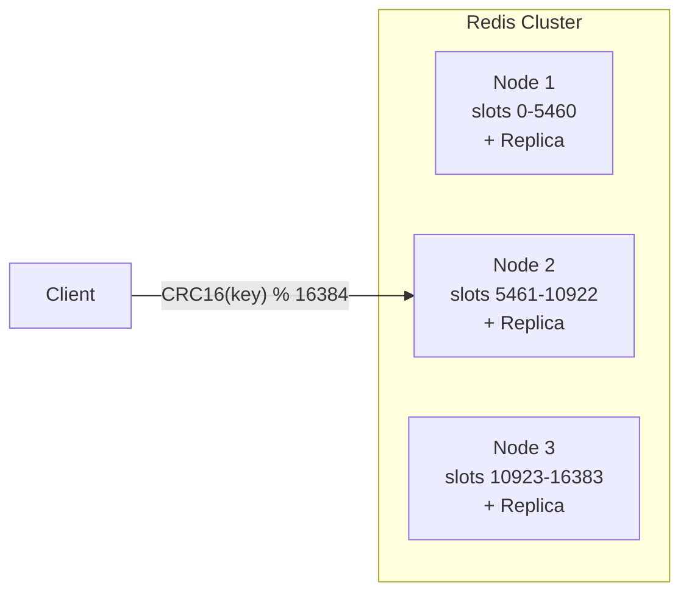

# Redis

## Mental Model

Redis is an **in-memory data structure server**. Unlike a simple cache (key → value), Redis supports rich data structures — sorted sets, hashes, lists, streams, sets — with atomic operations on each. Think of it as a network-accessible, persistent, single-threaded data structure library.

The single-threaded model means: no locks, no race conditions, every command is atomic. This makes it deceptively simple to reason about at the application level.

## Problem Being Solved

Many system design problems need a fast, shared data store that:
- Serves reads in < 1ms
- Supports complex data structures (not just key-value)
- Handles high throughput (100K+ ops/sec per node)
- Provides atomic operations without application-level locking
- Serves as the "fast layer" in front of a durable database

Redis fills the gap between "application memory" (fast but not shared) and "database" (shared but slow).

## Core Data Structures

### Strings

Basic key-value. Supports atomic increment, append, bit operations.

```
SET user:123:name "Alice"
GET user:123:name → "Alice"
INCR counter:messages → 1
```

**Use for:** Counters, simple cache, rate limiting (INCR + EXPIRE).

### Hashes

A key that maps to a set of field-value pairs. Like a mini row/object.

```
HSET user:123 name "Alice" status "online" lastSeen 1696591234
HGET user:123 name → "Alice"
HGETALL user:123 → {name: "Alice", status: "online", lastSeen: "1696591234"}
```

**Use for:** Object caching, session storage, connection registry (`conn:{userId}` → set of server:connection pairs), message status tracking.

**Why not just serialize JSON into a String?** Hashes let you read/update individual fields without deserializing the whole object. `HSET user:123 status "offline"` is O(1) — no read-modify-write cycle.

### Sorted Sets

A set where each member has a numeric score. Sorted by score. Supports range queries.

```
ZADD inbox:user456 1696591234 "msg-abc"    // score = timestamp
ZADD inbox:user456 1696591235 "msg-def"
ZRANGEBYSCORE inbox:user456 -inf +inf      // get all, ordered by timestamp
ZREM inbox:user456 "msg-abc"               // clean delete, no tombstones
```

**Use for:** Leaderboards, priority queues, time-ordered collections (Inbox!), rate limiting windows, trending/ranking.

**Key advantage over Cassandra for queue-like patterns:** Deletes are clean — the member is removed from the skip list. No tombstones, no compaction overhead.

### Lists

Linked list. Push/pop from both ends. Blocking pop for queue semantics.

```
LPUSH queue:notifications "msg-123"
RPOP queue:notifications → "msg-123"
BRPOP queue:notifications 30   // blocking pop, wait up to 30s
```

**Use for:** Simple message queues, task queues, recent activity feeds (LPUSH + LTRIM to keep last N items).

### Sets

Unordered unique collection. Supports intersection, union, difference.

```
SADD chat:123:members "user-A" "user-B" "user-C"
SISMEMBER chat:123:members "user-A" → 1 (true)
SMEMBERS chat:123:members → ["user-A", "user-B", "user-C"]
```

**Use for:** Group membership, tags, unique counters (HyperLogLog for approximate), mutual friends.

### Streams

Append-only log with consumer groups. Redis's answer to Kafka for lightweight streaming.

```
XADD stream:cs-182 * chatId "chat-123" content "hello" recipients "userB,userD"
XREAD COUNT 10 BLOCK 5000 STREAMS stream:cs-182 $     // read new entries, block up to 5s
XACK stream:cs-182 consumer-group msg-id               // acknowledge processing
```

**Use for:** Event streaming, server-to-server message passing, change data capture, activity feeds.

**vs Kafka:**

| Concern | Redis Streams | Kafka |
|---------|--------------|-------|
| Throughput | ~100K msgs/sec per stream | Millions/sec per topic |
| Durability | As durable as Redis persistence (AOF) | Replicated commit log — stronger |
| Topic/stream management | Lightweight, dynamic create/destroy | Heavy — metadata overhead per topic |
| Consumer groups | Built-in | Built-in |
| Best for | Ephemeral routing, lightweight fan-out | Durable event log, cross-service communication |

## Persistence

Redis is in-memory but offers two persistence mechanisms:

### RDB (Snapshotting)

Point-in-time snapshot of the entire dataset to disk at intervals.

```
save 900 1      // snapshot if ≥1 key changed in 900 seconds
save 300 10     // snapshot if ≥10 keys changed in 300 seconds
```

| Pros | Cons |
|------|------|
| Compact file, fast restart | Data loss between snapshots (up to save interval) |
| Low impact on runtime performance | Fork can be slow on large datasets |

### AOF (Append-Only File)

Logs every write operation. On restart, replays the log.

```
appendonly yes
appendfsync everysec    // fsync every second (good balance)
```

| Pros | Cons |
|------|------|
| At most 1 second of data loss | Larger file than RDB |
| Append-only — no corruption from partial writes | Slower restart (must replay log) |

### Recommendation

Use **AOF with `everysec`** for data you care about (Inbox, MessageStatus). Accept up to 1 second of data loss — the durable database (Cassandra) is the backstop.

Use **no persistence** for pure cache (group membership cache, session cache).

## Redis Cluster

### How It Works

Redis Cluster shards data across multiple nodes using **hash slots** (16,384 fixed slots).

```
slot = CRC16(key) % 16384
```

Each node owns a range of slots. Keys are automatically routed to the correct node.



### Key Lookup: Hash Slots vs Other Approaches

Redis Cluster chose **hash slots** over consistent hashing or modulo hashing. Here's why:

| Approach | How | Remapping on node change | Used by |
|----------|-----|------------------------|---------|
| **Modulo hashing** | `shard = hash(key) % N` | ~All keys remap (catastrophic) | Simple caches |
| **[Consistent hashing](/distributed-systems/consistent-hashing)** | Keys and nodes on a ring; key → next node clockwise | ~1/N keys remap | Cassandra, DynamoDB, Memcached |
| **Hash slots (Redis)** | 16384 fixed slots; `CRC16(key) % 16384`; each node owns a slot range | Only slots being moved — exact control | Redis Cluster |

**Why Redis chose hash slots over consistent hashing:**

1. **Deterministic resharding** — you choose exactly which slots move to which node. Consistent hashing remaps are implicit (depends on ring position).
2. **Simple metadata** — each node stores a 16384-bit bitmap (2KB) of slot ownership. Consistent hashing needs a sorted list of vnodes.
3. **No virtual nodes needed** — hash slots are inherently balanced (each node gets `16384 / N` slots). Consistent hashing needs 150+ vnodes per node for balance.
4. **Cluster gossip is lightweight** — nodes exchange slot bitmaps, not ring topology.

**Trade-off:** fixed max of 16384 shards (practically ~1000 recommended). Consistent hashing has no such limit. For Redis's use case (data fits in memory, clusters rarely exceed 100 nodes), 16384 is more than sufficient.

### How Key Routing Works

```
1. Client computes: slot = CRC16(key) % 16384
2. Client has a cached slot→node mapping (received on connect)
3. Client sends command directly to the correct node
4. If wrong node (slot migrated): node returns MOVED redirect
5. Client updates its slot map and retries
```

During resharding (slot migration), a node may return `ASK` (temporary redirect for in-flight slots) or `MOVED` (permanent — update your map).

### Hash Tags — Key Co-location

Multi-key operations (`MGET`, `PIPELINE`, Lua scripts) require all keys on the **same slot**. Hash tags force co-location:

```
Key: "rl:{rule-001:sk-abc123}:28284218"
     Only the {rule-001:sk-abc123} portion is hashed.
     Both window keys land on the same slot.

Key: "{userId}:inbox"  and  "{userId}:status"
     Both hash on userId → same slot → pipelined reads work.
```

**Rule:** if the key contains `{...}`, only the content between the first `{` and first `}` is hashed. Otherwise, the entire key is hashed.

**Use cases:**
- Rate limiter: current + previous window counters on the same slot for pipelined `GET + INCR`
- Chat: inbox + message status for the same user on the same slot
- Transactions: all keys in a `MULTI/EXEC` block must share a slot

### Replication & Failover

- Each master node has 1+ replica nodes
- Replicas are **asynchronous** — small window of data loss on master failure
- Automatic failover: if a master dies, its replica promotes to master (seconds, not minutes)
- Cluster continues serving during failover for unaffected slots

### Scaling

- **Add nodes** → cluster rebalances slots automatically (move slot ranges)
- **Linear read scaling** with read replicas (`READONLY` command on replicas)
- Typical setup: 6 nodes (3 masters + 3 replicas) for production
- Resharding is online — slots migrate in background while serving traffic

### Limitations

| Limitation | Impact | Mitigation |
|-----------|--------|------------|
| Multi-key ops must be on the same slot | Pipeline/Lua across slots fails | Use hash tags: `{userId}:inbox` and `{userId}:status` → same slot |
| Cross-slot transactions not supported | Can't MULTI/EXEC across slots | Design data model so related keys share a slot |
| Async replication → small data loss on failover | Writes acked but not replicated are lost | `min-replicas-to-write 1` for critical data; accept for ephemeral data |
| Memory-bound — all data in RAM | Cost and capacity limits | Monitor memory; use eviction + TTL; tier cold data to disk |
| Max ~1000 nodes (16384 slots) | Upper bound on cluster size | Sufficient for most use cases; beyond this, consider client-side partitioning |

## Eviction Policies

When Redis hits the memory limit, it evicts keys based on the configured policy:

| Policy | Behavior | Best For |
|--------|----------|----------|
| `noeviction` | Returns error on write when full | Data you can't afford to lose |
| `allkeys-lru` | Evict least recently used key | General-purpose cache |
| `volatile-lru` | Evict LRU among keys with TTL | Mix of cache + persistent data |
| `allkeys-lfu` | Evict least frequently used | Access pattern has clear hot/cold split |
| `volatile-ttl` | Evict keys closest to expiry | TTL-managed data |

## Failure Modes

| Failure | Impact | Mitigation |
|---------|--------|------------|
| Master node crash | Replica promotes; async replication = small data loss window | AOF persistence for critical data; application-level fallback to durable DB |
| Memory exhaustion | Eviction or OOM depending on policy | Monitor memory usage; set `maxmemory`; use TTL aggressively |
| Split brain (network partition) | Two masters for same slot — data divergence | `min-replicas-to-write` setting prevents writes if too few replicas reachable |
| Slow commands | Single-threaded — one slow command blocks everything | Avoid `KEYS *`, `SMEMBERS` on huge sets; use `SCAN` instead |
| Hot key | One key gets disproportionate traffic → one node overloaded | Read replicas for hot reads; split hot keys into sub-keys |

## When to Use / When to Avoid

| Use Redis When | Avoid Redis When |
|----------------|-----------------|
| Sub-millisecond latency required | Data doesn't fit in memory |
| Rich data structures needed (sorted sets, hashes, streams) | Need complex queries (joins, aggregations) |
| High-throughput ephemeral data | Need strong durability guarantees |
| Caching with TTL | Long-term storage of large datasets |
| Pub/Sub or lightweight streaming | Need Kafka-level durability and throughput for event streaming |
| Connection state, session management | |
| Rate limiting, leaderboards | |

## Real-World Usage

| Company | Use Case | Notes |
|---------|----------|-------|
| **Twitter/X** | Timeline cache, rate limiting | Massive sorted set usage |
| **GitHub** | Job queues (Resque), caching | Redis-backed background jobs |
| **Discord** | Presence, member lists, ephemeral state | Alongside Cassandra/ScyllaDB for messages |
| **Snapchat** | Stories, presence, rate limiting | Redis Cluster at scale |
| **WhatsApp** | Connection state (via Mnesia, but same pattern) | In-memory routing and presence |

## Related Concepts

- [Cassandra](/building-blocks/cassandra) — when you need durable storage for massive write volumes
- [SQL vs NoSQL](/decisions/sql-vs-nosql) — decision framework for database selection
- [WebSocket Connection Management](/building-blocks/websocket-connection-management) — Redis as connection registry
- [Sharding & Partitioning](/distributed-systems/sharding) — hash slots in the context of sharding approaches
- [Consistent Hashing](/distributed-systems/consistent-hashing) — the alternative Redis chose not to use (and why)
