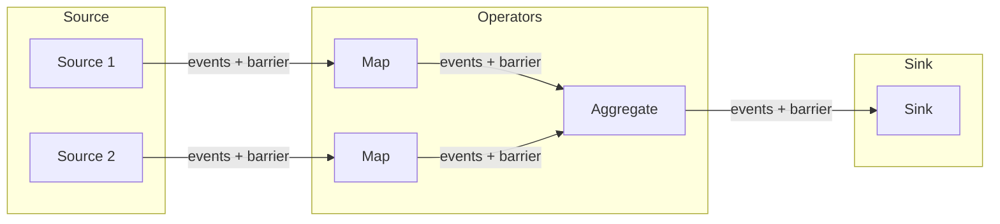
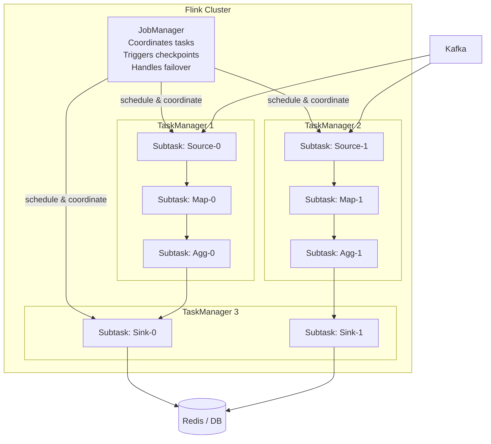

# Stream Processing (Flink / Kafka Streams)

## Mental Model

Batch processing takes a bounded dataset, processes it, and produces a result. Stream processing does continuous computation over an **unbounded sequence of events** — data that never ends.

The core abstraction is a **dataflow graph**: source → operators → sink.

```
Source (Kafka) → map → filter → keyBy → window → aggregate → Sink (Redis / DB)
```

Each operator transforms or combines events as they flow through. The system never "finishes" — it runs indefinitely, processing each event within seconds (or milliseconds) of its arrival.

| | Batch Processing | Stream Processing |
|---|-----------------|-------------------|
| **Input** | Bounded dataset (files, tables) | Unbounded event stream |
| **Execution** | Start → process all → finish | Continuous, never-ending |
| **Latency** | Minutes to hours | Seconds to milliseconds |
| **State** | Recomputed each run | Maintained incrementally |
| **Failure recovery** | Re-run the job | Checkpoint + replay |
| **Example** | Daily report, ETL pipeline | Fraud detection, trending topics |

**Key insight:** batch is a special case of streaming. A bounded dataset is just a stream that ends. Flink unifies both models.

## Problem Being Solved

Batch processing (MapReduce, Spark batch) has inherent latency — you must wait for the batch window to close (1 hour, 1 day) before results are available. Many use cases cannot tolerate that delay:

- **Trending topics** — must surface within minutes, not next morning
- **Fraud detection** — a fraudulent transaction must be flagged in &lt;1s, not in the next hourly batch
- **Real-time dashboards** — ops teams need live metrics, not stale data
- **Top-K leaderboards** — rankings must update as votes/views arrive
- **Rate limiting** — must count requests in a sliding window, not after the fact
- **Live comment aggregation** — comments per second on a live stream, delivered in real time

The batch approach to these problems — "run a job every N minutes" — creates a latency floor equal to the batch interval. Stream processing eliminates that floor by processing each event as it arrives.

## Core Mechanism

Stream processing engines maintain **state** across events and use **time semantics** to produce correct results despite out-of-order arrival and failures. The key mechanisms:

1. **Event time** semantics — reason about when events happened, not when they arrive
2. **Watermarks** — track progress of event time to know when windows can close
3. **Windows** — group events into finite chunks for aggregation
4. **Checkpointing** — snapshot state for exactly-once fault tolerance
5. **Backpressure** — flow control to prevent overload

These mechanisms work together: event time + watermarks determine window closure, state holds intermediate aggregates, checkpointing persists state for recovery, and backpressure keeps the pipeline stable under load.

## How It Works

### Event Time vs Processing Time

Every event has two timestamps:

| Timestamp | Definition | Example |
|-----------|-----------|---------|
| **Event time** | When the event actually happened (embedded in the event payload) | User clicked "like" at `2024-01-15T10:05:03Z` |
| **Processing time** | When the stream processor receives/processes the event | Flink processes it at `2024-01-15T10:05:07Z` |

**Event time is what matters for correctness.** If you count likes per minute, you want to count by when users clicked, not when your system got around to processing them.

But event time introduces a problem: events arrive **out of order**. A mobile user on a slow connection might generate an event at `10:05:03` that arrives at `10:05:15` — after events from `10:05:10` have already been processed. The system must handle this.

### Watermarks

A watermark is a declaration: **"all events with event time &lt;= W have (probably) arrived."**

When the watermark advances past the end of a window, that window closes and emits its result. This is how the system knows when it is safe to finalize an aggregation.

```
Event stream (event time):  10:01  10:04  10:02  10:05  10:03  10:06
                              ↓      ↓      ↓      ↓      ↓      ↓
Watermark:                  10:00  10:01  10:01  10:02  10:02  10:03
```

The watermark always lags behind the latest event time by a configured tolerance (the **allowed lateness**).

**The core trade-off:**

| Strategy | Watermark lag | Latency | Late event handling |
|----------|--------------|---------|-------------------|
| **Tight watermark** (small lag) | 1-2 seconds | Low — windows close quickly | More events arrive "late" and are dropped or side-outputted |
| **Loose watermark** (large lag) | 30-60 seconds | High — windows stay open longer | Fewer late events, more correct results |

In Flink, this is configured via `WatermarkStrategy`:

```java
WatermarkStrategy
    .<Event>forBoundedOutOfOrderness(Duration.ofSeconds(5))
    .withTimestampAssigner((event, ts) -> event.getTimestamp());
```

This says: "events can arrive up to 5 seconds late. After 5 seconds of event-time silence, close windows."

**What happens to late events?** Three options:
1. **Drop** (default) — late event is ignored
2. **Side output** — route to a separate stream for manual handling
3. **Allowed lateness** — keep the window open longer, emit updated results

### Windows

Windows group unbounded streams into finite chunks for aggregation. Three primary types:

#### Tumbling Windows

Fixed-size, non-overlapping. Every event belongs to exactly one window.

```mermaid
gantt
    title Tumbling Windows (5-minute)
    dateFormat HH:mm
    axisFormat %H:%M
    section Windows
    Window 1 :w1, 10:00, 5m
    Window 2 :w2, 10:05, 5m
    Window 3 :w3, 10:10, 5m
```



```
Time:     10:00  10:01  10:03  10:05  10:06  10:08  10:10  10:11
Events:     A      B      C    | D      E      F    | G      H
            └── Window 1 ──────┘ └── Window 2 ──────┘ └── Window 3 ...
```

**Use for:** Metrics aggregation ("requests per minute"), periodic rollups, hourly reports.

#### Sliding Windows

Fixed-size, overlapping. Defined by **size** and **slide interval**. An event can belong to multiple windows.

```mermaid
gantt
    title Sliding Windows (10-min size, 5-min slide)
    dateFormat HH:mm
    axisFormat %H:%M
    section Windows
    Window 1 :w1, 10:00, 10m
    Window 2 :w2, 10:05, 10m
    Window 3 :w3, 10:10, 10m
```



```
Time:     10:00  10:03  10:05  10:08  10:10  10:13  10:15
Events:     A      B      C      D      E      F      G
            └──────── Window 1 (10:00-10:10) ────────┘
                       └──────── Window 2 (10:05-10:15) ────────┘
                                  └──────── Window 3 (10:10-10:20) ──...
```

Event D at `10:08` belongs to **both** Window 1 and Window 2.

**Use for:** "Top-K in the last 1 hour, updated every 5 minutes", moving averages, sliding rate limits.

#### Session Windows

Defined by a **gap of inactivity**. No fixed size — the window closes when no events arrive for the gap duration. Different keys can have different window sizes.

```
User A:  [click] [click] [click] ---- 30min gap ---- [click] [click]
         └─── Session 1 ────────┘                    └── Session 2 ──┘

User B:  [click] ---- 30min gap ---- [click] [click] [click] [click]
         └─ S1 ─┘                    └──── Session 2 ───────────────┘
```

**Use for:** User session analysis, engagement tracking, billing per session.

### State Management

Stream operators maintain **state** — the intermediate results needed to produce output. A count-per-key operator needs to remember the current count for each key. A window operator needs to buffer events until the window closes.

| State Backend | Storage | Throughput | Max State Size | Use Case |
|--------------|---------|-----------|---------------|----------|
| **HashMapStateBackend** | JVM heap | Very high (no serialization) | Limited by heap (tens of GB) | Small state, low latency |
| **EmbeddedRocksDBStateBackend** | On-disk (SSD) with in-memory cache | Lower (serialization overhead) | Terabytes | Large state, windowed aggregations |

**State is partitioned by key.** When you call `keyBy(event -> event.getUserId())`, Flink partitions the stream so that all events for a given user go to the same subtask — and that subtask maintains state only for its keys. This is how state scales horizontally.

```
keyBy(userId)
├── Subtask 0: state for users A, D, G ...
├── Subtask 1: state for users B, E, H ...
├── Subtask 2: state for users C, F, I ...
```

### Checkpointing and Exactly-Once Semantics

Flink periodically takes **consistent snapshots** of all operator state across the entire job. On failure, it rolls back to the last successful checkpoint and replays events from Kafka starting at the checkpointed offsets. The result: **each event is counted exactly once in the output**, even after failures.

#### How It Works: Barrier-Based Snapshots (Chandy-Lamport)



1. The **JobManager** injects **checkpoint barriers** into the source streams (at the current Kafka offset)
2. Barriers flow through the dataflow graph like regular events
3. When an operator receives a barrier from **all** its input channels, it snapshots its state to durable storage (S3, HDFS)
4. Once all operators have snapshotted, the checkpoint is complete

**The key property:** barriers separate "pre-checkpoint" events from "post-checkpoint" events. The snapshot captures a consistent cut across all operators — no event is double-counted or lost.

#### Checkpoint Configuration Trade-offs

| Setting | Small interval (e.g., 1s) | Large interval (e.g., 5min) |
|---------|--------------------------|---------------------------|
| **Recovery time** | Minimal replay needed | Must replay minutes of data |
| **Overhead** | High — frequent state serialization | Low — infrequent snapshots |
| **State backend load** | Constant write pressure on storage | Bursty writes |
| **Recommended** | Small state, low-latency requirements | Large state, throughput-focused |

```java
env.enableCheckpointing(30_000); // every 30 seconds
env.getCheckpointConfig().setCheckpointingMode(CheckpointingMode.EXACTLY_ONCE);
env.getCheckpointConfig().setMinPauseBetweenCheckpoints(10_000);
```

### Backpressure

When a downstream operator is slower than upstream, events queue up. Without flow control, this causes out-of-memory errors. Flink handles this with **credit-based flow control**:

1. Each receiving task grants **credits** (buffer slots) to its upstream sender
2. Sender can only send as many records as it has credits
3. When credits run out, the sender blocks
4. Backpressure propagates upstream to the source, which slows down Kafka consumption

**This is a feature, not a bug.** Backpressure means the system adapts to the slowest operator instead of crashing. But sustained backpressure indicates a bottleneck that needs resolution (more parallelism, faster operator logic, or larger resources).

## Flink Architecture



| Component | Role |
|-----------|------|
| **JobManager** | The coordinator. Accepts job submissions, builds the execution graph, schedules subtasks onto TaskManagers, triggers checkpoints, handles failover (restarts failed subtasks from last checkpoint). |
| **TaskManager** | A worker process. Runs one or more **subtasks** (parallel instances of operators). Manages local state, network buffers, and communication with other TaskManagers. |
| **Subtask** | A single parallel instance of an operator. E.g., `Map-0` and `Map-1` are two subtasks of the Map operator running with parallelism=2. |

**Parallelism:** each operator can run N parallel instances. Typically, parallelism = number of Kafka partitions for the source operator. Downstream operators can have different parallelism. Data is redistributed between operators via a network shuffle (when key changes) or forwarded directly (when key is preserved).

**Deployment options:**

| Mode | Description | Use case |
|------|------------|----------|
| **Standalone** | Fixed cluster of JM + TMs | Dev, small-scale |
| **YARN** | YARN allocates containers for JM and TMs | Hadoop-native environments |
| **Kubernetes (native)** | Flink creates pods dynamically via K8s API | Production standard — autoscaling, resource isolation |

## Kafka Streams: The Library Alternative

Kafka Streams is **not** a cluster or framework — it is a **Java library** that runs inside your application. You deploy it as a normal JVM service (Docker container, K8s pod). No separate infrastructure.

### How It Differs from Flink

```
Flink:         Your Code  →  Submit to Flink Cluster  →  Flink manages execution
Kafka Streams: Your Code  →  Runs in your JVM process  →  You manage deployment
```

Kafka Streams uses Kafka itself for coordination:
- **Consumer groups** for partition assignment (no JobManager needed)
- **Changelog topics** (compacted) for state backup (no checkpoint to S3/HDFS)
- **Repartitioning** via internal topics (for key changes)

### Comparison: Flink vs Kafka Streams vs Spark Structured Streaming

| Dimension | Apache Flink | Kafka Streams | Spark Structured Streaming |
|-----------|-------------|---------------|--------------------------|
| **Model** | Distributed framework (cluster) | Library (runs in your app) | Micro-batch (short batch jobs) |
| **Deployment** | Separate Flink cluster (K8s, YARN) | Your app's JVM — no extra infra | Spark cluster (K8s, YARN) |
| **True streaming** | Yes — event-at-a-time | Yes — event-at-a-time | No — micro-batches (100ms+) |
| **Latency** | Milliseconds | Milliseconds | Hundreds of milliseconds |
| **State management** | RocksDB / heap, checkpointed to S3 | RocksDB, backed by Kafka changelog topics | HDFS/S3 write-ahead log |
| **Exactly-once** | Checkpoint barriers (Chandy-Lamport) | Kafka transactions | Write-ahead log + idempotent sinks |
| **Max throughput** | Very high (millions of events/sec) | Moderate (scales with app instances) | High (leverages Spark cluster) |
| **Windowing** | Tumbling, sliding, session, custom | Tumbling, sliding, session | Tumbling, sliding |
| **Source/Sink** | Kafka, Kinesis, files, JDBC, custom | Kafka only | Kafka, files, JDBC, custom |
| **Operational complexity** | High (Flink cluster management) | Low (just your app + Kafka) | Medium (Spark cluster) |
| **Best for** | High-scale, complex event processing | Moderate-scale, Kafka-native teams | Orgs already running Spark |

**When to choose Kafka Streams over Flink:**
- Your source and sink are both Kafka
- Throughput is moderate (tens of thousands of events/sec, not millions)
- You want to avoid operating a separate cluster
- Your team already runs JVM microservices

**When to choose Flink:**
- High throughput or complex event processing (CEP)
- Non-Kafka sources/sinks needed
- Event-time windowing with sophisticated late-event handling
- Large state (terabytes) with RocksDB

## Common Patterns

### Pattern 1: keyBy → Window → Aggregate

The workhorse of stream processing. Partition by key, group into windows, compute an aggregate.

```java
// Count messages per channel per minute
stream
    .keyBy(event -> event.getChannelId())
    .window(TumblingEventTimeWindows.of(Time.minutes(1)))
    .aggregate(new CountAggregate())
    .addSink(redisSink);
```

**Use for:** Counts, sums, averages, top-K (with a min-heap aggregate), rate limiting counters.

### Pattern 2: Enrichment Joins (Stream x Lookup Table)

Join a high-velocity stream with a slowly-changing reference dataset. Flink supports **broadcast state** for this: the lookup table is broadcast to all subtasks and held in memory.

```java
// Enrich click events with user profile data
DataStream<ClickEvent> clicks = ...;
DataStream<UserProfile> profiles = ...;  // slowly changing

BroadcastStream<UserProfile> broadcastProfiles =
    profiles.broadcast(profileStateDescriptor);

clicks.connect(broadcastProfiles)
    .process(new EnrichmentFunction());
```

**Use for:** Adding user metadata to events, geo-IP enrichment, feature flag evaluation.

### Pattern 3: Complex Event Processing (CEP)

Pattern matching over event streams — detect sequences, correlations, or absence of events.

```java
// Detect: login → failed_payment → failed_payment within 10 minutes
Pattern<Event, ?> fraudPattern = Pattern.<Event>begin("login")
    .where(e -> e.getType().equals("LOGIN"))
    .followedBy("fail1")
    .where(e -> e.getType().equals("PAYMENT_FAILED"))
    .followedBy("fail2")
    .where(e -> e.getType().equals("PAYMENT_FAILED"))
    .within(Time.minutes(10));
```

**Use for:** Fraud detection, anomaly detection, SLA violation alerting, IoT event correlation.

### Pattern 4: Dual Writes (Fast Store + Durable Store)

Write results to both a fast store (for serving) and a durable store (for history/recovery).

```
stream → aggregate → ┬→ Redis (fast reads, TTL)
                      └→ Cassandra / Postgres (durable, queryable)
```

**Why not just use the durable store?** Latency. Redis serves reads in &lt;1ms. The durable store handles recovery if Redis fails and serves analytical queries.

**Caution:** dual writes are not transactional. If one write fails, you get inconsistency. Mitigations: idempotent writes (upserts), reconciliation jobs, or use Kafka as the source of truth and have separate consumers write to each store.

## Scaling Considerations

| Dimension | Consideration | Mitigation |
|-----------|--------------|------------|
| **Parallelism** | Parallelism = Kafka partition count for the source operator. More partitions = more parallel subtasks. | Increase Kafka topic partitions. Downstream operators can have different parallelism. |
| **State size** | Large windows or many keys = large state. RocksDB can handle TBs but has serialization overhead. | Use incremental checkpoints. Tune RocksDB block cache and write buffer. Set state TTL to evict stale keys. |
| **Checkpoint interval** | Frequent checkpoints = more overhead but faster recovery. Infrequent = less overhead but longer replay on failure. | 30s-2min is typical. Use incremental checkpoints for large state. |
| **Key skew (hot keys)** | If one key has 100x more events than others, one subtask is overloaded while others idle. | Pre-aggregate with a random sub-key ("salting"), then re-aggregate. Or use local pre-aggregation. |
| **Network shuffle** | `keyBy` causes a network shuffle — all events for a key must go to the same subtask. This is expensive. | Minimize key changes. Chain operators that share the same key. |
| **Source throughput** | Flink can only consume as fast as Kafka can serve. | Increase Kafka partitions and brokers. Use batch fetching. |

### Key Skew: The Most Common Scaling Problem

If your key is `channelId` and one channel has 10M viewers while most have 100, the subtask handling that hot channel becomes the bottleneck.

**Solution — two-phase aggregation (salting):**

```
Phase 1: keyBy(channelId + random(0..9)) → window → partial aggregate
Phase 2: keyBy(channelId)                → window → merge partial results
```

Phase 1 spreads the hot key across 10 subtasks. Phase 2 merges the 10 partial results into the final count. This trades one shuffle for two but eliminates the hot-key bottleneck.

## Failure Modes

| Failure | Impact | Mitigation |
|---------|--------|------------|
| **Checkpoint failure** | State snapshot too large or too slow — checkpoint times out. Job cannot make progress (old checkpoints expire). | Increase checkpoint timeout. Use incremental checkpoints. Reduce state size (TTLs, pre-aggregation). |
| **Backpressure cascade** | One slow operator causes the entire pipeline to slow down, from sink back to source. Kafka consumer lag grows. | Identify bottleneck operator via Flink metrics. Increase parallelism of bottleneck. Optimize operator logic. |
| **State corruption** | Bug in serialization or deserialization. Job fails on restart from checkpoint. | Use schema evolution-compatible serializers (Avro). Test checkpoint/restore in CI. Keep N old checkpoints as rollback points. |
| **Kafka rebalance storm** | Frequent consumer rebalances (instance restarts, scaling) cause repeated pause/resume cycles. No progress. | Use static group membership (`group.instance.id`). Increase `session.timeout.ms`. Use Kafka cooperative rebalancing. |
| **Clock skew** | Different source producers have misaligned clocks. Watermarks advance unevenly. Windows emit incorrect results. | Use centralized time sources (NTP). Validate event timestamps. Use per-partition watermarks (Flink default). |
| **Out-of-memory (TaskManager)** | State exceeds heap, or too many in-flight records during backpressure. TaskManager crashes. | Use RocksDB state backend for large state. Configure managed memory limits. Enable network buffer backpressure. |
| **JobManager failover** | JobManager crashes. All running tasks are interrupted until a new JM takes over. | Run JobManager in HA mode (ZooKeeper or K8s leader election). Recovery resumes from last checkpoint. |

## Trade-offs

| Decision | Option A | Option B | Guidance |
|----------|----------|----------|----------|
| **Flink vs Kafka Streams** | Full-featured, high scale, operational complexity | Simple deployment, Kafka-only, moderate scale | Kafka Streams if Kafka-native and scale is moderate. Flink for complex pipelines or high throughput. |
| **Event time vs processing time** | Correct results, complexity of watermarks and late events | Simple, but results depend on system speed | Always use event time for business logic. Processing time only for internal metrics. |
| **Tight vs loose watermarks** | Low latency, drops late events | Higher latency, more complete results | Start loose (30s), tighten based on observed late-event rate. |
| **Heap vs RocksDB state** | Fast, limited size | Larger state, serialization cost | Heap for &lt;10 GB state. RocksDB for anything larger. |
| **Checkpoint interval** | Frequent = fast recovery, high overhead | Infrequent = low overhead, slow recovery | 30s-2min. Tune based on state size and recovery SLO. |
| **Exactly-once vs at-least-once** | Correct counts, higher latency (barrier alignment) | Faster, but may double-count on failure | Exactly-once for financial/counting use cases. At-least-once for idempotent sinks. |

## Real-World Examples

| System | Stream Processing Use Case | Key Technique |
|--------|--------------------------|---------------|
| **Uber** | Surge pricing — aggregate ride requests per geo-cell per minute | Flink, tumbling windows, keyBy geo-cell |
| **Netflix** | Real-time recommendations — process viewing events as they happen | Flink, enrichment joins with user profile |
| **LinkedIn** | Who viewed your profile — count views per user in sliding windows | Kafka Streams (Kafka-native stack) |
| **Alibaba** | Singles' Day dashboard — billions of events/sec, live GMV counter | Flink (largest known Flink deployment) |
| **Stripe** | Fraud detection — pattern matching over payment event sequences | Stream CEP, session windows |
| **Large retailer** | Real-time inventory — update stock counts as sales events stream in | Flink, keyBy SKU, stateful aggregation |

## Related Concepts

- [Apache Kafka](/building-blocks/kafka) — the standard source and sink for stream processing; provides the durable event log that Flink and Kafka Streams consume from
- [Redis](/building-blocks/redis) — common fast-path sink for stream processing results (counters, sorted sets for top-K, pub/sub for push)
- [Probabilistic Data Structures](/foundations/probabilistic-data-structures) — Count-Min Sketch and HyperLogLog are used inside stream operators for approximate counting at scale
- [Observability](/foundations/observability) — stream processing jobs need their own observability: checkpoint duration, backpressure metrics, consumer lag, watermark progression
