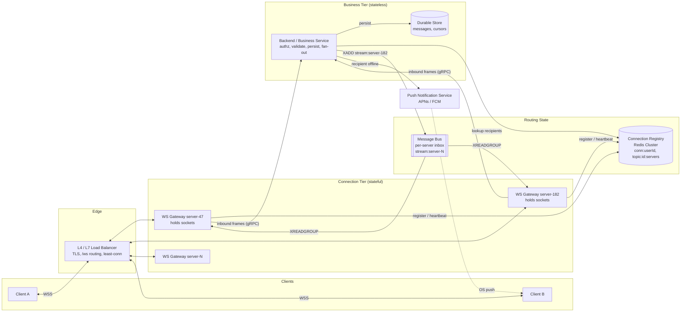
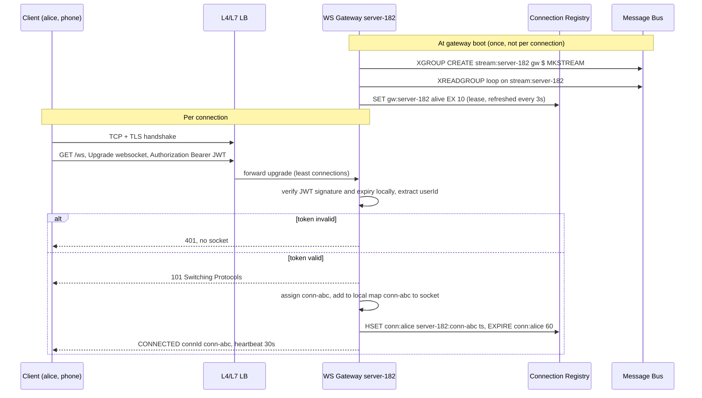
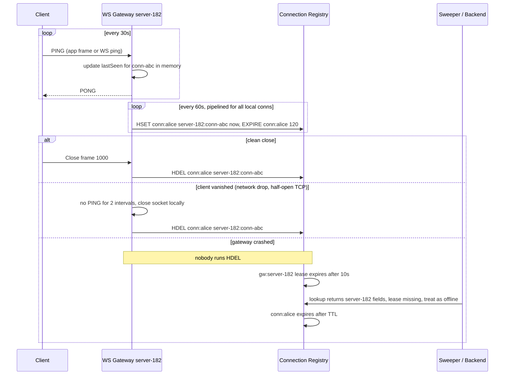
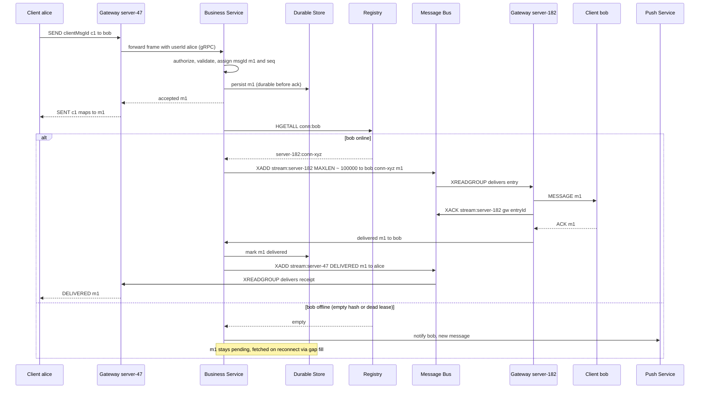
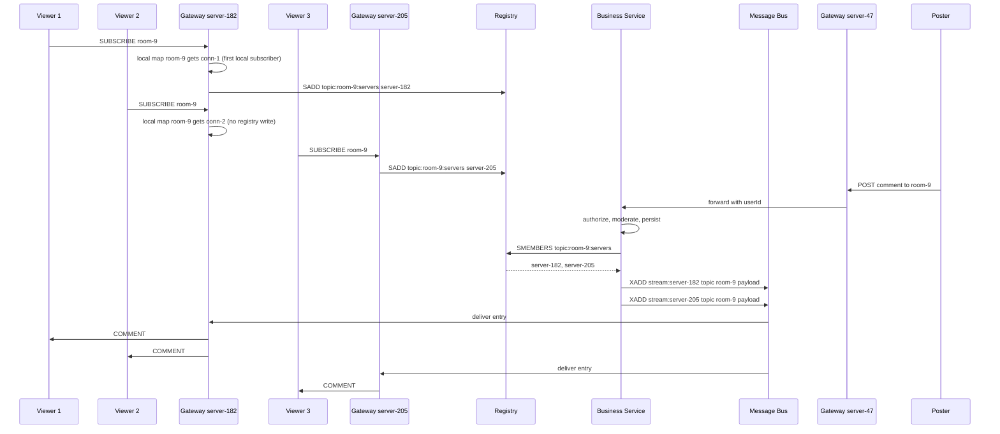
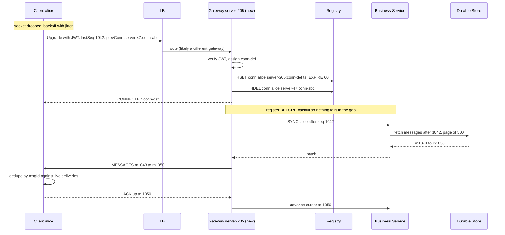
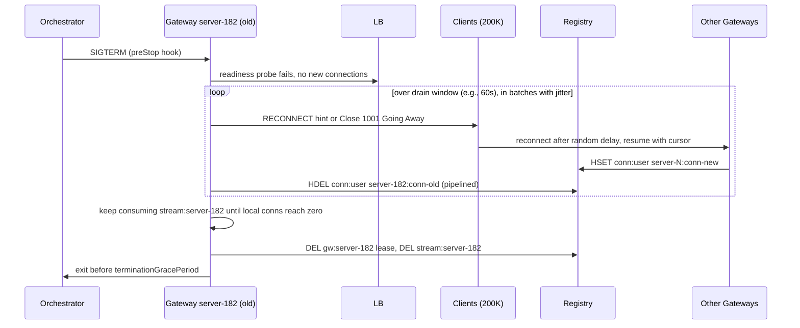

# WebSocket Connection Management at Scale

## Mental Model

When millions of users hold persistent WebSocket connections to a fleet of servers, two fundamental problems emerge:

1. **Where is User B?** — routing: which server holds a given user's connection
2. **How do servers talk?** — server-to-server communication for message delivery

Every real-time system at scale (chat, ride-hailing, live scores, collaborative editing, gaming) solves these two problems.

## Problem Being Solved

In a small system (1 server), all clients connect to the same server. Routing is trivial — the server has every connection in memory.

At scale (100+ servers), a message sender and recipient are almost certainly on different servers. The system needs:
- A way to **find** which server holds a given connection
- A way to **deliver** a message from one server to another
- A way to **clean up** when connections drop unexpectedly
- Support for **multi-device** (one user, multiple connections on different servers)

The sections below size the fleet, choose a registry, and then put it all together in a [Reference Architecture](#reference-architecture-hld) with step-by-step [Data Flows](#data-flows-lld).

## Socket Limits & Server Capacity

Each WebSocket connection = 1 TCP socket = 1 file descriptor. The binding constraint is **memory**, not ports.

| Resource | Limit | Notes |
|----------|-------|-------|
| File descriptors | ~1M per process (tunable via `ulimit`/`sysctl`) | Default is 1024, must be raised |
| Ports | Not a bottleneck | Client connections share the server's listening port; distinguished by `(client IP, client port)` tuple |
| Memory | **The real constraint** | TLS state + read/write buffers + metadata per connection |

### Capacity Planning

| Metric | Formula | Example (500M DAU) |
|--------|---------|-------------------|
| Concurrent connections | DAU × concurrent ratio (typically 10-30%) | 150M |
| Memory per connection | TLS state + buffers + app metadata | ~50KB |
| Connections per server | (Server RAM × allocation %) / per-connection memory | 640K (64GB, 50%) |
| Servers needed | Total connections / connections per server | ~235 |

:::tip Kubernetes Pods
In practice, run fewer connections per pod (100-200K) to leave headroom for GC, spikes, and graceful draining during deploys. This means 750-1500 pods for 150M connections.
:::

## Connection Registry

### The Problem

User A is on Server 47. User B is on Server 182. When A sends a message to B, how does Server 47 know to route to Server 182?

### Approach A: Broadcast to All Servers

Every message is sent to every server. Each server checks if the recipient is locally connected.

| Pros | Cons |
|------|------|
| Simple — no mapping needed | **O(N) fan-out per message** — at 235 servers × 1M msgs/sec = 235M internal messages/sec |
| No single point of failure | Network bandwidth explosion |
| | Doesn't scale beyond ~10 servers |

### Approach B: Consistent Hashing (Sticky Routing)

Hash userId to deterministically route to a specific server. `server = hash(userId) % num_servers`.

| Pros | Cons |
|------|------|
| O(1) lookup — no registry needed | Server add/remove causes **mass reconnection** (rehashing) |
| Simple, deterministic | Multi-device users forced to same server |
| No external dependency | No graceful scaling or failure handling |

:::note Virtual Nodes
Consistent hashing with virtual nodes reduces the rehashing blast radius, but still requires all clients to know the ring topology. At 150M connections, even a small % rehash is millions of reconnections.
:::

### Approach C: ZooKeeper / etcd

Centralized coordination service for the mapping.

| Pros | Cons |
|------|------|
| Strong consistency | **Not designed for millions of keys** — built for small metadata (leader election, config) |
| Watch mechanism for change notification | Write throughput ~10K/sec — far too low for connection churn |
| Mature, battle-tested | ZNode size limits |

**Verdict:** Wrong tool. ZooKeeper/etcd are for coordination (who is the leader?), not for high-throughput key-value lookup (where is this user?).

### Approach D: Redis Cluster

Centralized key-value mapping: `userId → serverId` in Redis.

| Pros | Cons |
|------|------|
| 150M keys is trivial (~20GB memory) | Need TTL + heartbeat for stale entries |
| O(1) lookup, ~1ms latency | Eventually consistent on failover (small window of ~seconds) |
| Multi-device support naturally (hash per user → set of connections) | Redis is an infrastructure dependency |
| Server add/remove is seamless — no rehashing | |
| Built-in sharding across cluster nodes | |

### Approach E: In-Memory with Gossip Protocol

Each server maintains a partial connection map, synchronized via gossip (like Cassandra's membership).

| Pros | Cons |
|------|------|
| No central dependency | Convergence delay → stale routes during propagation |
| Partition-tolerant | N servers × M connections = massive gossip payload |
| | Complex to implement correctly |

### Decision Guide

| Scale | Recommendation |
|-------|---------------|
| < 10 servers | Broadcast — simple and effective |
| 10-50 servers | Consistent hashing with virtual nodes |
| 50+ servers, high connection churn | **Redis Cluster** — O(1) lookup, seamless scaling |
| Extreme partition tolerance needed | Gossip + CRDT (rare, complex) |

### Redis Cluster Implementation

```
On connect:    HSET conn:{userId} "server-182:conn-abc" {timestamp}
On disconnect: HDEL conn:{userId} "server-182:conn-abc"
On route:      HGETALL conn:{recipientId} → [{serverId, connId}, ...]
```

**TTL + Heartbeat for stale cleanup:**
- Client sends heartbeat every 30s → server refreshes TTL to 60s
- Clean disconnect → explicit `HDEL`
- Unclean disconnect (crash, network drop) → TTL expires after 60s
- Server-side sweep every 30s to proactively clean connections that stopped heartbeating

**Multi-device:** Each userId maps to a **set** of `(serverId, connectionId)` pairs. Message delivery fans out to all active devices.

:::note Key-level vs field-level TTL
`EXPIRE conn:{userId}` applies to the **whole hash**, so a live phone keeps a dead laptop's field alive. Either store the last-heartbeat timestamp as the field value and let readers/sweepers ignore fields older than 60s, or use per-field TTL (`HEXPIRE`, Redis 7.4+).
:::

## Reference Architecture (HLD)

The registry answers "where is the user?" and [Server-to-Server Communication](/building-blocks/server-to-server-communication) answers "how does the payload get there?". This section shows how those pieces fit together with the rest of a real-time system. The same shape works for **unicast** (chat: user to user) and **broadcast** (group, room, live stream: one to many).



The load balancer choice (L4 pass-through vs L7 with path routing and auth on the upgrade) is covered in [API Gateway](/building-blocks/api-gateway). Offline delivery via APNs/FCM is covered in [Push Notifications](/building-blocks/push-notifications).

### Component Responsibilities

| Component | Responsibility | State | Scales by |
|-----------|---------------|-------|-----------|
| **Client** | One socket per device; heartbeats; reconnect with backoff + jitter; tracks last-seen cursor; dedupes by message id | Local cursor, pending (un-ACKed) sends | n/a |
| **L4 / L7 Load Balancer** | TLS termination (L7), route `/ws` upgrades to the gateway pool, least-connections balancing | Connection tracking only | New connections/sec, bandwidth |
| **WS Gateway / Connection Server** | Terminate sockets, validate auth on handshake, map `connId → socket` in memory, register in registry, consume its own inbox, write frames to sockets | **Stateful** — live sockets in memory | **Concurrent connections** (memory-bound, see [capacity planning](#capacity-planning)) |
| **Connection Registry** | `userId → set of server:connId`; `topicId → set of servers` for broadcast | Soft state with TTL — rebuildable from reconnects | Keys and ops/sec (add shards) |
| **Message Bus (per-server inbox)** | Carry a payload to one specific gateway (Redis Streams or Pub/Sub) | Short-lived, trimmed (`MAXLEN`) | Messages/sec, one stream per gateway |
| **Backend / Business Service** | Authorization, validation, sequencing, persistence, deciding who receives what | **Stateless** — truth lives in the store | **CPU / requests per second** |
| **Durable Store** | Source of truth for messages and cursors; serves gap fill on reconnect | Durable | Data volume, read QPS on reconnect storms |
| **Push Notification Service** | Wake offline devices via APNs/FCM | Stateless (device tokens in a DB) | Notifications/sec |

### Key Design Principle: Separate Stateful Connections from Stateless Logic

The gateway is deliberately **dumb**: it knows sockets, auth on handshake, heartbeats, and its inbox. It does not know what a "chat", "group", or "comment" is. All business logic lives behind it in stateless services.

| Concern | Gateway (stateful) | Business Service (stateless) |
|---------|--------------------|------------------------------|
| **Deploy cost** | Every restart drops sockets and triggers a reconnect wave | Rolling deploy is invisible to clients |
| **Deploy frequency** | Rare (weeks) — code changes slowly | Frequent (daily) — features change fast |
| **Scaling signal** | Connection count / memory | CPU / request rate |
| **Failure blast radius** | One pod = 100-200K users reconnect | One pod = in-flight requests retried |
| **Scale-out** | New pods only receive *new* connections (no rebalancing of existing ones) | Instant — any pod handles any request |

**Why it matters:** if business logic lived in the connection server, every feature deploy would disconnect every user — a self-inflicted [thundering herd](#failure-modes) several times a day. Splitting the tiers lets each scale on its own bottleneck (memory vs CPU) and confines socket churn to rare gateway deploys.

:::tip Fast path for ephemeral signals
Typing indicators, presence pings, and cursor positions don't need persistence. Some systems let the gateway do the registry lookup and publish directly to the destination inbox for these, skipping the business tier. Keep anything that must be durable or authorized going through the service.
:::

### Back-of-the-Envelope Tie-in

Using the [Capacity Planning](#capacity-planning) numbers above (150M concurrent connections, 100-200K per pod):

| Tier | What drives size | Rough number |
|------|------------------|--------------|
| WS Gateways | 150M connections ÷ 200K per pod | ~750 pods → **~750 inbox streams** |
| Connection Registry (memory) | 150M users × 1-3 device fields | ~20GB+ — small; spread over shards for **ops/sec**, not memory |
| Connection Registry (writes) | Naive: one TTL refresh per heartbeat = 150M ÷ 30s | **~5M writes/sec** — tens of shards. Pipeline refreshes per gateway and refresh less often than the heartbeat (e.g., every 60s, TTL 120s) to cut this 2-4x |
| Message Bus | 1M msgs/sec unicast → at most 1M `XADD`/sec, fewer with batch-by-destination | Spread across shards by stream key |
| Business Service | Scales on msgs/sec and CPU, independent of connection count | Sized separately |

:::info Heartbeat is not a registry write
The gateway tracks client liveness **locally** (it owns the socket). It only needs to write to the registry often enough to keep the TTL alive. Coupling the two is the most common reason a connection registry gets overloaded.
:::

## Data Flows (LLD)

All flows use the registry scheme from [Redis Cluster Implementation](#redis-cluster-implementation): `conn:{userId}` is a hash of `server-N:conn-id → last-heartbeat-ts`, and each gateway consumes its own stream `stream:server-N` (see [Redis Streams](/building-blocks/server-to-server-communication#approach-d-redis-streams)).

### 1. Connection Establishment



1. **At boot (once):** the gateway creates and starts consuming its own inbox `stream:server-182` and takes a short **liveness lease** `gw:server-182`. Inbox subscription is per server, not per connection — a gateway with 200K sockets has exactly one inbox.
2. Client opens TCP + TLS through the load balancer and sends the HTTP Upgrade with its JWT.
3. The token is verified **once** on the handshake — local signature check, no Auth Service call (see [WebSocket Authentication](/building-blocks/api-gateway#websocket-authentication)). Invalid → 401, no socket is created.
4. Gateway returns `101 Switching Protocols`, assigns a `connId`, and stores `connId → socket` in memory.
5. Gateway registers the connection (pipelined):

   ```
   HSET   conn:alice  server-182:conn-abc  1739462400
   EXPIRE conn:alice  60
   ```

6. Gateway sends an app-level `CONNECTED` frame with the `connId` and heartbeat interval. Only after this ack should the client flush queued sends.

:::tip Register only after the upgrade succeeds
Writing to the registry before `101` creates ghost entries for every failed handshake. Order matters: authenticate, upgrade, track locally, then register.
:::

### 2. Heartbeat, TTL Refresh, and Stale Cleanup



1. Client heartbeats every 30s. Keep this **below the load balancer's idle timeout** (often 60s), or the LB silently kills idle sockets.
2. Gateway updates `lastSeen` in memory on every heartbeat, but refreshes the registry in **pipelined batches** on a coarser timer (see the tip above on heartbeat vs registry write).
3. **Clean close:** explicit `HDEL`.
4. **Client vanished:** no heartbeat for 2 intervals → gateway closes the socket and runs `HDEL`. This catches half-open TCP that the kernel won't report for minutes.
5. **Gateway crashed:** nobody runs `HDEL`. Two safety nets:
   - **Gateway lease** `gw:server-182` (10s TTL) — readers that see a field pointing to a server without a lease treat it as dead. Detection drops from the per-user TTL (60-120s) to about 10s.
   - **Per-user TTL** eventually removes the key; a periodic sweeper deletes fields whose timestamp is older than the TTL.
6. Restarted gateways should come up with a **new instance id** (e.g., include the pod UID or a boot epoch), so stale fields from the previous incarnation can never match a live server.

### 3. Unicast Delivery (A to B on Different Servers)

Example: chat message from alice (on server-47) to bob (on server-182).



1. Sender's gateway forwards the frame to the business service with the **authenticated** userId attached (the client never asserts its own identity).
2. Service authorizes ("can alice message bob?"), assigns a server-side `msgId` and sequence number, and **persists before acking** — the `SENT` ack means "durable", so a crash after this point cannot lose the message.
3. Registry lookup: `HGETALL conn:bob` returns every device. With multiple devices on different servers, group fields by server and issue **one `XADD` per destination server**, not per device.
4. Publish to the destination inbox:

   ```
   XADD stream:server-182 MAXLEN ~ 100000 * to bob conn conn-xyz msg m1
   ```

5. Destination gateway reads its inbox (`XREADGROUP GROUP gw server-182 ...`), looks up `conn-xyz` in its local map, writes the frame to the socket, and `XACK`s the entry.
6. Bob's client ACKs `m1`. The gateway reports delivery to the service, which updates status and routes a `DELIVERED` receipt back to alice through **her** gateway's inbox (same lookup + `XADD` path, reversed).
7. **Offline branch:** empty hash (or every field points at a server with no lease) → message stays pending in the store and the service triggers a [push notification](/building-blocks/push-notifications). Bob receives `m1` via gap fill when he reconnects (flow 5).

:::note Two different ACKs
`XACK` means "the gateway took the entry off the bus". The client `ACK` means "the device actually received it". Only the client ACK can mark a message delivered. If the client ACK doesn't arrive within a timeout (e.g., 10s), the service treats the recipient as offline for that message: leave it pending and fall back to push.
:::

### 4. Topic / Room Broadcast (One to Many)

Example: a comment posted to live stream `room-9`, or a message to a large group. Looking up every recipient's connection (N registry reads, N publishes) does not work when N is 100K+ viewers. Instead, track **which gateways** have at least one subscriber for the topic, and publish **once per gateway**. The gateway fans out locally.

**Subscription registry options:**

| | Option A: Topic → Servers Set + Per-Server Inbox | Option B: Pub/Sub Channel per Topic |
|---|---|---|
| **Subscribe** | First local subscriber on a gateway: `SADD topic:room-9:servers server-182` | First local subscriber: `SSUBSCRIBE topic:room-9` |
| **Unsubscribe** | Last local subscriber leaves: `SREM topic:room-9:servers server-182` | Last local subscriber leaves: `SUNSUBSCRIBE topic:room-9` |
| **Publish** | `SMEMBERS topic:room-9:servers` then one `XADD stream:server-N` per member | Single `SPUBLISH topic:room-9 payload` — Redis fans out to subscribed gateways |
| **Durability** | Streams buffer if a gateway is briefly slow | Fire-and-forget — a disconnected gateway misses messages |
| **Publisher cost** | O(gateways subscribed) publishes | O(1) publish |
| **Extra state** | Topic set must be cleaned on gateway crash (lease check) | None — subscriptions die with the gateway's Redis connection |
| **Best for** | Groups and rooms where loss matters (chat groups) | High-volume, loss-tolerant broadcast (live comments, scores, reactions) |

:::info Use Sharded Pub/Sub on Redis Cluster
Classic `PUBLISH` on Redis Cluster is broadcast to **every node** in the cluster, which caps throughput as the cluster grows. Sharded Pub/Sub (`SPUBLISH` / `SSUBSCRIBE`, Redis 7.0+) routes each channel to a single shard by hash slot.
:::



1. **Subscribe:** the gateway keeps a local map `topicId → set of connIds`. It touches the registry **only on the 0→1 and 1→0 transitions** — 100K viewers on 50 gateways cost 50 registry writes, not 100K.
2. **Publish:** the service persists (if needed), reads the topic's server set, and publishes **one entry per gateway**. Payload is identical; the gateway fans it out to every local subscriber.
3. **Local fan-out** is a loop over in-memory sockets — this is where the 1-to-N cost actually lives, and it is spread across the gateway fleet.
4. **Group chat with known membership** can also use the per-user path: batch `HGETALL` for each member, group by server, one publish per server — see [Batch by Destination](/building-blocks/server-to-server-communication#fan-out-optimization-batch-by-destination). Per-user lookup works for groups up to a few thousand members. Beyond that (live streams, channels), use topic → servers.

:::tip Slow consumers in broadcast
One viewer on a bad mobile connection must not grow the gateway's memory without bound. Give each connection a **bounded send queue**. When it fills, drop or coalesce (for loss-tolerant broadcast) or close the socket and let the client gap-fill on reconnect (for must-deliver streams).
:::

### 5. Reconnect & Resume



1. Client detects the drop (close frame, failed heartbeat) and reconnects with **exponential backoff + jitter**. It will usually land on a different gateway — nothing about the design requires stickiness.
2. The upgrade carries the **resume cursor** (last contiguous `seq` it has, or per-conversation cursors) and optionally the **previous connId**.
3. New gateway registers `server-205:conn-def` and immediately `HDEL`s the old field if `prevConn` was supplied — no waiting for the TTL to expire.
4. **Register first, then backfill.** If the gateway fetched missed messages first and registered second, anything sent in between would go to neither path. Registering first means a message may arrive **both** live and via backfill — duplicates instead of loss.
5. Service pages missed messages from the durable store (`seq` after the cursor) and the gateway streams them down.
6. Client **dedupes by msgId** (or by `seq`), ACKs, and the cursor advances.

:::note Variant: key the field by deviceId
`HSET conn:{userId} {deviceId} server-205:conn-def` makes a reconnect **overwrite** the old entry automatically (last writer wins), so a device can never have two live registrations. The old gateway, if still alive, drops deliveries for a connId it no longer owns. The trade-off is that the client must send a stable deviceId.
:::

For broadcast topics (live streams), gap fill is usually **bounded** (e.g., last 50 comments) or skipped — stale broadcast content has little value, and a full replay for every reconnecting viewer would overload the store.

### 6. Graceful Drain During Gateway Deploy



1. Orchestrator sends `SIGTERM`. The gateway fails its readiness probe so the LB stops sending **new** connections, while existing sockets stay up.
2. Over a drain window (30-60s), the gateway closes connections **in batches with jitter**, sending an app-level `RECONNECT` hint or a `1001 Going Away` close frame. Clients reconnect after a random delay instead of all at once.
3. Clients land on other gateways and resume via flow 5. The old gateway `HDEL`s each closed connection (pipelined).
4. The gateway keeps consuming its inbox until it has no sockets left. Entries for connections that already moved are dropped — those messages are still pending in the store and arrive through the client's gap fill.
5. Release the lease, delete the inbox stream, exit. `terminationGracePeriodSeconds` must exceed the drain window.

:::tip Size for the reconnect wave
Draining 200K sockets over 60s is about 3.3K TLS handshakes/sec landing on the rest of the fleet, per draining pod. With 10 pods rolling in parallel that is roughly 33K handshakes/sec. TLS handshakes are CPU-heavy, so limit rollout parallelism (`maxUnavailable`) to what the fleet can absorb. This is the main reason the gateway tier is kept small, stable, and rarely deployed.
:::

## Failure Modes

| Failure | Impact | Mitigation |
|---------|--------|------------|
| **Server crash** | All connections on that server drop | Client auto-reconnect with jitter (random 0-5s delay); connection registry TTL cleans stale entries |
| **Redis Cluster node failure** | Routing lookups for affected shard fail | Redis auto-failover to replica (~seconds); fallback to broadcast during failover window |
| **Stale registry entries** | Messages routed to wrong server | TTL expiry + heartbeat sweep; recipient server drops unroutable messages |
| **Thundering herd on deploy** | Mass reconnection spike | Graceful drain: server stops accepting new connections, drains existing over 30s; client reconnect jitter |
| **Registry says online but socket is dead** (half-open TCP) | Message published to the inbox, written into a dead socket, never ACKed | Client-ACK timeout (e.g., 10s) → leave message pending, fall back to push; delivered via gap fill on reconnect. Heartbeat timeout closes the socket and runs `HDEL` |
| **Gateway crash with messages in its inbox** | Entries in `stream:server-N` have no consumer; registry still points at the dead server for up to the TTL | Gateway liveness lease (10s) — senders skip servers without a lease and take the offline path; messages are durable in the store and recovered via gap fill |
| **Duplicate / split-brain connections** (device reconnects before the old entry is cleared) | Same device registered on two gateways, so duplicate deliveries or deliveries to the stale socket | Client sends `prevConn` on reconnect → explicit `HDEL`; or key fields by deviceId so the newest connId wins (last writer wins); client dedupes by msgId |
| **Stale topic subscriptions** (gateway crashed while holding `topic:id:servers` membership) | Broadcasts published to a dead gateway's inbox, wasting bus capacity | Lease check before publish; `SREM` dead servers lazily; or use Sharded Pub/Sub, where subscriptions die with the connection |
| **Slow consumer** (client can't keep up with broadcast rate) | Per-connection send buffer grows until the gateway runs out of memory | Bounded per-connection queue; drop or coalesce for loss-tolerant topics; disconnect and gap-fill for must-deliver streams |
| **Reconnect storm after AZ / gateway-fleet loss** | Millions of TLS handshakes and gap-fill queries at once | Exponential backoff + jitter on clients; handshake rate limiting at the LB; paged, cursor-based gap fill to protect the store |

## Trade-offs

| Decision | Trade-off |
|----------|-----------|
| Redis Cluster over ZooKeeper | Higher throughput, eventual (not strong) consistency on failover |
| Redis Cluster over consistent hashing | External dependency for seamless scaling without rehash storms |
| TTL-based cleanup over explicit tracking | Stale entries possible for up to TTL duration after unclean disconnect |
| Stateful gateways separate from stateless business services | Extra network hop and one more tier to operate, in exchange for independent deploys and scaling (memory vs CPU) |
| Business service publishes to inboxes (gateway stays dumb) | Slightly higher latency than gateway-to-gateway, but authz, persistence, and fan-out logic live in one deployable place |
| Topic → servers registry over per-recipient lookup for broadcast | Extra subscription state to keep clean, in exchange for O(gateways) instead of O(recipients) publishes |
| Register before backfill on reconnect | Duplicates possible (client must dedupe) instead of a window of lost messages |

## Real-World Examples

| System | Connection Management | Notes |
|--------|----------------------|-------|
| **WhatsApp** | Custom Erlang servers, ~2M connections per server | BEAM VM handles cross-node routing natively |
| **Discord** | Elixir/Erlang, consistent hashing + registry | Guild-based routing |
| **Slack** | Go-based gateway servers | Redis for connection state |
| **Uber** | Custom Go servers, Ringpop (gossip) for routing | Gossip-based service discovery |

## Related Concepts

- [Server-to-Server Communication](/building-blocks/server-to-server-communication) — once you know the destination server, how to deliver the message
- [API Gateway](/building-blocks/api-gateway) — L4 vs L7 load balancing for WebSocket connections
- [Redis](/building-blocks/redis) — Redis Cluster internals for the connection registry
- [Push Notifications](/building-blocks/push-notifications) — offline fallback when the registry has no live connection
