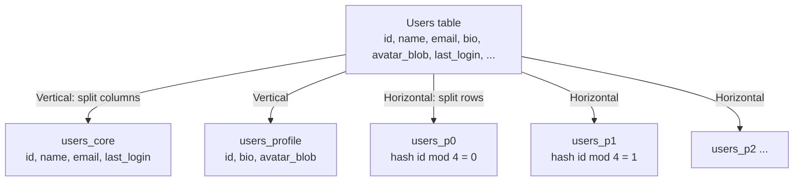
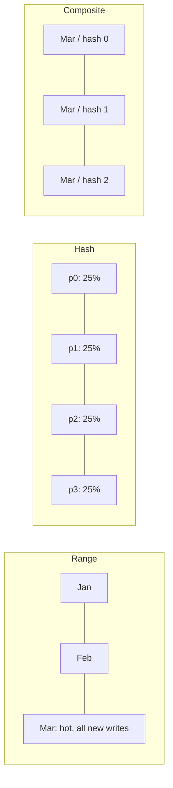
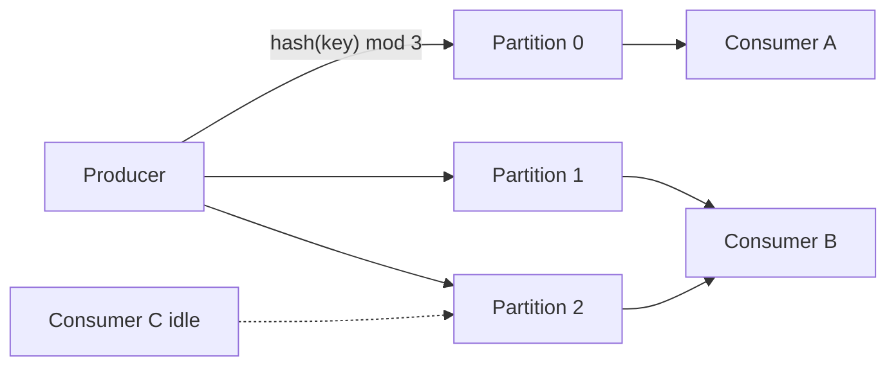
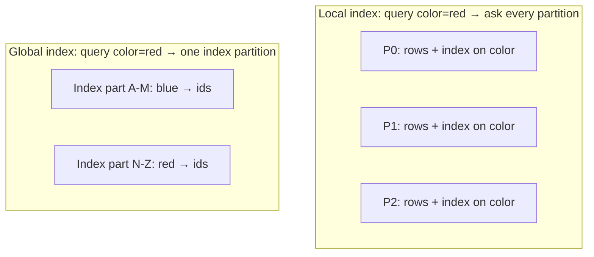

# Partitioning

:::info Partitioning vs Sharding
**Partitioning** is the logical act of splitting a dataset into subsets by some rule. Those subsets may live on one machine (PostgreSQL declarative partitions) or many (Cassandra, Kafka, DynamoDB). **Sharding** is horizontal partitioning *distributed across nodes*, which adds routing, rebalancing, and cross-node coordination. This page covers *how* to split data and design partition keys; for distribution, routing, and resharding see [Sharding](/distributed-systems/sharding).
:::

## Mental Model

Partitioning is a filing system. Instead of one giant drawer, you split files into labeled folders — by month, by customer, by region, by a hash of the name. A good filing rule means you open **one folder** to answer most questions and can throw away an entire old folder in one motion. A bad rule means one folder is overflowing while others are empty, or every question requires opening every folder.

The core idea: **the partition key decides which questions are cheap.** Queries that include the key touch one partition (pruning). Queries that don't must scan all partitions. Every partitioning decision is a bet on your access patterns.

### Partitioning vs Sharding

| Dimension | Partitioning | Sharding |
|-----------|-------------|----------|
| **Definition** | Splitting a dataset into subsets by a rule | Horizontal partitioning where subsets are placed on different nodes |
| **Scope** | Logical; may be single-node | Physical; always multi-node |
| **Directions** | Horizontal (rows) or vertical (columns) | Horizontal only |
| **Primary goal** | Manageability, query pruning, retention, ordering, parallelism | Scale writes, storage, and memory beyond one machine |
| **Transactions / joins** | Usually still local and ACID (single node) | Cross-shard = distributed transaction |
| **Routing** | DB planner picks partitions (pruning) | Router / smart client / proxy picks nodes |
| **Rebalancing** | Rarely needed (attach/detach partitions) | Central concern (move/split shards online) |
| **Examples** | PostgreSQL `PARTITION BY RANGE`, MySQL partitions, Kafka topic partitions, Parquet folder partitioning | Vitess, Citus, MongoDB sharded clusters, Redis Cluster |

:::note Terminology varies
Cassandra and DynamoDB call their distributed units "partitions"; MongoDB and Elasticsearch call them "shards"; HBase/Bigtable call them "regions"/"tablets"; Spanner/CockroachDB call them "splits"/"ranges". The concepts on this page apply regardless of the name.
:::

## Problem Being Solved

Large, undivided tables and streams cause problems long before you run out of machines:

| Problem | Without partitioning | With partitioning |
|---------|---------------------|-------------------|
| **Query scans** | Queries filter a 5B-row table; indexes are deep and huge | Planner prunes to the one partition that matches (e.g. this month) |
| **Retention / deletion** | `DELETE WHERE created_at < ...` on billions of rows → massive WAL, bloat, vacuum storms | `DROP` / `DETACH` a whole partition — metadata operation, near-instant |
| **Index maintenance** | One giant index; rebuilds take hours; doesn't fit in memory | Smaller per-partition indexes; hot partition's index stays in RAM |
| **Hot vs cold data** | Old, rarely-read rows share pages / storage tier with hot rows | Old partitions on cheaper storage, compressed, or archived |
| **Parallelism** | One unit of work → one worker | Each partition processed independently (parallel scans, Kafka consumers, Spark tasks) |
| **Ordering** | Total ordering of a stream limits throughput to one writer | Ordering per partition (per key) while scaling across partitions |
| **Wide rows / large columns** | BLOBs and rarely-used columns bloat every row read | Vertical partitioning moves them out of the hot row |
| **Distribution** | Can't spread data across nodes without a split rule | Partitions are the unit that [sharding](/distributed-systems/sharding) places on nodes |

## Core Mechanism

Partitioning has two axes and a key:

1. **Direction** — split **rows** (horizontal) or **columns** (vertical).
2. **Strategy** — the function that maps a row to a partition: range, hash, list, composite, or time-based.
3. **Partition key** — the attribute(s) that function is applied to.



### Vertical partitioning (split columns)

| Pattern | How | Why |
|---------|-----|-----|
| **Hot vs cold columns** | Keep frequently read/updated columns (`status`, `last_seen`, `balance`) in a narrow table; move rarely accessed ones (`bio`, `preferences`, audit fields) to a side table with the same PK | More rows per page → better cache hit ratio; updates rewrite smaller rows (important for MVCC databases like Postgres) |
| **BLOBs out of row** | Store large binary/text in object storage ([S3](/building-blocks/s3-object-storage)) or a separate table; keep a pointer/URL in the main row | Avoid dragging MBs through the buffer pool on every read; enables CDN delivery |
| **Functional / feature partitioning** | Split by domain: `auth`, `billing`, `catalog` each get their own tables or databases | Independent scaling, ownership, and failure domains — the data side of microservices |
| **Columnar storage** | Every column stored separately (Parquet, ClickHouse, Redshift) | Analytics read few columns of many rows — vertical partitioning taken to the extreme |

**Cost:** reading a full entity needs a join (or two lookups); keeping both halves consistent requires a transaction or an accepted lag; functional splits lose cross-domain joins and transactions entirely.

### Horizontal partitioning (split rows)

Every partition has the **same schema** and holds a subset of rows. This is what most people mean by "partitioning", and it is the prerequisite for sharding.

## How It Works

### Partitioning Strategies

| Strategy | Rule | Best for | Weakness |
|----------|------|----------|----------|
| **Range** | Contiguous key ranges: `[2025-01, 2025-02)`, `A-F`, `id 0-1M` | Range scans, time-series, ordered iteration, retention by dropping old ranges | Hot spots with monotonic keys (all writes hit the newest range); skewed ranges |
| **Hash** | `partition = hash(key) mod N` (or hash ranges) | Uniform distribution of writes and data; point lookups | Range queries hit all partitions; changing N reshuffles data (unless fixed/logical) |
| **List** | Explicit value sets: `region IN ('us','ca') → p_na` | Categorical keys with known values: region, tenant tier, data residency | Uneven sizes; new values need a new partition or a default; low cardinality |
| **Composite** | Two levels, e.g. range by month, then hash by `userId` within each month | Combine retention-friendly time ranges with even write distribution | More partitions to manage; more complex pruning |
| **Time-based** | A range strategy on a timestamp with fixed intervals (hour/day/month) | Logs, events, metrics, audit trails with TTL-based retention | Current interval is always the hot partition; needs automation to pre-create partitions |
| **Round-robin / random** | Rows assigned in rotation, ignoring content | Even load for write-only bulk ingestion | No pruning at all — every read scans every partition |



**Choosing a strategy:**

| If your dominant need is... | Use |
|------------------------------|-----|
| Delete/archive old data cheaply | Time-based range |
| Even write throughput with point lookups | Hash |
| Range scans over the key | Range |
| Data residency / regulatory boundaries | List (by region / country) |
| Time-ordered retention **and** high write rate | Composite (time range → hash sub-partitions) |
| Per-entity ordering in a stream | Hash of entity key (Kafka) |

### Partition Key Design

The partition key determines **locality** (what's stored together), **pruning** (which queries touch one partition), and **balance** (whether partitions are even).

#### Compound keys: partition key + sort/clustering key

Most distributed stores separate the key into two roles:

| Store | Partition part (where) | Sort part (order within partition) | Example |
|-------|------------------------|-----------------------------------|---------|
| **[Cassandra](/building-blocks/cassandra)** | Partition key (hashed to a token) | Clustering columns (sorted on disk) | `PRIMARY KEY ((chat_id, bucket), message_ts)` |
| **DynamoDB** | Partition key (PK, hashed) | Sort key (SK, ordered) | `PK = USER#42`, `SK = ORDER#2025-03-01#981` |
| **HBase / Bigtable** | Row key prefix (range-partitioned) | Rest of row key (lexicographic) | `deviceId#reverse_ts` |
| **Kafka** | Message key (hashed to partition) | Offset (append order) | key = `orderId` |

The partition key should be what you **always** know at query time; the sort key enables range queries, pagination, and "latest N" **within** a partition.

#### Bucketing large partitions

A partition key with unbounded growth (e.g. `chat_id` for a chat that lives for years, `sensor_id` emitting every second) creates **unbounded partitions**: they exceed recommended sizes, compaction and repair slow down, and reads of "latest" have to skip tombstones and old data.

Fix by adding a **bucket** to the partition key:

```
Before:  PRIMARY KEY ((chat_id), message_ts)          -- grows forever
After:   PRIMARY KEY ((chat_id, month), message_ts)   -- bounded per month
         month = '2025-03'

Read latest 50 messages:
  query (chat_id, current_month) LIMIT 50
  if fewer than 50 → query (chat_id, previous_month) ...
```

| Bucket type | How | Use when |
|-------------|-----|----------|
| **Time bucket** | `key + day/week/month` | Append-mostly data read by recency |
| **Hash bucket** | `key + (hash(sub_id) mod B)` | Very hot single key; need write spread; reads fan out to B buckets |
| **Count bucket** | Start a new bucket every N items (bucket index stored in metadata) | Uneven write rates across keys |

Size buckets so the busiest key's bucket stays within the store's comfortable range (e.g. Cassandra: tens to ~100MB and ~100K rows per partition; DynamoDB: one partition key value served at up to ~3000 RCU / 1000 WCU).

#### Avoiding skew through key design

| Anti-pattern | Why it skews | Better design |
|--------------|-------------|---------------|
| Monotonic key with range partitioning (`created_at`, auto-increment) | All writes go to the last partition | Hash the key, prefix with a hash bucket, or use composite (time → hash) |
| Low-cardinality key (`status`, `country`, `boolean`) | Few partitions, sizes follow the value distribution | Higher-cardinality key; use the low-cardinality field as a sort-key prefix or index |
| Tenant as key with whale tenants | One tenant = one partition = a hot spot | `tenantId + hash bucket` for large tenants; isolate whales (see [Sharding](/distributed-systems/sharding) hot shard mitigations) |
| Celebrity entity (`post_id` of a viral post) | All reads/writes on one key | Write sharding with N suffixes; cache reads; aggregate counters locally |
| Date-only key (`2025-03-01`) | Every write today hits one partition | `date + hash(id) mod B` |

:::tip Design keys from queries, not entities
List the top access patterns first ("get user's last 20 orders", "all events for device X in a time window"), then design the partition key so each pattern touches one partition and the sort key orders results the way the query needs. This is the essence of single-table design in DynamoDB and query-first modeling in Cassandra.
:::

### Single-Node Database Partitioning (PostgreSQL)

[PostgreSQL](/building-blocks/postgresql) declarative partitioning splits a table into child tables on the **same server**. It doesn't add write capacity beyond one node, but solves retention, index size, and scan pruning.

```sql
CREATE TABLE events (
    event_id   bigint,
    tenant_id  bigint,
    created_at timestamptz NOT NULL,
    payload    jsonb,
    PRIMARY KEY (event_id, created_at)       -- PK must include partition key
) PARTITION BY RANGE (created_at);

CREATE TABLE events_2025_03 PARTITION OF events
    FOR VALUES FROM ('2025-03-01') TO ('2025-04-01');

-- Retention: near-instant, no bloat, no vacuum storm
ALTER TABLE events DETACH PARTITION events_2024_03 CONCURRENTLY;
DROP TABLE events_2024_03;
```

| Feature | Detail |
|---------|--------|
| **Strategies** | `PARTITION BY RANGE`, `LIST`, `HASH (MODULUS n, REMAINDER r)`; sub-partitioning allowed (e.g. range → hash) |
| **Partition pruning** | Planner (and executor, for parameters) skips partitions whose bounds can't match the `WHERE` clause — only works when the query filters on the partition key |
| **Indexes** | Index on the parent creates a matching index on each partition; each is smaller and can be built per partition |
| **Unique constraints** | Must include the partition key columns — no global uniqueness on other columns |
| **Retention** | `DETACH PARTITION [CONCURRENTLY]` + `DROP TABLE` instead of mass `DELETE` |
| **Default partition** | Catches rows that match no partition; but makes attaching new partitions slower (must scan default) |
| **Automation** | Partitions must exist before data arrives — use `pg_partman` or a cron job to pre-create future partitions |

**Limits and pitfalls:**
- **Too many partitions** (thousands) inflate planning time and memory, especially for queries that can't prune.
- **Queries without the partition key** scan every partition — often slower than an unpartitioned table with a good index.
- **No global indexes** — a lookup by a non-key column must probe each partition's index.
- **Updating the partition key** moves the row between partitions (delete + insert).
- MySQL has similar `PARTITION BY RANGE/LIST/HASH/KEY` with the same "unique key must include partition columns" restriction.

:::note When single-node partitioning is the right answer
Large append-heavy tables (events, logs, audit, metrics) with time-based retention on a single primary. It often delays the need for [sharding](/distributed-systems/sharding) by years. Distributed Postgres (Citus) layers sharding on top of the same concepts.
:::

### Stream / Log Partitioning (Kafka)

A [Kafka](/building-blocks/kafka) topic is split into partitions — each an ordered, append-only log. Partitioning is how Kafka scales throughput while preserving order where it matters.



| Property | Detail | Implication |
|----------|--------|-------------|
| **Key → partition** | Default partitioner: `murmur2(key) mod numPartitions`; null keys are spread (sticky partitioner) | Same key always lands in the same partition (while partition count is fixed) |
| **Ordering** | Guaranteed **only within a partition** | Use the entity ID (`orderId`, `userId`) as the key to get per-entity ordering |
| **Consumer parallelism** | Within a consumer group, each partition is consumed by at most one consumer | Max useful consumers = partition count; extra consumers sit idle |
| **Throughput** | Partitions spread across brokers; each is written/read sequentially | More partitions → more aggregate throughput (up to broker limits) |
| **Repartitioning** | Adding partitions changes `hash mod N` → existing keys map to new partitions | Breaks per-key ordering during transition and invalidates key-based state in consumers (Kafka Streams state stores); partitions can't be removed |
| **Head-of-line blocking** | One slow or poison message blocks everything behind it in that partition | Retry topics / DLQ; bounded retries; parallel processing by key within a partition (e.g. parallel consumer libraries) |
| **Hot partitions** | A hot key overloads one partition and its consumer | Composite key (`key + suffix`) if strict per-key order isn't needed; isolate heavy keys to their own topic |

:::tip Over-provision partitions up front
Because adding partitions remaps keys, pick a count that covers future consumer parallelism (e.g. 2-3× today's need, often 12-60 for a busy topic). But don't go extreme: each partition costs file handles, memory, replication traffic, and longer leader elections and rebalances.
:::

### Secondary Indexes on Partitioned Data

Partitioning by one key makes lookups by any other attribute hard. Two designs:

| | Local index (document-partitioned) | Global index (term-partitioned) |
|---|-----------------------------------|--------------------------------|
| **Where the index lives** | Each partition indexes only its own rows | Index is partitioned by the **indexed value**, independent of the data's partitioning |
| **Writes** | Local, synchronous, consistent with the row | May touch a different partition/node → usually async (eventually consistent) or needs a distributed txn |
| **Reads by indexed value** | Scatter-gather to every partition | Single partition lookup (then fetch rows) |
| **Best for** | Write-heavy; queries that also include the partition key | Read-heavy lookups by secondary attribute |
| **Examples** | Cassandra secondary indexes / SAI, DynamoDB LSI, Elasticsearch per-shard indexes, Postgres partitioned indexes, MongoDB per-shard indexes | DynamoDB GSI (async), Vitess lookup vindexes, Spanner/CockroachDB global indexes (transactional), Riak search term partitions |



:::note DynamoDB specifics
LSIs share the base table's partition key (local), are strongly consistent, but cap each partition key's item collection at 10GB. GSIs have their own partition key (global), are eventually consistent, and consume their own write capacity — a throttled GSI can back-pressure base-table writes.
:::

## Scaling Considerations

### Partition sizing: too many vs too few

| | Too few partitions | Too many partitions |
|---|-------------------|--------------------|
| **Symptoms** | Partitions too large; can't parallelize; can't spread across more nodes; slow retention drops | Planning overhead (Postgres); metadata, file handles, and memory per partition; slow rebalances and leader elections (Kafka); small-file problem (data lakes) |
| **Fix cost** | High — usually requires re-keying / repartitioning data | Moderate — merge partitions or change granularity for new data |

**Target sizes (rules of thumb):**

| System | Comfortable partition size / count |
|--------|------------------------------------|
| PostgreSQL declarative | Partitions of GB to tens of GB; hundreds to low thousands of partitions per table |
| Cassandra | ≤ ~100MB and ≤ ~100K rows per partition |
| DynamoDB | Managed (~10GB per internal partition); per key ≤ 3000 RCU / 1000 WCU |
| Kafka | Enough partitions for peak consumer parallelism; thousands per broker is fine on modern KRaft clusters, but keep counts deliberate |
| Elasticsearch | ~10-50GB per shard |
| Data lake (Parquet / Hive-style) | Files of ~128MB-1GB; avoid partitioning by high-cardinality columns |

### Partition granularity for time-based data
Pick the interval so the current partition fits in memory along with its indexes and the retention drop is a reasonable unit (daily for high-volume logs, monthly for business events). Changing granularity later is fine for **new** partitions — old ones keep their size.

### Repartitioning
- **Single-node** — attach/detach and split partitions online, mostly metadata operations.
- **Hash with fixed logical partitions** — key → partition never changes; only placement changes (see [Sharding](/distributed-systems/sharding)).
- **Hash `mod N` with changing N** (Kafka) — keys move; plan migration (new topic + dual-write or replay) when ordering or state matters.
- **Changing the partition key** — a full data rewrite in practically every system; treat it as a migration project.

## Failure Modes

| Failure | Impact | Mitigation |
|---------|--------|------------|
| **Unbounded partition** | One partition grows to GBs; slow reads, compaction, repair; timeouts | Time / count buckets in the partition key; monitor max partition size |
| **Hot partition from key design** | One partition absorbs most writes/reads; throttling (DynamoDB), consumer lag (Kafka) | Higher-cardinality keys, hash buckets, composite keys; distribution-level fixes in [Sharding](/distributed-systems/sharding) |
| **Missing future partition** | Inserts fail (no partition for value) or land in default partition | Pre-create partitions (`pg_partman`); alert when fewer than N future partitions exist |
| **Queries that can't prune** | Full scan of every partition; worse than unpartitioned | Ensure hot queries filter on the partition key; review plans for pruning |
| **Partition explosion** | Thousands of tiny partitions → planning time, memory, metadata overhead | Coarser granularity; cap partition count |
| **Repartition breaks ordering** | Kafka partition count change → same key in two partitions → out-of-order processing | Over-provision partitions; migrate via a new topic |
| **Poison message in a partition** | Head-of-line blocking; whole partition stalls | Bounded retries, DLQ / retry topics |
| **Global index lag** | Reads via async index miss recent writes | Read-your-writes from base table; accept lag explicitly |
| **Vertical split drift** | Two halves of an entity out of sync after partial failure | Same-database transaction, or one side as source of truth + repair job |
| **Tombstone buildup** (Cassandra) | Deletes inside a partition make reads scan tombstones | Time-bucketed partitions dropped/expired as a whole; TTL with TWCS compaction |

## Trade-offs

| Decision | Gain | Cost |
|----------|------|------|
| Range vs hash | Range scans, cheap retention | Hot spots with monotonic keys |
| Hash vs range | Even distribution | Range queries scatter; no ordered iteration across partitions |
| Composite (time → hash) | Retention plus even writes | More partitions; more complex queries |
| List partitioning | Explicit control (residency, tiers) | Manual; uneven sizes |
| Vertical partitioning | Narrow hot rows, better cache efficiency | Joins / double lookups to rebuild the entity |
| Coarse partitions | Fewer objects, less overhead | Larger units to scan, move, and drop |
| Fine partitions | Precise pruning and retention | Metadata and planning overhead |
| Bucketing a key | Bounded partition size, spread writes | Reads span multiple buckets |
| Local secondary index | Consistent, cheap writes | Scatter-gather reads |
| Global secondary index | Single-partition reads by secondary key | Async or expensive writes |
| More Kafka partitions | Parallelism and throughput | Resource overhead; ordering only per partition |

## Real-World Examples

| System | Partitioning model | Key design notes |
|--------|-------------------|------------------|
| **PostgreSQL** | Declarative RANGE / LIST / HASH, sub-partitioning | Time-range partitions + `pg_partman` for event and audit tables; drop old partitions for retention |
| **MySQL** | RANGE / LIST / HASH / KEY partitions | Unique keys must include partition columns |
| **Cassandra / ScyllaDB** | Partition key hashed to token; clustering columns sort within partition | Query-first tables; time-bucketed partition keys for messages and time-series (Discord buckets messages by `channel_id` + time window) |
| **DynamoDB** | PK hashed to partitions; SK sorted within | Single-table design with `PK/SK` overloading; write sharding with suffixes for hot keys; GSIs for alternate access |
| **Kafka** | Topic partitions; `murmur2(key) mod N` | Entity ID as key for per-entity ordering; partition count sized for max consumer parallelism |
| **HBase / Bigtable** | Lexicographic row-key ranges (regions / tablets) with auto-split | Salt or reverse monotonic prefixes (`reverse_ts`, hashed prefix) to avoid hot-spotting the newest region |
| **Elasticsearch** | Index split into primary shards; time-based indices with ILM | Rollover indices by size/age; `_routing` to co-locate a tenant's docs |
| **Data lakes (Hive / Iceberg / Delta)** | Directory or hidden partitioning by columns (`dt=2025-03-01/`) | Partition by low-cardinality time columns; Iceberg hidden partitioning and partition evolution avoid query-side coupling |
| **ClickHouse** | `PARTITION BY` (usually month) + `ORDER BY` sort key | Partition for data management, sort key for query speed; too many partitions hurts merges |

## Related Concepts

- [Sharding](/distributed-systems/sharding) — distributing partitions across nodes: routing, resharding, cross-shard queries/transactions, hot shard mitigations
- [Consistent Hashing](/distributed-systems/consistent-hashing) — mapping hash partitions onto nodes with minimal movement
- [Replication](/distributed-systems/replication) — each partition replicated for durability and availability
- [PostgreSQL](/building-blocks/postgresql) — declarative partitioning on a single node
- [Cassandra](/building-blocks/cassandra) — partition key + clustering key design, bucketing
- [Kafka](/building-blocks/kafka) — topic partitions, ordering, consumer parallelism
- [Redis](/building-blocks/redis) — hash slots and hash tags as a fixed logical partitioning scheme
