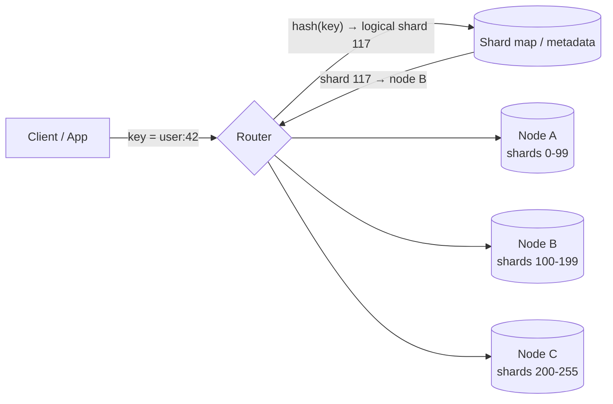
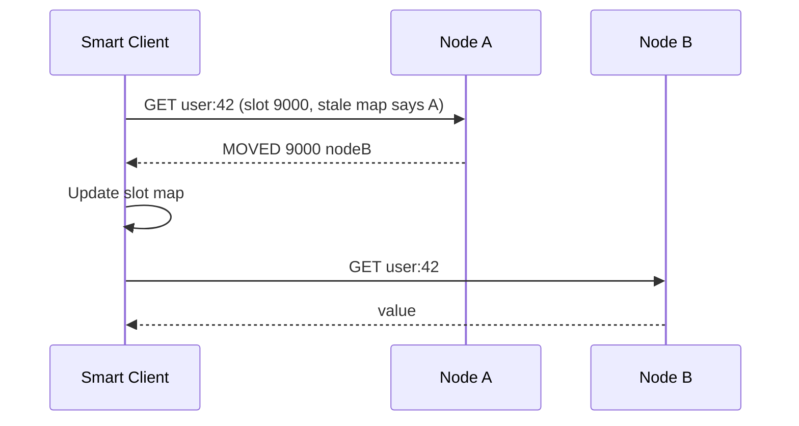
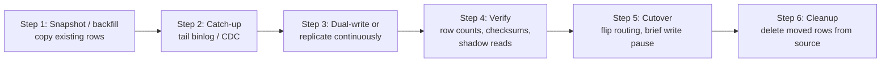

# Sharding

:::info Sharding vs Partitioning
**Partitioning** is *how* you split a dataset into subsets (by range, hash, list, columns). **Sharding** is horizontal partitioning where the subsets are placed on **different nodes** — and everything that comes with that: routing, rebalancing, cross-node queries and transactions, and per-node failure. This page covers the distribution problem. For key design, partition strategies and single-node partitioning, see [Partitioning](/distributed-systems/partitioning).
:::

## Mental Model

Sharding splits a dataset across multiple machines so that no single machine holds all the data or serves all the traffic. Each shard is an independent database (usually with its own replicas) that owns a slice of the keyspace. A **shard key** decides which slice a record belongs to, and a **routing layer** decides which machine currently owns that slice.

Think of a library that outgrew one building. Books A-M go to Branch 1, N-Z to Branch 2. Every visitor must know which branch to go to (routing), the split must be balanced (you don't want 80% of visitors in one branch), and when you open Branch 3 you have to physically move books without closing the library (online resharding). Questions like "list every book by this author across all branches" suddenly become expensive (scatter-gather).

The key insight: **sharding buys near-linear write and storage scaling at the cost of turning a database problem into a distributed-systems problem.** Every feature a single node gave you for free — joins, unique constraints, transactions, auto-increment IDs, consistent backups — now needs an explicit design.

## Problem Being Solved

A single database node eventually hits a hard ceiling:

| Limit | Symptom | Why replicas don't help |
|-------|---------|-------------------------|
| **Write throughput** | Primary CPU / WAL / disk IOPS saturated | Every replica must apply every write — replicas scale reads, not writes |
| **Storage** | Dataset exceeds what one disk / instance can hold (tens of TB) | Every replica holds a full copy |
| **Working set / memory** | Hot data no longer fits in RAM; cache hit ratio collapses | Same working set on every replica |
| **Operational blast radius** | One node failure, one bad migration, or one vacuum stall affects 100% of users | Replicas share the same schema and the same failure domain |
| **Maintenance time** | Backups, restores, index builds take hours or days | Same data size per node |

Sharding divides data and load so each node handles roughly `1/N` of the total, and a failure on one shard affects only `1/N` of users.

### When NOT to shard (yet)

Sharding is a one-way door with permanent complexity. Exhaust the cheaper options first:

| Option | What it buys | When it's enough |
|--------|-------------|------------------|
| **Vertical scaling** | Bigger instance (up to hundreds of vCPUs, multiple TB of RAM, NVMe) | Most systems under ~10K writes/sec and a few TB never need to shard |
| **Read replicas** | Scale reads horizontally | Read-heavy workloads (90%+ reads) with tolerable replication lag |
| **Caching** | Offload hot reads to [Redis](/building-blocks/redis) / CDN | Skewed read patterns with high hit ratio |
| **Single-node [partitioning](/distributed-systems/partitioning)** | Smaller indexes, partition pruning, cheap retention via `DROP PARTITION` | Large time-series / log tables on one node |
| **Functional split** | Move unrelated domains (billing, auth, catalog) to separate databases | Different domains with independent load |
| **Archiving cold data** | Move old rows to object storage / warehouse | Working set is small but total data is huge |
| **Managed distributed DB** | DynamoDB, Spanner, CockroachDB, Cassandra shard for you | Greenfield where the data model fits the store |

:::tip Interview heuristic
Say "we'll shard" only after showing the numbers: e.g. "50K writes/sec sustained and 40TB in 3 years exceeds a single primary, and replicas don't help writes — so we shard by `userId`." Sharding without a capacity argument reads as premature optimization.
:::

## Core Mechanism

Every sharding scheme answers five questions:

1. **Shard key** — which field decides ownership (`userId`, `tenantId`, `chatId`, `orderId`)?
2. **Key → shard mapping** — modulo, consistent hashing, hash slots, range, or directory?
3. **Shard → node mapping (routing)** — who knows which physical node hosts which shard, and how do clients find out?
4. **Rebalancing** — how do shards move or split when nodes are added, removed, or overloaded?
5. **Cross-shard operations** — how are queries, transactions, and unique constraints that span shards handled?

The two-level mapping (**key → logical shard → physical node**) is the single most important design choice. It decouples "which bucket does this key belong to" (fixed, never changes) from "where does this bucket live" (changes during rebalancing).

## How It Works

### Shard Key Selection

The shard key is the hardest decision to reverse. A good key satisfies four properties:

| Property | Question | Bad outcome if violated |
|----------|----------|-------------------------|
| **High cardinality** | Are there many more distinct values than shards? | `country` or `status` → only a handful of buckets; can't scale past that |
| **Even frequency** | Is traffic spread evenly across values? | One celebrity / big tenant dominates a shard (hot shard) |
| **Non-monotonic** | Does the value increase over time? | Timestamps / auto-increment IDs with range sharding → all writes hit the last shard |
| **Query alignment** | Do the most frequent queries include the key? | Every query becomes scatter-gather across all shards |

**Good vs bad keys:**

| Workload | Bad key | Why | Better key |
|----------|---------|-----|------------|
| Social app user data | `createdAt` | Monotonic → write hotspot on newest range | `userId` (hashed) |
| Multi-tenant SaaS | `rowId` | Tenant queries scatter across all shards | `tenantId` (co-locates tenant data) — plus a plan for whale tenants |
| Chat messages | `messageId` | "Load recent messages in chat X" hits every shard | `chatId` (+ time bucket for huge chats, see [Partitioning](/distributed-systems/partitioning)) |
| E-commerce orders | `orderStatus` | ~5 distinct values | `customerId` for customer views; separate index for merchant views |
| IoT telemetry | `deviceType` | Low cardinality, skewed | `deviceId` (hashed), or `deviceId + day` |
| URL shortener | `longUrl` | Lookups are by short code | `shortCode` |

:::note Primary query pattern wins
You can only co-locate data along **one** dimension. Pick the key that serves the hottest, most latency-sensitive query path, and serve the other access patterns with global secondary indexes, denormalized copies, or a search/analytics store.
:::

### Key Lookup Approaches

| Approach | How | Pros | Cons | Resharding cost |
|----------|-----|------|------|-----------------|
| **Modulo hashing** | `shard = hash(key) % N` | Trivial; perfectly even for uniform keys | Changing N remaps ~all keys (rehash storm) | ~100% of keys move |
| **[Consistent hashing](/distributed-systems/consistent-hashing)** | Keys and nodes on a ring; key maps to next node clockwise; virtual nodes for balance | Only ~`1/N` keys remap on node change; decentralized | Ring management; uneven without vnodes; no range scans | ~`1/N` of keys move |
| **Hash slots** (fixed logical shards) | Fixed number of slots (Redis: 16384); `slot = CRC16(key) % 16384`; each node owns a set of slots | Deterministic; resharding = move whole slots; key→slot never changes | Slot count is a hard upper bound on node count; slot map must be distributed to clients | Only moved slots |
| **Range-based** | Keys split by contiguous value ranges (A-M, N-Z); ranges split when they grow | Efficient range scans; ranges can split/merge dynamically | Hot ranges with monotonic or skewed keys | Split a range in place; move one half |
| **Directory-based** | Lookup table maps each key (or key group / tenant) to a shard | Total control; move any tenant independently; supports heterogeneous shards | Directory is an extra hop and a potential SPOF / bottleneck; must be cached and kept consistent | Update one directory entry + copy data |

#### When to use which

| Use case | Recommended | Example |
|----------|-------------|---------|
| Key-value store (cache, counters) | Hash slots or consistent hashing | Redis Cluster, Memcached (Ketama) |
| Wide-column / leaderless distributed DB | Consistent hashing with virtual nodes | Cassandra, DynamoDB, Riak |
| Ordered data / range scans / time-series | Range-based with automatic splits | HBase, Bigtable, CockroachDB, TiKV, Spanner |
| Multi-tenant SaaS with whale tenants | Directory (tenant → shard) | Slack, Salesforce, Shopify pods |
| Self-managed sharded SQL | Fixed logical shards (hash) mapped to physical hosts | Instagram, Vitess keyspaces, Citus |
| Prototype / fixed-size cluster | Modulo hashing | Simple app-level caches |

:::tip The "logical shards" trick
Hash into a large, **fixed** number of logical shards (e.g. 4096) and map many logical shards onto few physical nodes. Key → logical shard never changes, so resharding is just moving a logical shard (a schema, a slot, a file) to a new host. This is how Redis Cluster (16384 slots), Instagram (thousands of Postgres schemas), Couchbase (1024 vBuckets), and Elasticsearch (fixed primary shard count) avoid rehash storms.
:::

### Routing

Once you know the logical shard, something must translate it to a physical node.

| Routing model | How it works | Pros | Cons | Examples |
|---------------|-------------|------|------|----------|
| **Client-side / smart client** | Client library holds the shard map and connects directly to the owning node | No extra hop; lowest latency | Every client language needs the library; map staleness handled in clients | Redis Cluster clients, Cassandra drivers (token-aware), Memcached Ketama |
| **Proxy / router tier** | Stateless proxy parses the query, looks up the shard, forwards it, and merges results | App sees "one database"; central place for scatter-gather, rewrites, connection pooling | Extra hop (~sub-ms); proxy tier must scale and be HA | Vitess VTGate, MongoDB `mongos`, Twemproxy, Envoy Redis proxy, Citus coordinator |
| **Any-node coordinator** | Client connects to any node; that node forwards to the owner | Simple clients; no separate tier | Extra hop for non-owner requests | Cassandra (coordinator node), CockroachDB, Elasticsearch |
| **Config / metadata service** | Authoritative shard map in a consensus store; routers / clients watch it | Single source of truth; atomic map changes | Must be highly available; watch fan-out | ZooKeeper, etcd (Vitess topo), MongoDB config servers, HBase `hbase:meta` |

**Handling stale routing.** Shard maps change during rebalancing, so every model needs a correction path:

- **Redirect** — the node replies "not mine, go to X" (Redis `MOVED` / `ASK`, HBase `NotServingRegionException`). Client updates its map and retries.
- **Versioned maps** — requests carry a shard-map version; nodes reject stale versions (MongoDB shard versioning).
- **Watch / push** — routers subscribe to the metadata store and refresh on change (Vitess VTGate watching topo).

### Resharding and Rebalancing

Rebalancing is where most sharding pain lives. Two families of strategy:

| Strategy | How | Pros | Cons | Used by |
|----------|-----|------|------|---------|
| **Fixed number of logical shards** | Create many more shards than nodes up front; rebalance by moving whole shards between nodes | Simple, predictable; no key remapping | Must pick the count up front; each shard grows unboundedly with data; too many = overhead | Redis Cluster, Elasticsearch, Couchbase, Instagram, Riak |
| **Dynamic splitting** | Shards (ranges) split automatically when they exceed a size/load threshold; may merge when small | Adapts to data growth and skew; shard size stays bounded | Splits cause short disruption; needs a metadata service; range-based only (or hash-range) | HBase, Bigtable, CockroachDB, TiKV, MongoDB chunks, DynamoDB |
| **Proportional to nodes** | Fixed number of partitions *per node* (vnodes); a new node steals partitions from others | Shard size scales with cluster size | Random splits can be uneven | Cassandra (vnodes) |

#### Online migration playbook

Moving data between shards without downtime follows a standard sequence:

| Phase | What happens | Key risk | Mitigation |
|-------|-------------|----------|------------|
| **Backfill** | Bulk copy a consistent snapshot of the moving range to the target | Load on source shard | Throttle; copy from a replica |
| **Catch-up** | Stream changes made since the snapshot (binlog / WAL / CDC) | Falling behind under heavy writes | Monitor lag; only cut over when lag ≈ 0 |
| **Dual-write** (app-level alternative) | App writes to old and new locations | Partial failure → divergence | Old store remains source of truth; reconcile with a verifier |
| **Verification** | Compare counts / checksums; shadow-read from target and diff | Silent data loss | Automated diff tools (Vitess `VDiff`) |
| **Cutover** | Briefly block writes for the range, drain in-flight, flip shard map, resume | Write unavailability window | Keep it to seconds; do it per shard, not globally |
| **Cleanup** | Delete source copy after a safety window | Deleting before rollback window ends | Keep source for hours/days; reverse replication for rollback |

**How real systems do it:**

| System | Mechanism |
|--------|-----------|
| **Redis Cluster** | Slot migration: mark slot `MIGRATING` on source and `IMPORTING` on target; `MIGRATE` keys in batches; clients get `ASK` redirects for keys already moved; finally `CLUSTER SETSLOT ... NODE` assigns ownership. Moves one slot at a time while serving traffic. |
| **Vitess** | `Reshard` workflow (VReplication): copy rows + stream binlogs into target shards, run `VDiff`, `SwitchTraffic` for reads then writes (seconds of write pause), with reverse replication so you can `ReverseTraffic` to roll back. |
| **DynamoDB** | Fully managed: partitions split automatically when they exceed ~10GB or ~3000 RCU / 1000 WCU; split-for-heat isolates hot key ranges. Invisible to the app, but a single partition key value still has a per-key throughput ceiling. |
| **MongoDB** | Data split into chunks (ranges of shard key); balancer moves chunks between shards; since 5.0 `reshardCollection` can change the shard key online. |
| **Cassandra** | Adding a node: it claims tokens and streams the corresponding ranges from existing replicas; run `nodetool cleanup` on old owners afterwards. |
| **Instagram** | Thousands of logical shards as Postgres schemas; move a schema to a new host via replication, then update the logical→physical map. |

:::note Expand early
Rebalancing adds load (copy + catch-up) to shards that are usually already hot — that's why you're rebalancing. Trigger at ~60-70% capacity, not 95%.
:::

### Cross-Shard Queries

Any query that doesn't include the shard key must hit multiple shards.

| Technique | How | Pros | Cons |
|-----------|-----|------|------|
| **Scatter-gather** | Send the query to all (or many) shards in parallel; merge, sort, paginate at the router | No extra storage; always consistent with source | Latency = slowest shard (tail amplification); load on every shard per query; pagination and `ORDER BY ... LIMIT` are expensive |
| **Global secondary index** | Separate index sharded by the *secondary* attribute → points to primary key / shard | Single-shard lookup by secondary attribute | Index update is a cross-shard write → usually async (eventually consistent) or needs 2PC |
| **Local secondary index + scatter** | Each shard indexes its own rows; queries scatter but use the index on each shard | Index writes are local and consistent | Still scatter-gather |
| **Denormalization / duplicate by second key** | Store the data twice, sharded by each access pattern (e.g. `orders_by_customer`, `orders_by_merchant`) | Every read is single-shard | Write amplification; keeping copies consistent (CDC / outbox) |
| **Lookup / mapping table** | Small table mapping secondary key → shard key (Vitess "lookup vindex") | Cheap point lookups | Extra hop; must be maintained transactionally or async |
| **Offload to search / OLAP** | Stream changes (CDC → [Kafka](/building-blocks/kafka)) to Elasticsearch / warehouse | Arbitrary queries without touching OLTP shards | Lag; another system to operate |

:::tip Tail latency amplification
If each shard has a 1% chance of a slow (p99) response, a query fanning out to 100 shards will hit at least one slow shard ~63% of the time. Scatter-gather on the hot path turns your p99 into your p50. Keep hot-path queries single-shard.
:::

### Cross-Shard Transactions

| Approach | How | Pros | Cons | When |
|----------|-----|------|------|------|
| **Co-location (avoid it)** | Choose a shard key so related rows share a shard (`tenantId`, Redis hash tags `{user:42}:cart`, Cassandra partition key, Vitess keyspace ID) | Local ACID transactions; no coordination | Constrains data model; whale tenants become hot | Default — design for this first |
| **Two-phase commit (2PC)** | Coordinator asks all participants to *prepare*, then *commit* | Atomic across shards | Blocking if coordinator fails; extra round trips; locks held across network | Rare, low-volume, must-be-atomic operations |
| **Consensus-backed distributed txns** | 2PC over Raft/Paxos groups with synchronized clocks / timestamps | Atomic and fault-tolerant | Higher latency; complex; usually needs a purpose-built DB | Spanner, CockroachDB, TiDB, YugabyteDB |
| **Saga** | Sequence of local transactions with compensating actions on failure | Non-blocking; each step is local | No isolation (intermediate states visible); compensation logic is hard | Business workflows (order → payment → inventory) |
| **Outbox + idempotent consumers** | Write the change + an event in one local txn; relay publishes; other shards apply idempotently | Reliable, decoupled | Eventual consistency | Propagating changes to other shards / indexes |

**Unique constraints** across shards (e.g. "username must be globally unique") have the same problem: either shard a uniqueness table by that attribute and write to it first (claim-then-create), or use a global store for that constraint only.

### Hot Shards

A **hot shard** receives disproportionately more traffic or data than others. Hot spots are fundamentally a *distribution* problem: even a well-designed key space can concentrate load on one node. (For preventing skew through key design — compound keys, bucketing, avoiding monotonic keys — see [Partitioning](/distributed-systems/partitioning).)

Common causes:
- **Celebrity key** — one user / tenant / item generates vastly more traffic (a viral post, a large enterprise tenant, `clientId=BigCorp` in a rate limiter)
- **Temporal skew** — range sharding on time means "now" is always hot
- **Skewed key distribution** — low cardinality or a poor hash leads to uneven ownership
- **Uneven shard placement** — several busy logical shards land on the same physical node

#### Mitigation Strategies

| Strategy | How | Trade-off |
|----------|-----|-----------|
| **Sub-sharding / key splitting** | Split hot key into N sub-keys: `key:shard_N`. Write to a random sub-key; read = SUM / merge across all N. | Read fan-out (N reads instead of 1); slight inaccuracy if reads are stale |
| **Local aggregation** | Accumulate writes locally (in-process); periodically flush to the shard | Bounded staleness during flush interval; lose buffer on crash |
| **Dedicated shard** | Pin hot keys / whale tenants to a beefier, isolated node (directory-based) | Manual; doesn't scale if many keys go hot |
| **Salting** | Append a random suffix before hashing: `hash(key + salt)` | Scatters hot key across shards, but point lookups must query all salts |
| **Read replicas / caching for hot reads** | Serve hot reads from replicas or a cache layer in front of the shard | Doesn't help writes; staleness |
| **Application-level / adaptive routing** | Detect hot keys dynamically; route to a pool of replicas or split the range | Complex but adaptive; DynamoDB adaptive capacity and split-for-heat |
| **Move / split the shard** | Move the hot logical shard to its own node, or split the hot range | Doesn't help if a *single key* is the hotspot |

:::note Single-key hotspots
Splitting or moving shards only helps when the hot range contains *many* keys. If one key is hot, the only fixes are key splitting, caching, local aggregation, or rate limiting that key.
:::

### ID Generation in a Sharded World

Auto-increment stops working once rows are created on many independent primaries.

| Approach | How | Pros | Cons |
|----------|-----|------|------|
| **UUID v4** | 128-bit random | No coordination | Large; random → poor B-tree locality, index bloat |
| **UUID v7 / ULID** | Timestamp prefix + random | Time-ordered; no coordination | 128 bits; doesn't encode shard |
| **Snowflake** (Twitter) | 64-bit: 41 bits ms timestamp + 10 bits worker ID + 12 bits sequence | Compact, time-sortable, ~4K IDs/ms/worker | Needs unique worker IDs; clock skew/regression handling |
| **Shard ID embedded in ID** (Instagram) | 41 bits ms timestamp + 13 bits logical shard ID + 10 bits per-shard sequence (generated in Postgres via PL/pgSQL) | Route by ID alone — no lookup; time-sortable | Logical shard count is fixed by bit width |
| **Ticket server / range allocation** | Central service hands out ID blocks (Flickr ticket DBs, block allocation) | Simple, dense IDs | Central dependency (mitigated by blocks + two servers with odd/even) |
| **Per-shard auto-increment with offset** | Shard k uses IDs `k, k+N, k+2N, ...` | Simple | Fixed N; adding shards breaks the scheme |

:::tip Embed the shard in the ID
If child objects are looked up by their own ID (e.g. `GET /photos/:id`), encoding the logical shard into the ID means you can route without a lookup table — and the ID stays valid forever because logical shards never change, only their physical placement.
:::

## Scaling Considerations

### Per-shard replication
Each shard is its own replication group — typically a primary + 2 replicas (or a Raft group of 3/5). Shard count × replication factor = total nodes. See [Replication](/distributed-systems/replication). Failover is per-shard, so one shard failing over does not affect the others.

### Choosing the shard count
- **Too few** logical shards → you hit a ceiling and must do a painful re-key later.
- **Too many** → per-shard overhead (connections, metadata, small files, scatter-gather fan-out).
- Rule of thumb: logical shards = 10-100× the initial physical nodes, sized so each logical shard stays well under what one node can handle at your 5-year projection.

### Schema migrations across shards
- A DDL change must run on every shard; some will succeed and some fail → **mixed schema state** is normal during rollout.
- Make changes backward-compatible (expand → migrate → contract) so app code works against both schemas.
- Use orchestration tools (Vitess online DDL, gh-ost / pt-online-schema-change per shard) and roll out in waves.

### Backups and restores
- Per-shard backups are not taken at the same instant → a "global" restore is **not a consistent snapshot** across shards.
- If cross-shard consistency matters, use PITR (point-in-time recovery) to a common timestamp, or accept per-shard consistency.

### Monitoring skew
Track per shard, not just cluster-wide averages:

| Metric | Why |
|--------|-----|
| QPS / write rate per shard | Detect hot shards early |
| Data size per shard | Detect growth imbalance; plan splits |
| p99 latency per shard | A single slow shard dominates scatter-gather latency |
| Top-K keys per shard | Identify celebrity keys |
| Replication lag per shard | Detect overloaded primaries |
| Skew ratio (max / mean) | Alert when the busiest shard exceeds ~2× the average |

### Connection management
N app servers × M shards × pool size can exhaust database connections. Use a proxy / pooler (VTGate, PgBouncer, RDS Proxy) or a smart client with shared pools.

## Failure Modes

| Failure | Impact | Mitigation |
|---------|--------|------------|
| **Shard primary down** | Writes for `1/N` of keys fail until failover | Per-shard replication with automatic failover (Sentinel/Raft/orchestrator) |
| **Hot shard overloaded** | Latency spikes / timeouts for keys on that shard; can cascade to callers | Sub-sharding, caching, adaptive routing, per-key rate limits |
| **Stale shard map** | Requests sent to the wrong node → errors or (worse) writes to a non-owner | Redirects (`MOVED`/`ASK`), versioned maps, owner-side ownership checks |
| **Metadata service outage** | Can't route new connections or perform rebalancing | Cache the map in routers/clients; metadata in a quorum store (etcd/ZK) |
| **Resharding during traffic** | Inconsistent reads, lost writes, or double writes during migration | CDC-based catch-up, verification (diff), short write-freeze at cutover, reverse replication for rollback |
| **Partial cross-shard write** | One shard committed, another didn't → inconsistency | Co-location, sagas with compensation, outbox, 2PC where required |
| **Uneven distribution** | Some shards full while others idle; wasted capacity | Many logical shards, vnodes, automatic splits; monitor skew ratio |
| **Scatter-gather tail latency** | One slow shard slows every fan-out query | Avoid fan-out on hot paths; hedged requests; partial results with timeouts |
| **Schema drift across shards** | Failed DDL leaves shards on different schemas → app errors | Backward-compatible migrations; per-shard migration tracking |
| **Global ID collision / clock regression** | Duplicate IDs or out-of-order IDs | Unique worker IDs; refuse to generate on clock regression |
| **Correlated shard placement** | Replicas of a shard in the same rack/AZ → shard lost in AZ outage | Rack/AZ-aware replica placement |

## Trade-offs

| Decision | Gain | Cost |
|----------|------|------|
| Shard vs scale vertically | Near-linear write/storage scaling; smaller blast radius | Loss of joins, global transactions, global constraints; operational complexity forever |
| Hash-based vs range-based | Uniform distribution; no monotonic hotspots | No efficient range scans; range queries scatter |
| Consistent hashing vs modulo | Minimal remapping (`1/N`) | Ring/vnode management |
| Fixed logical shards vs dynamic splits | Simple, predictable moves | Must choose count up front; shard size grows with data |
| Directory vs computed mapping | Move any key/tenant independently | Extra hop; directory must be HA and cached |
| Smart client vs proxy | No extra hop | Fat clients in every language; harder upgrades |
| Shard key = primary query key | Single-shard hot path | Other access patterns need GSIs, denormalization, or scatter |
| Global secondary index | Single-shard lookups by secondary key | Async (eventually consistent) or expensive cross-shard writes |
| Sagas vs 2PC | Non-blocking, available | No isolation; compensation logic |
| More shards | Parallelism; smaller failure domain; faster rebuilds | More fan-out, connections, metadata, operational overhead |

## Real-World Examples

| System | Sharding approach | Shard key | Routing | Rebalancing |
|--------|-------------------|-----------|---------|-------------|
| **Vitess (YouTube, Slack, GitHub)** | MySQL sharded by keyspace ID ranges computed by a vindex (often hash) | Sharding key via vschema | VTGate proxy + topo (etcd/ZK) | `Reshard` / `MoveTables` via VReplication with VDiff and traffic switching |
| **Instagram** | Thousands of logical shards as Postgres schemas on few physical hosts | `userId` | App-level logical→physical map | Move schemas between hosts; IDs embed logical shard |
| **Discord** | Messages in Cassandra (later ScyllaDB) | `(channel_id, bucket)` where bucket = time window | Driver token-aware routing | Cassandra token ranges; request coalescing in front for hot channels |
| **MongoDB** | Range or hashed sharding; data in chunks | Shard key field(s) | `mongos` + config servers | Balancer migrates chunks; `reshardCollection` for key changes |
| **Citus (PostgreSQL)** | Hash-distributed tables; co-located tables share the distribution column | Distribution column (often `tenant_id`) | Coordinator node | Shard rebalancer moves shards online |
| **DynamoDB** | Hash of partition key → internal partitions | Partition key (PK) | Request router (managed) | Automatic split by size/heat; adaptive capacity |
| **Cassandra / ScyllaDB** | Consistent hashing (Murmur3) with vnodes | Partition key | Any node as coordinator; token-aware drivers | New nodes stream token ranges |
| **Redis Cluster** | 16384 hash slots | `CRC16(key) % 16384`; hash tags for co-location | Smart clients with `MOVED`/`ASK` redirects | Slot migration |
| **Elasticsearch** | Fixed primary shard count per index | `_routing` (default doc ID) | Any node coordinates | Moves shards between nodes; split/shrink API for count changes |
| **Spanner / CockroachDB** | Range-based with automatic splits; Raft per range | Primary key | Any node; range descriptors in meta ranges | Automatic split, merge, and rebalance; distributed transactions |

## Related Concepts

- [Partitioning](/distributed-systems/partitioning) — how data is split (range, hash, list, composite), partition key design, single-node and log partitioning
- [Consistent Hashing](/distributed-systems/consistent-hashing) — ring-based key distribution with virtual nodes
- [Replication](/distributed-systems/replication) — per-shard replication for fault tolerance
- [Redis](/building-blocks/redis) — hash slots, hash tags, slot migration, `MOVED`/`ASK` redirects
- [Cassandra](/building-blocks/cassandra) — partition key, token ranges, virtual nodes
- [PostgreSQL](/building-blocks/postgresql) — scaling paths before sharding; Citus for distributed Postgres
- [Kafka](/building-blocks/kafka) — CDC pipelines for resharding, global indexes, and search offload
