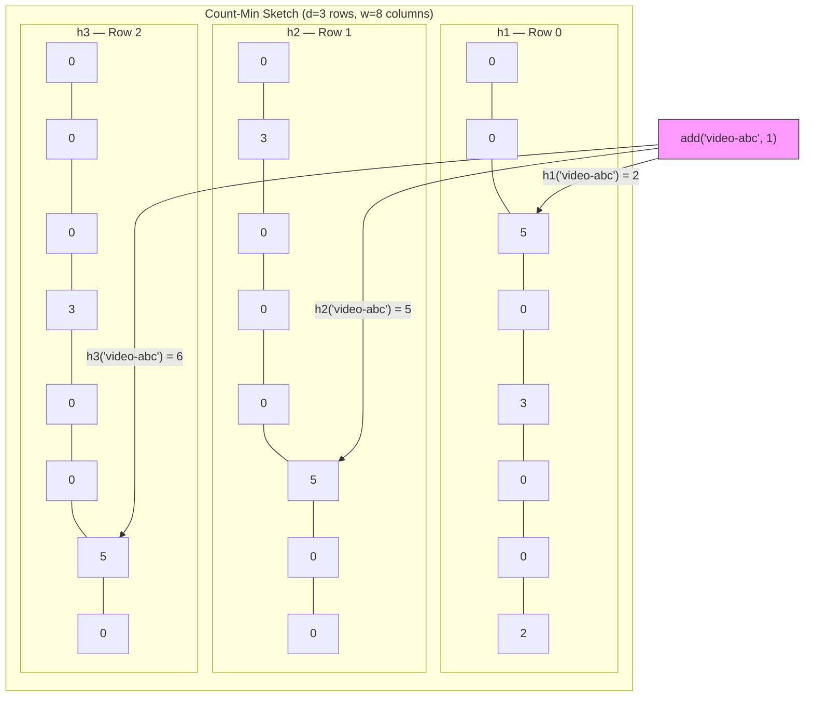
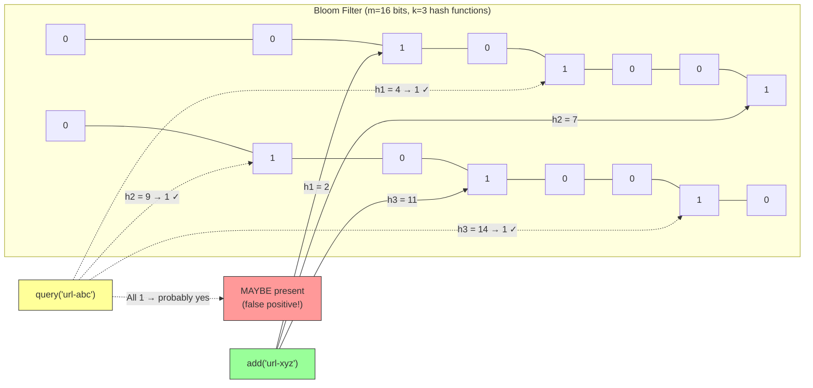

# Probabilistic Data Structures

## Mental Model

Exact counting, exact membership, and exact cardinality all require memory proportional to the data. When you have billions of items and only need *approximate* answers, you can trade a tiny, bounded error for orders-of-magnitude memory savings.

Probabilistic data structures are **lossy compression of statistics**. They answer questions like "how many times has X appeared?" or "have I seen X before?" or "how many distinct items exist?" — using fixed memory regardless of input size. The key insight: they control error mathematically (you choose how wrong they can be), not heuristically.

Think of them as the sketching equivalent of floating-point arithmetic: you accept a small, quantified imprecision in exchange for being able to operate at a scale where exact answers are physically impossible.

## Problem Being Solved

At internet scale, exact data structures break down:

| Problem | Exact solution | Cost at 1B items | Probabilistic solution | Cost |
|---------|---------------|-------------------|----------------------|------|
| "How many times has item X been viewed?" | `HashMap&lt;String, Long>` | ~16 GB (16 bytes/entry) | Count-Min Sketch | ~109 KB |
| "How many distinct users visited today?" | `HashSet&lt;String>` | ~40 GB | HyperLogLog | ~12 KB |
| "Has this URL been crawled before?" | `HashSet&lt;String>` | ~40 GB | Bloom Filter | ~1.2 GB at 1% FP |
| "What are the top 100 most frequent items?" | Sort all counters | O(N log N) | Space-Saving / CMS + heap | Fixed memory |
| "What is the p99 latency?" | Store all values, sort | Unbounded | t-digest | ~10 KB |

The pattern: when you have **high cardinality** (many unique items) and **high throughput** (millions of events/sec), exact answers cost too much memory, CPU, or both. Probabilistic structures give you an answer that is *good enough* for the decision you need to make.

## Core Mechanism

All probabilistic data structures rely on **hashing** to compress a large input space into a small, fixed-size representation. The core trade-off is always the same:

1. **Hash the input** into a fixed-size structure (bit array, counter array, register set)
2. **Collisions introduce error** — two different items mapping to the same slot
3. **More memory = fewer collisions = lower error** — the relationship is mathematical and tunable
4. **The structure is append-only** — you can add information but generally cannot remove it (with some exceptions)

What varies is *what question* the structure answers and *how it handles collisions*.

## How It Works

### Count-Min Sketch (CMS) — Frequency Estimation

The Count-Min Sketch estimates how many times an item has appeared in a stream. It is the probabilistic analogue of a frequency counter map.

**Structure:** a 2D array of counters — `d` rows (one per hash function) and `w` columns (counters per row).



**Add operation — `add(item, count)`:**
1. Hash the item with each of the `d` hash functions: `h1(item)`, `h2(item)`, ..., `hd(item)`
2. Each hash maps to a column index in its respective row
3. Increment the counter at that position by `count`

**Query operation — `estimate(item)`:**
1. Hash the item with all `d` functions (same as add)
2. Read the counter at each position
3. Return the **minimum** across all rows

The minimum is the tightest upper bound because a cell can only be inflated by collisions from *other* items, and different rows use different hash functions. The row with the fewest collisions for this item gives the closest-to-true count.

**Key property: CMS always over-counts, never under-counts.** Hash collisions can only *add* to a cell, never subtract. This is critical for top-K use cases: if an item truly belongs in the top K, its CMS estimate will be at least as high as its real count, so it will never be missed by a min-heap filter.

#### Error Bounds

CMS has two tunable parameters:

| Parameter | Controls | Formula | Meaning |
|-----------|----------|---------|---------|
| `epsilon` | Width (columns) | `w = ceil(e / epsilon)` | Maximum overcount as a fraction of total stream size N |
| `delta` | Depth (rows) | `d = ceil(ln(1 / delta))` | Probability that the error exceeds epsilon * N |

The guarantee: **P(estimate - true_count > epsilon * N) &lt; delta**, where N is the total count of all items added.

#### Concrete Sizing

For `epsilon = 0.001` (0.1% error), `delta = 0.01` (99% confidence):
- `w = ceil(e / 0.001) = ceil(2718.28) = 2719` columns
- `d = ceil(ln(100)) = ceil(4.605) = 5` rows
- Total cells: 2719 * 5 = 13,595
- At 8 bytes per counter: **~109 KB**

Compare to exact counters for 1 billion unique items: `1B * 16 bytes` (key hash + counter) = **~16 GB**. That is a 150,000x reduction.

#### Conservative Update Optimization

Standard CMS increments all `d` cells on every add, even cells that are already higher than the minimum. This causes unnecessary over-counting.

**Conservative update:** on `add(item, count)`, first compute the current estimate (minimum across rows). Then only increment cells whose current value equals the minimum. Cells already above the minimum are left untouched.

This significantly reduces over-counting in practice without changing the worst-case bounds.

#### Variants

| Variant | Difference from CMS | Trade-off |
|---------|-------------------|-----------|
| **Count-Mean-Min Sketch** | Subtracts a noise estimate (`(N - cell_value) / (w - 1)`) before taking the minimum | Better accuracy for low-frequency items; slightly more computation |
| **Count Sketch** | Uses `+1/-1` hashing (each hash also picks a sign, adds `+count` or `-count`) | Unbiased estimates (can under-count too), better for point queries; median instead of min |

#### Limitations

- **Cannot enumerate items** — only answers "how many times has X appeared?", not "list all items with count > Y"
- **Cannot delete/decrement** — cells are shared; decrementing one item's cell corrupts other items' counts
- **Error is proportional to total stream volume N**, not to the item's count — rare items have high *relative* error

#### Redis Support

The RedisBloom module provides native CMS operations:

```
CMS.INITBYDIM key width depth    # Create with explicit dimensions
CMS.INITBYPROB key epsilon delta  # Create with error bounds
CMS.INCRBY key item count        # Add occurrences
CMS.QUERY key item               # Estimate count
CMS.MERGE dest numkeys src1 src2  # Merge multiple sketches
```

---

### HyperLogLog (HLL) — Cardinality Estimation

HyperLogLog estimates the number of **distinct items** in a stream. It answers: "how many unique users / IPs / queries have we seen?"

**How it works:**
1. Hash each item to a uniformly distributed bit string
2. Count the longest run of leading zeros (the "register value") — call it `R`
3. Maintain 2^p registers (typically p=14, so 16,384 registers), each storing the maximum `R` seen for items hashing to that register's bucket
4. The cardinality estimate is a harmonic mean across all registers, with bias corrections

**Intuition:** if you flip a fair coin and see 20 heads in a row, you've probably flipped the coin about 2^20 times. More leading zeros = more items have been hashed. By splitting into many registers and taking the harmonic mean, variance is reduced dramatically.

**Memory:** 2^14 registers * 6 bits each = **12,288 bytes (~12 KB)** for ~0.81% standard error on cardinalities up to billions.

**Redis support:**

```
PFADD key item1 item2 ...   # Add items
PFCOUNT key1 key2 ...       # Estimate cardinality (merges if multiple keys)
PFMERGE dest src1 src2 ...  # Merge into a new HLL
```

**Use cases:**
- Unique visitors per page/day
- Unique search queries
- Unique IP addresses (DDoS detection)
- Cardinality estimation for query planning in databases

**Why mergeability matters:** because `PFMERGE` produces a valid HLL, you can count unique visitors per hour across 100 servers by merging their individual HLLs. This is critical for distributed counting — you cannot merge exact sets without transferring all elements.

---

### Bloom Filter — Membership Testing

A Bloom filter answers: "have I seen this item before?" It can say **"definitely not"** or **"probably yes"** — false positives are possible, false negatives are impossible.

**Structure:** a bit array of `m` bits (all initially 0) and `k` hash functions.



**Add:** hash the item with all `k` functions, set those bit positions to 1.

**Query:** hash the item with all `k` functions, check those bit positions. If **any** bit is 0, the item is definitely not in the set. If **all** bits are 1, the item is *probably* in the set (could be a false positive from other items' bits overlapping).

#### Sizing Formula

- Optimal bit array size: `m = -n * ln(p) / (ln(2))^2`
- Optimal number of hash functions: `k = (m / n) * ln(2)`

Where `n` = expected number of items, `p` = desired false positive rate.

For `n = 1 billion`, `p = 1%`: `m` = ~9.6 billion bits = **~1.14 GB**, `k = 7`.

#### Use Cases

| Use case | Why a Bloom filter? |
|----------|-------------------|
| **Cassandra SSTable lookup** | Before reading an SSTable from disk, check the Bloom filter in memory. If it says "no", skip the disk read entirely. Saves enormous I/O. |
| **CDN / web crawler dedup** | "Have we already crawled this URL?" Avoids re-fetching billions of pages. |
| **Cache miss filtering** | Before querying the database for a cache miss, check a Bloom filter. If the item doesn't exist in the DB either, avoid the DB query. Prevents cache penetration attacks. |
| **Spell checking** | "Is this word in the dictionary?" Fast pre-filter before expensive edit-distance calculation. |

#### Redis Support

```
BF.RESERVE key error_rate capacity   # Create with target FP rate
BF.ADD key item                      # Add an item
BF.EXISTS key item                   # Check membership
BF.MADD key item1 item2 ...         # Bulk add
BF.MEXISTS key item1 item2 ...      # Bulk check
```

---

### Space-Saving / Heavy Hitters — Top-K Tracking

Space-Saving tracks the **most frequent items** in a stream using fixed memory. Unlike CMS (which can only estimate the count of a *known* item), Space-Saving can **enumerate** the current top K.

**How it works:**
1. Maintain a fixed-size map of at most `k` entries: `(item, count, error)`
2. When a new event arrives for an item **already in the map**: increment its count
3. When a new event arrives for an item **not in the map**:
   - If the map has room: add it with count = 1
   - If the map is full: find the entry with the **smallest count** (`c_min`), evict it, insert the new item with `count = c_min + 1` and `error = c_min`

**Guarantee:** any item with true frequency greater than `N / k` (where N = total events) is guaranteed to be in the map. This makes it deterministic for truly heavy hitters.

**CMS + min-heap vs Space-Saving:**

| Property | CMS + min-heap | Space-Saving |
|----------|---------------|-------------|
| Memory structures | Two (sketch + heap) | One (map) |
| Enumerable? | Heap gives top K | Map gives top K |
| Per-item accuracy | Better (multiple hash rows reduce collision) | Worse (evicted items lose all history, inherit `c_min`) |
| Simplicity | More complex (two structures to maintain) | Simpler |
| Distributed merging | CMS is trivially mergeable (cell-wise add) | Merging is non-trivial |
| Best for | High-accuracy counts when you know *what* to query | Quick top-K enumeration with simpler code |

---

### t-digest — Percentile Estimation

t-digest estimates **quantiles** (p50, p99, p99.9) from a data stream without storing every value. It is the standard approach for latency percentiles in monitoring.

**How it works:** maintains a sorted set of "centroids" — `(mean, weight)` pairs — that summarize the distribution. Centroids near the tails (p0, p100) are kept small (high precision where it matters for p99), while centroids near the median are allowed to grow large (lower precision where it matters less).

**Memory:** typically **~10 KB** regardless of how many values are ingested.

**Key properties:**
- **Extremely accurate at the tails** — exactly where you care about percentiles (p99, p99.9)
- **Mergeable** — two t-digests from different servers can be combined, preserving accuracy
- **Streaming** — processes values one at a time, constant memory

**Used by:** Elasticsearch (percentile aggregations), Prometheus (via histogram approximation), HDR Histogram (similar concept), Datadog.

**Redis:** not natively supported, but the `t-digest` module exists in RedisBloom (`TDIGEST.ADD`, `TDIGEST.QUANTILE`, `TDIGEST.MERGE`).

## Comparison Table

| Structure | What it estimates | Memory (typical) | Error guarantee | Can enumerate? | Mergeable? | Redis module |
|-----------|------------------|-------------------|-----------------|----------------|------------|-------------|
| **Count-Min Sketch** | Frequency of a known item | ~109 KB | Over-counts by at most `epsilon * N` with prob `1 - delta` | No | Yes (cell-wise add) | RedisBloom `CMS.*` |
| **HyperLogLog** | Count of distinct items | ~12 KB | ~0.81% standard error | No | Yes (`PFMERGE`) | Built-in `PF*` |
| **Bloom Filter** | Set membership (yes/no) | ~1.14 GB for 1B items at 1% FP | False positive rate `p`, zero false negatives | No | Yes (bitwise OR) | RedisBloom `BF.*` |
| **Space-Saving** | Top-K items + counts | `O(k)` entries | Items with freq > `N/k` guaranteed present | Yes | Non-trivial | RedisBloom `TOPK.*` |
| **t-digest** | Quantiles (p50, p99, ...) | ~10 KB | &lt;1% error at tails, higher near median | No | Yes (merge centroids) | RedisBloom `TDIGEST.*` |

:::tip Mergeability is the distributed systems superpower
In a system with 100 partitions or servers, you need to combine partial results into a global answer. Structures that are **mergeable** (CMS, HLL, Bloom, t-digest) let you aggregate without transferring raw data. This is why CMS + HLL are so common in streaming architectures — each [Kafka](/building-blocks/kafka) consumer maintains a local sketch, and a coordinator merges them.
:::

## Scaling Considerations

### Partitioned Sketches

At very high throughput (millions of events/sec), a single CMS or HLL becomes a contention point. The solution: **one sketch per partition** (e.g., per Kafka partition), merged periodically.

- **CMS merge:** cell-wise addition. The merged sketch has the same error bounds as a single sketch that saw all events.
- **HLL merge:** register-wise max. Exact same result as if all items hit one HLL.
- **Bloom merge:** bitwise OR. False positive rate increases (more bits set), but no false negatives.

### Time-Windowed Sketches

For "top K in the last hour", you cannot simply decrement a CMS (decrement is unsafe). Instead:

1. **Tumbling windows:** maintain one sketch per time bucket (e.g., per minute). To query the last hour, merge the 60 per-minute sketches. Expire old sketches.
2. **Sliding windows with exponential decay:** weight older events less. More complex but smoother transitions.

### Memory Budgeting

Probabilistic structures are attractive *because* they use fixed memory, but at scale you may have thousands of them (per-tenant, per-metric, per-partition). Budget accordingly:

- 1,000 CMS sketches at 109 KB each = ~109 MB
- 1,000 HLL sketches at 12 KB each = ~12 MB
- 1,000 Bloom filters at 1.14 GB each = not feasible — consider partitioning or Cuckoo filters

## Failure Modes

| Failure | Impact | Mitigation |
|---------|--------|------------|
| **CMS over-counting on skewed data** | Low-frequency items get inflated counts from collisions with high-frequency items | Use conservative update; increase width; consider Count Sketch for unbiased estimates |
| **Bloom filter saturation** | As the filter fills, false positive rate climbs above the designed threshold | Monitor fill ratio; use Scalable Bloom Filters that chain multiple filters |
| **HLL bias at low cardinality** | Raw HLL estimate is biased for cardinalities below ~2.5 * m (where m = number of registers) | Use bias correction (linear counting for small cardinalities); Redis handles this automatically |
| **Merging Bloom filters inflates FP rate** | Each merge performs bitwise OR, setting more bits; after many merges, the filter approaches 100% false positives | Use separate filters per time window and reconstruct rather than accumulate |
| **Space-Saving eviction loses history** | An item that was evicted and re-enters inherits the minimum count, losing its prior true count | Increase `k` (map size); accept that only truly heavy hitters are accurate |
| **Choosing wrong epsilon/delta for CMS** | Too-loose bounds waste the structure's potential; too-tight bounds waste memory | Size based on the decision the estimate feeds — top-K needs relative accuracy for the K-th item, not absolute accuracy for all items |
| **Clock skew in time-windowed sketches** | Sketches for different windows get events from the wrong period | Use event timestamps (not processing time) for bucketing; tolerate small overlap |

## Trade-offs

| Decision | Option A | Option B | When to pick A |
|----------|----------|----------|----------------|
| **CMS vs exact counters** | CMS (~109 KB, approximate) | `HashMap` (~16 GB for 1B items, exact) | When items are too numerous to count exactly in memory |
| **CMS vs Count Sketch** | CMS (always over-counts, minimum estimator) | Count Sketch (unbiased, median estimator, can under-count) | When over-counting is safe (top-K: won't miss true heavy hitters) |
| **CMS + heap vs Space-Saving** | CMS + min-heap (better per-item accuracy, mergeable) | Space-Saving (simpler, single structure, enumerable) | When you need distributed merging or higher accuracy per item |
| **Bloom filter vs Cuckoo filter** | Bloom (simpler, no deletion) | Cuckoo (supports deletion, better space at low FP rates) | When you never need to remove items |
| **HLL vs exact set** | HLL (~12 KB, ~0.81% error) | `HashSet` (~40 GB for 1B items) | Always, unless you need to enumerate members or need exact count |
| **t-digest vs HDR Histogram** | t-digest (mergeable, better at extreme tails) | HDR Histogram (exact within configured precision, faster) | When you need to merge across servers (distributed percentiles) |
| **More CMS depth vs width** | More depth (lower delta = less likely to exceed error) | More width (lower epsilon = smaller maximum error) | Width matters more — it controls the magnitude of error; depth controls the probability |

## Real-World Examples

| Company / System | Structure | Use case |
|-----------------|-----------|----------|
| **Google** | Count-Min Sketch | Trending search queries, MapReduce frequency analysis |
| **Twitter / X** | CMS + Space-Saving | Trending topics detection from the tweet firehose |
| **Redis** | HyperLogLog (built-in) | Unique visitor counting (`PFADD` / `PFCOUNT`) |
| **Cassandra** | Bloom Filter | SSTable lookup — avoids reading SSTables that definitely don't contain the requested partition key |
| **Elasticsearch** | t-digest | Percentile aggregations across shards |
| **Prometheus** | Histogram (similar to t-digest) | Latency percentiles for SLO monitoring |
| **Cloudflare** | Bloom Filter | "Have we seen this request before?" for DDoS mitigation |
| **Apache Flink / Spark** | CMS, HLL | Built-in approximate aggregation operators for streaming analytics |
| **YouTube / Netflix** | CMS + min-heap | Top-K most-viewed content per time window |

## Related Concepts

- [Redis](/building-blocks/redis) — native support for HLL (`PF*` commands), plus RedisBloom module for CMS, Bloom, t-digest, and Top-K
- [Kafka](/building-blocks/kafka) — streaming architectures maintain per-partition sketches, merge at the coordinator
- [Observability](/foundations/observability) — HLL for cardinality estimation (unique metrics), t-digest for percentile computation in monitoring systems
- [Top-K Heavy Hitters](/problems/real-time/top-k) — the primary consumer of CMS + min-heap and Space-Saving in system design
