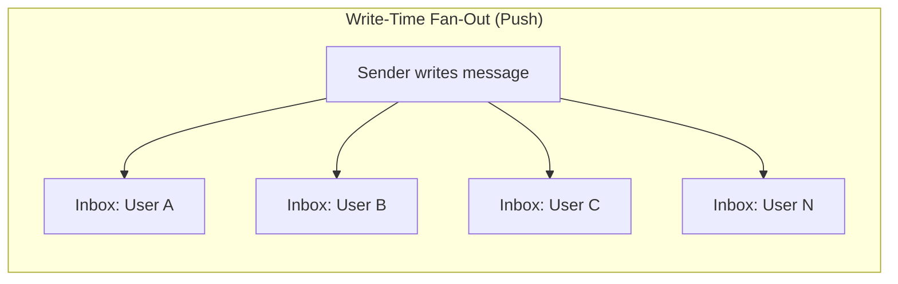
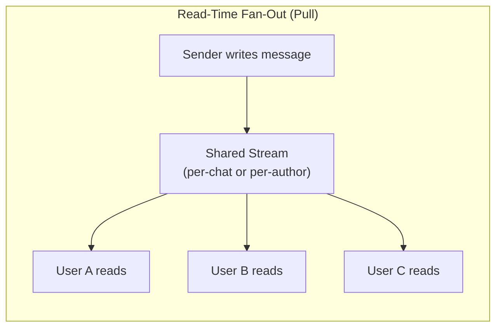
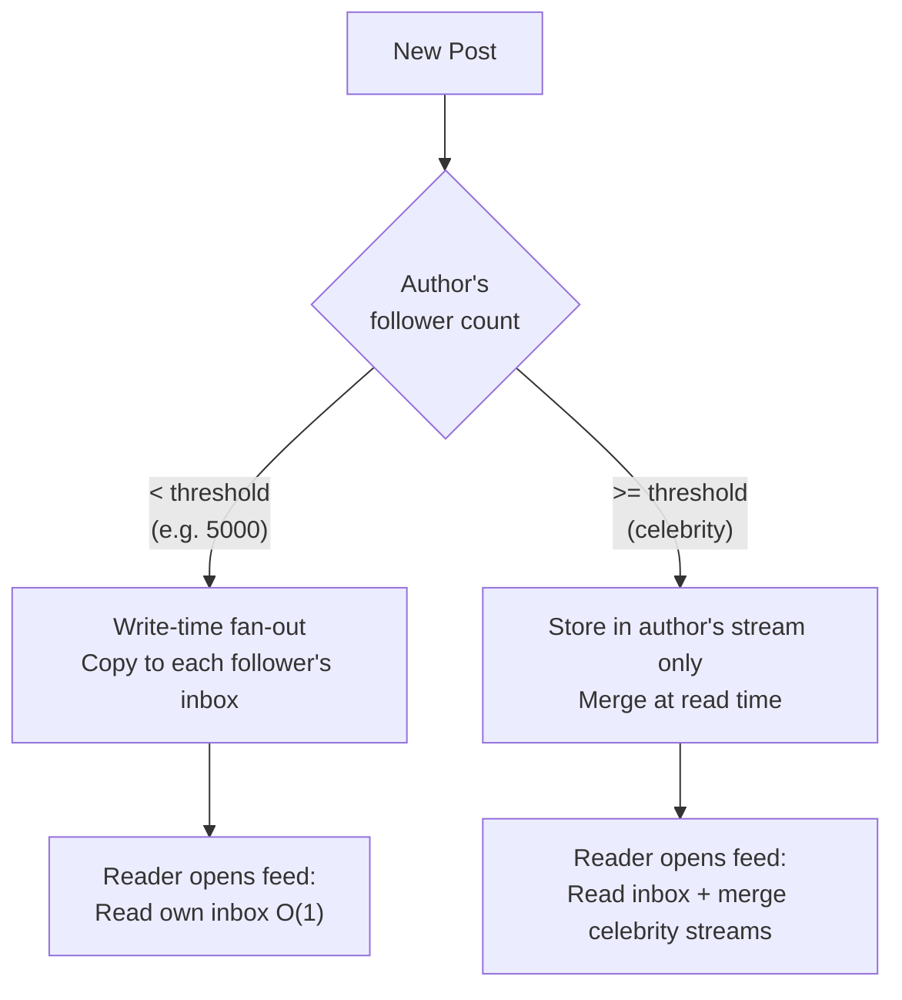

# Fan-Out: Write-Time vs Read-Time

## Mental Model

When one write must reach many readers (a message to a group, a post to followers), the system pays a distribution cost. The question is **when** to pay it:

- **Write-time fan-out (push):** pay on write — copy the item into every recipient's inbox immediately. Reads are O(1).
- **Read-time fan-out (pull):** pay on read — store the item once; each reader assembles their view by querying the source. Writes are O(1).

Neither is universally better. The optimal choice depends on the **write-to-read ratio** and the **fan-out factor** (how many recipients per write).

## Problem Being Solved

Delivering one event to N recipients without either:
- Overwhelming the write path (write amplification), or
- Making every read expensive (read amplification)

This trade-off appears in every system where content flows from producers to consumers: chat messages, social media timelines, notifications, event-driven architectures, and pub/sub systems.

## Core Mechanism





| | Write-Time (Push) | Read-Time (Pull) |
|---|---|---|
| **Write cost** | O(N) — one copy per recipient | O(1) — single write |
| **Read cost** | O(1) — read own inbox | O(sources) — merge from all followed sources |
| **Latency** | Read is instant (pre-materialized) | Read requires aggregation |
| **Storage** | N copies of each item | Single copy |
| **Stale data risk** | Inbox is always current | None — reads from source of truth |

## How It Works

### Write-Time Fan-Out

On every new message or post:

1. Resolve the recipient list (group members, followers)
2. Write a copy into each recipient's inbox (Redis sorted set, Cassandra partition, etc.)
3. Recipients read their own inbox — O(1), pre-sorted, ready to display

**Best when:**
- Groups/follower lists are small (tens to low hundreds)
- Read-to-write ratio is high (many reads per write)
- Latency matters — readers expect instant results

**Used by:** WhatsApp groups, Slack channels (small/medium), email delivery

### Read-Time Fan-Out

On every new message or post:

1. Write once to the author's or chat's shared stream
2. When a reader opens their feed, query all sources they follow and merge-sort

**Best when:**
- Fan-out factor is enormous (celebrity with 100M followers)
- Most followers never read (low engagement)
- Write throughput matters more than read latency

**Used by:** Twitter (for celebrity accounts), YouTube subscriptions, RSS readers

### The Celebrity Problem

A single write-time fan-out to 100M followers means 100M inbox writes per post. At even 1 post/minute from a celebrity, that's ~1.7M writes/sec for **one account**. This breaks any write-time system.

**Solution: hybrid fan-out.** Classify publishers by follower count:



The threshold is tunable. Twitter reportedly uses ~5000 followers as the boundary.

## Scaling Considerations

### Write Amplification Math

```
Write amplification = avg_recipients × writes_per_second

Example (WhatsApp):
  100B messages/day × avg group size 20 = 2T inbox writes/day
  = ~23M inbox writes/sec average (2T ÷ 86,400), ~46M at a 2× peak

Example (Twitter):
  500M tweets/day × avg followers 700 = 350B timeline writes/day
  = impossible without hybrid fan-out
```

### Batching and Pipelining

Write-time fan-out doesn't mean one-write-per-recipient synchronously:

- **Redis pipeline:** batch 200 inbox writes into a single round-trip (~10ms vs ~200ms)
- **Kafka partitioning:** partition by chatId so one consumer handles all recipients for a chat
- **Async workers:** decouple the write from the fan-out via a durable queue (Kafka, SQS)

### Sharding the Inbox

At scale, inboxes are sharded by userId/clientId. Each shard handles a subset of recipients, distributing the write load across nodes. Hot users (members of many active groups) create hot shards — monitor per-shard write rates and rebalance if needed.

## Failure Modes

| Failure | Impact | Mitigation |
|---------|--------|------------|
| **Fan-out worker crash mid-batch** | Some recipients get inbox entries, others don't | Idempotent writes (`messageId + clientId` as key) + Kafka replay from last committed offset |
| **Inbox storage full** | New messages can't be written | Alert on memory usage; entries are transient (deleted on ACK); if Inbox is a cache, fall back to source of truth (message table) |
| **Stale membership cache** | Fan-out uses old group membership — added members miss messages, removed members receive them | Version membership snapshots; capture recipient list at send time, not fan-out time |
| **Hot group (viral chat)** | Single Kafka partition overloaded; one consumer can't keep up | Rate-limit per chat; batch inbox writes; switch hot chats to read-time fan-out |
| **Consumer lag growing** | Inbox entries arrive late — users see "delivered" but message isn't in inbox yet | Monitor consumer lag; scale consumers up to partition count; separate lag from real-time path (which uses a different channel) |

## Trade-offs

| Dimension | Write-Time | Read-Time |
|-----------|-----------|-----------|
| **Read latency** | O(1) — pre-materialized | O(sources) — aggregation at query time |
| **Write cost** | O(N recipients) per message | O(1) per message |
| **Storage** | N× duplication | Single copy |
| **Consistency** | Inbox can be stale during fan-out lag | Always fresh (reads from source) |
| **Operational complexity** | Fan-out workers, inbox storage, idempotency | Merge logic, read-path caching, query complexity |
| **Failure blast radius** | Worker crash = partial delivery | Read service crash = no reads for anyone |

**When to switch from write-time to read-time for a specific entity:**
- Fan-out worker can't keep up (sustained consumer lag)
- A meaningful share of write amplification comes from entities above the threshold
- Most recipients don't read within the TTL window (wasted writes)

**When to stay with write-time:**
- Read-to-write ratio is high (each message is read many times)
- Latency SLO requires pre-materialized results
- Group sizes are bounded (e.g., WhatsApp max 1024 members)

## Real-World Examples

| System | Strategy | Why |
|--------|----------|-----|
| **WhatsApp** | Write-time (per-device inbox) | Groups capped at 1024; bounded write amplification; latency-critical |
| **Slack** | Write-time for DMs and small channels; read-time for large public channels | Hybrid based on channel membership |
| **Twitter/X** | Hybrid — write-time for normal users, read-time for celebrities (>5K followers) | Celebrity accounts would generate billions of writes per tweet |
| **Discord** | Read-time (per-channel stream) | Channels can have millions of members; write-time is impossible |
| **Instagram** | Write-time for feed; read-time for explore/discover | Feed has bounded follow count; explore aggregates globally |
| **YouTube** | Read-time (subscription feed merges at read time) | Creators can have 100M+ subscribers |

:::staff[The real decision is not "which one" but "where to draw the line"]
Every production system at scale uses **both** — the question is the threshold. WhatsApp can be pure write-time because groups are bounded (max 1024). Twitter can't, because follower counts are unbounded. The system design insight is recognizing that fan-out strategy is **per-entity, not system-wide**: a chat system should fan-out small groups at write time and flip individual hot groups to read-time when they cross the threshold. The monitoring signal is consumer lag on the fan-out worker — sustained lag for a single entity means that entity should switch.
:::

## Related Concepts

- [Apache Kafka](/building-blocks/kafka) — durable queue between write acceptance and fan-out execution
- [Redis](/building-blocks/redis) — sorted sets for inbox storage; Streams for server-to-server real-time push
- [Idempotency](/patterns/idempotency) — safe replay after fan-out worker crash
- [Rate Limiting](/patterns/rate-limiting) — throttling hot groups to protect fan-out workers
- [Circuit Breaker](/patterns/circuit-breaker) — fail-fast when inbox storage is degraded
- [Bulkhead](/patterns/bulkhead) — isolate fan-out worker pools per priority tier
