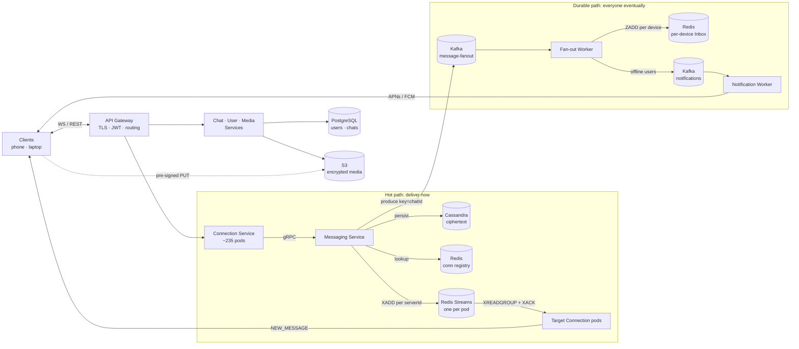

### TL;DR {#cs-chat-tldr}

:::tip[The design in 30 seconds]
- **Edge:** clients hold a WebSocket through an L7 API Gateway (TLS, JWT checked once on the upgrade, `/ws` vs `/v1/*` routing) to a stateful **Connection Service** (~640K connections/pod, ~235 pods). REST handles the cold path: chat CRUD, Inbox sync, receipt sync, presence, media URLs.
- **Send:** Connection Service → gRPC → stateless **Messaging Service**. It validates membership, snapshots the recipient devices, assigns `messageId` + server timestamp, and persists ciphertext to **Cassandra** (partition `chatId`) plus a durable fan-out intent (outbox row), produces to Kafka with `acks=all`, and only then acks `SENT`. If Kafka is degraded it acks once the outbox row is durable and a relay publishes later.
- **Two delivery layers run in parallel:** *real-time*: look up `conn:{userId}` in Redis, batch by `serverId`, `XADD stream:{serverId}`, the pod's `XREADGROUP` loop pushes over WS (~5-10ms). *Durable*: Kafka `message-fanout` (key `chatId`, carries `recipientSnapshot` + `membershipVersion`) → Fan-out Worker → per-device `inbox:{clientId}` Redis sorted set (~30ms), then the `notifications` topic → APNs/FCM for offline users.
- **E2E encryption:** Signal (X3DH + Double Ratchet) for 1:1 chats and Sender Keys for groups. The server is a public-key directory and a blind router. Ciphertext is logically deleted once every device ACKs (never served again) and physically expires via a 30-day TTL + TWCS; search and history live on the client.
- **Everything is per device:** `Client` is a first-class entity with its own keys, socket, Inbox and ACK state. Receipts live in `status:{messageId}` (per device) and `recipient-status:{messageId}` (per user) and go **only to the sender**.
- **Presence comes from the same registry:** the 30s client heartbeat is answered in-process (no Redis write); each pod refreshes its endpoints every 60s to `now + 120s` in a pipelined batch (~2.5M `ZADD`/s cluster-wide). Clean close = immediate `ZREM`; a crashed pod's users go offline within 120s. PG `last_seen` is written only when the last endpoint disappears. Clients pull presence.
- **Correctness invariant:** snapshot recipients before fan-out, make the message and fan-out intent durable before `SENT`, make writes idempotent by `messageId + clientId`, and have clients dedupe by `messageId`.
:::

### Scale {#cs-chat-scale}

<StatGrid stats={[
  {value: '500M', label: 'Daily active users', detail: '~30% online at once', accent: 'blue'},
  {value: '100B', label: 'Messages / day', detail: '~1.16M/s average', accent: 'purple'},
  {value: '~2.3M/s', label: 'Peak send QPS', detail: '2x average', accent: 'green'},
  {value: '~150M', label: 'Concurrent WebSockets', detail: '500M DAU x 30%', accent: 'cyan'},
  {value: '~235', label: 'Connection Service pods', detail: '640K connections each', accent: 'amber'},
  {value: '~20 TB', label: 'New message data / day', detail: '100B x 200 bytes, ~7.3 PB/yr', accent: 'red'},
]} />

**Numbers to remember**
- **Connections:** ~50KB per connection, 64GB server (50% for sockets) → **640K/pod** (tuned event-loop server; 100-200K is the conservative default elsewhere) → 150M ÷ 640K ≈ **235 pods** → **~235 streams** (`stream:{serverId}`).
- **Registry:** 150M keys ≈ **~20GB** in Redis Cluster. Heartbeats stay in-process; pods refresh every 60s → 150M ÷ 60s ≈ **2.5M pipelined `ZADD`/s** (vs ~5M/s if every 30s heartbeat wrote). None of it goes to PostgreSQL.
- **Traffic shape:** read:write ≈ **5:1**, average group = **20 members**.
- **Fan-out batching:** 200 members / 250 devices across ~30 pods → **30 `XADD`s**, not 250.
- **Latency budget:** Inbox fan-out ≈ 5 (produce) + 5 (replication) + 10 (poll) + 10 (200-entry pipeline) = **~30ms** (recipients come from the event snapshot, no lookup). WS push ≈ **5-10ms**. Both are well inside 500ms.
- **Kafka:** `message-fanout` has **200 partitions** (max 200 workers), RF 3, `min.insync.replicas` 2. `notifications` has **32 partitions**, RF 3.
- **Media:** ~1% of messages carry media (~1B uploads/day). Routing ~5MB avg × 1B uploads/day through servers ≈ **5 PB/day**, hence pre-signed URLs.
- **Receipts:** a 200-member group with broadcast receipts = **40K** WS pushes per message. Sender-only = **200** (a 200× reduction).
- **Hot chat:** 500 members × 100 msgs/s = **50K Inbox writes/s** on one partition.

### Requirements {#cs-chat-requirements}

| FR | Requirement | Satisfied by |
|----|-------------|--------------|
| FR1 | Create 1:1 or group chat | `POST /v1/chats` → Chat Service PG transaction → `CHAT_CREATED` push |
| FR2 | Add / remove participants | `PUT /v1/chats/:chatId/participants` → PG + cache refresh + `membership-events` → clients rotate Sender Keys |
| FR3 | Send and receive text messages | `SEND_MESSAGE` → Messaging Service → Cassandra + Redis Streams push + Kafka fan-out |
| FR4 | Receive messages sent while offline | `inbox:{clientId}` + cursor-paginated `GET /v1/inbox` + push wake-up |
| FR5 | Upload and share images / videos | Client-side encryption + pre-signed S3 URL + `UPLOAD_COMPLETE` / HEAD check |
| FR6 | Delivery and read receipts | `ACK` / `READ` → status hashes → `MESSAGE_ACK` to sender; `GET /v1/sync/status` |
| FR7 | Search messages within a chat | Client-side only (SQLite / IndexedDB); server holds ciphertext |
| FR8 | Online status and last seen | Live member in `conn:{userId}`, else PG `last_seen`; pull via `GET /v1/users/:userId/presence` |
| FR9 | Multi-device, independent sync per device | `Client` entity: per-device endpoint, Inbox, key bundle, ACK state |

| NFR (LSDARO) | Target | Mechanism |
|--------------|--------|-----------|
| **L**atency | Delivery under 500ms (p99) | WS push via Redis Streams; Kafka kept off the hot path |
| **S**cale | 100B msgs/day, ~2.3M/s peak, 150M sockets | ~235 Connection pods, batch-by-server, Kafka 200 partitions, Cassandra |
| **D**urability | Zero loss; E2E (ciphertext only, not served after delivery, TTL-expired) | Outbox row + Kafka `acks=all` before `SENT`; outbox relay; Kafka `acks=all`; idempotent Inbox writes; Cassandra backs Redis (AOF `everysec`) |
| **A**vailability | 99.99% | Stateless services, Redis replica failover, Cassandra RF=3 `LOCAL_QUORUM`, active-passive regions |
| **R**esiliency | Graceful degradation | Kafka as shock absorber, circuit breaker, Redis bulkhead, shed push first |
| **O**bservability | Delivery p50/p99, fan-out lag, registry health, error rates | Per-hop USE/RED, SLO burn-rate alerts, end-to-end `traceparent` |

**Out of scope:** audio/video calls, status/stories, profile and settings, spam detection, ad analytics.

### Entities & Stores {#cs-chat-stores}

Entities: **User**, **Chat** (1:1 and group handled the same way), **Message** (media metadata embedded), **Client**, a first-class device entity because keys, socket and sync state are per device.

| Store | Tech | Key / partition | Holds | Why this tech |
|-------|------|-----------------|-------|---------------|
| User, Client, Chat, ChatParticipants | PostgreSQL | PK `id`; `PRIMARY KEY (chat_id, user_id)` + index on `user_id`; unique `phone` | Profiles, key bundles, push tokens, membership | Small, relational, joins, strong consistency |
| Membership cache | Redis | `chat:{chatId}:members` | Hot-path membership check on every send | Hit rate >99.9% because membership rarely changes |
| Message | Cassandra | Partition `chat_id`, clustering `(timestamp DESC, message_id DESC)` (no same-ms overwrites), 30-day TTL, TWCS 1-day windows | Ciphertext + `mediaUrl` / `mediaType` + `status` (`UPLOADING` / `SENT`); logically deleted after all ACKs, physically by TTL (no tombstones) | 100B writes/day; single-partition reads; no secondary indexes |
| Inbox | Redis sorted set | `inbox:{clientId}`, member `messageId`, score = epoch ms | Per-device undelivered queue | High insert/delete churn would cause tombstone storms in Cassandra. `ZREM` deletes cleanly |
| MessageStatus | Redis hash | `status:{messageId}`, field `clientId` | `SENT` / `DELIVERED` / `READ` per device | True in-place `HSET`; deleted with the message |
| RecipientMessageStatus | Redis hash | `recipient-status:{messageId}`, field `userId` | Sender-visible aggregate per recipient user | Aggregate ticks without a per-member fan-out |
| Connection Registry | Redis sorted set | `conn:{userId}`, member `{clientId}\|{serverId}\|{connId}`, score `expiresAtEpochMs` (pod refreshes every 60s to now + 120s) | Live endpoints; also the presence source | Per-connection expiry (a hash TTL would cover the whole user) |
| Delivery bus | Redis Streams | `stream:{serverId}` (~235), one consumer group per pod, `MAXLEN ~` | Batched delivery instructions per pod | Durable if the pod is briefly down (Pub/Sub is not) |
| Event log | Kafka | `message-fanout` (key `chatId`), `notifications` (key `userId`), `membership-events` | Durable fan-out, push events, cache invalidation | Replay, per-chat ordering, backpressure |
| Media | S3 | `media/{chatId}/{messageId}/file.enc`, `thumb.enc` | Encrypted blobs + thumbnails | 11-nines durability, pre-signed URLs, UUID keys avoid hot prefixes |

### API {#cs-chat-api}

| Direction | Frame / Endpoint | Purpose |
|-----------|------------------|---------|
| WS client→server | `SEND_MESSAGE` | `chatId`, ciphertext `content`, optional `mediaUrl` / `mediaType` |
| | `ACK` | Device received `messageId` → DELIVERED, removed from that device's Inbox |
| | `READ` | Device opened the chat → READ |
| | `REQUEST_UPLOAD` / `UPLOAD_COMPLETE` | Get pre-signed URLs / confirm upload, which triggers fan-out |
| | `HEARTBEAT` | Every 30s: keeps the socket alive; answered in-process (the pod refreshes the registry separately every 60s) |
| | `SYNC_SENT_STATUS` | On reconnect: receipts missed for messages this device sent, `since` = this device's receipt-sync cursor |
| WS server→client | `NEW_MESSAGE` | `chatId, messageId, senderId, content, timestamp` |
| | `MESSAGE_ACK` | `delivered` / `read` per `userId`, or `all_delivered` aggregate (sender only) |
| | `CHAT_CREATED` / `CHAT_UPDATED` | Membership pushed to online devices |
| | `UPLOAD_URL` | `messageId, uploadUrl, thumbnailUploadUrl` |
| REST (cold) | `POST /v1/chats`, `PUT /v1/chats/:chatId/participants` | Create chat / change membership |
| | `GET /v1/inbox?before={cursor}&limit=50` | Paginated undelivered messages. The cursor is an epoch-ms timestamp, read with `ZREVRANGEBYSCORE inbox:{clientId} (cursor -inf LIMIT 0 50` |
| | `GET /v1/sync/status?since={timestamp}` | REST twin of `SYNC_SENT_STATUS`: receipts missed while offline, `since` = the device's receipt-sync cursor (not `last_seen`) |
| | `GET /v1/users/:userId/presence` | Online or `last_seen` (pull) |

Inbox sync uses REST so a large backlog doesn't swamp the WS, which stays free for live messages. There is no history API because the server stops serving ciphertext once it is delivered (a TTL removes it later).

### Architecture {#cs-chat-architecture}

### Key Flows {#cs-chat-flows}

**Send message (online recipient)**
1. The device sends `SEND_MESSAGE` (ciphertext) over WS. The Connection Service forwards it over gRPC to the Messaging Service, attaching the authenticated sender.
2. The Messaging Service validates the sender against the cached membership version, captures the recipient-device snapshot plus `membershipVersion`, and assigns `messageId` and the server timestamp.
3. It persists ciphertext and fan-out intent in Cassandra, produces to `message-fanout` (`acks=all`, key `chatId`), then acks `SENT`. If it crashes after persisting, an outbox relay republishes the same `messageId`.
4. In parallel, it runs `ZRANGEBYSCORE conn:{userId} (now +inf` per recipient, groups endpoints by `serverId`, and issues one `XADD stream:{serverId}` per pod.
5. The target pod's `XREADGROUP GROUP cg-{serverId} ... BLOCK 0 STREAMS stream:{serverId} >` loop pushes `NEW_MESSAGE` to each listed `connId`, then `XACK`s the entry (on restart it first drains its pending entries with `... 0`). The recipient sends `ACK`.
6. The Kafka path still writes the Inbox entry, so the device may see the message twice and dedupes by `messageId`.

**Offline recipient + reconnect sync**
1. The Fan-out Worker consumes `message-fanout` (ordered per `chatId`) and uses the captured snapshot. It does not re-read membership.
2. For each target device: `ZADD inbox:{clientId} <ts> messageId` (idempotent on `messageId + clientId`). It commits the Kafka offset only after these writes.
3. If the user has no live endpoint, it produces to `notifications`. APNs/FCM sends a wake-up signal only, and the ciphertext stays in the Inbox.
4. On reconnect: WS upgrade + JWT, then **register in `conn:{userId}` before backfill**, so a message arriving during sync is pushed live rather than lost.
5. The device pages `GET /v1/inbox`, ACKs each message (`ZREM` from **this device's** Inbox only), and dedupes against live pushes.
6. If the Redis Inbox is lost, the device sends `lastReceivedTimestamp` and the server rebuilds from Cassandra for that device's chats. This is slower but correct.

**Multi-device**
1. Each device is a `Client` with its own key bundle, `connId` per socket, and `inbox:{clientId}`.
2. `conn:{userId}` holds one member per socket, each scored by its own expiry. A crashed phone's entry expires without touching the live laptop, and one device can never keep another falsely online.
3. Routing returns every live endpoint (batched per server). Fan-out writes one Inbox entry per device.
4. A phone ACK never deletes the laptop's pending copy. History on a new device comes from encrypted cloud backup (user passphrase).

**Delivery / read receipts**
1. Device `ACK` → `HSET status:{messageId} {clientId} DELIVERED`.
2. `HSET recipient-status:{messageId} {userId} DELIVERED`. The first verified device is enough for that user.
3. `MESSAGE_ACK` goes fire-and-forget to the **sender only**, never to the other group members.
4. Group ticks: `HGETALL recipient-status:{messageId}`. When the last recipient user transitions, the server pushes `MESSAGE_ACK all_delivered` (double tick). All READ = blue tick.
5. `READ` follows the same path with `READ`.
6. If the sender is offline, each of their devices sends `SYNC_SENT_STATUS` (REST: `GET /v1/sync/status?since={timestamp}`) on reconnect with its own receipt-sync cursor. The server answers from `MessageStatus` (per device) and `RecipientMessageStatus` (per-user aggregate). There is no receipt event log.

**Media upload**
1. The client encrypts the file and thumbnail locally and generates a media key.
2. `REQUEST_UPLOAD` → the server creates `messageId` and pre-signed URLs (1h TTL, size limits in URL conditions, e.g. 100MB video / 16MB image) and writes the Message row as `UPLOADING`, then returns `UPLOAD_URL`.
3. The client PUTs both blobs directly to S3 (`media/{chatId}/{messageId}/file.enc`, `thumb.enc`).
4. `UPLOAD_COMPLETE` → the server runs a HEAD check (~5ms), sets status `SENT` with an outbox intent, and triggers Kafka fan-out. Client notification is used instead of S3 events, which are eventually consistent.
5. The media key rides inside the E2E message body, so recipients download and decrypt locally. Objects are deleted when the message is logically deleted (all devices ACKed), with an S3 lifecycle rule at 30 days (same as the Message TTL) as a safety net.

**Presence / last seen**
1. Connect: `ZADD conn:{userId} now+120s "{clientId}|{serverId}|{connId}"`. The 30s heartbeat is answered in-process by the pod; every 60s the pod pipelines `ZADD XX` for all its endpoints to now + 120s (~2.5M/s cluster-wide).
2. Online = any non-expired member: `ZRANGEBYSCORE conn:{userId} (now +inf`.
3. Clean close (or 2 missed heartbeats): `ZREM` that endpoint. If none remain, run `UPDATE users SET last_seen = NOW` in PostgreSQL.
4. Pod crash: its endpoints stop being refreshed and expire within 120s; readers ignore them and a sweeper later runs `ZREMRANGEBYSCORE conn:{userId} -inf now`. Presence and `last_seen` can be up to ~120s stale.
5. Clients pull presence via `GET /v1/users/:userId/presence`. Push would mean fanning every connect/disconnect out over the social graph.

**Notifications**
1. The Fan-out Worker finds no live endpoint and publishes `{ userId, chatId, senderName, preview }` to `notifications` (key `userId`, 32 partitions).
2. The Notification Worker looks up device tokens (Client table) and sends APNs/FCM, one per device.
3. It batches per user, at most 1 push per 5s ("Alice: 50 new messages" instead of 50 pushes).
4. Content is "New message from [sender]" because the server can't read the message. A push is a best-effort signal to open the app (4KB cap, no ordering), not delivery.
5. Under stress, notifications are shed first. They use a separate consumer group from fan-out.

### Decisions {#cs-chat-decisions}

| Topic | Chosen | Rejected | Why | Revisit when |
|-------|--------|----------|-----|--------------|
| Transport (§3) | WebSocket + REST cold path | Polling, HTTP per message, SSE, WebRTC | Bidirectional, persistent, low latency. WebRTC has no server persistence or offline delivery | — |
| Connection registry (5.1) | Redis Cluster, sorted set `conn:{userId}` with per-endpoint expiry; pod-local heartbeats, pipelined 60s refresh, 120s expiry | ZooKeeper, consistent hashing, gossip; hash + single TTL | O(1) at 150M keys. ZK too slow, hashing too rigid (mass reconnect), gossip too laggy | — |
| Server-to-server (5.1) | Redis Streams, one per pod (~235), batched by destination | Pub/Sub, Kafka, direct RPC; stream per chat or per user | Durable if the subscriber is down. Each pod reads exactly one stream. Kafka too heavy for dynamic routing | — |
| Ordering (5.2) | Server timestamp + `messageId` tiebreaker | Per-chat sequencer, vector clocks | Zero coordination on a 2.3M/s path. Same-sender and reply-after-read order already guaranteed | Order becomes semantic (edits/deletes racing sends, polls, threads) → per-chat seq, e.g. Kafka offset of the `chatId` partition |
| Message store (5.3) | Cassandra, `PRIMARY KEY ((chat_id), timestamp, message_id)`, 30-day TTL, TWCS | PostgreSQL, DynamoDB; per-row `DELETE` on ACK | Massive write volume, single-partition reads, no tombstones. Gives up strong consistency; delivered ciphertext lingers until TTL | — |
| Inbox / receipts store (5.3) | Redis sorted set / hashes, AOF `everysec` | Cassandra | Churn (insert-delete, in-place flips) creates tombstones. Cassandra is the backstop | Redis memory dominated by never-syncing users → tier cold Inboxes to Cassandra |
| Metadata (5.3) | PostgreSQL + Redis membership cache | Full NoSQL | Joins and strong consistency for small, stable data | — |
| Encryption (5.4) | Signal X3DH + Double Ratchet for 1:1; Sender Keys for groups | Pairwise group encryption | Forward secrecy + break-in recovery. O(1) vs O(N) per message, and messages far outnumber membership changes | — |
| New-device history (5.4) | Encrypted cloud backup (passphrase) | Signal-style no backup | UX over maximum privacy | — |
| Fan-out pipeline (5.5) | Kafka keyed by `chatId` | Redis Streams only, direct writes | Durability, per-chat order, replay, backpressure for ~30ms extra | — |
| Two layers (5.5) | Redis Streams (now) + Kafka (eventually) | Single layer | Latency and durability SLOs don't fight. Cost: two systems + duplicates (client dedupe) | Kafka p99 approaches Redis Streams, or two-pipeline ops cost outweighs the win |
| Fan-out timing (5.5, 6.2) | Write-time + per-chat rate limit + batched writes | Read-time everywhere | ~20-member groups and 5:1 read:write make O(1) reads worth O(N) writes | Hot chats sustained (a meaningful share of fan-out writes above the threshold) → flip **that chat** to read-time |
| Receipts (5.6) | Sender-only, current-state hashes | Broadcast to group, receipts through the Inbox, event log | 200 vs 40K pushes. Avoids 2×N Inbox writes. Loses transition timestamps | — |
| Media (5.7) | Pre-signed URL direct to S3, client notifies, HEAD verify | Upload via Chat Server, S3 event notifications | Zero server bandwidth. S3 events are eventually consistent | — |
| Notifications (5.8) | Kafka `notifications` → APNs/FCM, no content preview | Server-generated preview | Durable and replayable. Server can't read E2E content | — |
| Presence (5.9) | Derived from registry, pull-based, PG `last_seen` on last disconnect | Push presence, heartbeats to PG | Social-graph push too costly at 500M DAU. Millions of registry refreshes/s to PG impossible. Crash staleness ≤120s | — |
| Multi-region (6.4) | Active-passive, DNS failover (~60s) | Active-active | Avoids cross-region ordering, conflict resolution, split-brain. Redis is rebuilt from Cassandra, not replicated | Per-region **latency** complaints → home each chat to a region first |
| Metric cardinality (5.11) | Bounded labels + exemplars + tail-sampled traces | Per-user / per-chat labels | Per-user labels would mean tens of billions of series. Per-user debugging goes through traces/logs by `messageId` | Escalations unresolvable from sampled data → per-message events in a columnar store (ClickHouse/Pinot), never `userId` labels |
| Search (FR7) | Client-side local DB | Server-side index | Server only holds ciphertext | — |

### Failure Modes {#cs-chat-failures}

| Scenario | Impact | Mitigation |
|----------|--------|------------|
| Deploy / pod restart (thundering herd) | ~640K reconnects per pod hit Inbox sync + registry | Client jitter 0-5s, graceful drain (announce 30s early), rolling one pod at a time, gateway caps new WS/sec per pod, autoscale as safety net |
| Hot chat (viral group) | 500 × 100 msgs/s = 50K Inbox writes/s on one Kafka partition | Rate limit 10 msgs/s per chat ("slow down"), batch Inbox writes per chat, flip to read-time above threshold (e.g. > 50 msgs/min) |
| Messaging Service slow | Backs up into Connection Service and users | Circuit breaker (p99 > 500ms → fail fast "try later"), 200ms gRPC timeout, client backoff |
| Kafka producer backs up | Fan-out delayed | Kafka absorbs; degraded mode acks `SENT` once the outbox row is durable and the relay publishes on recovery; bounded in-flight requests |
| Fan-out consumer lag | Inbox stale, "not delivered" | Alert > 10s, page > 60s; scale to 200 consumers; pause notifications; separate consumer groups |
| Redis slow (Inbox pressure) | Could starve routing | Bulkhead: separate pools for Inbox vs Registry; retry + dead-letter queue |
| Connection pod crash | ~640K users disconnect | Reconnect with jitter; un-refreshed registry entries expire within 120s |
| Registry shard down | Can't route to affected users | Replica promotion (~seconds); real-time push skipped for affected users, Kafka → Inbox still delivers on next sync. Broadcast fallback infeasible at ~2.3M msg/s × ~235 pods |
| Inbox shard down / memory full | Can't write/read Inbox | Failover; rebuild from Cassandra; alert on memory; evict oldest with Cassandra fallback |
| Cassandra node down | Persistence fails for affected partitions | RF=3 + `LOCAL_QUORUM` survives 1 node; hinted handoff |
| Kafka broker down | Fan-out stalls on its partitions | Leader election (~seconds); real-time path unaffected |
| All Messaging / Fan-out instances down | No new messages / no Inbox writes or pushes | Kafka buffers and retains; breaker returns "try later"; replay from last offset |
| Region down | Full outage in region A | DNS failover (~60s); PG async replica promotes (small loss window); Cassandra `NetworkTopologyStrategy` RF=3 per region; Redis Inbox rebuilt from Cassandra; Kafka MirrorMaker |

### Observability {#cs-chat-observability}

- **SLOs (28-day):** delivery latency p99 under 500ms (server accept → recipient ACK, measured server-side to avoid device clock skew); delivery completeness **99.999%** (Inbox entries for all participants within 60s); send availability **99.99%**; connect availability **99.99%** (client-measured); Inbox sync p99 under 300ms.
- **Infra (USE):** open WS connections per pod (warn > 80% of capacity); fd usage (page > 90% of ulimit); GC pause p99 (warn > 200ms, because stalled heartbeats cause mass false disconnects and presence flapping); OOMKills.
- **Dependencies:** Redis Stream lag per server (page > 5s); `message-fanout` lag per partition (warn > 10s, page > 60s); `notifications` lag (ticket > 5 min); Cassandra p99 write (warn > 20ms) and tombstones / pending compactions; Redis memory (warn > 75%, **page on any Inbox eviction**); Redis p99 **per pool** (warn > 5ms, verifies the bulkhead); membership cache hit ratio (warn under 99%).
- **App (RED):** per WS frame type (`SEND_MESSAGE`, `ACK`, `READ`, `REQUEST_UPLOAD`); breaker open > 1 min → page; ACK timeout rate > 1%; DLQ depth growth → page.
- **Business:** messages sent/s vs. same time last week (page on > 20% drop, because no requests means no errors); Inbox depth p99; push fallback rate; receipt completion within 1 min.
- **Alerting:** page on symptoms via multi-window burn rate (e.g. 14× over 1h confirmed by 5m). Causes become tickets, **except** fast ones: fd exhaustion, Inbox evictions, stuck stream, DLQ growth.
- **Tracing:** W3C `traceparent` flows from `SEND_MESSAGE` through gRPC metadata, Kafka headers, Stream entry fields, `NEW_MESSAGE` and `ACK`, with `messageId` logged at every hop. Fan-out uses span links (~30 per-server deliveries). Sampling: 0.1% head (~2K traces/s) plus 100% tail sampling of slow (> 500ms) or errored traces.
- **Hygiene:** metadata-only structured logs. Never log content, media keys or preview blobs. Pseudonymize user IDs. Bounded labels only (region, pod, `serverId` ~235, partition 200, frame type, status). Hot chats are found via a top-K sketch.

### Concept Crib {#cs-chat-concepts}

| Concept | What to remember for this design | Link |
|---------|----------------------------------|------|
| WebSocket connection management | Memory is the limit (~50KB/conn), not ports; 1 socket = 1 fd. Register **before** backfill (duplicates, never loss). Keep the stateful gateway dumb and the business logic stateless. Heartbeat below the LB idle timeout (often 60s). Only the client ACK means delivered; `XACK` just means the bus entry was taken | [WebSocket Mgmt](/building-blocks/websocket-connection-management) |
| Server-to-server | Pub/Sub is fire-and-forget (~1ms). Streams are durable with ACK/replay (~2-5ms) and need `MAXLEN` trimming. Kafka is wrong for dynamic per-server routing. Batch by destination turns N publishes into K | [Server-to-Server](/building-blocks/server-to-server-communication) |
| Redis | Single-threaded, so every command is atomic. `ZREM` is a clean delete with no tombstones. AOF `everysec` loses at most ~1s. Cluster uses 16384 hash slots with async replicas (small loss on failover). Hash tags like `{userId}` co-locate keys | [Redis](/building-blocks/redis) |
| Kafka | Ordering holds only within a partition, so key = `chatId`. Max consumers = partitions. `acks=all` + idempotent producer + RF 3 / `min.insync.replicas` 2. Commit after processing + idempotent consumer = effectively once. Alert on lag | [Kafka](/building-blocks/kafka) |
| Cassandra | `HashMap<PartitionKey, SortedMap<ClusteringKey, Row>>`: single-partition reads are fast. Deletes write tombstones (`gc_grace_seconds` 10 days), so no queue patterns. TWCS drops whole SSTables when TTL expires. Use `LOCAL_QUORUM` for multi-DC. Conflicts resolve last-write-wins | [Cassandra](/building-blocks/cassandra) |
| SQL vs NoSQL | Pick the store per table by access pattern. A single PG handles ~10K-50K writes/s. Cassandra fits > 100K writes/s, append-heavy data. Redis fits high-churn, queue-like data | [SQL vs NoSQL](/decisions/sql-vs-nosql) |
| E2E encryption | The server stores public Key Bundles (IK, SPK + signature, OPKs consumed one per new conversation). Double Ratchet gives forward secrecy + break-in recovery. Sender Keys cost O(1) per message, but removing a member forces everyone to rotate (O(N²)). Metadata is **not** protected | [E2E Encryption](/building-blocks/e2e-encryption) |
| S3 / object storage | Pre-signed URLs are scoped to key, method, expiry and `Content-Length-Range`. Strong read-after-write consistency means the HEAD check always sees the upload. Limits are 3,500 PUT / 5,500 GET per sec per prefix, so UUID keys spread load. S3 events are eventually consistent and at-least-once | [S3](/building-blocks/s3-object-storage) |
| API Gateway | L7 for path routing. JWT is validated **once** on the WS upgrade with a local signature check (no Auth Service call). Least-connections balancing for long-lived sockets. On token expiry, close the socket or refresh over WS. Common setup: L4 in front of L7 | [API Gateway](/building-blocks/api-gateway) |
| Fan-out | Write-time costs O(N) writes for O(1) reads; read-time is the reverse. Strategy is chosen **per entity** against a threshold. Capture the recipient list at send time. Sustained lag on one entity is the signal to switch it. WhatsApp groups are capped at 1024 | [Fan-Out](/patterns/fan-out) |
| Rate limiting | Sliding-window counter is the best default (1 GET + 1 INCR, ~1-2% error). Token bucket allows bursts. If Redis is down, fail open with local counters. Used here for the per-chat cap and gateway connection caps | [Rate Limiting](/patterns/rate-limiting) |
| Observability | Alert on symptoms (top of the stack) and debug down it. Use USE for resources and RED per frame type. Lag in seconds beats lag in messages. Exemplars link a p99 spike to a trace. Never log user content | [Observability](/foundations/observability) |
| Consistent hashing | Only ~1/N keys move on a change, but for WS routing a pod change still forces mass reconnects and pins all of a user's devices to one server, so it was rejected. Redis uses hash slots instead; Cassandra uses Murmur3 + vnodes | [Consistent Hashing](/distributed-systems/consistent-hashing) |

Stub pages with nothing beyond the design-page facts above: [PostgreSQL](/building-blocks/postgresql), [gRPC](/building-blocks/grpc), [Push Notifications](/building-blocks/push-notifications), [Presence & Heartbeat](/patterns/presence-heartbeat), [Idempotency](/patterns/idempotency), [Circuit Breaker](/patterns/circuit-breaker), [Bulkhead](/patterns/bulkhead), [Multi-Region & Failover](/distributed-systems/multi-region-failover), [Message Queues](/building-blocks/message-queues), [CQRS](/patterns/cqrs), [Consistency Models](/foundations/consistency), [Replication](/distributed-systems/replication).

### Staff Talking Points {#cs-chat-staff}

:::staff[What makes this answer senior]
- **"Deliver now" vs "everyone eventually."** Redis Streams and Kafka are split so the latency SLO and the durability SLO never compete for the same knob. Real-time push is an optimization, not the guarantee. The price is two pipelines plus a duplicate window, which client dedupe on `messageId` absorbs.
- **Four rules make async chat correct without a distributed transaction:** recipient snapshot fixed before fan-out, ciphertext and fan-out intent durable before `SENT`, every write idempotent by `messageId + clientId`, every client dedupes by `messageId`.
- **Pick stores by churn, not volume.** Inbox and receipts live in Redis because insert-then-delete and status flips generate tombstones in an LSM store. Redis is a cache of recoverable truth: losing it costs latency, not messages.
- **E2E reshapes the server, not just the payload.** A blind router that can't serve history doesn't need to keep it, and that is what enables logical delete-on-ACK, TTL-expired TWCS SSTable drops and a bounded Inbox.
- **Choose a weaker guarantee on purpose.** Timestamp ordering avoids a per-chat sequencer hot spot, and the causal cases users notice are already guaranteed. Sender-only receipts are a product decision that removes a 200× receipt storm.
- **Under stress, shed the cheapest work first:** real-time delivery > Inbox durability > push. The most common thundering herd is our own deploy, so fix it with client jitter and the rollout process, not extra capacity.
:::

### Likely Follow-ups {#cs-chat-followups}

| Question | Crisp answer |
|----------|--------------|
| Why not Kafka for real-time delivery too? | ~10-50ms from batching and poll intervals, and per-server topics are heavy to create and destroy as pods scale. Redis Streams is ~2-5ms with one stream per pod. |
| Why Streams instead of Redis Pub/Sub? | Pub/Sub drops messages if the subscriber pod is briefly down. Streams buffer until the pod reads, at the cost of ~1-4ms and trimming. |
| The server crashes after the Cassandra write but before Kafka confirms. Lost? | No. The fan-out intent is durable, and an outbox relay republishes the same `messageId`. Inbox writes are idempotent on `messageId + clientId`. |
| Recipient's socket dies just as we push. | Push is best-effort. The Kafka path still writes `inbox:{clientId}`. The device registers before backfill on reconnect, so it gets the message via Inbox sync (dedupe by `messageId`). |
| The whole Redis Inbox cluster is lost? | Devices send `lastReceivedTimestamp` and the server rebuilds from Cassandra (slower, correct). Lost receipts degrade to "sent". AOF `everysec` caps loss at ~1s otherwise. |
| A member is removed while a message is in flight? | The message carries `membershipVersion` and a recipient-device snapshot taken at send time, so the worker never re-reads membership. Clients rotate Sender Keys after the change. |
| A 500-member group goes viral? | Cap at 10 msgs/s per chat, batch Inbox writes per chat, and flip that one chat to read-time fan-out (per-chat stream, Discord model) above the threshold. |
| Why not consistent hashing users to servers? | Adding or removing a WS server forces mass reconnects, and a user's devices get pinned to one server. Redis Cluster moves registry slots without touching sockets. |
| How do you prove the 500ms SLO? | Measure server accept → recipient ACK on the server (no device clock skew), alert on burn rate, and use exemplars plus tail-sampled traces to find the slow hop. |
| How do search and new devices work if the server can't read messages? | Search runs over the client's local DB. History comes from an encrypted cloud backup with a user passphrase. The server only ever held ciphertext, temporarily. |

→ [Full design](/problems/messaging/chat-system)
