import CheatSheet from '@site/src/cheatsheets/chat-system';

# Chat System

Design a real-time messaging system similar to WhatsApp or Slack.

<CheatSheetToggle>
  <CheatSheet />
</CheatSheetToggle>

## 1. Requirements

### Functional Requirements
1. **FR1**: User should be able to create a chat (individual or group) — handled similarly
2. **FR2**: User should be able to add or remove participants in a chat
3. **FR3**: User should be able to send and receive text messages in a chat
4. **FR4**: User should receive all chat messages sent while offline
5. **FR5**: User should be able to upload and share media files (images, videos) in a chat
6. **FR6**: User should see message delivery and read receipts
7. **FR7**: User should be able to search messages within a chat
8. **FR8**: User should see other users' online status and "last seen" time
9. **FR9**: User can be signed in on multiple devices simultaneously — messages are delivered to all active devices, and each device maintains independent sync state

### Non-Functional Requirements (LSDARO)
1. **NFR1 — Latency**: Message delivery should be near real-time (&lt; 500ms)
2. **NFR2 — Scale**: System should support 100 billion messages per day
3. **NFR3 — Durability**: Zero message loss — guaranteed message delivery; E2E encrypted (server stores ciphertext only, deletes after delivery confirmation)
4. **NFR4 — Availability**: 99.99% uptime
5. **NFR5 — Resiliency**: System should be fault-tolerant across component failures; graceful degradation when individual components fail
6. **NFR6 — Observability**: Message delivery latency (p50/p99), fan-out lag, connection registry health, per-service error rates — see [§5.11 Observability](#511-observability)

**Additional constraints:**
- **E2E Encryption**: Messages must be end-to-end encrypted; server cannot read content
- **Ordering**: Messages within a conversation must be ordered

### Out of Scope
- Audio/video calls
- User status/stories
- Profile management, settings
- Spam detection
- Data analytics on messages for ad targeting

## 2. Core Entities

```
User       — end user who creates chats, sends/receives messages
Chat       — group of 2 or more users (covers both 1:1 and group)
Message    — individual message (text or media) in a chat
Client     — user device (phone, laptop, tablet) associated with a user account
```

:::info Why Client is a first-class entity
With E2E encryption, each device has its own encryption keys, its own WebSocket connection, and its own message sync state. Message delivery is per-Client, not per-User. A User with 3 devices = 3 Clients, each needing independent delivery and key management.
:::

:::note Media in Message
For simplicity, media URL + metadata (type, size, thumbnail) are embedded directly in the Message entity rather than a separate Attachment entity. Revisit when designing the media upload/CDN pipeline.
:::

## 3. API / Interface

**Communication: WebSocket** for real-time messaging (bidirectional, persistent, low latency). REST for infrequent operations (chat creation, participant management, media upload).

| Option | Verdict |
|--------|---------|
| Polling | High latency, massive wasted requests at scale |
| HTTP/TLS | Too much handshake overhead per message |
| SSE | Unidirectional (server → client only) |
| **WebSocket** | **Bidirectional, persistent, low latency** — connection management overhead accepted |
| WebRTC | P2P — no server persistence, no offline delivery, wrong model for chat |

### Client → Server (WebSocket frames)

```
// Send a message (text or media)
{ type: "SEND_MESSAGE", payload: { chatId, content, mediaUrl?, mediaType? } }

// Acknowledge message delivery
{ type: "ACK", payload: { messageId } }

// Mark message as read
{ type: "READ", payload: { messageId } }

// Request media upload URL
{ type: "REQUEST_UPLOAD", payload: { chatId, fileType, size } }

// Confirm media upload complete
{ type: "UPLOAD_COMPLETE", payload: { messageId } }

// Heartbeat (every 30s — keeps the socket alive; answered in-process by the pod, no registry write)
{ type: "HEARTBEAT" }

// Sync receipts missed while this device was offline (since = this device's receipt-sync cursor)
{ type: "SYNC_SENT_STATUS", payload: { since } }
```

### Server → Client (WebSocket frames)

```
// New message delivery
{ type: "NEW_MESSAGE", payload: { chatId, messageId, senderId, content, timestamp } }

// Message receipt (delivered / read)
{ type: "MESSAGE_ACK", payload: { messageId, status: "delivered" | "read", userId } }

// Chat created (pushed to added participants)
{ type: "CHAT_CREATED", payload: { chatId, name, participants: [...], createdBy } }

// Chat membership updated
{ type: "CHAT_UPDATED", payload: { chatId, added: [...], removed: [...] } }

// Upload URL response
{ type: "UPLOAD_URL", payload: { messageId, uploadUrl, thumbnailUploadUrl } }
```

### REST APIs (cold path)

```
POST /v1/chats                          → create a chat (returns chatId)
PUT  /v1/chats/:chatId/participants     → add/remove participants
GET  /v1/inbox?before={cursor}&limit=50 → fetch unread messages (paginated, lazy loading)
GET  /v1/sync/status?since={timestamp}  → fetch missed delivery/read receipts (REST equivalent of SYNC_SENT_STATUS; since = device's receipt-sync cursor)
GET  /v1/users/:userId/presence         → online status + last seen (pull-based)
```

:::note Cursor is a timestamp
`cursor` is the `timestamp` (epoch ms) of the last message **that device** already has. Each Client owns a Redis sorted set scored by timestamp, so the server runs `ZREVRANGEBYSCORE inbox:{clientId} (cursor -inf LIMIT 0 50` — an O(log N + K) index seek that is stable under concurrent writes (unlike offset-based pagination, which shifts when new messages arrive).
:::

:::tip Why REST for Inbox Sync?
On reconnect, a user may have hundreds of unread messages. Fetching these via paginated REST (lazy loading) avoids overwhelming the WebSocket connection with a large batch, and keeps the WebSocket free for real-time delivery of new messages arriving during sync.
:::

:::note No full message history API
Messages are E2E encrypted and are no longer served once delivery is confirmed (physically removed when their TTL expires). Full chat history lives on the client device (or client-managed backup like iCloud/Google Drive), not on the server. The Inbox API only serves messages not yet delivered.
:::

## 4. High-Level Design

### Data Model

**User**

| Field | Type | Description | Example |
|-------|------|-------------|---------|
| id | UUID | Primary key | `u-abc123` |
| name | string | Display name | `"Alice"` |
| phone | string | E.164 phone number | `"+14155551234"` |
| avatarUrl | string | Profile image URL | `"s3://avatars/u-abc123.jpg"` |
| lastSeen | timestamp | Last disconnect time (updated on disconnect only) | `2024-10-11T08:30:00Z` |
| createdAt | timestamp | Account creation time | `2024-01-15T12:00:00Z` |

**Client**

| Field | Type | Description | Example |
|-------|------|-------------|---------|
| id | UUID | Primary key | `cl-xyz789` |
| userId | UUID | FK → User | `u-abc123` |
| deviceName | string | Human-readable device label | `"iPhone 15"` |
| platform | enum | `ios` / `android` / `web` | `ios` |
| publicKeys | jsonb | E2E encryption key bundle (identity, signed pre-key, one-time pre-keys) | `{...}` |

**Chat**

| Field | Type | Description | Example |
|-------|------|-------------|---------|
| id | UUID | Primary key | `chat-001` |
| name | string | Group name (null for 1:1) | `"Engineering Team"` |
| createdBy | UUID | FK → User | `u-abc123` |
| createdAt | timestamp | Chat creation time | `2024-10-01T09:00:00Z` |

**ChatParticipants**

| Field | Type | Description | Example |
|-------|------|-------------|---------|
| chatId | UUID | FK → Chat (composite PK) | `chat-001` |
| userId | UUID | FK → User (composite PK) | `u-abc123` |
| createdAt | timestamp | When user joined the chat | `2024-10-01T09:00:00Z` |

**Message** (Cassandra — transient: logically deleted once all devices ACK, physically removed by a 30-day row TTL)

| Field | Type | Description | Example |
|-------|------|-------------|---------|
| chatId | UUID | Partition key | `chat-001` |
| timestamp | timestamp | Clustering key 1 (DESC) | `2024-10-11T08:31:00Z` |
| messageId | UUID | Clustering key 2 (DESC) — unique id and tiebreaker for same-millisecond messages | `msg-555` |
| senderId | UUID | FK → User | `u-abc123` |
| content | blob | E2E encrypted ciphertext | `<binary>` |
| mediaUrl | string | Encrypted media S3 key (nullable) | `"media/chat-001/msg-555/file.enc"` |
| mediaType | string | MIME type (nullable) | `"image/jpeg"` |
| status | enum | `UPLOADING` (media not yet confirmed) / `SENT` (accepted, fan-out intent durable) | `SENT` |

**Inbox** (Redis sorted set — per-Client undelivered queue; write on send, delete when that device ACKs)

| Field | Type | Description | Example |
|-------|------|-------------|---------|
| clientId | string | Sorted set key: `inbox:{clientId}` | `inbox:cl-phone` |
| messageId | string | Member | `msg-555` |
| timestamp | float | Score (epoch ms — natural ordering) | `1697013060000` |

**MessageStatus** (Redis hash — per-Client sync tracking; updated in-place and deleted with Message)

| Field | Type | Description | Example |
|-------|------|-------------|---------|
| messageId | string | Hash key: `status:{messageId}` | `status:msg-555` |
| clientId | string | Hash field; each target device is independent | `cl-phone` |
| status | enum | `SENT` / `DELIVERED` / `READ` | `DELIVERED` |

**RecipientMessageStatus** (Redis hash — sender-visible aggregate receipt per recipient User)

| Field | Type | Description | Example |
|-------|------|-------------|---------|
| messageId | string | Hash key: `recipient-status:{messageId}` | `recipient-status:msg-555` |
| userId | string | Hash field; one aggregate per recipient | `u-def456` |
| status | enum | `SENT` / `DELIVERED` / `READ`; derived from that user's device statuses | `READ` |

### Architecture

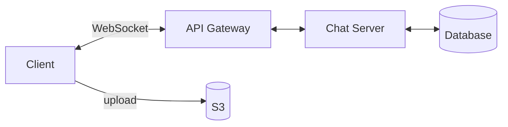

The minimum architecture to satisfy FRs: clients connect via WebSocket through an [L7 API Gateway](/building-blocks/api-gateway) to Chat Servers. Chat Servers manage chats, messages, and the inbox. Media uploads go directly to S3 via pre-signed URLs.

We use the API Gateway for path-based routing (`/ws` → Chat Servers, `/v1/*` → REST), JWT validation on the WebSocket upgrade handshake, and TLS termination.

### How This Satisfies FRs

**FR1: Create a chat** — Client calls `POST /v1/chats` → Chat Server creates Chat + ChatParticipants → pushes `CHAT_CREATED` to online participants

**FR2: Add/remove participants** — Client calls `PUT /v1/chats/:chatId/participants` → Chat Server updates ChatParticipants → notifies affected online participants

**FR3: Send and receive messages** — User A sends `SEND_MESSAGE` via WebSocket → Chat Server persists Message + writes Inbox entry per participant → pushes to online recipients → recipient ACKs → server deletes Inbox entry, updates MessageStatus

**FR4: Offline delivery** — Inbox entries persist until reconnect → client calls `GET /v1/inbox` (paginated) → ACKs → server deletes entries

**FR5: Media files** — Client requests pre-signed URL → encrypts locally → uploads to S3 → notifies server → server proceeds with fan-out

**FR6: Receipts** — Single tick (sent) → double tick (delivered) → blue tick (read). MessageStatus updated in-place, fire-and-forget over WebSocket, synced on reconnect via `GET /v1/sync/status`

**FR7: Message search** — Entirely client-side. E2E encrypted — server only has ciphertext. Client searches local DB (SQLite / IndexedDB).

**FR8: Online status & last seen** — Heartbeat-based presence. Pull-based: client requests `GET /v1/users/:userId/presence`.

:::note
This HLD is intentionally minimal — a single Chat Server with a single database. The deep dives below evolve this into a full microservices architecture that satisfies the NFRs (scale, latency, fault tolerance, E2E encryption). The final architecture diagram is at the end of the deep dives section.
:::

## 5. Deep Dives

### 5.1 Client-Server Connection Management

**Problem:** How do we maintain persistent connections for 500M DAU and route messages between Chat Servers efficiently?

See [WebSocket Connection Management at Scale](/building-blocks/websocket-connection-management) for the full concept — socket limits, capacity planning, registry approaches, and server-to-server communication patterns.

#### Decisions for This System

| Concern | Decision | Why |
|---------|----------|-----|
| **Capacity** | ~150M concurrent connections, ~235 pods at 640K each | 500M DAU × 30% online; 64GB pods with 50% (32GB) for sockets ÷ ~50KB per connection ≈ 640K — requires a tuned event-loop server (epoll, small per-connection buffers) |
| **Connection Registry** | Redis Cluster | O(1) lookup at 150M keys (~20GB); ZooKeeper too slow, [consistent hashing](/distributed-systems/consistent-hashing) too rigid, gossip too laggy |
| **Server-to-Server** | Redis Streams — one stream per Connection Service pod (`stream:{serverId}`, ~235 streams, capped with `MAXLEN ~`) | Durable delivery (Pub/Sub loses messages if subscriber is down); Kafka too heavy for dynamic routing; each pod reads its own stream through a consumer group (`XREADGROUP` + `XACK`) |
| **Fan-out** | Batch by destination server | 200 group members across ~30 servers → 30 `XADD` commands (one per destination pod), not 200 individual pushes |
| **Stale cleanup** | Per-endpoint expiry score (`now + 120s`), refreshed by the pod every 60s; client heartbeat (30s) handled in-process | Heartbeats never write to Redis (~2.5M pipelined `ZADD`/s instead of ~5M/s); clean disconnect → `ZREM`; crashed pod → its entries age out within 120s |
| **Multi-device** | Per-user set of `(clientId, serverId, connId)` endpoints | User with phone + laptop = 2 connections, potentially on different servers |

#### Connection Registry Records

Redis holds **live connection endpoints**, not message data. A single user can have several endpoints: one per connected device, and potentially more than one per device while an old socket is draining after a network change.

```text
Key:    conn:{userId}                         Type: sorted set
Member: {clientId}|{serverId}|{connId}         Score: expiresAtEpochMs

conn:u-alice =
  "cl-phone|ws-042|c-a1"       1739941260000  # iPhone socket
  "cl-laptop|ws-117|c-b9"      1739941260000  # laptop socket
```

`clientId` is stable for a registered device; `connId` is generated for a specific WebSocket session. The `serverId` tells the Fan-out Worker which Connection Service pod owns that socket.

**Phone connects** — register one routable endpoint with a 120-second expiry (`now + 120s`):
```
ZADD conn:user-alice 1739941260000 "cl-phone|ws-042|c-a1"
```

**Heartbeat vs. registry refresh** — the client's 30s `HEARTBEAT` is answered in-process by its pod (it owns the socket) and never touches Redis. Separately, every 60s each pod refreshes **all** of its endpoints in one pipelined batch, moving each expiry to `now + 120s`. That is 150M ÷ 60s ≈ **2.5M `ZADD`/s cluster-wide**, half of the ~5M/s that writing on every heartbeat would cost:
```
ZADD conn:user-alice XX 1739941320000 "cl-phone|ws-042|c-a1"   # pipelined with the pod's other endpoints
```

**Route a message** — return every endpoint whose expiry is still in the future (i.e., non-expired):
```
ZRANGEBYSCORE conn:user-bob (1739941200000 +inf
                              ↑ current epoch ms   ↑ no upper bound
```

**Clean disconnect** — remove only that socket immediately; Alice's laptop remains online. A device that misses two heartbeats is closed by its pod and removed the same way:
```
ZREM conn:user-alice "cl-phone|ws-042|c-a1"
```

**Crashed pod** — nobody runs `ZREM`; its refreshes stop, so its endpoints become unroutable within 120s (routing ignores expired scores) and a background sweeper reclaims them:
```
ZREMRANGEBYSCORE conn:user-alice -inf now
```

:::note Why not one Redis hash with a single TTL?
A hash such as `HSET conn:{userId} clientId serverId` cannot expire **one device** independently: Redis TTL applies to the whole hash. If Alice's laptop keeps refreshing that TTL, a crashed phone entry could live forever. The sorted-set score is an expiry **per connection**. Routing filters expired scores, so one device never keeps another device falsely online.
:::

#### Redis Streams for Server-to-Server Delivery

Each Connection Service pod owns one Redis Stream named `stream:{serverId}`. The Messaging Service writes batched delivery instructions; the pod reads them through its own consumer group (`XREADGROUP`) and acknowledges each entry with `XACK`. Streams are capped with `MAXLEN ~` so an idle or dead pod's stream can't grow without bound.

**Stream key:** `stream:ws-042` (one per pod, ~235 total)

**Example: delivering msg-555 to a 200-member group with 250 active devices across ~30 pods:**

```
1. Messaging Service reads live endpoints:
   ZRANGEBYSCORE conn:user-bob  (now +inf  →  cl-phone|ws-042|c-a1
   ZRANGEBYSCORE conn:user-carol (now +inf →  cl-laptop|ws-117|c-b9, cl-phone|ws-042|c-d4
   ... (250 endpoints total)

2. Group by serverId:
   ws-042: [cl-phone|c-a1, cl-phone|c-d4, ...]   (12 devices)
   ws-117: [cl-laptop|c-b9, ...]                  (8 devices)
   ... (~30 distinct pods)

3. One XADD per destination pod (stream capped with MAXLEN ~):
   XADD stream:ws-042 MAXLEN ~ 100000 * msgId msg-555 recipients "cl-phone|c-a1,cl-phone|c-d4,..."
   XADD stream:ws-117 MAXLEN ~ 100000 * msgId msg-555 recipients "cl-laptop|c-b9,..."
   → 30 writes, not 250
```

**On the receiving pod:**

```
ws-042 at boot (group created once):
  XGROUP CREATE stream:ws-042 cg-ws-042 $ MKSTREAM
  XREADGROUP GROUP cg-ws-042 ws-042 STREAMS stream:ws-042 0      ← drain own pending entries (PEL) after a restart

ws-042 loop:
  XREADGROUP GROUP cg-ws-042 ws-042 BLOCK 0 STREAMS stream:ws-042 >
  → receives {msgId: msg-555, recipients: "cl-phone|c-a1,cl-phone|c-d4,..."}
  → pushes NEW_MESSAGE over each listed connId's WebSocket
  → XACK stream:ws-042 cg-ws-042 <entryId>
```

| Alternative | Streams | Why not |
|---|---|---|
| Stream per chat | Millions | Each pod subscribes to thousands of streams |
| Stream per user | 150M | Unmanageable |
| Pub/Sub per server | ~235 channels | Lost if subscriber is temporarily down |
| **Stream per server pod** | **~235** | Each pod reads exactly one; durable; natural batching |

:::info How a group message reaches multiple devices
For each recipient, the Messaging Service reads their active endpoints, then batches them by destination server. If a 200-member group has 250 active devices spread across 30 Connection Service pods, it publishes **30 `XADD` commands** (one per destination pod), not 250 individual messages. Each destination pod splits the recipients list and pushes over the matching `connId` WebSocket. The same `messageId` can arrive through this real-time push and the durable Inbox sync path; the client deduplicates by `messageId`.
:::

### 5.2 Message Ordering

**Problem:** Messages within a chat must appear in order. At 2.3M msgs/sec across ~235 Chat Servers, how do we guarantee ordering?

**Short answer:** Timestamp from the Chat Server + messageId as tiebreaker. This is sufficient for chat. The tiebreaker is also physical: `message_id` is the last clustering column in Cassandra ([§5.3](#cassandra-schema-for-messages)), so two messages in the same chat and millisecond are distinct rows rather than one overwriting the other.

**Why not something stronger?**

| Concern | Reality in Chat |
|---------|----------------|
| Two users send at the same millisecond to the same chat | Messages appear in arbitrary but **deterministic** order (tiebreak by messageId). No user notices — they were typing simultaneously. |
| Server clock skew (1-10ms with NTP) | Same reasoning — simultaneous messages from different users appearing in either order is imperceptible. |
| Same sender's messages out of order | **Cannot happen** — one user sends sequentially through one WebSocket connection, processed in FIFO order by their Chat Server. |
| Reply appears before the original | **Cannot happen** — the replier read the original before typing, so their message has a later timestamp. |

**Decision: Server timestamp + messageId tiebreaker.** Chat is not a financial ledger — strict total ordering across concurrent senders adds complexity (per-chat sequence generators, single-writer bottleneck) for a problem users don't experience.

**When you'd need stronger ordering:** Collaborative editing (OT/CRDT), financial transactions, distributed databases. Not chat.

:::staff[Deliberately choosing a weaker ordering guarantee]
We trade strict total order for zero coordination: no per-chat sequencer means no single-writer hot spot and no extra hop on a 2.3M msg/s write path. The causal cases users actually perceive (same sender, reply-after-read) are already guaranteed by the connection model; we only give up a deterministic-but-arbitrary order for truly concurrent senders. Revisit when order becomes semantic — edits/deletes racing sends, polls, threaded replies — and then use per-chat sequence numbers (e.g., the Kafka offset of the chatId partition), not global clocks.
:::

### 5.3 Database Selection

**Problem:** At 100B messages/day, no single database handles everything. How do we choose the right store for each table?

See [SQL vs NoSQL](/decisions/sql-vs-nosql) for the general decision framework, [Cassandra](/building-blocks/cassandra) for wide-column internals, and [Redis](/building-blocks/redis) for in-memory data structures.

#### Access Pattern Analysis

| Table | Write Volume | Read Pattern | Churn (insert/delete) | Needs Joins |
|-------|-------------|-------------|----------------------|-------------|
| User | Low | By userId | Low | Yes (with Client) |
| Client | Low | By userId | Low | Yes (with User) |
| Chat | Low | By chatId | Low | Yes (with ChatParticipants) |
| ChatParticipants | Low | By chatId (all members) | Low | Yes (with Chat) |
| Message | **100B/day** | By chatId + timestamp range | Low (no per-row deletes — rows expire via TTL) | No |
| Inbox | **High** | By clientId (each device's unread messages) | **Very high** (insert on send, delete on device ACK) | No |
| MessageStatus | **High** | By messageId | **High** (frequent in-place updates) | No |

#### Decisions

| Table | Store | Why |
|-------|-------|-----|
| **User, Client** | [PostgreSQL](/building-blocks/postgresql) | Small dataset, relational, strong consistency, stable schema |
| **Chat, ChatParticipants** | [PostgreSQL](/building-blocks/postgresql) + Redis cache | Relational joins for membership queries; Redis cache for hot-path reads (group membership checked on every message send — cache hit rate >99.9% since membership changes are rare) |
| **Message** | [Cassandra](/building-blocks/cassandra) | Massive write volume; `partition_key = chatId, clustering = (timestamp DESC, messageId DESC)` gives single-partition reads for "last N messages in chat X"; row TTL + TimeWindowCompaction for natural time-series data |
| **Inbox** | [Redis sorted set](/building-blocks/redis) | Per-Client transient queue (insert, device ACK, delete) — high churn would create tombstone storms in Cassandra; sorted sets give clean deletes, timestamp ordering via score, and independent phone/laptop sync |
| **MessageStatus** | [Redis hash](/building-blocks/redis) | Short-lived (deleted with Message); frequent in-place updates (SENT → DELIVERED → READ) — Cassandra would create tombstones on each status change; Redis HSET is true in-place update |

#### Durability Strategy

Redis Inbox and MessageStatus are ephemeral but important. If Redis crashes:

- **Inbox recovery:** Cassandra Message table still has the data. On reconnect, a device provides `lastReceivedTimestamp` → server queries Messages for that device's chats since that timestamp. Slower, but correct.
- **MessageStatus recovery:** Lost receipt statuses are acceptable — sender sees "sent" instead of "delivered" until the next interaction triggers a fresh status check.

Redis AOF persistence (`appendfsync everysec`) limits data loss to ~1 second.

:::staff[Pick stores by churn, and keep receipts out of the Inbox]
Inbox and MessageStatus live in Redis because of **churn**, not volume: insert-then-delete and in-place status flips are tombstone generators in an LSM store like Cassandra. Receipts go to a per-message MessageStatus hash rather than through recipients' Inboxes — routing DELIVERED/READ events through the Inbox would add up to 2×N writes per group message (N = group size) and bloat every reconnect sync. Redis is treated as a cache of recoverable truth: Cassandra is the backstop, so losing Redis costs latency, not messages. Revisit if Redis memory cost is dominated by a long tail of never-syncing users — tier cold Inboxes back to Cassandra.
:::

#### Cassandra Schema for Messages

```sql
CREATE TABLE messages (
    chat_id    UUID,
    timestamp  TIMESTAMP,
    message_id UUID,
    sender_id  UUID,
    content    BLOB,          -- E2E encrypted ciphertext
    media_url  TEXT,
    media_type TEXT,
    status     TEXT,          -- UPLOADING | SENT
    PRIMARY KEY ((chat_id), timestamp, message_id)
) WITH CLUSTERING ORDER BY (timestamp DESC, message_id DESC)
  AND default_time_to_live = 2592000   -- 30 days = offline retention window
  AND compaction = {'class': 'TimeWindowCompactionStrategy', 'compaction_window_size': '1', 'compaction_window_unit': 'DAYS'};
```

`message_id` in the clustering key is the tiebreaker: with `(chat_id, timestamp)` alone, two messages in the same chat and millisecond would share a primary key and the later write would silently overwrite the earlier one.

**Delete-on-ACK is logical, not physical.** Once every target device ACKs, its Inbox entries are removed and the server never serves the row again. The row itself is never `DELETE`d: every row is written with a TTL equal to the 30-day offline retention window, and because rows arrive in time order, each 1-day TWCS window holds rows that all expire together — Cassandra drops the whole expired SSTable as a file delete. No per-row `DELETE` means no tombstones to scan or compact (see [Cassandra: TWCS](/building-blocks/cassandra#time-window-compaction-strategy-twcs)). Trade-off: delivered ciphertext lingers on disk until its TTL expires — acceptable because the server only ever holds ciphertext it cannot read.

#### Indexing Strategy

**PostgreSQL tables:**

```sql
-- User: PK on id (automatic). Phone lookup for login/contact search.
CREATE UNIQUE INDEX idx_user_phone ON users(phone);

-- Client: PK on id. Fetch all devices for a user.
CREATE INDEX idx_client_user_id ON clients(user_id);

-- Chat: PK on id. No additional indexes needed.

-- ChatParticipants: Most queried table.
--   Query 1: "Get all members of chat X" (fan-out, membership check)
--   Query 2: "Get all chats for user Y" (chat list)
-- Composite PK covers both:
PRIMARY KEY (chat_id, user_id)
CREATE INDEX idx_cp_user_id ON chat_participants(user_id);
```

**Cassandra:** Indexing is implicit in the schema — `partition_key = chat_id, clustering = (timestamp DESC, message_id DESC)`. The only query ("messages in chat X by time") is a single-partition range scan. No secondary indexes — they're an anti-pattern in Cassandra at scale (scatter-gather across nodes).

**Redis:** Data structures *are* the index — sorted sets give timestamp ordering, hashes give O(1) field lookup, keys give O(1) existence check. No separate indexing concept.

### 5.4 E2E Encryption & Key Management

**Problem:** Messages must be end-to-end encrypted. The server must never be able to read message content. How do users establish shared secrets without the server being able to derive them?

See [E2E Encryption & Signal Protocol](/building-blocks/e2e-encryption) for the full concept — Diffie-Hellman, X3DH, Double Ratchet, Sender Keys, and the new device problem.

#### Decisions for This System

| Concern | Decision | Why |
|---------|----------|-----|
| **Key exchange (1:1)** | Signal Protocol (X3DH + Double Ratchet) | Industry standard, used by WhatsApp. Forward secrecy + break-in recovery. |
| **Group encryption** | Sender Keys | O(1) encryption per message vs O(N) for pairwise. Messages >>> membership changes. |
| **Key storage** | Server stores public Key Bundles per Client (device) | Server is a public key directory — cannot derive shared secrets (Diffie-Hellman property) |
| **Media encryption** | Client encrypts file locally, embeds media encryption key in the message (which is itself E2E encrypted) | Server and S3 only see ciphertext blobs |
| **Message history on new device** | Encrypted cloud backup (iCloud/Google Drive) with user passphrase | Trade-off: UX convenience vs pure Signal-style "no backup" |
| **MITM protection** | Safety number verification (QR code / number comparison) | Detects server substituting public keys |

#### Impact on Data Model

The Client entity stores encryption key metadata:

```
Client:
  id | userId | deviceName | platform
  identityPublicKey          — long-term, identifies this device
  signedPrePublicKey         — medium-term, rotated periodically
  signedPreKeySignature      — proves SPK was generated by this device
  oneTimePrePublicKeys[]     — ephemeral, consumed one per new conversation
```

#### Impact on Server Design

:::staff[E2E encryption reshapes the server, not just the payload]
The server becomes a blind router plus a transient store — every feature that needs content moves to the client or out of scope:

- Server **cannot** provide search over messages (ciphertext only)
- Server **cannot** provide message history to new devices (no longer served after ACK, expired by TTL)
- Message content in Cassandra and Inbox entries are **ciphertext** — opaque blobs to the server
- Spam detection and content moderation **cannot** operate on message content (out of scope, as specified)

Second-order effect: because the server can't serve history, it doesn't need to keep it — which is what makes logical delete-on-ACK, TTL-expired TWCS SSTable drops, and a bounded Redis Inbox possible.
:::

### 5.5 Write-Time Fan-Out

**Problem:** When a message is sent to a group of 200 members, how do we persist Inbox entries for all participants reliably at 100B msgs/day?

See [Apache Kafka](/building-blocks/kafka) for details on partitioning, consumer groups, replication, ordering, and backpressure, and [Fan-Out: Write-Time vs Read-Time](/patterns/fan-out) for the fan-out strategy decision.

#### Two Messaging Layers

The system uses two separate messaging layers, running in parallel:

| Layer | Technology | Purpose | Latency |
|-------|-----------|---------|---------|
| **Real-time delivery** | Redis Streams (one per Connection Service pod) | Push to online users' WebSocket connections | ~2-5ms |
| **Durable fan-out** | [Kafka](/building-blocks/kafka) (partitioned by chatId) | Persist Inbox entries for all participants | ~10-50ms |

:::staff[Two messaging layers: "deliver now" vs. "everyone eventually"]
These serve different concerns. Redis Streams handles the "deliver now" path. Kafka handles the "make sure everyone eventually gets it" path. Splitting them means the latency SLO and the durability SLO never fight over the same knob — Kafka's batching and `acks=all` would tax the hot path, while Redis alone can't replay. The price is two systems to operate and a duplicate-delivery window (WS push and Inbox entry can both reach a device), so clients dedupe on messageId. Revisit if Kafka p99 at our scale gets close to Redis Streams, or the ops cost of two pipelines outweighs the latency win.
:::

#### Write Flow

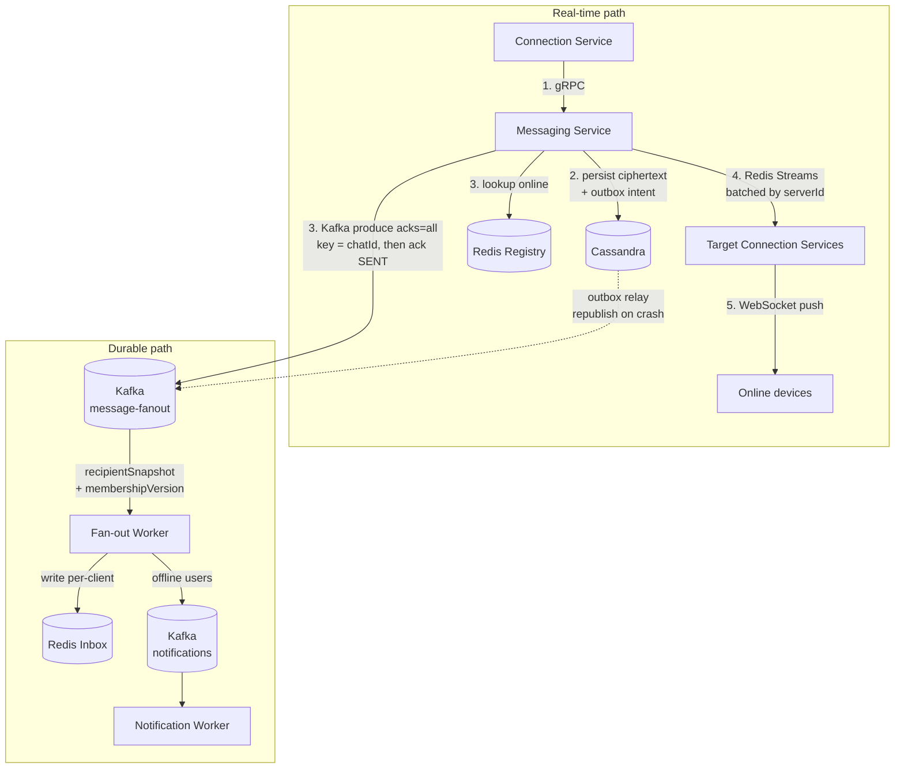

**Step by step:**

1. **Connection Service** receives `SEND_MESSAGE` over WebSocket, forwards to Messaging Service via gRPC
2. **Messaging Service** validates membership, captures the recipient-device snapshot + `membershipVersion`, and persists the ciphertext plus a fan-out intent (outbox row) to Cassandra
3. **In parallel:**
   - Publishes to Kafka topic `message-fanout` (partition key = chatId, `acks=all`) for durable fan-out; once Kafka acknowledges, the sender gets `SENT`. If the service crashes between the Cassandra write and the Kafka ack, an outbox relay republishes the same `messageId`
   - Looks up online recipient endpoints in Redis Connection Registry
4. **Real-time path:** groups endpoints by `serverId`, writes one Redis Streams batch per target Connection Service pod
5. **Target Connection Services** push `NEW_MESSAGE` over the already-open WebSocket to each online device
6. **Durable path (async):** Fan-out Worker consumes from Kafka:
   - Uses the `recipientSnapshot` + `membershipVersion` carried in the event — it never re-reads membership
   - Writes an Inbox entry (`inbox:{clientId}`) for each recipient device
   - Emits notification event for users with no live endpoint

#### Why Two Layers Instead of One?

| Concern | Redis Streams alone | Kafka alone | Both |
|---------|-------------------|-------------|------|
| Real-time latency | ✅ ~2-5ms | ❌ ~10-50ms (batching, poll interval) | ✅ Redis for real-time |
| Durability | ⚠️ Redis AOF, not as strong | ✅ Replicated commit log | ✅ Kafka for durability |
| Replay on failure | ⚠️ Limited | ✅ Full replay from offset | ✅ Kafka for replay |
| Ordering per chat | ⚠️ Per-server ordering only | ✅ Partition by chatId = strict order | ✅ Kafka for ordering |
| Backpressure | ⚠️ Manual | ✅ Consumer lag, auto-managed | ✅ Kafka absorbs spikes |

#### Kafka Topics

Two topics serve different concerns:

**`message-fanout`** — durable fan-out of messages to every recipient device

```
Topic: message-fanout
  Partition key: chatId → all messages for one chat land on the same partition
                          → strict ordering per chat guaranteed
  Partitions: 200 (max 200 Fan-out Worker consumers)
  Replication factor: 3
  min.insync.replicas: 2

Message schema:
  {
    messageId,           -- idempotency key
    chatId,              -- partition key
    senderId,
    membershipVersion,   -- version of the membership snapshot at send time
    recipientSnapshot: [ -- captured by Messaging Service, NOT re-read by worker
      { clientId, userId },
      ...
    ]
  }
```

**`notifications`** — wake-up signal for offline users via APNs/FCM

```
Topic: notifications
  Partition key: userId → messages for the same user land on the same partition
                          → Notification Worker can batch into one push
  Partitions: 32
  Replication factor: 3

Message schema:
  {
    userId,              -- partition key
    chatId,
    senderName,
    preview              -- opaque E2E-encrypted blob (server can't read it)
  }
```

:::note Why chatId for message-fanout but userId for notifications?
`message-fanout` partitions by `chatId` so all messages in one chat are processed **in order** by a single Fan-out Worker. `notifications` partitions by `userId` so all pending notifications for the same user land on the same consumer — enabling batching ("Alice: 50 new messages") instead of 50 separate pushes.
:::

#### Kafka Producer and Consumer Configuration

```
Producer (Messaging Service):
  acks: all
  enable.idempotence: true
  linger.ms: 5 (small batch window for throughput)
  compression.type: lz4

Consumer (Fan-out Worker):
  group.id: fanout-service
  auto.offset.reset: earliest
  enable.auto.commit: false (manual commit after Inbox writes)
  max.poll.records: 500 (batch processing)
```

#### Fan-Out Latency Budget

```
Messaging Service → Kafka publish:   ~5ms  (batched, linger.ms=5)
Kafka replication:                   ~5ms  (acks=all, RF=3)
Consumer poll interval:              ~10ms (near real-time consumption)
Recipients from event snapshot:      ~0ms  (carried in the event, no lookup)
Write 200 Inbox entries (pipeline):  ~10ms (Redis pipeline, batched)
Total Inbox fan-out:                ~30ms

Real-time WebSocket delivery (parallel): ~5-10ms
```

Both paths complete well within the 500ms budget. Online users see the message via WebSocket in ~10ms; Inbox entries are written within ~30ms as a durability backstop.

#### Scaling the Fan-Out Service

- **Add consumers** up to the partition count (200 partitions = max 200 consumers)
- **Monitor consumer lag** — if lag grows, add consumers or increase `max.poll.records`
- **[Idempotent writes](/patterns/idempotency)** — Fan-out Service uses `messageId + clientId` as idempotency key for Inbox writes; safe to replay on crash

### 5.6 Delivery & Read Receipts

**Problem:** How do we propagate delivery and read receipts (FR6) back to the sender — and in group chats, to all participants — without creating a secondary fan-out storm?

#### Receipt Lifecycle

Every target device transitions through three states in the `MessageStatus` Redis hash; `RecipientMessageStatus` holds the sender-visible aggregate per recipient user:

```
SENT → DELIVERED → READ
```

- **SENT** — server persisted the message and its fan-out intent is durable (Inbox entries are written asynchronously afterwards by the Fan-out Worker)
- **DELIVERED** — recipient's device received the message (client sent `ACK` frame)
- **READ** — recipient opened the chat (client sent `READ` frame)

#### 1:1 Receipt Flow

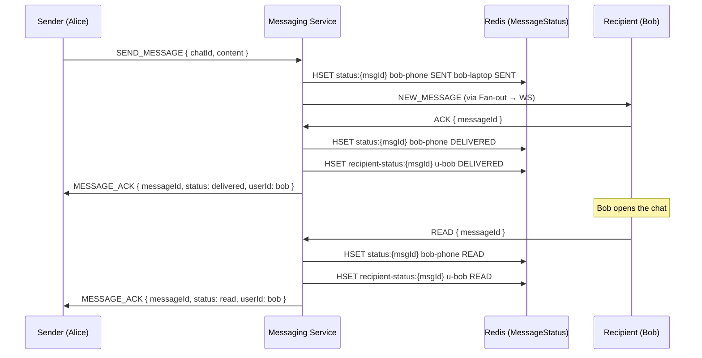

Key detail: receipt updates are **fire-and-forget over WebSocket** — if Alice is offline when Bob reads, the receipt is not retried in real-time. Alice's devices sync missed receipts on reconnect via `SYNC_SENT_STATUS` (or `GET /v1/sync/status?since={timestamp}`) — see [Offline Receipt Sync](#offline-receipt-sync). Status hash fields are per **device** (`clientId`) in `status:{msgId}` and per **user** (`userId`) in `recipient-status:{msgId}`.

#### Group Receipt Flow

In a 200-member group, when Bob reads a message from Alice, who needs to know?

**WhatsApp model:** only the **sender** sees per-participant delivery/read status (in message info). Other members don't see Bob's receipt — this is a deliberate product decision that also solves the fan-out problem.

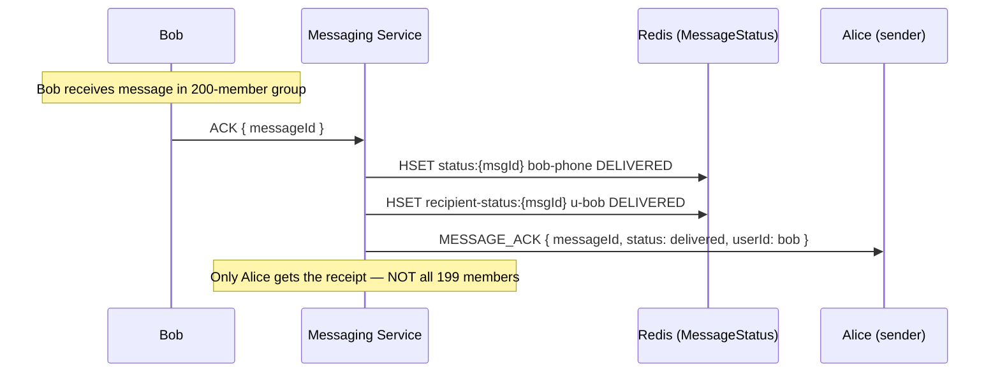

| Approach | Receipt fan-out per message per reader | Write amplification |
|----------|---------------------------------------|---------------------|
| **Broadcast to all members** | O(N) — every member gets every receipt | 200 readers × 200 WS pushes = 40K receipt deliveries per message |
| **Sender-only** (chosen) | O(1) — only sender gets the receipt | 200 readers × 1 WS push = 200 receipt deliveries per message |

:::staff[Why receipts go only to the sender]
This is where product design and system design intersect. Broadcasting every receipt to every group member creates a **secondary fan-out storm**: a single message in a 200-member group generates up to 200 delivery receipts × 200 fan-out writes = **40K WS pushes** just for delivery status. Sender-only receipts reduce this to 200 pushes — a 200× reduction. WhatsApp makes the same choice: group message info (per-participant ticks) is visible only to the sender, and only on demand (pull, not push). The double-tick on the message bubble shows the **aggregate** (all delivered / all read), which requires only a single status check, not per-member fan-out.
:::

#### Aggregate Group Ticks

The double-tick (✓✓) and blue tick on a group message represent aggregate status:

```
Single tick (✓):   Message persisted and fan-out intent is durable
Double tick (✓✓):  ALL recipient users delivered (all HGET recipient-status:{msgId} are DELIVERED or READ)
Blue tick:         ALL recipient users read (all HGET recipient-status:{msgId} are READ)
```

A device ACK first updates its own `status:{messageId}` field. The service then updates that user’s aggregate field in `recipient-status:{messageId}`; the sender's client periodically checks aggregate status, or the server pushes an aggregate update when the **last recipient user** transitions:

```
On a device receipt update:
  1. HSET status:{msgId} {clientId} DELIVERED
  2. HSET recipient-status:{msgId} {userId} DELIVERED  # first verified device is enough
  3. HGETALL recipient-status:{msgId} → check all recipient users
  4. If all are delivered → push MESSAGE_ACK { messageId, status: all_delivered } to sender
```

The final aggregate check is O(N recipients), but happens at most once per newly advanced recipient status and is acceptable for bounded group sizes.

#### Offline Receipt Sync

When one of Alice's devices reconnects after being offline, it sends `SYNC_SENT_STATUS` over the WebSocket, or calls the REST equivalent:

```
GET /v1/sync/status?since={timestamp}
```

`since` is **that device's own receipt-sync cursor** — the point up to which it has already applied receipt updates — not the user's `last_seen` (another of Alice's devices may have been online and advanced its own cursor meanwhile). The server answers from `MessageStatus` (per-device state, for message info) and `RecipientMessageStatus` (per-user aggregate, which drives the group ticks) for messages Alice sent whose status changed after the cursor, and returns batched updates plus a new cursor. This avoids storing receipt events durably — the current state is the source of truth, not a log of transitions.

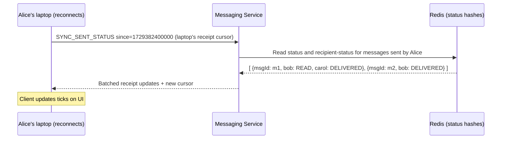

:::note Receipt state is current-state, not an event-log
`MessageStatus` stores the current state per **device**, and `RecipientMessageStatus` stores the current sender-visible state per **recipient user**. Both use true in-place `HSET` updates — no append, no tombstones. The trade-off: we lose transition timestamps (when exactly did Bob read?). WhatsApp shows these in message info, which would require timestamp fields per device/status or a separate receipt-event log. For our design, current state is sufficient.
:::

### 5.7 Media Upload Pipeline

**Problem:** How do we handle media file uploads (images, videos) at scale without bottlenecking Chat Servers?

See [S3 / Object Storage](/building-blocks/s3-object-storage) for details on pre-signed URLs, durability, multipart uploads, and performance.

#### Why Not Upload Through Chat Server?

At 100B msgs/day, even if only ~1% carry media (~1B uploads/day), routing files through Chat Servers would saturate their bandwidth and memory: ~5MB average × 1B uploads/day ≈ **5 PB/day** of traffic through servers that should be handling lightweight WebSocket frames.

#### Flow: Pre-Signed URL Upload

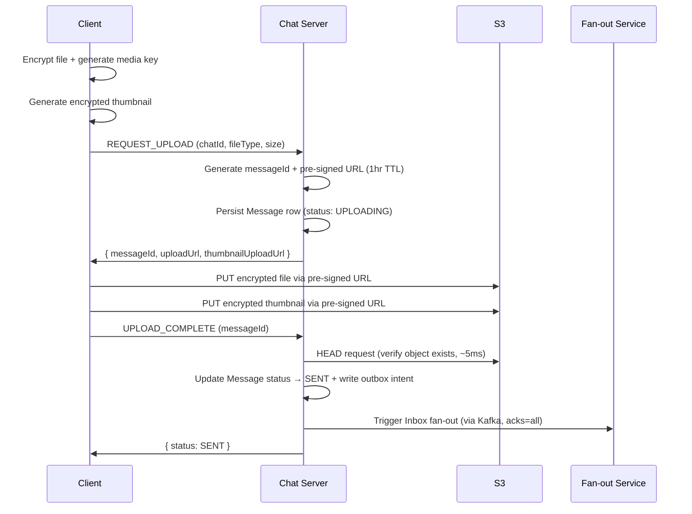

#### Key Design Decisions

| Decision | Choice | Why |
|----------|--------|-----|
| Upload path | Pre-signed URL (direct to S3) | Zero Chat Server bandwidth consumption |
| Upload notification | Client notifies server (not S3 event notification) | Faster, more reliable than S3's eventually-consistent events |
| Verification | Server does HEAD request on S3 | Confirm upload succeeded before fan-out (~5ms) |
| Encryption | Client encrypts locally before upload | E2E encryption — server never sees plaintext media |
| Thumbnails | Client generates + encrypts + uploads separately | Fast preview for recipients; both blobs encrypted |
| Pre-signed URL TTL | 1 hour | Long enough for slow connections; client requests new URL if expired |
| File size limit | Enforced via pre-signed URL conditions | Prevents abuse; e.g., max 100MB for video, 16MB for image |

#### E2E Encryption for Media

The media encryption key is embedded in the message body (which is itself E2E encrypted):

```
Message {
  chatId: "chat-123",
  content: "Check out this photo",
  mediaUrl: "s3://bucket/media/chat-123/msg-456/photo.enc",
  thumbnailUrl: "s3://bucket/media/chat-123/msg-456/thumb.enc",
  mediaEncryptionKey: "base64-encoded-AES-key",  // only visible to chat participants
  mediaType: "image/jpeg",
  mediaSize: 2400000
}
```

Recipients download the encrypted blob from S3 → decrypt locally using the key from the message. Server and S3 only ever see ciphertext.

#### S3 Key Structure

```
media/{chatId}/{messageId}/file.enc
media/{chatId}/{messageId}/thumb.enc
```

UUIDs in chatId and messageId naturally distribute requests across S3's internal partitions — no hot-prefix problem.

#### Cleanup

Since messages are logically deleted once all target devices ACK:
- S3 objects are deleted at that point (the Message row itself just waits for its 30-day TTL)
- **S3 lifecycle policy** as a safety net: auto-delete objects older than 30 days — the same window as the Message TTL (catches orphaned uploads from failed flows)

### 5.8 Notification Service

**Problem:** How do we notify offline users that they have new messages?

The Notification Worker consumes from the Kafka `notifications` topic. When the Fan-out Worker writes an Inbox entry for an offline user, it also publishes a notification event to Kafka. See [Push Notifications (APNs / FCM)](/building-blocks/push-notifications) for the delivery mechanism.

#### Flow

```
Fan-out Worker:
  1. Lookup user in Connection Registry
  2. User is offline (no entry)
  3. Write Inbox entry (Redis sorted set)
  4. Publish to Kafka topic:notifications { userId, chatId, senderName, preview }

Notification Worker:
  1. Consumes from Kafka topic:notifications
  2. Looks up user's device tokens (from User Service / Client table)
  3. Sends push notification via APNs (iOS) / FCM (Android)
```

#### Key Design Decisions

| Decision | Choice | Why |
|----------|--------|-----|
| Delivery mechanism | Kafka (`notifications` topic) | Durable, replayable if Notification Worker is down; same pipeline pattern as message fan-out |
| Push notification content | Sender name + "new message" (no content preview) | E2E encrypted — server can't read the message to generate a preview |
| Purpose of push notification | **Signal to open the app**, not message delivery | Push is best-effort, size-limited (4KB), no ordering guarantees |
| Batching | Batch multiple notifications per user (max 1 push per 5 seconds) | Avoid notification spam when user receives 50 messages in a group while offline |
| Device tokens | Stored in Client table (User Service) | Each device has its own push token; multi-device = multiple pushes |

:::note E2E Encryption and Push Previews
WhatsApp shows sender name and message preview in push notifications. How? The preview is generated **on the sender's device** and included as metadata in the notification payload (encrypted separately with a notification key). The server forwards this opaque preview blob to the push notification system. The server still cannot read the preview — it just relays it.

For simplicity, we skip this and show "New message from [sender]" only.
:::

### 5.9 Presence & Last Seen

**Problem:** How do we track online/offline status at 500M DAU without overwhelming the database?

See [Presence & Heartbeat](/patterns/presence-heartbeat) for the general pattern.

#### Decisions

| Concern | Decision | Why |
|---------|----------|-----|
| **Online status** | At least one non-expired endpoint in `conn:{userId}` | Connection registry already tracks each device; avoids a second conflicting presence source |
| **Heartbeat** | Each client heartbeats every 30s; its pod answers in-process (no Redis write). Every 60s the pod refreshes each of its endpoints to `now + 120s` in one pipelined batch (~2.5M `ZADD`/s cluster-wide) | Decouples liveness from registry writes; per-endpoint scores mean a phone failure never expires a user's active laptop |
| **Last seen (persistent)** | PostgreSQL `last_seen` updated only when the **last** endpoint disappears | Millions of registry refreshes/sec could never go to PG; a user with another live device is still online |
| **Crash recovery** | Clean disconnects `ZREM` immediately; a crashed pod's endpoints stop being refreshed and expire within 120s, are ignored by readers, and are swept later. Presence and PG `last_seen` can therefore be up to ~120s stale after a pod crash | Self-healing without relying on clean disconnect |
| **Query model** | Pull-based: `GET /v1/users/:userId/presence` | Push-based = tracking social graph on every connect/disconnect — too expensive at 500M DAU |

```text
Connect:
  ZADD conn:{userId} now+120s "{clientId}|{serverId}|{connId}"

Client HEARTBEAT (every 30s):
  handled in-process by the pod (update local lastSeen), no Redis write

Pod refresh (every 60s, pipelined for all local endpoints):
  ZADD conn:{userId} XX now+120s "{clientId}|{serverId}|{connId}"

Disconnect:
  ZREM conn:{userId} "{clientId}|{serverId}|{connId}"
  If ZRANGEBYSCORE conn:{userId} (now +inf is empty:
    PostgreSQL UPDATE users SET last_seen = NOW

Presence lookup:
  ZRANGEBYSCORE conn:{userId} (now +inf
  Any result → online; no result → return PostgreSQL last_seen
```

Presence is derived from the same per-device registry used for routing. This ensures a user stays online while **any** registered device remains connected. Staleness is bounded by the registry expiry: immediate on clean disconnect, at most ~120s when a pod crashes.

### 5.10 Final Architecture

After all deep dives, the system has evolved from a single Chat Server to a full microservices architecture:

#### Microservices

| Service | Owns | Storage | Scaling Profile |
|---------|------|---------|----------------|
| **Connection Service** | WebSocket connections, Connection Registry | Redis Cluster | Stateful, memory-bound (~640K conn per pod) |
| **User Service** | User, Client, E2E Key Bundles, Presence | PostgreSQL + Redis | Stateless, low traffic |
| **Chat Service** | Chat, ChatParticipants | PostgreSQL + Redis cache | Stateless, publishes membership events to Kafka |
| **Messaging Service** | Message, MessageStatus | Cassandra + Redis | Stateless, high throughput |
| **Inbox Service** | Per-device Inbox | Redis (sorted sets) | IO-bound, high write/delete churn |
| **Fan-out Worker** | Kafka consumer — orchestrates Inbox writes + notifications | — (stateless) | CPU-bound, scales with Kafka partitions |
| **Media Service** | Pre-signed URL generation, S3 lifecycle | S3 | Stateless, lightweight |
| **Notification Worker** | Push notifications (APNs/FCM) | Kafka consumer (`notifications` topic) | Async, rate-limited by platform APIs |

#### Architecture Diagram

<DesignPreview file="chat-system.vetora.yaml" height={600} title="Chat System — Final Architecture (Vetora)" />

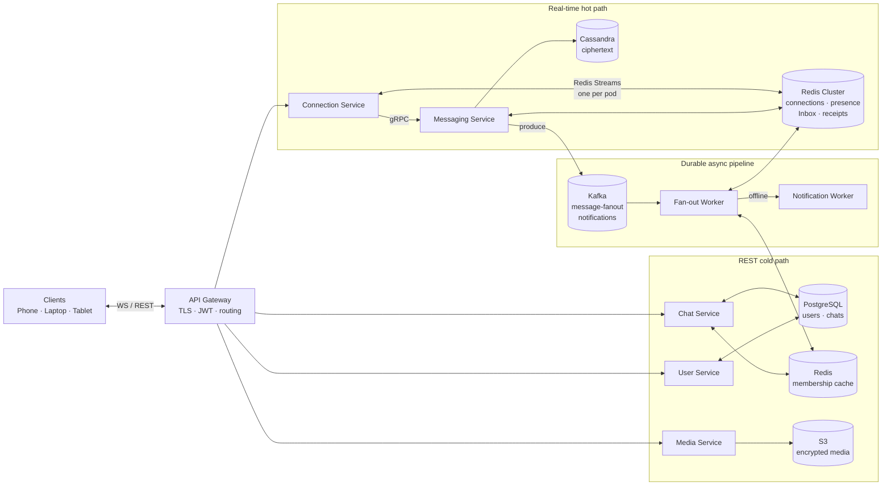

**How to read it:** traffic enters from the left. The **hot path** (top) handles real-time messaging — Connection Service, Messaging Service, Redis, and Cassandra. The **cold path** (middle) handles REST operations — Chat Service, User Service, PostgreSQL, and S3. The **async pipeline** (bottom) handles durable fan-out — Kafka feeds the Fan-out Worker, which writes per-device Inbox entries into Redis and triggers notifications for offline users. Data stores sit next to the services that own them, not in a separate layer.

#### Inter-Service Communication

| From → To | Protocol | Why |
|-----------|----------|-----|
| Client → Connection Service | WebSocket | Real-time bidirectional |
| Connection Service → Messaging Service | [gRPC](/building-blocks/grpc) | Low-latency, typed contracts |
| Messaging Service → Kafka | Kafka produce | Durable async fan-out (partitioned by chatId) |
| Kafka → Fan-out Worker | Kafka consume | Scalable, replayable, ordered per chat |
| Fan-out Worker → Redis (Inbox) | CACHE_CALL (Redis sorted set) | Write one inbox entry per target Client device |
| Fan-out Worker → Kafka (`notifications`) | Kafka produce | Notification events for offline users |
| Kafka → Notification Worker | Kafka consume | Durable, replayable notification delivery |
| Messaging Service → Connection Service | [Redis Streams](/building-blocks/server-to-server-communication) | Real-time delivery to online users |
| Chat Service → Kafka | Kafka produce | Membership change events for cache invalidation |
| Client → Media Service | REST | Pre-signed URL request |

#### Data Store Responsibilities

| Store | What It Holds | Why This Store |
|-------|--------------|----------------|
| **[PostgreSQL](/building-blocks/postgresql)** | User, Client, Chat, ChatParticipants | Small, relational, strong consistency |
| **Cassandra** | Message (ciphertext) | Massive write volume, partitioned by chatId, time-bucketed |
| **Redis Cluster** | Connection Registry, per-device Inboxes (sorted sets), device + recipient receipt hashes, Presence, ChatParticipants cache | Sub-ms latency, rich data structures, clean deletes |
| **S3** | Encrypted media files | Virtually unlimited, 11-nines durability, pre-signed URL access |
| **Kafka** | message-fanout topic, notifications topic, membership-events topic | Durable async pipeline, ordering per chat, replay on failure |

#### System Stories: How the Pieces Work Together

Read these flows in order. They turn the architecture into one consistent story: a device connects, a group changes, a message is made durable, active devices receive it immediately, offline devices catch up later, and receipts close the loop.

##### 1. Create or Update a Chat

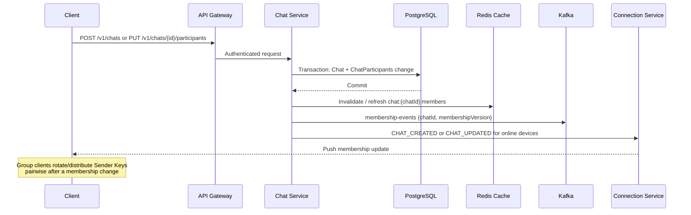

1. The Chat Service commits the chat and membership change in PostgreSQL; that database is the membership source of truth.
2. It refreshes the Redis membership cache used by the message hot path and emits a versioned membership event for other consumers.
3. Online devices receive `CHAT_CREATED` or `CHAT_UPDATED`; the clients then perform the E2E Sender Key rotation/distribution themselves. The server only relays encrypted key messages.
4. Every accepted message carries the **membership version and recipient-device snapshot resolved at send time**. A member added later cannot receive old ciphertext, and a removed member cannot receive new ciphertext merely because the asynchronous worker read a newer cache entry.

##### 2. Device Connect, Reconnect, and Disconnect

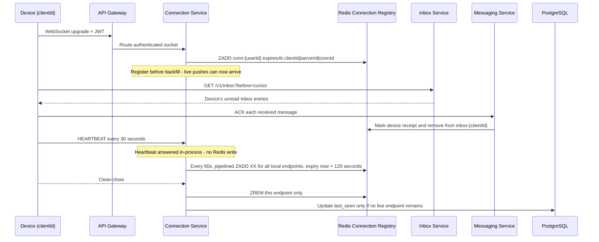

1. The gateway validates the WebSocket upgrade; the Connection Service creates a unique `connId` and registers `clientId → serverId + connId` in the user’s Redis sorted set.
2. Registration occurs **before** Inbox sync. A message that arrives during sync can therefore be pushed live; the client deduplicates by `messageId` if it also appears in the Inbox page.
3. Every device has its own `inbox:{clientId}` and acknowledgement state. A phone ACK never deletes a laptop’s pending message.
4. Heartbeats are a pod-local liveness check; the registry is refreshed separately, every 60s per pod in one pipelined batch (~2.5M `ZADD`/s cluster-wide). A clean close removes just that endpoint with `ZREM`, and a device that misses two heartbeats is closed and removed the same way. If the pod itself crashes, its endpoints stop being refreshed, become unroutable within 120 seconds, and are eventually swept from the sorted set. The user is offline only when no live endpoint remains.

##### 3. Send a Message: Durable Record, Then Real-Time Delivery

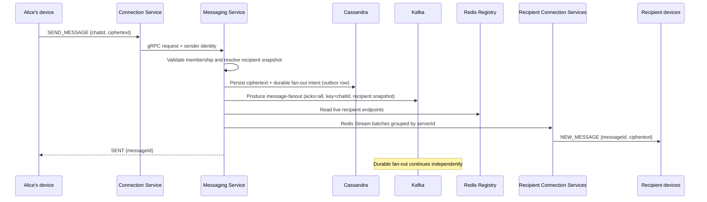

1. Alice’s device sends ciphertext; the Connection Service forwards it to the Messaging Service over gRPC.
2. The Messaging Service validates Alice against the cached membership version, resolves the recipients and their target Client IDs, and assigns `messageId` plus server timestamp.
3. It persists the ciphertext and a **durable fan-out intent** (outbox row) in Cassandra, produces to `message-fanout` with `acks=all`, and only then acknowledges `SENT`. If Kafka is degraded (producer breaker open), it acks `SENT` as soon as the outbox intent is durable and lets the relay publish when Kafka recovers ([§6.3](#63-cascading-failure)). The publisher is retry-safe: if it crashes after persistence but before Kafka confirms the event, an outbox relay republishes the same `messageId`; downstream writes are idempotent.
4. In parallel, it looks up currently live endpoints in Redis, groups them by `serverId`, and writes one Redis Stream batch per destination Connection Service. Those pods push `NEW_MESSAGE` over the already-open sockets.
5. Real-time push is an optimization, not the delivery guarantee. The Kafka path below makes every target device eventually catch up.

##### 4. Durable Fan-Out and Offline Catch-Up

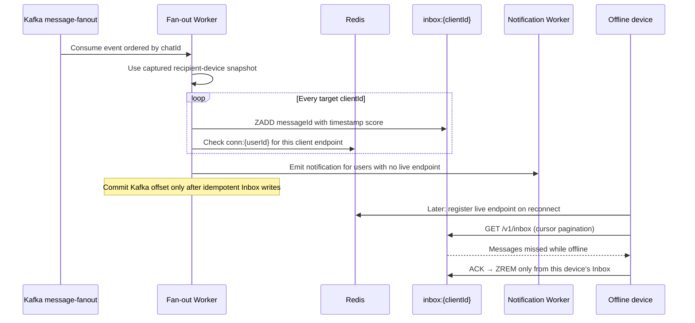

1. Kafka preserves message order per `chatId`; the Fan-out Worker uses the recipient snapshot captured when the message was accepted, rather than rereading potentially changed group membership.
2. It writes the message into each existing recipient device’s `inbox:{clientId}`. The idempotency key is `messageId + clientId`, so replay after a worker crash is safe.
3. An online device may receive the message twice (immediate WebSocket push plus later Inbox sync). Clients deduplicate by `messageId`.
4. If a user has no active endpoint, the worker emits one notification event. The Notification Worker sends APNs/FCM as a wake-up signal only; the actual ciphertext stays in the device Inbox.
5. On reconnect, a device reads its own paginated Inbox and ACKs each item. An ACK removes only that device’s copy; it never deprives another linked device of sync.

##### 5. Delivery and Read Receipts

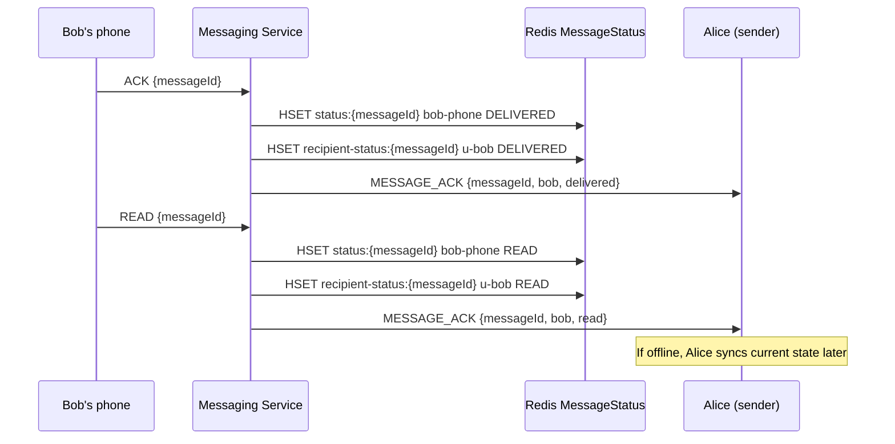

1. Device-level `MessageStatus` records preserve independent phone/laptop sync state. A sender-visible receipt is then aggregated **per recipient user** — in this design, the first verified device ACK marks that user delivered/read, while other devices still retain their own Inbox entries until they sync.
2. In a group, only the original sender receives each participant’s aggregate receipt. Broadcasting Bob’s read event to all 199 other members would create a secondary O(N²) receipt fan-out storm.
3. If the sender is offline, the per-device state stays in `MessageStatus` and the per-user aggregate in `RecipientMessageStatus`. On reconnect, each of the sender's devices sends `SYNC_SENT_STATUS` (REST: `GET /v1/sync/status?since={timestamp}`) with its own receipt-sync cursor and receives the current state from both hashes. No receipt transition log is required for the core product behavior.

:::staff[The invariant that keeps asynchronous chat correct]
The message’s recipient membership/device snapshot is fixed **before** fan-out begins; its ciphertext and fan-out intent are durable **before** `SENT` is acknowledged; every downstream write is idempotent by `messageId + clientId`; and every client deduplicates by `messageId`. Those four rules make retries, delayed Kafka delivery, reconnects, and concurrent membership changes safe without requiring a distributed transaction across Cassandra, Kafka, Redis, and WebSocket servers.
:::

### 5.11 Observability

See [Observability](/foundations/observability) for the generic framework (metric layers, USE/RED, SLOs, burn-rate alerting, tracing, cardinality control). This section applies it to the final architecture above.

**Problem:** A message crosses six hops — WS frame → Connection Service → Messaging Service → Cassandra/Kafka → Redis Stream → recipient socket — and can stall at any of them while every service still reports healthy. At 2.3M msgs/sec across ~235 stateful pods, how do we know messages are delivered within 500ms *before* users tell us, and pinpoint which hop is failing?

#### Metrics by Layer

| Layer | Metric | Why it matters | Alert |
|-------|--------|----------------|-------|
| **Infrastructure (USE)** | Open WebSocket connections per Connection Service pod | Capacity is ~640K/pod; skew means LB imbalance or a reconnect storm landing on few pods | Warn > 80% of pod capacity |
| | File descriptor usage per pod | One socket = one fd; exhaustion silently rejects new connections | Page > 90% of ulimit |
| | Heap usage + GC pause p99 (Connection Service) | ~50KB/connection; long pauses stall heartbeats → mass false disconnects + presence flapping | Warn GC p99 > 200ms |
| | Pod restarts / OOMKills | Each restart = ~640K reconnects ([§6.1](#61-thundering-herd-on-deploy)) | Ticket on any OOMKill; page on repeated restarts across the fleet |
| **Dependencies (DB / Cache / Queue)** | Redis Streams pending entries + lag per server stream | Real-time path backlog for one Connection Service pod; a stuck consumer = all its users stop receiving | Page if any stream lag > 5s |
| | Kafka consumer lag — `message-fanout`, per partition | Inbox durability backstop falling behind; per-partition view isolates hot chats | Warn > 10s, page > 60s ([§6.3](#63-cascading-failure)) |
| | Kafka consumer lag — `notifications` | Offline users aren't being woken | Ticket > 5 min |
| | Cassandra p99 write latency + dropped mutations / unavailable errors | Message persistence on the send path at LOCAL_QUORUM | Warn p99 > 20ms; page on unavailable errors |
| | Cassandra pending compactions + tombstones scanned per read | TWCS health — rows should only leave via TTL; tombstone growth means per-row deletes or out-of-window writes crept in | Ticket |
| | Redis memory used + evictions (Inbox shards) | Evicted Inbox entries force the slow Cassandra fallback ([§6.5](#65-component-failure-summary)) | Warn > 75% memory; page on any Inbox eviction |
| | Redis p99 latency + pool saturation, **per pool** (Registry vs Inbox) | Verifies the bulkhead — Inbox pressure must not starve routing | Warn p99 > 5ms |
| | ChatParticipants cache hit ratio | Expected > 99.9%; a drop means PostgreSQL stampede on every send | Warn &lt; 99% |
| | S3 PUT/HEAD error rate (5xx, 403 expired URL) | Media sends fail after the client already uploaded | Ticket |
| **Application (RED)** | Rate / errors / duration per WS frame type (`SEND_MESSAGE`, `ACK`, `READ`, `REQUEST_UPLOAD`) | Per-frame RED catches a broken ACK path while sends look fine | Feeds SLO burn rate |
| | gRPC Connection → Messaging p99 + circuit-breaker state | Open breaker = users get "try later" | Page if breaker open > 1 min |
| | ACK timeout rate (pushed over WS, no ACK within N s) | Silent delivery failure — frame left the server but never reached the device | Warn > 1% |
| | Fan-out writes/sec + batch size | Write amplification; early hot-chat signal ([§6.2](#62-hot-chat-viral-group)) | Ticket on sustained spike |
| | Dead-letter queue depth (failed Inbox writes) | Should be ~0; growth = messages at risk | Page on growth |
| **Business / Product** | Messages sent/sec vs. same time last week | A global drop is invisible to per-service error rates (no requests = no errors) | Page on > 20% drop vs. baseline |
| | Inbox depth per user (p99, max) | Growing depth = users not syncing or ACK path broken | Warn on trend |
| | Push-notification fallback rate (% of deliveries via Inbox + push vs. live WS) | Rising = connections failing or registry/presence wrong | Ticket on deviation |
| | Receipt completion (% messages reaching DELIVERED within 1 min, online recipients) | Product-level proxy for end-to-end delivery health | Feeds SLO |
| **Client / End-to-end** | Send → deliver latency p50/p99 (server accept → recipient ACK received) | The real NFR1 metric; measured server-side to avoid device clock skew | SLO |
| | WebSocket connect success rate + time-to-connect (client-reported) | Gateway/TLS/auth failures never reach our servers' metrics | SLO burn rate |
| | Reconnect rate per client per hour | Flaky networks, LB idle timeouts, bad deploys | Warn on 2× baseline |
| | Inbox sync duration on reconnect p99 | First-screen UX after being offline | Ticket |

#### SLIs & SLOs

| SLI | Definition | SLO (28-day window) |
|-----|-----------|---------------------|
| **Delivery latency** | Server accept → recipient ACK, online recipients | p99 &lt; 500ms (NFR1) |
| **Delivery completeness** | % of accepted messages with Inbox entries written for all participants within 60s | 99.999% (NFR3 — zero loss) |
| **Send availability** | % of `SEND_MESSAGE` frames that get a server ack (not error/timeout) | 99.99% (NFR4) |
| **Connect availability** | % of WebSocket connect attempts that succeed (client-measured) | 99.99% |
| **Inbox sync latency** | `GET /v1/inbox` duration | p99 &lt; 300ms |

#### Alerting

- **Page on symptoms, via burn rate.** Multi-window burn-rate alerts on each SLO (fast burn, e.g. 14× over 1h confirmed by 5m → page; slow burn over 6h → page; 1× over 3 days → ticket). Users feel symptoms, not causes.
- **Ticket on causes.** Compaction backlog, Redis memory at 75%, fd usage at 80% go to dashboards and tickets — **except** leading causes that become an outage within minutes (fd exhaustion, Inbox evictions, stuck Redis Stream, DLQ growth), which page directly.
- Every page links a runbook and a per-hop dashboard, so the on-call goes from "delivery SLO burning" to "stream lag on server X" in one click.

#### Tracing & Logs

- **Propagate one trace context end to end.** Connection Service starts a trace (W3C `traceparent`) on `SEND_MESSAGE` and carries it in gRPC metadata → Kafka record headers → Redis Stream entry fields → recipient `NEW_MESSAGE` delivery → `ACK`. `messageId` is logged at every hop as the correlation key.
- **Fan-out uses span links**, not one giant trace — a 200-member group produces ~30 per-server deliveries linked to the parent send span.
- **Sample.** Head-sample ~0.1% (~2K traces/sec at peak) plus **tail-based sampling** that keeps 100% of traces that are slow (> 500ms) or errored, and force-sampling for flagged test/debug accounts.
- **Structured logs, metadata only.** Log messageId, chatId, frame type, size, latency, serverId, status. Sample success logs; keep all errors.

:::info E2E encryption and telemetry
Never log, trace, or attach as a span attribute any message content, media encryption keys, or push preview blobs — even though they're ciphertext, they don't belong in a telemetry pipeline with broader access. Metadata (who messaged whom, when) is itself sensitive: pseudonymize user IDs in long-retention logs and enforce short retention.
:::

#### Metric Cardinality

**Approach A: Per-user / per-chat labeled metrics**
- Label delivery latency, ACK timeouts, and Inbox depth with `userId` / `chatId`
- Pros: directly answers "is user X affected?"; trivial hot-chat detection
- Cons: 500M users × ~10 metrics × ~15 histogram buckets ≈ tens of billions of series — no TSDB survives that; slow queries, huge cost, and user identifiers leak into the metrics store

**Approach B: Bounded-label metrics + exemplars + sampled traces/logs**
- Metrics carry only bounded labels: region, pod, serverId (~235), Kafka partition (200), frame type, status
- Latency histograms attach **exemplars** (trace IDs) so a p99 spike links straight to a slow trace
- Per-user/per-message questions are answered from tail-sampled traces and structured logs queried by messageId/userId; hot chats come from a bounded top-K (heavy-hitters sketch) emitted by the Fan-out Worker
- Pros: bounded, predictable series count; cheap; PII stays out of metrics
- Cons: a given user's latency can't be graphed; per-user answers depend on sampling and log retention

**Decision: Approach B.** Rule: no metric label with unbounded values; serverId and partition are allowed because they're bounded and map to the unit an operator can act on (drain a pod, rebalance a partition).

:::staff[Cardinality: metrics say "is it broken", traces and logs say "who is affected"]
We chose bounded-label metrics plus exemplars and tail-sampled traces over per-user/per-chat labels. We give up graphing any single user's or chat's latency — support escalations are resolved by looking up the messageId in logs/traces instead. Revisit if "my messages aren't delivering" escalations regularly can't be resolved from sampled data: then ship per-message delivery events to a columnar event store (ClickHouse/Pinot-style) built for high-cardinality queries — never by adding userId labels to the TSDB.
:::

---

## 6. Bottlenecks & Failure Scenarios

### 6.1 Thundering Herd on Deploy

**Problem:** Connection Service pod restarts → 640K users reconnect simultaneously → spike in Inbox sync + connection registry writes.

:::staff[The thundering herd is usually self-inflicted]
Autoscaling reacts in minutes — too slow for a spike that happens in seconds. The most frequent mass reconnect is our own deploy, so the fix lives in the client (jitter + backoff) and the rollout process, not in capacity. Size the blast radius per pod (~640K reconnects) and verify Inbox sync and the Registry can absorb exactly one pod's worth at a time.
:::

| Mitigation | How |
|------------|-----|
| **Client-side jitter** | Reconnect after random 0-5s delay. Spreads 640K reconnections over 5 seconds instead of instant. |
| **Graceful drain** | Pod announces shutdown 30s early → stops accepting new connections → lets existing ones finish cleanly. |
| **Rolling deploys** | One pod at a time, never multiple simultaneously. 640K is manageable; 640K × 5 pods is not. |
| **Connection [rate limiting](/patterns/rate-limiting)** | API Gateway caps new WebSocket connections/sec per pod. Excess connections queue or retry. |
| **Autoscale** | Safety net — scales up if sustained load exceeds capacity after the spike. |

### 6.2 Hot Chat (Viral Group)

**Problem:** 500-member group with 100 msgs/sec → 50K Inbox writes/sec for one chat. Single Kafka partition overloaded.

| Mitigation | How |
|------------|-----|
| **Chat-level [rate limiting](/patterns/rate-limiting)** | Max 10 msgs/sec per chat. Sender gets "slow down" response. This is what WhatsApp does for broadcast lists. |
| **Batched Inbox writes** | Fan-out Worker batches multiple messages for the same chat before writing. Instead of 500 writes × 100 msgs = 50K writes, batch into 500 writes containing 100 messages each. |
| **Switch to [read-time fan-out](/patterns/fan-out)** | Detect when a chat exceeds threshold (e.g., > 50 msgs/min) → stop writing per-user Inbox entries → store in per-chat stream instead → members pull from the stream. This is the Discord channel model. |

:::staff[Write-time fan-out economics]
Decision: **Rate-limit + batched writes** for simplicity. Write-time fan-out pays O(group size) writes per message to make every read O(1) — the right trade with ~20-member groups and a 5:1 read:write ratio. A hot 500-member chat inverts those economics, so it's the signal to flip **that chat** (not the whole system) to read-time fan-out. Switch to read-time fan-out only if hot chats become a sustained pattern — e.g., a meaningful share of fan-out writes come from chats above the threshold.
:::

### 6.3 Cascading Failure

**Problem:** One service slows → upstream backs up → everything degrades. The chain: Messaging Service slow → Kafka backs up → Fan-out lag → Inbox stale → users see "not delivered."

Each boundary must **absorb pressure** rather than propagate it (see [Circuit Breaker](/patterns/circuit-breaker) and [Bulkhead](/patterns/bulkhead)):

```
Connection Service → Messaging Service (slow)
  ├── Circuit breaker: if p99 > 500ms, fail fast, return "try later"
  ├── Timeout: 200ms max per gRPC call
  └── Client retries with backoff

Messaging Service → Kafka (producer backs up)
  ├── Kafka absorbs: this is what Kafka is for
  ├── Normal path: SENT only after outbox row in Cassandra + Kafka acks=all
  ├── Degraded mode (producer breaker open): ack SENT once the outbox intent
  │   is durable in Cassandra; the outbox relay publishes when Kafka recovers
  └── Producer backpressure: bounded in-flight requests

Kafka → Fan-out Worker (consumer lag grows)
  ├── Monitor: alert at > 10s lag, page at > 60s
  ├── Auto-scale consumers up to partition count
  ├── Shed load: pause notification events, prioritize delivery
  └── Separate consumer groups for notifications vs fan-out

Fan-out Worker → Redis (slow)
  ├── Bulkhead: separate Redis pools for Inbox vs Connection Registry
  ├── Retry with backoff, dead-letter for failed writes
  └── Inbox pressure can't starve routing
```

:::staff[Absorb pressure at boundaries, shed the cheapest work first]
**Key principle:** Kafka is the shock absorber. Circuit breakers are the fuses. No single slow service can cascade to the full system. Under stress the priority order is explicit: real-time delivery > Inbox durability > push notifications — load shedding drops the work that is cheapest to lose (a late push) first. The Redis bulkhead exists because Inbox and Connection Registry share infrastructure but not criticality.
:::

### 6.4 Multi-Region Failure

**Problem:** If we deploy across regions — what happens when Region A goes down? See [Multi-Region & Failover](/distributed-systems/multi-region-failover) for the general pattern.

| Concern | Approach |
|---------|----------|
| **Traffic routing** | DNS-based failover — health check fails in Region A → DNS routes to Region B (~60s propagation) |
| **PostgreSQL (User, Chat)** | Cross-region async replication. Region B has a read replica that promotes to primary. Small data loss window (async replication lag). |
| **Cassandra (Messages)** | Native multi-region via `NetworkTopologyStrategy`. RF=3 per region. Survives full region failure. |
| **Redis (Inbox, Registry)** | Redis Cluster doesn't support cross-region natively. Options: Redis Enterprise with active-geo, or application-level replication. On failover, Inbox rebuilds from Cassandra (Message table is the durability backstop). |
| **Kafka** | Kafka MirrorMaker replicates topics across regions. On failover, consumers in Region B pick up from replicated topic. |

**Active-passive vs Active-active:**

| Model | Pros | Cons |
|-------|------|------|
| **Active-passive** (recommended) | Simple. One region serves traffic, other is warm standby. | Failover delay (~60s). Standby region costs money while idle. |
| **Active-active** | Both regions serve traffic. Lower latency for geographically distributed users. | Massive complexity: message ordering across regions, conflict resolution for concurrent writes to same chat, split-brain during partition. |

:::staff[Active-passive: buying simplicity with a ~60s RTO]
**Decision: Active-passive.** Active-active adds enormous complexity (cross-region message ordering, conflict resolution) for a marginal latency improvement. Chat can tolerate ~60s failover — users see "connecting..." and retry. Redis state is deliberately not replicated cross-region: it's rebuildable from Cassandra, so failover costs a slower first sync, not lost messages. Revisit when per-region *latency* (not availability) becomes the complaint — and then home each chat to a region first, so ordering never spans regions.
:::

### 6.5 Component Failure Summary

| Component | Failure | Impact | Recovery |
|-----------|---------|--------|----------|
| **Connection Service pod** | Pod crash | ~640K users disconnect | Client reconnect with jitter; the dead pod's registry entries stop being refreshed and expire within 120s |
| **Redis (Connection Registry)** | Shard down | Can't route to affected users | Replica promotion (~seconds). During that window the real-time push is skipped for affected users; the durable Kafka → Inbox path still delivers, and devices pick messages up on their next Inbox sync/reconnect. Broadcast fallback is infeasible at ~2.3M msg/s × ~235 pods |
| **Redis (Inbox)** | Shard down | Can't write/read Inbox for affected users | Auto-failover; fallback: rebuild from Cassandra Message table |
| **Cassandra** | Node down | Message persistence fails for affected partitions | RF=3 + LOCAL_QUORUM survives 1 failure; hinted handoff replays |
| **Kafka broker** | Broker down | Fan-out stalled for affected partitions | Leader election to surviving broker (~seconds); real-time path unaffected |
| **Messaging Service** | All instances down | No new messages processed | Kafka buffers; Connection Service circuit breaker returns "try later" |
| **Fan-out Worker** | All instances down | No Inbox writes, no push notifications | Kafka retains messages; restart consumers, replay from last offset |
| **Inbox Redis full** | Memory exhaustion | Can't write new Inbox entries | Alert on memory; entries are transient (deleted on ACK) — growing Inbox means users aren't syncing; evict oldest with Cassandra fallback |

## 7. Trade-offs & Alternatives

| Decision | Chose | Over | Trade-off |
|----------|-------|------|-----------|
| Communication | WebSocket | Polling / SSE / WebRTC | Operational complexity of stateful connections for real-time bidirectional delivery |
| Connection registry | Redis Cluster | ZooKeeper / Consistent Hashing / Gossip | Redis dependency for O(1) routing; ZK too slow, hashing too rigid, gossip too laggy |
| Server-to-server | Redis Streams | Redis Pub/Sub / Kafka / Direct RPC | Slight latency over Pub/Sub for durability; Kafka too heavy for dynamic topics |
| Message ordering | Server timestamp + messageId tiebreaker | Per-chat sequence IDs / Vector clocks | Occasional same-ms ordering ambiguity for simplicity; imperceptible in chat UX |
| Fan-out pipeline | Kafka (partitioned by chatId) | Redis Streams only / Direct writes | Kafka adds ~30ms but gives durability, ordering, replay, backpressure |
| Two messaging layers | Redis Streams (real-time) + Kafka (durable) | Single layer | Operational complexity for optimal latency AND durability |
| Message store | Cassandra | PostgreSQL / DynamoDB | Eventual consistency for massive write throughput; single-partition reads by chatId |
| Message deletion | Logical delete on ACK + 30-day row TTL + TWCS | Per-row `DELETE` on ACK | No tombstones (whole SSTables dropped); delivered ciphertext lingers until TTL |
| Registry liveness | Pod-local heartbeats + pipelined 60s refresh, 120s expiry | Registry write on every 30s heartbeat | ~2.5M vs ~5M writes/s; crash staleness grows to ≤120s |
| `SENT` semantics | Ack after outbox row + Kafka `acks=all` (outbox-only in degraded mode) | Ack after Inbox writes / fire-and-forget produce | One extra Kafka round trip on the send path; never acks a message that can't be fanned out |
| Inbox / MessageStatus | Redis | Cassandra | Memory-bound for clean deletes without tombstones; Cassandra as durability backstop |
| User/Chat metadata | PostgreSQL + Redis cache | Full NoSQL | Relational joins and strong consistency for small, stable datasets |
| Observability cardinality | Bounded-label metrics + exemplars + tail-sampled traces | Per-user / per-chat metric labels | Can't graph a single user's latency; per-user debugging relies on traces/logs by messageId |

## 8. Related Concepts

- [API Gateway: Roles & Responsibilities](/building-blocks/api-gateway) — L4 vs L7, auth at the gateway, TLS termination, LB algorithms
- [WebSocket Connection Management](/building-blocks/websocket-connection-management) — connection registry, capacity planning, multi-device support
- [Server-to-Server Communication](/building-blocks/server-to-server-communication) — Redis Streams vs Pub/Sub vs RPC vs Kafka for inter-server routing
- [Message Queues](/building-blocks/message-queues) — Kafka partitioning, consumer groups, exactly-once
- [SQL vs NoSQL](/decisions/sql-vs-nosql) — database selection decision framework
- [Cassandra](/building-blocks/cassandra) — wide-column store for message storage, tombstone problem
- [Redis](/building-blocks/redis) — in-memory data structures for Inbox, MessageStatus, connection registry
- [Apache Kafka](/building-blocks/kafka) — partitioning, consumer groups, replication, backpressure, ordering
- [S3 / Object Storage](/building-blocks/s3-object-storage) — pre-signed URLs, durability, media storage
- [E2E Encryption & Signal Protocol](/building-blocks/e2e-encryption) — X3DH, Double Ratchet, Sender Keys, key exchange
- [PostgreSQL](/building-blocks/postgresql) — relational store for User, Client, Chat, ChatParticipants
- [gRPC](/building-blocks/grpc) — typed, low-latency inter-service communication
- [Push Notifications (APNs / FCM)](/building-blocks/push-notifications) — waking offline clients
- [Consistency Models](/foundations/consistency) — eventual consistency in message delivery
- [Replication](/distributed-systems/replication) — Redis Cluster replication, Cassandra RF
- [Consistent Hashing](/distributed-systems/consistent-hashing) — ring-based key distribution, rehash blast radius
- [Multi-Region & Failover](/distributed-systems/multi-region-failover) — active-passive vs active-active, DNS failover
- [CQRS](/patterns/cqrs) — separate read model (conversation metadata) from write model (message stream)
- [Fan-Out: Write-Time vs Read-Time](/patterns/fan-out) — delivering one write to many recipients
- [Rate Limiting](/patterns/rate-limiting) — throttling per client/chat to protect capacity
- [Circuit Breaker](/patterns/circuit-breaker) — fail fast to stop cascading failures
- [Bulkhead](/patterns/bulkhead) — resource isolation to contain failures
- [Idempotency](/patterns/idempotency) — safe retries under at-least-once delivery
- [Presence & Heartbeat](/patterns/presence-heartbeat) — online/last-seen tracking at scale
- [Observability](/foundations/observability) — metric layers (USE/RED), SLIs/SLOs, burn-rate alerting, tracing, cardinality control

## Appendix: Scale Assumptions

<StatGrid stats={[
  {value: '500M', label: 'Daily active users', accent: 'blue'},
  {value: '100B', label: 'Messages / day', accent: 'purple'},
  {value: '~2.3M/s', label: 'Peak send QPS', detail: '2x the ~1.16M/s average', accent: 'green'},
  {value: '~20 TB', label: 'New message data / day', detail: '100B × 200 bytes', accent: 'amber'},
]} />

| Metric | Value |
|--------|-------|
| DAU | 500M |
| Messages/day | 100B |
| Avg message size | 200 bytes |
| Peak QPS (messages) | ~2.3M/s (assume 2x avg) |
| Storage/day | ~20 TB |
| Storage/year | ~7.3 PB |
| Read:write ratio | ~5:1 |
| Avg group size | 20 members |
