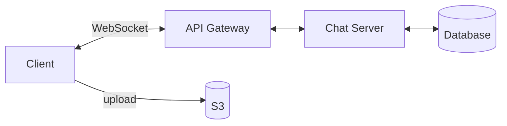
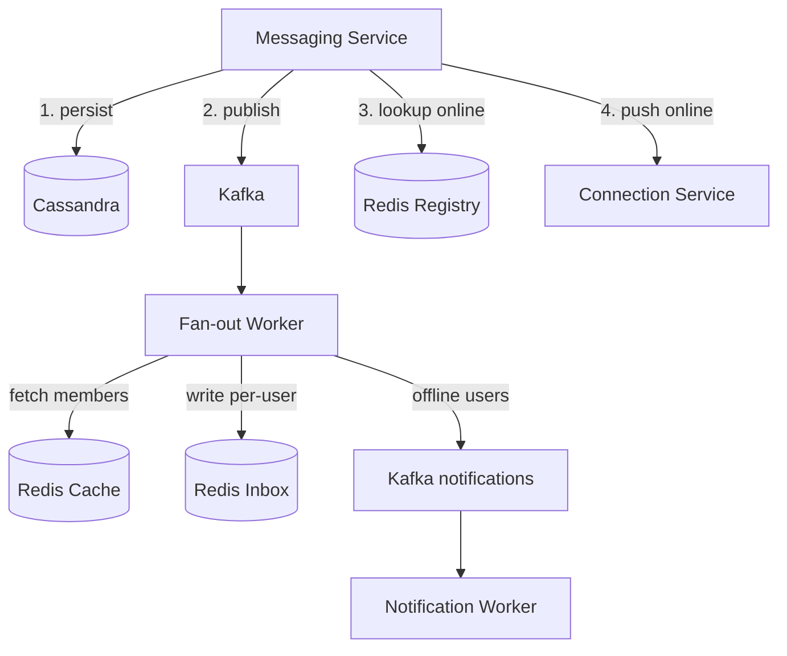
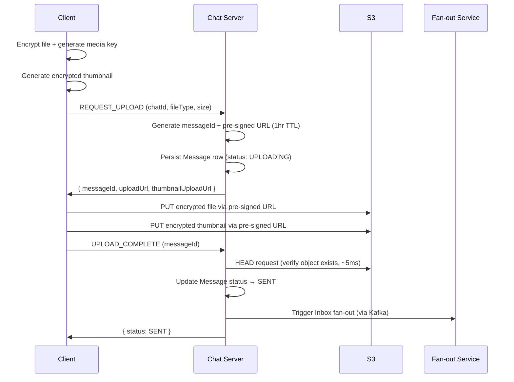
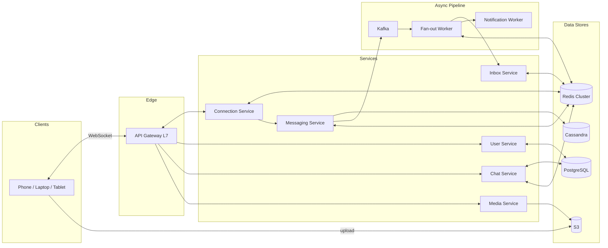

# Chat System

Design a real-time messaging system similar to WhatsApp or Slack.

## 1. Requirements

### Functional Requirements
1. User should be able to create a chat (individual or group) — handled similarly
2. User should be able to add or remove participants in a chat
3. User should be able to send and receive text messages in a chat
4. User should receive all chat messages sent while offline
5. User should be able to upload and share media files (images, videos) in a chat
6. User should see message delivery and read receipts
7. User should be able to search messages within a chat
8. User should see other users' online status and "last seen" time

### Non-Functional Requirements
1. **Latency**: Message delivery should be near real-time (&lt; 500ms)
2. **Scale**: System should support 100 billion messages per day
3. **Durability**: Zero message loss — guaranteed message delivery
4. **E2E Encryption**: Messages must be end-to-end encrypted; server stores ciphertext only, deletes after delivery confirmation
5. **Ordering**: Messages within a conversation must be ordered
6. **Availability**: 99.99% uptime
7. **Resilience**: System should be fault-tolerant across component failures

### Out of Scope
- Audio/video calls
- User status/stories
- Profile management, settings
- Spam detection
- Data analytics on messages for ad targeting

## 2. Core Entities

```
User       — end user who creates chats, sends/receives messages
Chat       — group of 2 or more users (covers both 1:1 and group)
Message    — individual message (text or media) in a chat
Client     — user device (phone, laptop, tablet) associated with a user account
```

:::info Why Client is a first-class entity
With E2E encryption, each device has its own encryption keys, its own WebSocket connection, and its own message sync state. Message delivery is per-Client, not per-User. A User with 3 devices = 3 Clients, each needing independent delivery and key management.
:::

:::note Media in Message
For simplicity, media URL + metadata (type, size, thumbnail) are embedded directly in the Message entity rather than a separate Attachment entity. Revisit when designing the media upload/CDN pipeline.
:::

## 3. API / Interface

**Communication: WebSocket** for real-time messaging (bidirectional, persistent, low latency). REST for infrequent operations (chat creation, participant management, media upload).

| Option | Verdict |
|--------|---------|
| Polling | High latency, massive wasted requests at scale |
| HTTP/TLS | Too much handshake overhead per message |
| SSE | Unidirectional (server → client only) |
| **WebSocket** | **Bidirectional, persistent, low latency** — connection management overhead accepted |
| WebRTC | P2P — no server persistence, no offline delivery, wrong model for chat |

### Client → Server (WebSocket frames)

```
// Send a message (text or media)
{ type: "SEND_MESSAGE", payload: { chatId, content, mediaUrl?, mediaType? } }

// Acknowledge message delivery
{ type: "ACK", payload: { messageId } }

// Mark message as read
{ type: "READ", payload: { messageId } }

// Request media upload URL
{ type: "REQUEST_UPLOAD", payload: { chatId, fileType, size } }

// Confirm media upload complete
{ type: "UPLOAD_COMPLETE", payload: { messageId } }

// Heartbeat (every 30s — keeps connection alive + refreshes presence)
{ type: "HEARTBEAT" }
```

### Server → Client (WebSocket frames)

```
// New message delivery
{ type: "NEW_MESSAGE", payload: { chatId, messageId, senderId, content, timestamp } }

// Message receipt (delivered / read)
{ type: "MESSAGE_ACK", payload: { messageId, status: "delivered" | "read", userId } }

// Chat created (pushed to added participants)
{ type: "CHAT_CREATED", payload: { chatId, name, participants: [...], createdBy } }

// Chat membership updated
{ type: "CHAT_UPDATED", payload: { chatId, added: [...], removed: [...] } }

// Upload URL response
{ type: "UPLOAD_URL", payload: { messageId, uploadUrl, thumbnailUploadUrl } }
```

### REST APIs (cold path)

```
POST /v1/chats                          → create a chat (returns chatId)
PUT  /v1/chats/:chatId/participants     → add/remove participants
GET  /v1/inbox?before={cursor}&limit=50 → fetch unread messages (paginated, lazy loading)
GET  /v1/sync/status?since={timestamp}  → fetch missed delivery/read receipts
GET  /v1/users/:userId/presence         → online status + last seen (pull-based)
```

:::tip Why REST for Inbox Sync?
On reconnect, a user may have hundreds of unread messages. Fetching these via paginated REST (lazy loading) avoids overwhelming the WebSocket connection with a large batch, and keeps the WebSocket free for real-time delivery of new messages arriving during sync.
:::

:::note No full message history API
Messages are E2E encrypted and deleted from server after delivery confirmation. Full chat history lives on the client device (or client-managed backup like iCloud/Google Drive), not on the server. The Inbox API only serves messages not yet delivered.
:::

## 4. High-Level Design

### Data Model

```
User:             id | name | phone | avatarUrl | lastSeen | createdAt
Client:           id | userId | deviceName | platform | publicKeys
Chat:             id | name | createdBy | createdAt
ChatParticipants: id | chatId | userId | createdAt
Message:          id | chatId | userId | content (ciphertext) | media | timestamp
Inbox:            id | messageId | userId
MessageStatus:    messageId | userId | status (delivered|read) | timestamp
```

- **Inbox** — per-user undelivered message queue. Write on send, delete on ACK.
- **Message** — transient. Deleted once all participants have ACKed (E2E encrypted, server can't read it anyway).
- **MessageStatus** — receipt tracking. Updated in-place (not insert/delete like Inbox). Deleted with Message.

### Architecture



The minimum architecture to satisfy FRs: clients connect via WebSocket through an [L7 API Gateway](/building-blocks/api-gateway) to Chat Servers. Chat Servers manage chats, messages, and the inbox. Media uploads go directly to S3 via pre-signed URLs.

We use the API Gateway for path-based routing (`/ws` → Chat Servers, `/v1/*` → REST), JWT validation on the WebSocket upgrade handshake, and TLS termination.

### How This Satisfies FRs

**FR1: Create a chat** — Client calls `POST /v1/chats` → Chat Server creates Chat + ChatParticipants → pushes `CHAT_CREATED` to online participants

**FR2: Add/remove participants** — Client calls `PUT /v1/chats/:chatId/participants` → Chat Server updates ChatParticipants → notifies affected online participants

**FR3: Send and receive messages** — User A sends `SEND_MESSAGE` via WebSocket → Chat Server persists Message + writes Inbox entry per participant → pushes to online recipients → recipient ACKs → server deletes Inbox entry, updates MessageStatus

**FR4: Offline delivery** — Inbox entries persist until reconnect → client calls `GET /v1/inbox` (paginated) → ACKs → server deletes entries

**FR5: Media files** — Client requests pre-signed URL → encrypts locally → uploads to S3 → notifies server → server proceeds with fan-out

**FR6: Receipts** — Single tick (sent) → double tick (delivered) → blue tick (read). MessageStatus updated in-place, fire-and-forget over WebSocket, synced on reconnect via `GET /v1/sync/status`

**FR7: Message search** — Entirely client-side. E2E encrypted — server only has ciphertext. Client searches local DB (SQLite / IndexedDB).

**FR8: Online status & last seen** — Heartbeat-based presence. Pull-based: client requests `GET /v1/users/:userId/presence`.

:::note
This HLD is intentionally minimal — a single Chat Server with a single database. The deep dives below evolve this into a full microservices architecture that satisfies the NFRs (scale, latency, fault tolerance, E2E encryption). The final architecture diagram is at the end of the deep dives section.
:::

## 5. Deep Dives

### 5.1 Client-Server Connection Management

**Problem:** How do we maintain persistent connections for 500M DAU and route messages between Chat Servers efficiently?

See [WebSocket Connection Management at Scale](/building-blocks/websocket-connection-management) for the full concept — socket limits, capacity planning, registry approaches, and server-to-server communication patterns.

#### Decisions for This System

| Concern | Decision | Why |
|---------|----------|-----|
| **Capacity** | ~150M concurrent connections, ~235 pods at 640K each | 500M DAU × 30% online, ~50KB per connection on 64GB servers |
| **Connection Registry** | Redis Cluster | O(1) lookup at 150M keys (~20GB); ZooKeeper too slow, [consistent hashing](/distributed-systems/consistent-hashing) too rigid, gossip too laggy |
| **Server-to-Server** | Redis Streams (per-server) | Durable delivery (Pub/Sub loses messages if subscriber is down); Kafka too heavy for dynamic routing; ~235 streams is trivial |
| **Fan-out** | Batch by destination server | 200 group members across ~30 servers → 30 batched publishes, not 200 individual ones |
| **Stale cleanup** | TTL (60s) + heartbeat (30s) | Clean disconnect → explicit delete; unclean → TTL expiry |
| **Multi-device** | Per-user set of `(serverId, connId)` pairs | User with phone + laptop = 2 connections, potentially on different servers |

### 5.2 Message Ordering

**Problem:** Messages within a chat must appear in order. At 2.3M msgs/sec across ~235 Chat Servers, how do we guarantee ordering?

**Short answer:** Timestamp from the Chat Server + messageId as tiebreaker. This is sufficient for chat.

**Why not something stronger?**

| Concern | Reality in Chat |
|---------|----------------|
| Two users send at the same millisecond to the same chat | Messages appear in arbitrary but **deterministic** order (tiebreak by messageId). No user notices — they were typing simultaneously. |
| Server clock skew (1-10ms with NTP) | Same reasoning — simultaneous messages from different users appearing in either order is imperceptible. |
| Same sender's messages out of order | **Cannot happen** — one user sends sequentially through one WebSocket connection, processed in FIFO order by their Chat Server. |
| Reply appears before the original | **Cannot happen** — the replier read the original before typing, so their message has a later timestamp. |

**Decision: Server timestamp + messageId tiebreaker.** Chat is not a financial ledger — strict total ordering across concurrent senders adds complexity (per-chat sequence generators, single-writer bottleneck) for a problem users don't experience.

**When you'd need stronger ordering:** Collaborative editing (OT/CRDT), financial transactions, distributed databases. Not chat.

### 5.3 Database Selection

**Problem:** At 100B messages/day, no single database handles everything. How do we choose the right store for each table?

See [SQL vs NoSQL](/decisions/sql-vs-nosql) for the general decision framework, [Cassandra](/building-blocks/cassandra) for wide-column internals, and [Redis](/building-blocks/redis) for in-memory data structures.

#### Access Pattern Analysis

| Table | Write Volume | Read Pattern | Churn (insert/delete) | Needs Joins |
|-------|-------------|-------------|----------------------|-------------|
| User | Low | By userId | Low | Yes (with Client) |
| Client | Low | By userId | Low | Yes (with User) |
| Chat | Low | By chatId | Low | Yes (with ChatParticipants) |
| ChatParticipants | Low | By chatId (all members) | Low | Yes (with Chat) |
| Message | **100B/day** | By chatId + timestamp range | Medium (deleted after all ACKs) | No |
| Inbox | **High** | By userId (all unread) | **Very high** (insert on send, delete on ACK) | No |
| MessageStatus | **High** | By messageId | **High** (frequent in-place updates) | No |

#### Decisions

| Table | Store | Why |
|-------|-------|-----|
| **User, Client** | [PostgreSQL](/building-blocks/postgresql) | Small dataset, relational, strong consistency, stable schema |
| **Chat, ChatParticipants** | [PostgreSQL](/building-blocks/postgresql) + Redis cache | Relational joins for membership queries; Redis cache for hot-path reads (group membership checked on every message send — cache hit rate >99.9% since membership changes are rare) |
| **Message** | [Cassandra](/building-blocks/cassandra) | Massive write volume; `partition_key = chatId, clustering_key = timestamp DESC` gives single-partition reads for "last N messages in chat X"; TimeWindowCompaction for natural time-series data |
| **Inbox** | [Redis sorted set](/building-blocks/redis) | Transient queue pattern (insert, read, delete) — high churn would create tombstone storms in Cassandra; Redis sorted sets give clean deletes, natural timestamp ordering via score; bounded size since entries are deleted after ACK |
| **MessageStatus** | [Redis hash](/building-blocks/redis) | Short-lived (deleted with Message); frequent in-place updates (SENT → DELIVERED → READ) — Cassandra would create tombstones on each status change; Redis HSET is true in-place update |

#### Durability Strategy

Redis Inbox and MessageStatus are ephemeral but important. If Redis crashes:

- **Inbox recovery:** Cassandra Message table still has the data. On reconnect, client provides `lastReceivedTimestamp` → server queries Messages by chatId for the user's chats since that timestamp. Slower, but correct.
- **MessageStatus recovery:** Lost receipt statuses are acceptable — sender sees "sent" instead of "delivered" until the next interaction triggers a fresh status check.

Redis AOF persistence (`appendfsync everysec`) limits data loss to ~1 second.

#### Cassandra Schema for Messages

```sql
CREATE TABLE messages (
    chat_id    UUID,
    timestamp  TIMESTAMP,
    message_id UUID,
    sender_id  UUID,
    content    BLOB,          -- E2E encrypted ciphertext
    media_url  TEXT,
    media_type TEXT,
    PRIMARY KEY (chat_id, timestamp)
) WITH CLUSTERING ORDER BY (timestamp DESC)
  AND compaction = {'class': 'TimeWindowCompactionStrategy', 'compaction_window_size': '1', 'compaction_window_unit': 'DAYS'};
```

TimeWindowCompaction is ideal here — messages are time-ordered and ephemeral (deleted after ACK). Entire SSTables for expired time windows can be dropped without tombstone overhead.

#### Indexing Strategy

**PostgreSQL tables:**

```sql
-- User: PK on id (automatic). Phone lookup for login/contact search.
CREATE UNIQUE INDEX idx_user_phone ON users(phone);

-- Client: PK on id. Fetch all devices for a user.
CREATE INDEX idx_client_user_id ON clients(user_id);

-- Chat: PK on id. No additional indexes needed.

-- ChatParticipants: Most queried table.
--   Query 1: "Get all members of chat X" (fan-out, membership check)
--   Query 2: "Get all chats for user Y" (chat list)
-- Composite PK covers both:
PRIMARY KEY (chat_id, user_id)
CREATE INDEX idx_cp_user_id ON chat_participants(user_id);
```

**Cassandra:** Indexing is implicit in the schema — `partition_key = chat_id, clustering_key = timestamp DESC`. The only query ("messages in chat X by time") is a single-partition range scan. No secondary indexes — they're an anti-pattern in Cassandra at scale (scatter-gather across nodes).

**Redis:** Data structures *are* the index — sorted sets give timestamp ordering, hashes give O(1) field lookup, keys give O(1) existence check. No separate indexing concept.

### 5.4 E2E Encryption & Key Management

**Problem:** Messages must be end-to-end encrypted. The server must never be able to read message content. How do users establish shared secrets without the server being able to derive them?

See [E2E Encryption & Signal Protocol](/building-blocks/e2e-encryption) for the full concept — Diffie-Hellman, X3DH, Double Ratchet, Sender Keys, and the new device problem.

#### Decisions for This System

| Concern | Decision | Why |
|---------|----------|-----|
| **Key exchange (1:1)** | Signal Protocol (X3DH + Double Ratchet) | Industry standard, used by WhatsApp. Forward secrecy + break-in recovery. |
| **Group encryption** | Sender Keys | O(1) encryption per message vs O(N) for pairwise. Messages >>> membership changes. |
| **Key storage** | Server stores public Key Bundles per Client (device) | Server is a public key directory — cannot derive shared secrets (Diffie-Hellman property) |
| **Media encryption** | Client encrypts file locally, embeds media encryption key in the message (which is itself E2E encrypted) | Server and S3 only see ciphertext blobs |
| **Message history on new device** | Encrypted cloud backup (iCloud/Google Drive) with user passphrase | Trade-off: UX convenience vs pure Signal-style "no backup" |
| **MITM protection** | Safety number verification (QR code / number comparison) | Detects server substituting public keys |

#### Impact on Data Model

The Client entity stores encryption key metadata:

```
Client:
  id | userId | deviceName | platform
  identityPublicKey          — long-term, identifies this device
  signedPrePublicKey         — medium-term, rotated periodically
  signedPreKeySignature      — proves SPK was generated by this device
  oneTimePrePublicKeys[]     — ephemeral, consumed one per new conversation
```

#### Impact on Server Design

- Server **cannot** provide search over messages (ciphertext only)
- Server **cannot** provide message history to new devices (deleted after ACK)
- Message content in Cassandra and Inbox entries are **ciphertext** — opaque blobs to the server
- Spam detection and content moderation **cannot** operate on message content (out of scope, as specified)

### 5.5 Write-Time Fan-Out

**Problem:** When a message is sent to a group of 200 members, how do we persist Inbox entries for all participants reliably at 100B msgs/day?

See [Apache Kafka](/building-blocks/kafka) for details on partitioning, consumer groups, replication, ordering, and backpressure, and [Fan-Out: Write-Time vs Read-Time](/patterns/fan-out) for the fan-out strategy decision.

#### Two Messaging Layers

The system uses two separate messaging layers, running in parallel:

| Layer | Technology | Purpose | Latency |
|-------|-----------|---------|---------|
| **Real-time delivery** | Redis Streams (per Chat Server) | Push to online users' WebSocket connections | ~2-5ms |
| **Durable fan-out** | [Kafka](/building-blocks/kafka) (partitioned by chatId) | Persist Inbox entries for all participants | ~10-50ms |

These serve different concerns. Redis Streams handles the "deliver now" path. Kafka handles the "make sure everyone eventually gets it" path.

#### Write Flow



**Step by step:**

1. **Chat Server** receives message, persists to Cassandra (async)
2. **Chat Server** publishes to Kafka topic `message-fanout` (partition key = chatId)
3. **Chat Server** looks up online participants in Redis, pushes via Redis Streams for real-time WebSocket delivery
4. **Fan-out Service** (Kafka consumer) processes the event:
   - Fetches chat participants from Redis cache
   - Writes an Inbox entry (Redis sorted set) for each participant
   - Triggers push notification for offline users

#### Why Two Layers Instead of One?

| Concern | Redis Streams alone | Kafka alone | Both |
|---------|-------------------|-------------|------|
| Real-time latency | ✅ ~2-5ms | ❌ ~10-50ms (batching, poll interval) | ✅ Redis for real-time |
| Durability | ⚠️ Redis AOF, not as strong | ✅ Replicated commit log | ✅ Kafka for durability |
| Replay on failure | ⚠️ Limited | ✅ Full replay from offset | ✅ Kafka for replay |
| Ordering per chat | ⚠️ Per-server ordering only | ✅ Partition by chatId = strict order | ✅ Kafka for ordering |
| Backpressure | ⚠️ Manual | ✅ Consumer lag, auto-managed | ✅ Kafka absorbs spikes |

#### Kafka Configuration for Fan-Out

```
Topic: message-fanout
  Partitions: 200 (scale with fan-out service instances)
  Partition key: chatId (ordering per chat)
  Replication factor: 3
  min.insync.replicas: 2

Producer (Chat Server):
  acks: all
  enable.idempotence: true
  linger.ms: 5 (small batch window for throughput)
  compression.type: lz4

Consumer (Fan-out Service):
  group.id: fanout-service
  auto.offset.reset: earliest
  enable.auto.commit: false (manual commit after Inbox writes)
  max.poll.records: 500 (batch processing)
```

#### Fan-Out Latency Budget

```
Chat Server → Kafka publish:        ~5ms  (async, batched)
Kafka replication:                   ~5ms  (acks=all, RF=3)
Consumer poll interval:              ~10ms (near real-time consumption)
Fetch participants (Redis cache):    ~2ms
Write 200 Inbox entries (pipeline):  ~10ms (Redis pipeline, batched)
Total Inbox fan-out:                ~32ms

Real-time WebSocket delivery (parallel): ~5-10ms
```

Both paths complete well within the 500ms budget. Online users see the message via WebSocket in ~10ms; Inbox entries are written within ~32ms as a durability backstop.

#### Scaling the Fan-Out Service

- **Add consumers** up to the partition count (200 partitions = max 200 consumers)
- **Monitor consumer lag** — if lag grows, add consumers or increase `max.poll.records`
- **[Idempotent writes](/patterns/idempotency)** — Fan-out Service uses `messageId + userId` as idempotency key for Inbox writes; safe to replay on crash

### 5.6 Media Upload Pipeline

**Problem:** How do we handle media file uploads (images, videos) at scale without bottlenecking Chat Servers?

See [S3 / Object Storage](/building-blocks/s3-object-storage) for details on pre-signed URLs, durability, multipart uploads, and performance.

#### Why Not Upload Through Chat Server?

At 100B msgs/day, even if 10% have media (~10B), routing files through Chat Servers would saturate their bandwidth and memory. A 5MB image × 1B uploads/day = **5 PB/day** of traffic through servers that should be handling lightweight WebSocket frames.

#### Flow: Pre-Signed URL Upload



#### Key Design Decisions

| Decision | Choice | Why |
|----------|--------|-----|
| Upload path | Pre-signed URL (direct to S3) | Zero Chat Server bandwidth consumption |
| Upload notification | Client notifies server (not S3 event notification) | Faster, more reliable than S3's eventually-consistent events |
| Verification | Server does HEAD request on S3 | Confirm upload succeeded before fan-out (~5ms) |
| Encryption | Client encrypts locally before upload | E2E encryption — server never sees plaintext media |
| Thumbnails | Client generates + encrypts + uploads separately | Fast preview for recipients; both blobs encrypted |
| Pre-signed URL TTL | 1 hour | Long enough for slow connections; client requests new URL if expired |
| File size limit | Enforced via pre-signed URL conditions | Prevents abuse; e.g., max 100MB for video, 16MB for image |

#### E2E Encryption for Media

The media encryption key is embedded in the message body (which is itself E2E encrypted):

```
Message {
  chatId: "chat-123",
  content: "Check out this photo",
  mediaUrl: "s3://bucket/media/chat-123/msg-456/photo.enc",
  thumbnailUrl: "s3://bucket/media/chat-123/msg-456/thumb.enc",
  mediaEncryptionKey: "base64-encoded-AES-key",  // only visible to chat participants
  mediaType: "image/jpeg",
  mediaSize: 2400000
}
```

Recipients download the encrypted blob from S3 → decrypt locally using the key from the message. Server and S3 only ever see ciphertext.

#### S3 Key Structure

```
media/{chatId}/{messageId}/file.enc
media/{chatId}/{messageId}/thumb.enc
```

UUIDs in chatId and messageId naturally distribute requests across S3's internal partitions — no hot-prefix problem.

#### Cleanup

Since messages are deleted after all participants ACK:
- S3 objects are deleted when the Message row is deleted
- **S3 lifecycle policy** as a safety net: auto-delete objects older than 30 days (catches orphaned uploads from failed flows)

### 5.7 Notification Service

**Problem:** How do we notify offline users that they have new messages?

The Notification Worker consumes from the Kafka `notifications` topic. When the Fan-out Worker writes an Inbox entry for an offline user, it also publishes a notification event to Kafka. See [Push Notifications (APNs / FCM)](/building-blocks/push-notifications) for the delivery mechanism.

#### Flow

```
Fan-out Worker:
  1. Lookup user in Connection Registry
  2. User is offline (no entry)
  3. Write Inbox entry (Redis sorted set)
  4. Publish to Kafka topic:notifications { userId, chatId, senderName, preview }

Notification Worker:
  1. Consumes from Kafka topic:notifications
  2. Looks up user's device tokens (from User Service / Client table)
  3. Sends push notification via APNs (iOS) / FCM (Android)
```

#### Key Design Decisions

| Decision | Choice | Why |
|----------|--------|-----|
| Delivery mechanism | Kafka (`notifications` topic) | Durable, replayable if Notification Worker is down; same pipeline pattern as message fan-out |
| Push notification content | Sender name + "new message" (no content preview) | E2E encrypted — server can't read the message to generate a preview |
| Purpose of push notification | **Signal to open the app**, not message delivery | Push is best-effort, size-limited (4KB), no ordering guarantees |
| Batching | Batch multiple notifications per user (max 1 push per 5 seconds) | Avoid notification spam when user receives 50 messages in a group while offline |
| Device tokens | Stored in Client table (User Service) | Each device has its own push token; multi-device = multiple pushes |

:::note E2E Encryption and Push Previews
WhatsApp shows sender name and message preview in push notifications. How? The preview is generated **on the sender's device** and included as metadata in the notification payload (encrypted separately with a notification key). The server forwards this opaque preview blob to the push notification system. The server still cannot read the preview — it just relays it.

For simplicity, we skip this and show "New message from [sender]" only.
:::

### 5.8 Presence & Last Seen

**Problem:** How do we track online/offline status at 500M DAU without overwhelming the database?

See [Presence & Heartbeat](/patterns/presence-heartbeat) for the general pattern.

#### Decisions

| Concern | Decision | Why |
|---------|----------|-----|
| **Online status** | Redis key with TTL: `presence:{userId}` EX 60 | Ephemeral, self-cleaning, sub-ms lookup |
| **Heartbeat** | Client sends every 30s, refreshes Redis TTL | Self-healing — no reliance on clean disconnect |
| **Last seen (persistent)** | PostgreSQL `last_seen` updated on disconnect only | 5M heartbeat writes/sec to PG is impossible; disconnect events are ~50K/sec |
| **Crash recovery** | Redis TTL expires after 60s; PG `last_seen` is at most 60s stale | Acceptable for "last seen X minutes ago" display |
| **Query model** | Pull-based: `GET /v1/users/:userId/presence` | Push-based = tracking social graph on every connect/disconnect — too expensive at 500M DAU |

```
Connect:     Redis SET presence:{userId} NOW EX 60
Heartbeat:   Redis SET presence:{userId} NOW EX 60   (Redis only, no PG write)
Disconnect:  Redis DEL + PG UPDATE users SET last_seen = NOW
Crash:       Redis TTL expires after 60s (PG at most 60s stale)
```

Reading presence: check Redis first (online?), fall back to PG (last seen).

### 5.9 Final Architecture

After all deep dives, the system has evolved from a single Chat Server to a full microservices architecture:

#### Microservices

| Service | Owns | Storage | Scaling Profile |
|---------|------|---------|----------------|
| **Connection Service** | WebSocket connections, Connection Registry | Redis Cluster | Stateful, memory-bound (~640K conn per pod) |
| **User Service** | User, Client, E2E Key Bundles, Presence | PostgreSQL + Redis | Stateless, low traffic |
| **Chat Service** | Chat, ChatParticipants | PostgreSQL + Redis cache | Stateless, publishes membership events to Kafka |
| **Messaging Service** | Message, MessageStatus | Cassandra + Redis | Stateless, high throughput |
| **Inbox Service** | Inbox | Redis (sorted sets) | IO-bound, high write/delete churn |
| **Fan-out Worker** | Kafka consumer — orchestrates Inbox writes + notifications | — (stateless) | CPU-bound, scales with Kafka partitions |
| **Media Service** | Pre-signed URL generation, S3 lifecycle | S3 | Stateless, lightweight |
| **Notification Worker** | Push notifications (APNs/FCM) | Kafka consumer (`notifications` topic) | Async, rate-limited by platform APIs |

#### Architecture Diagram

<DesignPreview file="chat-system.vetora.yaml" height={600} title="Chat System — Final Architecture (Vetora)" />



#### Inter-Service Communication

| From → To | Protocol | Why |
|-----------|----------|-----|
| Client → Connection Service | WebSocket | Real-time bidirectional |
| Connection Service → Messaging Service | [gRPC](/building-blocks/grpc) | Low-latency, typed contracts |
| Messaging Service → Kafka | Kafka produce | Durable async fan-out (partitioned by chatId) |
| Kafka → Fan-out Worker | Kafka consume | Scalable, replayable, ordered per chat |
| Fan-out Worker → Redis (Inbox) | CACHE_CALL (Redis sorted set) | Write per-user inbox entries directly |
| Fan-out Worker → Kafka (`notifications`) | Kafka produce | Notification events for offline users |
| Kafka → Notification Worker | Kafka consume | Durable, replayable notification delivery |
| Messaging Service → Connection Service | [Redis Streams](/building-blocks/server-to-server-communication) | Real-time delivery to online users |
| Chat Service → Kafka | Kafka produce | Membership change events for cache invalidation |
| Client → Media Service | REST | Pre-signed URL request |

#### Data Store Responsibilities

| Store | What It Holds | Why This Store |
|-------|--------------|----------------|
| **[PostgreSQL](/building-blocks/postgresql)** | User, Client, Chat, ChatParticipants | Small, relational, strong consistency |
| **Cassandra** | Message (ciphertext) | Massive write volume, partitioned by chatId, time-bucketed |
| **Redis Cluster** | Connection Registry, Inbox (sorted sets), MessageStatus (hashes), Presence (TTL keys), ChatParticipants cache | Sub-ms latency, rich data structures, clean deletes |
| **S3** | Encrypted media files | Virtually unlimited, 11-nines durability, pre-signed URL access |
| **Kafka** | message-fanout topic, notifications topic, membership-events topic | Durable async pipeline, ordering per chat, replay on failure |

---

## 6. Bottlenecks & Failure Scenarios

### 6.1 Thundering Herd on Deploy

**Problem:** Connection Service pod restarts → 640K users reconnect simultaneously → spike in Inbox sync + connection registry writes.

Autoscaling reacts in minutes — too slow for a spike that happens in seconds.

| Mitigation | How |
|------------|-----|
| **Client-side jitter** | Reconnect after random 0-5s delay. Spreads 640K reconnections over 5 seconds instead of instant. |
| **Graceful drain** | Pod announces shutdown 30s early → stops accepting new connections → lets existing ones finish cleanly. |
| **Rolling deploys** | One pod at a time, never multiple simultaneously. 640K is manageable; 640K × 5 pods is not. |
| **Connection [rate limiting](/patterns/rate-limiting)** | API Gateway caps new WebSocket connections/sec per pod. Excess connections queue or retry. |
| **Autoscale** | Safety net — scales up if sustained load exceeds capacity after the spike. |

### 6.2 Hot Chat (Viral Group)

**Problem:** 500-member group with 100 msgs/sec → 50K Inbox writes/sec for one chat. Single Kafka partition overloaded.

| Mitigation | How |
|------------|-----|
| **Chat-level [rate limiting](/patterns/rate-limiting)** | Max 10 msgs/sec per chat. Sender gets "slow down" response. This is what WhatsApp does for broadcast lists. |
| **Batched Inbox writes** | Fan-out Worker batches multiple messages for the same chat before writing. Instead of 500 writes × 100 msgs = 50K writes, batch into 500 writes containing 100 messages each. |
| **Switch to [read-time fan-out](/patterns/fan-out)** | Detect when a chat exceeds threshold (e.g., > 50 msgs/min) → stop writing per-user Inbox entries → store in per-chat stream instead → members pull from the stream. This is the Discord channel model. |

Decision: **Rate-limit + batched writes** for simplicity. Switch to read-time fan-out only if hot chats become a sustained pattern.

### 6.3 Cascading Failure

**Problem:** One service slows → upstream backs up → everything degrades. The chain: Messaging Service slow → Kafka backs up → Fan-out lag → Inbox stale → users see "not delivered."

Each boundary must **absorb pressure** rather than propagate it (see [Circuit Breaker](/patterns/circuit-breaker) and [Bulkhead](/patterns/bulkhead)):

```
Connection Service → Messaging Service (slow)
  ├── Circuit breaker: if p99 > 500ms, fail fast, return "try later"
  ├── Timeout: 200ms max per gRPC call
  └── Client retries with backoff

Messaging Service → Kafka (producer backs up)
  ├── Kafka absorbs: this is what Kafka is for
  ├── Async produce: don't wait for Kafka ACK before responding
  └── Producer backpressure: bounded in-flight requests

Kafka → Fan-out Worker (consumer lag grows)
  ├── Monitor: alert at > 10s lag, page at > 60s
  ├── Auto-scale consumers up to partition count
  ├── Shed load: pause notification events, prioritize delivery
  └── Separate consumer groups for notifications vs fan-out

Fan-out Worker → Redis (slow)
  ├── Bulkhead: separate Redis pools for Inbox vs Connection Registry
  ├── Retry with backoff, dead-letter for failed writes
  └── Inbox pressure can't starve routing
```

**Key principle:** Kafka is the shock absorber. Circuit breakers are the fuses. No single slow service can cascade to the full system.

### 6.4 Multi-Region Failure

**Problem:** If we deploy across regions — what happens when Region A goes down? See [Multi-Region & Failover](/distributed-systems/multi-region-failover) for the general pattern.

| Concern | Approach |
|---------|----------|
| **Traffic routing** | DNS-based failover — health check fails in Region A → DNS routes to Region B (~60s propagation) |
| **PostgreSQL (User, Chat)** | Cross-region async replication. Region B has a read replica that promotes to primary. Small data loss window (async replication lag). |
| **Cassandra (Messages)** | Native multi-region via `NetworkTopologyStrategy`. RF=3 per region. Survives full region failure. |
| **Redis (Inbox, Registry)** | Redis Cluster doesn't support cross-region natively. Options: Redis Enterprise with active-geo, or application-level replication. On failover, Inbox rebuilds from Cassandra (Message table is the durability backstop). |
| **Kafka** | Kafka MirrorMaker replicates topics across regions. On failover, consumers in Region B pick up from replicated topic. |

**Active-passive vs Active-active:**

| Model | Pros | Cons |
|-------|------|------|
| **Active-passive** (recommended) | Simple. One region serves traffic, other is warm standby. | Failover delay (~60s). Standby region costs money while idle. |
| **Active-active** | Both regions serve traffic. Lower latency for geographically distributed users. | Massive complexity: message ordering across regions, conflict resolution for concurrent writes to same chat, split-brain during partition. |

**Decision: Active-passive.** Active-active adds enormous complexity (cross-region message ordering, conflict resolution) for a marginal latency improvement. Chat can tolerate ~60s failover — users see "connecting..." and retry.

### 6.5 Component Failure Summary

| Component | Failure | Impact | Recovery |
|-----------|---------|--------|----------|
| **Connection Service pod** | Pod crash | ~640K users disconnect | Client reconnect with jitter; Registry TTL cleans stale entries in 60s |
| **Redis (Connection Registry)** | Shard down | Can't route to affected users | Auto-failover to replica (~seconds); queue in Kafka during window |
| **Redis (Inbox)** | Shard down | Can't write/read Inbox for affected users | Auto-failover; fallback: rebuild from Cassandra Message table |
| **Cassandra** | Node down | Message persistence fails for affected partitions | RF=3 + LOCAL_QUORUM survives 1 failure; hinted handoff replays |
| **Kafka broker** | Broker down | Fan-out stalled for affected partitions | Leader election to surviving broker (~seconds); real-time path unaffected |
| **Messaging Service** | All instances down | No new messages processed | Kafka buffers; Connection Service circuit breaker returns "try later" |
| **Fan-out Worker** | All instances down | No Inbox writes, no push notifications | Kafka retains messages; restart consumers, replay from last offset |
| **Inbox Redis full** | Memory exhaustion | Can't write new Inbox entries | Alert on memory; entries are transient (deleted on ACK) — growing Inbox means users aren't syncing; evict oldest with Cassandra fallback |

## 7. Trade-offs & Alternatives

| Decision | Chose | Over | Trade-off |
|----------|-------|------|-----------|
| Communication | WebSocket | Polling / SSE / WebRTC | Operational complexity of stateful connections for real-time bidirectional delivery |
| Connection registry | Redis Cluster | ZooKeeper / Consistent Hashing / Gossip | Redis dependency for O(1) routing; ZK too slow, hashing too rigid, gossip too laggy |
| Server-to-server | Redis Streams | Redis Pub/Sub / Kafka / Direct RPC | Slight latency over Pub/Sub for durability; Kafka too heavy for dynamic topics |
| Message ordering | Server timestamp + messageId tiebreaker | Per-chat sequence IDs / Vector clocks | Occasional same-ms ordering ambiguity for simplicity; imperceptible in chat UX |
| Fan-out pipeline | Kafka (partitioned by chatId) | Redis Streams only / Direct writes | Kafka adds ~30ms but gives durability, ordering, replay, backpressure |
| Two messaging layers | Redis Streams (real-time) + Kafka (durable) | Single layer | Operational complexity for optimal latency AND durability |
| Message store | Cassandra | PostgreSQL / DynamoDB | Eventual consistency for massive write throughput; single-partition reads by chatId |
| Inbox / MessageStatus | Redis | Cassandra | Memory-bound for clean deletes without tombstones; Cassandra as durability backstop |
| User/Chat metadata | PostgreSQL + Redis cache | Full NoSQL | Relational joins and strong consistency for small, stable datasets |

## 8. Related Concepts

- [API Gateway: Roles & Responsibilities](/building-blocks/api-gateway) — L4 vs L7, auth at the gateway, TLS termination, LB algorithms
- [WebSocket Connection Management](/building-blocks/websocket-connection-management) — connection registry, capacity planning, multi-device support
- [Server-to-Server Communication](/building-blocks/server-to-server-communication) — Redis Streams vs Pub/Sub vs RPC vs Kafka for inter-server routing
- [Message Queues](/building-blocks/message-queues) — Kafka partitioning, consumer groups, exactly-once
- [SQL vs NoSQL](/decisions/sql-vs-nosql) — database selection decision framework
- [Cassandra](/building-blocks/cassandra) — wide-column store for message storage, tombstone problem
- [Redis](/building-blocks/redis) — in-memory data structures for Inbox, MessageStatus, connection registry
- [Apache Kafka](/building-blocks/kafka) — partitioning, consumer groups, replication, backpressure, ordering
- [S3 / Object Storage](/building-blocks/s3-object-storage) — pre-signed URLs, durability, media storage
- [E2E Encryption & Signal Protocol](/building-blocks/e2e-encryption) — X3DH, Double Ratchet, Sender Keys, key exchange
- [PostgreSQL](/building-blocks/postgresql) — relational store for User, Client, Chat, ChatParticipants
- [gRPC](/building-blocks/grpc) — typed, low-latency inter-service communication
- [Push Notifications (APNs / FCM)](/building-blocks/push-notifications) — waking offline clients
- [Consistency Models](/foundations/consistency) — eventual consistency in message delivery
- [Replication](/distributed-systems/replication) — Redis Cluster replication, Cassandra RF
- [Consistent Hashing](/distributed-systems/consistent-hashing) — ring-based key distribution, rehash blast radius
- [Multi-Region & Failover](/distributed-systems/multi-region-failover) — active-passive vs active-active, DNS failover
- [CQRS](/patterns/cqrs) — separate read model (conversation metadata) from write model (message stream)
- [Fan-Out: Write-Time vs Read-Time](/patterns/fan-out) — delivering one write to many recipients
- [Rate Limiting](/patterns/rate-limiting) — throttling per client/chat to protect capacity
- [Circuit Breaker](/patterns/circuit-breaker) — fail fast to stop cascading failures
- [Bulkhead](/patterns/bulkhead) — resource isolation to contain failures
- [Idempotency](/patterns/idempotency) — safe retries under at-least-once delivery
- [Presence & Heartbeat](/patterns/presence-heartbeat) — online/last-seen tracking at scale

## Appendix: Scale Assumptions

| Metric | Value |
|--------|-------|
| DAU | 500M |
| Messages/day | 100B |
| Avg message size | 200 bytes |
| Peak QPS (messages) | ~2.3M/s (assume 2x avg) |
| Storage/day | ~20 TB |
| Storage/year | ~7.3 PB |
| Read:write ratio | ~5:1 |
| Avg group size | 20 members |
