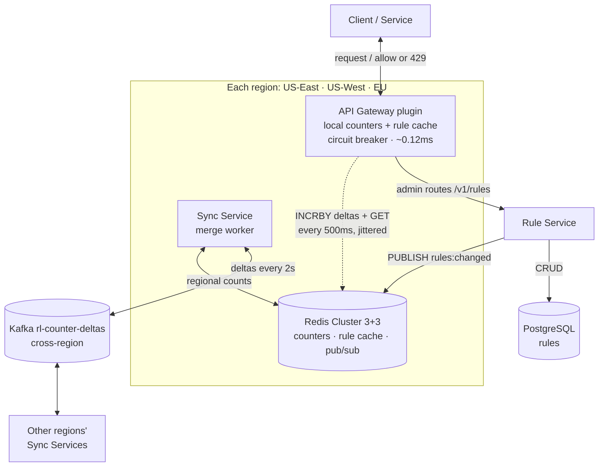

### TL;DR {#cs-rl-tldr}

:::tip[The design in 30 seconds]
- **Placement:** the limiter is a **plugin in the API Gateway**, which already sees every request, so there's no extra hop and no new tier-0 service. A separate **Rule Service** (PostgreSQL) handles admin CRUD on the cold path.
- **Hot path has no network call (~0.12ms):** identity → local rule cache → `AtomicLong.incrementAndGet()` on an in-process `ConcurrentHashMap` → allow, or `429` with `Retry-After` + `X-RateLimit-*` headers.
- **Hybrid counters:** a background thread in the gateway plugin syncs every **500ms** (jittered). In one pipelined round-trip it sends `INCRBY key delta` (returns the new global count) + `GET` of the previous window to the regional Redis Cluster, and resets the local counter to match. Redis load scales with pods × sync frequency, not with request rate, so hot keys are solved by design. Overshoot: typical **~0.8%**, worst case **up to 2× for one sync cycle**.
- **Algorithm per rule:** **Sliding Window Counter** by default (O(1), ~1-2% error, no boundary burst). **Token Bucket** for rules that need bursts. Counter key is `rl:{<ruleId>:<identityValue>}:<windowId>` (braces = literal hash tag, so current + previous window share a slot) with `windowId = floor(now_epoch / windowSeconds)`, and TTL = `2 × windowSeconds` handles cleanup.
- **Multi-region:** each region runs its own Redis. A Sync Service (cross-region only) exchanges deltas over the Kafka topic `rl-counter-deltas` every **2s**, and enforcement uses `local_count + sum(remote_counts)`. The ~10% overshoot bound is part of the product contract.
- **Fail-open by default:** after 3 consecutive Redis timeouts the circuit breaker opens and each pod falls back to local-only counting with the full limit. This is silent, so breaker-open duration **pages**.
- **Rules propagate** via Redis pub/sub `rules:changed` (~1-2s), a **60s TTL** safety net and a cold-start load from the Rule Service. A `version` field drops out-of-order events.
:::

### Scale {#cs-rl-scale}

<StatGrid stats={[
  {value: '1M rps', label: 'Peak checks', detail: 'Inline on every API request', accent: 'blue'},
  {value: '10M', label: 'Unique client keys', detail: 'x 5 active rules', accent: 'purple'},
  {value: '100M', label: 'Counter keys (peak)', detail: '10M x 5 x 2 windows', accent: 'green'},
  {value: '~12 GB', label: 'Redis memory', detail: '~120 B/key, ~4 GB per primary', accent: 'amber'},
  {value: '~0.12ms', label: 'Hot-path cost', detail: 'Budget is 10ms; decision SLO p99 1ms', accent: 'cyan'},
  {value: '~10%', label: 'Cross-region overshoot', detail: '3 regions, 2s sync', accent: 'red'},
]} />

**Numbers to remember**
- **Memory:** key `rl:{rule-001:sk-abc123}:28284218` = 32 B + value 8 B + Redis per-key overhead ~80 B ≈ **120 B/key** (~148 B with a full UUID rule id; token bucket ~200 B). 10M × 5 × 2 (current + previous window, TTL = 2 × window) = **100M keys × 120 B ≈ 12 GB**. 3 primaries + 3 replicas → **~4 GB/shard** on 8-16 GB nodes (~50% headroom).
- **Hot key:** one client at 100K rps. Redis sees 50 pods × 2 syncs/s = **100 pipelined round-trips/s (200 commands/s: `INCRBY` + `GET`)** on that key, not 100K. Sub-shard only at 1000+ pods.
- **Hybrid overshoot (per region):** *typical* (steady traffic spread across pods) ≈ pods × per-pod rate × sync interval = 50 × (1000 / 60s / 50) × 0.5s ≈ **8 requests (~0.8%)**. *Worst case* (all pods burst within one 500ms interval): 20 per pod between syncs, and if every pod syncs at the same moment, **1000 extra (up to 2× limit for one sync cycle)**. Jitter mitigates it.
- **Cross-region overshoot:** 3 regions × (2s / 60s) × 1000 = **100 requests (~10%)**. Going from 2s to 1s halves it.
- **Fail-open cost:** permissive = 50 pods × 1000 = **50,000/min (50× over)**. Conservative = 1000/50 = **20/pod**, which under-admits when autoscaling changes the pod count.
- **Latency menu:** local counter ~0.1ms · Redis intra-AZ ~1-2ms · single global Redis cross-region **~70-150ms**.
- **Rules:** change ~1-10/day. 50 gateways polling every 30s = 100 queries/min (144K/day). Each change is seen once per gateway, so ~99.97% of polls return "no change" at ~1 change/day (~99.65% at 10/day), so pub/sub is the better fit. Propagation takes ~1-2s normally and **60s** worst case.
- **Fleet:** 3 regions (US-East, US-West, EU) × ~50 gateway pods. Rule Service 2-3 pods. Sync Service one per region (cross-region only). Kafka `rl-counter-deltas` replicated across regions. PostgreSQL single primary + read replica.
- **Metrics:** per-identity labels = 10M × 5 × 2 ≈ **100M series** (hundreds of GB). Bounded labels = 5 rules × 2 outcomes × 3 regions × 50 pods ≈ **1.5K series**.

### Requirements {#cs-rl-requirements}

| FR | Requirement | Satisfied by |
|----|-------------|--------------|
| FR1 | Admin manages rules per identity type | `/v1/rules` CRUD → Rule Service → PostgreSQL → `PUBLISH rules:changed` |
| FR2 | Evaluate and enforce on every request | Gateway plugin: local rule cache + local counter, synced to Redis every 500ms |
| FR3 | Return rate-limit headers on every response | `Retry-After` (429 only) + `X-RateLimit-Limit` / `-Remaining` / `-Reset` on every response |

| NFR (LSDARO) | Target | Mechanism |
|--------------|--------|-----------|
| **L**atency | Evaluation under 10ms, inline | In-process counter + local rule cache (~0.12ms). Redis is off the request path |
| **S**cale | 1M rps, millions of unique keys | Hybrid counters (Redis sees pods × sync rate), O(1) algorithms, Redis Cluster 3 + 3 |
| **D**urability | Rules durable. Counters ephemeral (losing a window is OK) | PostgreSQL for rules. Counters use TTL with no persistence |
| **A**vailability | 99.99%, fail-open by default | Circuit breaker → local-only permissive mode. The limiter never returns 5xx |
| **R**esiliency | Degrade on Redis down, rule store down, region partition | Local fallback, 60s cached rules + cold-start bootstrap, regions keep enforcing on last-known remote counts |
| **O**bservability | Rejection rates, top throttled, accuracy drift, per-rule hits | Bounded-label metrics, Space-Saving top-K + Count-Min sketches, breaker-open page, canary tenant |

**Out of scope:** DDoS / WAF (network-layer floods), billing / monetization tiers, request queuing / retry orchestration (we only allow or 429).

### Entities & Stores {#cs-rl-stores}

Entities: **Rule** (identity type, threshold, window, algorithm), **Client** (the identity being limited: IP, API key, service, user id), **Counter** (the hot-path state). Request is the *input* to `checkLimit` and is not stored.

| Store / Entity | Tech | Key / shape | Holds | Why |
|----------------|------|-------------|-------|-----|
| Rule | PostgreSQL | PK `id` (UUID). `identityType` (`ip` / `api_key` / `client_key` / `service`), `resource` (route, e.g. `/api/v1/orders`), `limit`, `windowSeconds`, `algorithm` (`fixed_window` / `sliding_window` / `token_bucket`), `action` (`reject` / `throttle`), `version` (bumped on every update) | Source of truth for rules | Durable, relational, auditable. Low write volume (admin only) |
| Rule cache | Redis + in-process local cache | Local entries TTL 60s, invalidated on `rules:changed` | Hot-path rule lookup | Zero-hop reads, bounded staleness |
| Counter (global) | Redis Cluster | `rl:{<ruleId>:<identityValue>}:<windowId>` → int, TTL = `2 × windowSeconds` (set with `EXPIRE key ttl NX`) | Global request count per window | Sub-ms, atomic `INCRBY`, hash tag keeps current + previous window in one slot, TTL self-cleans (no cleanup job) |
| Counter (local) | In-process `ConcurrentHashMap<String, AtomicLong>` | Same key + delta accumulator | Per-pod count since last sync | ~0.1ms, no network hop |
| Rule-change channel | Redis pub/sub | `rules:changed`, payload `{ ruleId, version, action: "updated" }` | Invalidation events | Event-driven: zero cost when idle |
| Cross-region deltas | Kafka topic `rl-counter-deltas` (cross-region) | Per-region deltas every 2s | Remote counts for `effective_count` | Async, keeps cross-region latency off the hot path |
| Top-K throttled | Redis sorted set | `topk:<ruleId>:<minute>` | Merged heavy-hitter list per rule | Bounded size regardless of identity count |

### API {#cs-rl-api}

| Path | Call / Endpoint | Purpose |
|------|-----------------|---------|
| Admin (cold) | `POST /v1/rules`, `PUT /v1/rules/:ruleId`, `GET /v1/rules`, `GET /v1/rules/:ruleId`, `DELETE /v1/rules/:ruleId` | Rule CRUD. Body: `identityType`, `resource`, `limit`, `windowSeconds`, `algorithm`, `action` (`version` is server-managed) |
| Hot (inline) | `POST /v1/check` with `identityType`, `identityValue`, `resource` | Logical contract only. In practice it runs as gateway / mesh middleware (Envoy, Kong, Istio) or an in-process library |
| Allowed | `200 OK` + `X-RateLimit-Limit: 100`, `X-RateLimit-Remaining: 42`, `X-RateLimit-Reset: 1697051400` | Callers can see their remaining quota |
| Throttled | `429 Too Many Requests` + `Retry-After: 2` + `X-RateLimit-Remaining: 0` + Limit / Reset | Reject. Queuing is the caller's job |
| Header math | Limit = `rule.limit`. Remaining = `max(0, limit - count)`. Reset = `(windowId + 1) × windowSeconds`. Retry-After = reset - now | Computed from the counter result |

### Placement & Algorithm {#cs-rl-algorithm}

| Placement | Verdict |
|-----------|---------|
| Client-side SDK | ✗ Trivially bypassed. You can't trust the client |
| Per-pod sidecar (local only) | ✗ 50 pods each see 1/50th of traffic, so global accuracy needs a shared store anyway |
| Dedicated limiter service | ✗ Clean, but adds a hop and a new tier-0 dependency (possible SPOF) to every request at 1M rps |
| **API Gateway plugin + shared Redis** | ✓ No new infra, sees all traffic, global accuracy. Cost: coupled to the gateway, and east-west traffic isn't limited |

| Algorithm | Memory | Accuracy | Bursts | Redis cost | Verdict |
|-----------|--------|----------|--------|------------|---------|
| Fixed Window | O(1) | Poor | 2× at edges (100 at 12:00:59 + 100 at 12:01:00) | 1 INCR | ✗ Boundary burst |
| **Sliding Window Counter** | **O(1)** | **~1-2% off** | Smoothed | **1 GET + 1 INCR** (pipelined, 1 RTT, no Lua) | **✓ Default** (Cloudflare) |
| Sliding Window Log | O(N): 1000 rps × 60s = 60K entries/key | Perfect | None | ZADD + ZREM + ZCARD | ✗ Memory explodes. OK for low-volume login 5/min |
| Leaky Bucket | O(1) | Perfect | Queues | Lua | ✗ A shaper (outbound), not a gate |
| **Token Bucket** | **O(1)** | Good | **Controlled** ("100 burst, sustain 10/sec") | **Lua** (atomic read-compute-write) | **✓ Per rule when bursts are needed** (Stripe, AWS) |

- **Sliding window math:** `weighted = prev_count × (1 - elapsed_ratio) + curr_count`. Example at 12:01:15: 84 × 0.75 + 36 = 99 against a limit of 100 → allow.
- **Token bucket vs leaky bucket:** token bucket *polices* input (bursts allowed, instant allow/reject). Leaky bucket *shapes* output (smooth drain, excess queues).
- **Atomicity:** sliding window counter needs **no Lua**: `INCRBY` on the current window is atomic, the previous window is a read-only `GET`, and the estimate is computed in the gateway. Token bucket's refill-then-take is a read-modify-write, so it needs a **Lua script**, which runs on Redis's single thread. Keep it to ~5 commands, because a slow script blocks every other command.

### Architecture {#cs-rl-architecture}

`rules:changed` reaches every gateway through its Redis subscription. On cold start, a pod loads all rules from the Rule Service over HTTP.

### Key Flows {#cs-rl-flows}

**Request check (allowed)**
1. The gateway plugin extracts the identity (IP, API key, ...) from the request (~0.01ms).
2. It matches the rule from the **local** rule cache (~0.05ms).
3. It builds `rl:{<ruleId>:<identityValue>}:<windowId>` and calls `AtomicLong.incrementAndGet()` on the local delta (~0.05ms).
4. If the local delta ≤ `localAllowance`, the request is forwarded with `X-RateLimit-*` headers. `localAllowance = max(0, limit − estimatedGlobal) / activePods`, recomputed at each sync; `estimatedGlobal` includes remote region counts. Without the split, a client spraying all 50 pods could get 50× its limit in one interval.
5. The gateway plugin's background thread runs every 500ms (jittered). For each dirty counter it pipelines `INCRBY key delta` (returns the new global count) + `GET` of the previous window in one round-trip, updates the local counter and resets the delta. None of this is on the request path.

**Request rejected (429)**
1. Steps 1-3 as above. The local delta exceeds `localAllowance`.
2. The gateway returns `429 Too Many Requests` with `Retry-After` = reset - now, `X-RateLimit-Remaining: 0`, plus Limit and Reset.
3. The backend never sees the request, and nothing is queued for replay.
4. The deny increments the per-rule `deny` metric (bounded labels). The identity goes into the pod's Space-Saving top-K + Count-Min sketch. 1% of denies are logged with a hashed identity. Allows are never logged.

**Rule create / update propagation**
1. `PUT /v1/rules/:ruleId` goes through the gateway to the Rule Service, which persists to PostgreSQL.
2. The Rule Service runs `PUBLISH rules:changed` with `{ ruleId, version, action: "updated" }`.
3. Every gateway is subscribed. It invalidates the local entry, and the next request fetches the rule fresh from the Redis rule cache. `version` lets a pod ignore duplicate or out-of-order events.
4. If a pod misses the message (restart, network blip), the local entry still expires within its **60s TTL**. That is the worst-case staleness.
5. A pod's cold start loads **all** active rules from the Rule Service (HTTP, not the cache), then subscribes. It never depends on cache state.

**Multi-region counter sync**
1. Each region keeps counters in its own Redis Cluster, at ~1-2ms local latency.
2. Every 2s, each region's Sync Service publishes its delta to the cross-region Kafka topic.
3. The merge worker consumes the other regions' deltas. Example: 400 + 350 + 200 = global estimate 950.
4. Enforcement: `effective_count = local_count + sum(remote_counts)`. If that is > limit, reject.
5. During a partition, each region keeps enforcing on its last-known remote counts. Overshoot grows with the length of the partition, but enforcement never stops.

**Counter store down (fail-open)**
1. The Redis health check fails 3 times in a row, so the circuit breaker **opens**.
2. The pod switches to local-only mode and enforces the **full** limit itself (permissive, up to 50× in aggregate).
3. An alert fires: breaker open > 30s on > 10% of pods pages. Callers still get allow or 429, never a 5xx.
4. Redis auto-failover takes seconds (typically under 10s). The breaker goes **half-open** and probes with a single sync.
5. If the probe succeeds, the breaker closes, normal sync resumes, and local counters re-warm from the Redis global state.
6. Security or cost rules (login/OTP brute force, vendor-billed calls) can opt into fail-closed or conservative `limit / num_pods` instead.

### Decisions {#cs-rl-decisions}

| Topic | Chosen | Rejected | Why | Revisit when |
|-------|--------|----------|-----|--------------|
| [Placement](/problems/real-time/rate-limiter#placement-decision) | API Gateway plugin + shared Redis | Client SDK, per-pod sidecar, dedicated service | Reuses a chokepoint that already sees all traffic and has an availability budget. No extra hop or tier-0 dependency at 1M rps | Much of the protected traffic skips the gateway (east-west) → mesh sidecar / shared library. Several gateway products need the same quotas → shared library, same counter store |
| [Default algorithm](/problems/real-time/rate-limiter#algorithm-selection) | Sliding Window Counter | Fixed Window, Sliding Log, Leaky Bucket | O(1), 1 pipelined RTT, no boundary burst, ~1-2% approximation | — |
| Burst algorithm | Token Bucket, per rule via `algorithm` | Sliding window for every rule | Explicit burst control | Lua latency spikes → move hot rules to sliding window |
| [Counter store (5.1)](/problems/real-time/rate-limiter#51-latency--counter-store) | Hybrid: local `AtomicLong` + 500ms Redis sync | Redis-only (~1-2ms), local-only (1/Nth view) | 0.1ms hot path. A slow Redis makes counts staler, not requests slower. Removes the hot-key problem | A rule needs hard guarantees (paid quotas, login/OTP) → Redis-only path for that subset |
| Memory policy (5.1) | Size for peak + ~50% headroom, `maxmemory-policy noeviction` | Eviction policies | An eviction silently grants a fresh quota. `noeviction` turns pressure into failed writes → breaker + page | Key cardinality grows (new identity types / rules) → add shards before any eviction |
| [Multi-region (5.2)](/problems/real-time/rate-limiter#52-multi-region-accuracy) | Per-region Redis + async 2s sync (Kafka) | Single global Redis (70-150ms), static `limit / num_regions`, CRDT G-Counter | Local latency. ~10% bound becomes a product contract. CRDTs would be functionally equivalent but more complex | A tighter contract is needed → 1s sync or pin tenants to a home region first. CRDTs only for sub-second convergence |
| [Failure mode (5.3)](/problems/real-time/rate-limiter#53-availability--fail-open) | Fail-open, local fallback, permissive, circuit breaker | Fail-closed (503), fail-open with no limiting, conservative `limit / num_pods` | A Redis outage must not become a full outage. Pod count is dynamic, so conservative mode under-admits paying customers | Outages last minutes, not seconds. Security / cost rules opt into fail-closed |
| [Rule propagation (5.4)](/problems/real-time/rate-limiter#54-rule-propagation) | Redis pub/sub + 60s TTL + cold-start bootstrap | Polling every 30s, pub/sub alone, direct push | Fast path + staleness ceiling + correct bootstrap. Zero cost when idle | Rules become an incident lever ("block now") → acknowledged push (per-pod applied version) or durable log (Kafka) |
| [Final shape (5.5)](/problems/real-time/rate-limiter#55-final-architecture) | Gateway (hot + 500ms Redis sync) · Rule Service (cold) · Sync Service per region (cross-region only) · Kafka · Redis · PostgreSQL | Single Redis, single region (the initial HLD) | Each deep dive adds one piece | — |
| [Observability cardinality (5.6)](/problems/real-time/rate-limiter#56-observability) | Bounded labels + per-pod Space-Saving top-K (K ≈ 100) + Count-Min, merged every ~10s, plus 1% sampled deny logs | Per-identity metric labels | ~1.5K series vs ~100M. Keeps raw keys / IPs out of the TSDB | Per-tenant counts become customer-facing or billing → decision events to Kafka → OLAP (Pinot / ClickHouse). Raise K if abusers go missing |
| Rule storage | PostgreSQL | Redis-only, config file | Durable, relational, auditable, low write volume | — |
| Counter durability | Ephemeral (TTL, no persistence) | AOF / disk-backed | Counters reset every window anyway. Loss means brief over-admission | — |

### Failure Modes {#cs-rl-failures}

| Scenario | Impact | Mitigation |
|----------|--------|------------|
| Hot key (e.g. `clientId=acme` at 100K rps) | One Redis key hammered | Hybrid already absorbs it (~100 pipelined round-trips/s = ~200 commands/s). At 1000+ pods: split into N sub-keys, write to a random one, sum on read |
| Redis Cluster outage | Can't sync counters or read the rule cache | Breaker trips → local-only permissive. Auto-failover in ~seconds. Page on breaker-open duration |
| Redis shard overload | Higher latency on one shard | Watch per-shard ops/sec, rebalance hash slots, audit hash tags that co-locate too many keys |
| Memory pressure / eviction | **Silent** quota reset for evicted clients | `noeviction` + headroom. `evicted_keys` must be 0 (page) |
| Rule propagation lag | Stale rule enforced for up to 60s | Accepted. Pub/sub is ~1-2s on the happy path, and the TTL bounds the worst case |
| Cross-region sync drift / partition | ~10% over-admit, growing during a partition | By design. Enforce on last-known remote counts. 2s → 1s halves drift |
| Pod restart (thundering herd) | Local counters zeroed, so the pod admits freely for ~500ms | Pre-warm active counters from Redis **before** the readiness probe passes |
| Lua script latency spike | Token-bucket Lua blocks Redis's single thread | Keep scripts to ~5 commands, watch `slowlog`, move hot rules to sliding window (no Lua) |
| Counter key explosion | Hundreds of millions of keys | TTL auto-cleans. Monitor `dbsize`. Shorten windows or reduce rules per identity |
| Rule store (PostgreSQL) down | New pods can't bootstrap | Running pods keep the local + Redis rule cache. Alert on bootstrap error rate > 1% |

### Observability {#cs-rl-observability}

- **SLOs:** decision overhead p99 under 1ms (p50 under 0.2ms). Overshoot ≤ ~10% for 99% of windows. Enforcement coverage (pod-minutes with breaker closed) ≥ 99.9%. Rule propagation p99 under 2s, hard max 60s. Gateway availability 99.99%. **Limiter-caused 5xx = 0**.
- **Fail-open is silent, so alert on missing signal:** when the breaker opens, requests succeed and latency *improves*. Page on breaker open > 30s on > 10% of pods, on the 429 rate collapsing to ~0 while traffic is steady, and on the **synthetic canary tenant** (sends `limit + N`, expects ~N 429s) getting 0 429s.
- **Pages:** fleet-wide breaker open, `evicted_keys` > 0, canary not throttled, availability burn (14× over 1h). **Tickets:** drift creeping toward 10%, Kafka lag > 2 sync intervals (~4s) for 5 min, rule version skew > 0 for > 60s, Redis memory > 75% (page at > 90%).
- **Infra / deps:** gateway GC pause p99 > 50ms (the limiter runs in-process), restart spikes (each zeroes counters), cross-region RTT > 2× baseline, Redis per-shard p99 > 5ms or one shard > 2× mean ops/sec, connection pool > 80%, gateway sync flush (`INCRBY` + `GET`) failures > 1% or p99 > 100ms.
- **App / business:** per-rule deny rate > 3× its 1h baseline (bad rule or attack). Top-K throttled identities per rule (hashed). A paying tenant in the top-K > 1h opens a ticket to the account team. Track % of tenants above 80% of quota.
- **Client:** retries sent before `X-RateLimit-Reset` (`Retry-After` ignored, which can look like an attack). Synthetic latency with the limiter on vs off (regression > 1ms).
- **Tracing / logs at 1M rps:** no span per decision. Add `rule_id` + `decision` attributes to the sampled gateway span. Gateway sync flushes and the Sync Service merge worker get their own spans. Log denies sampled with a hashed identity, and never log allows.

### Concept Crib {#cs-rl-concepts}

| Concept | What to remember for this design | Link |
|---------|----------------------------------|------|
| Rate limiting algorithms | A rate limiter is a counter with a clock. Sliding window counter weights the previous window by the remaining overlap. Token bucket = policing, leaky bucket = shaping. Sliding log is O(N), fine only for low volume (login 5/min). Clock skew is negligible at 1-10ms on 60s windows, but use Redis `TIME` for sub-second windows. Redis tops out around ~100K ops/sec per key | [Rate Limiting](/patterns/rate-limiting) |
| Redis | Single-threaded, so every command (and every Lua script) is atomic, and a slow script blocks everything. Cluster = 16384 hash slots, `CRC16(key) % 16384`. Multi-key pipelines and Lua need one slot, so use a hash tag (e.g. `rl:{rule-001:sk-abc123}:28284218` keeps the current and previous window keys together). Replicas are async with failover in seconds, and the small loss is fine for ephemeral counters. `noeviction` errors on write when full. Classic pub/sub is fire-and-forget | [Redis](/building-blocks/redis) |
| API Gateway | Single entry point for cross-cutting concerns. Pipeline: TLS → Auth → **Rate Limiting** → Routing. L7 adds ~1-2ms. Common setup: L4 (NLB) in front of L7 (Envoy / Kong). Gateway overload is itself mitigated by rate limiting | [API Gateway](/building-blocks/api-gateway) |
| Observability | Page on symptoms, ticket on causes. **Alert on absence**: "zero rejections" means the limiter isn't enforcing. An open breaker on a fail-open path pages directly. Answer "top offenders" with streaming top-K sketches, never per-entity series. Synthetic canary tenants catch "nothing is happening" failures | [Observability](/foundations/observability) |
| Sharding | The celebrity-key example is literally `clientId=BigCorp` in a rate limiter. Moving or splitting shards doesn't fix a **single** hot key. The only fixes are key splitting (`key:shard_N`, write random, read SUM), caching, local aggregation, or rate limiting. Rebalance at ~60-70% capacity | [Sharding](/distributed-systems/sharding) |
| Partitioning | Skew is prevented in the key design: hash buckets (`key + (hash(sub_id) mod B)`) for a very hot single key, `tenantId + hash bucket` for whale tenants. Reads then fan out to B buckets | [Partitioning](/distributed-systems/partitioning) |
| Consistent hashing | ~1/N keys move on a node change. Redis does **not** use it. Hash slots give deterministic resharding, a 2KB slot bitmap and no vnodes | [Consistent Hashing](/distributed-systems/consistent-hashing) |

Stub pages (design-page facts only): [Circuit Breaker](/patterns/circuit-breaker), [Bulkhead](/patterns/bulkhead).

### Staff Talking Points {#cs-rl-staff}

:::staff[What makes this answer senior]
- **Own the hot path, don't add to it.** A dedicated limiter service is the "clean" answer but adds a hop and a tier-0 dependency at 1M rps. Embedding in the gateway reuses a chokepoint that already has an availability budget. The cost: plugin model coupling, and east-west traffic isn't covered.
- **Trade exactness for a bounded, tunable error.** Overshoot ≤ pods × requests admitted per sync interval, tuned with sync interval and jitter. Redis load then scales with pods × sync frequency, not request rate, so one choice removes the hot-key class of bottleneck. The cost is that pods become stateful, so pre-warm before readiness is **required**.
- **State the error bound as a product contract** ("limits are enforced within ~10%") instead of pretending to have global consistency. Tighten with a shorter sync interval or tenant homing before reaching for CRDTs.
- **Fail-open is a per-rule business decision, and it's silent.** Default permissive, but login/OTP and vendor-billed rules opt into fail-closed. Page on breaker-open duration, 429 collapse and the canary, because "not enforcing" produces no errors.
- **Design out silent failures:** an eviction silently resets a quota, so use `noeviction` and treat `evicted_keys` = 0 as an invariant. Rule propagation layers pub/sub (fast) + TTL (ceiling) + bootstrap (correct start) + `version` (measurable skew).
- **A rate limiter counts a huge, attacker-controlled keyspace.** That makes it the worst place for unbounded metric labels. Answer "who" with sketches (~1.5K series), not labels (~100M).
:::

### Likely Follow-ups {#cs-rl-followups}

| Question | Crisp answer |
|----------|--------------|
| Why not a standalone rate-limit service? | It adds a network hop and a new tier-0 dependency to every request at 1M rps. The gateway already sees all traffic and has an availability budget. |
| Why not `INCR` in Redis on every request? | It costs ~1-2ms per request, puts Redis in the request path, and makes a 100K-rps client a single hot key. Hybrid takes 0.1ms and Redis sees ~100 pipelined round-trips/s (~200 commands/s) per key. Hard-guarantee rules can still use the Redis-only path. |
| How far over the limit can a client get? | Within a region: typically ~0.8% (1000 × 0.5s / 60s ≈ 8 requests), worst case up to 2× for one sync cycle if every pod bursts in the same 500ms interval (jitter mitigates). Across regions it's ~10% (3 × 2s/60s × 1000 = 100). SLO: overshoot ≤ ~10% in 99% of windows. |
| Redis goes down. What happens? | After 3 consecutive timeouts the breaker opens and pods go local-only with the full limit (up to 50× over, for seconds). That pages. The breaker goes half-open, probes one sync, closes, and counters re-warm from Redis. |
| Why not fail-closed? | It turns a Redis outage into a full outage that blocks paying customers. Fail-closed is a per-rule opt-in for security and cost rules (login/OTP, vendor-billed calls). |
| Sliding window counter or token bucket? | Sliding window counter by default: O(1), 1 GET + 1 INCR with no Lua, ~1-2% error, no boundary burst. Token bucket per rule when product wants bursts ("100 burst, sustain 10/sec"), at the cost of a Lua script. |
| What's wrong with fixed window? | Boundary burst: 100 requests at 12:00:59 + 100 at 12:01:00 = 200 in 2s against a 100/min limit. |
| A gateway pod restarts. Any risk? | Its local counters reset to 0, so it would admit freely for ~500ms. Pre-warm active counters from Redis before the readiness probe passes. |
| How does a rule change reach ~150 pods? | `PUBLISH rules:changed` (~1-2s). A missed event is covered by the 60s local TTL. New pods bootstrap from the Rule Service. `version` drops stale events. Rules that need "block now" would need an acked push or Kafka. |
| How do you report top throttled clients at 10M identities? | Not with metric labels (~100M series, plus secrets in labels). Each pod runs a Space-Saving top-K + Count-Min sketch over denies, ships them every ~10s, and they merge into `topk:<ruleId>:<minute>`. Sampled deny logs cover the long tail. |

→ [Full design](/problems/real-time/rate-limiter)
