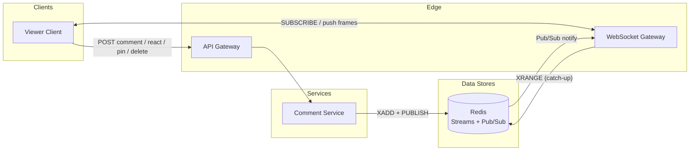
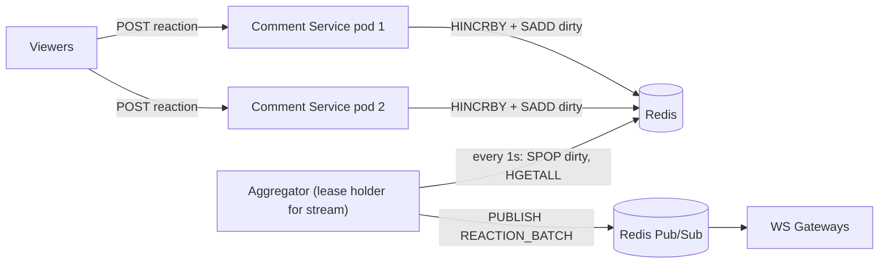
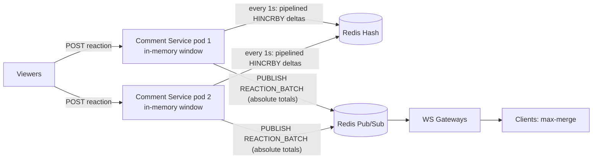
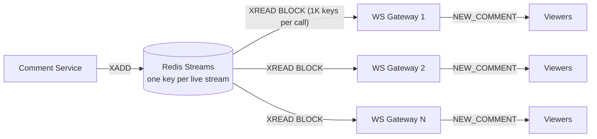
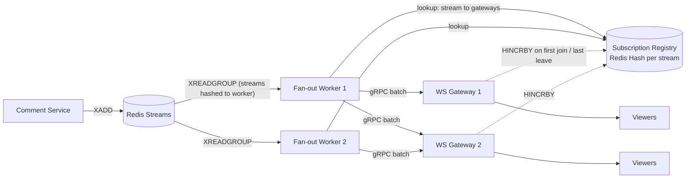
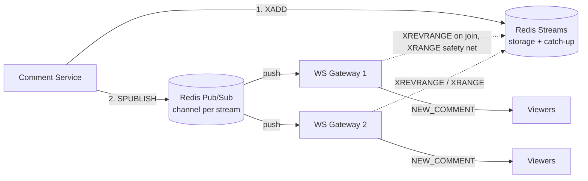
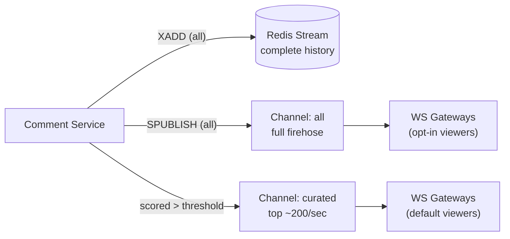
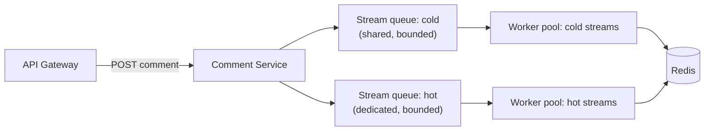

# Live Comments

Design a real-time comment system for live streaming — the comment overlay viewers see during a Facebook/Instagram Live broadcast.

## 1. Requirements

### Functional Requirements
1. **FR1**: User should be able to post a comment on a live stream in real-time
2. **FR2**: User should see all comments from other viewers in near real-time; users joining mid-stream should see recent comments posted before they joined
3. **FR3**: User should be able to react to a comment (like, emoji)
4. **FR4**: Comments are ephemeral — visible only during the live session, not persisted after stream ends
5. **FR5**: Streamer should be able to pin a comment to the top
6. **FR6**: Streamer/moderator should be able to delete a comment

### Non-Functional Requirements (LSDARO)
1. **NFR1 — Latency**: Comment should appear on all viewers' screens within 500ms of posting
2. **NFR2 — Scale**: Support 1M+ concurrent viewers on a single stream; 10K comments/sec on a viral stream
3. **NFR3 — Durability**: Comments are ephemeral — no persistence after stream ends. Loss of a comment during delivery is acceptable (best-effort)
4. **NFR4 — Availability**: 99.9% uptime; comment delivery can degrade gracefully (drop/sample comments) under extreme load rather than take down the stream
5. **NFR5 — Resiliency**: System should handle viewer spikes (celebrity goes live) without affecting other streams; isolate blast radius per stream
6. **NFR6 — Observability**: Comments/sec per stream, delivery latency p99, dropped comment rate, active viewer count — see [§5.2 Observability](#52-observability)

### Out of Scope
- Video/audio streaming infrastructure — we only handle the comment overlay
- Comment moderation / spam filtering / toxicity detection — separate ML pipeline
- Comment persistence / history / replay after stream ends
- Threaded replies / conversations within comments
- Monetization (Super Chat / paid comments)
- User authentication — assume identity is resolved upstream

## 2. Core Entities

| Entity | Description |
|--------|-------------|
| **User** | Viewer or streamer — `userId`, `displayName`, `avatarUrl`, `role` (viewer / streamer / moderator) |
| **LiveStream** | The live session container — `streamId`, `streamerId`, `status` (live / ended), `startedAt`. Comments, pins, and reactions are all scoped to a stream. |
| **Comment** | A single message in the stream — `commentId`, `streamId`, `userId`, `text`, `createdAt` |
| **Reaction** | An emoji/like on a comment — `reactionId`, `commentId`, `userId`, `type` (❤️, 😂, etc.). Separate entity to avoid write amplification on Comment rows. |
| **PinnedComment** | One per stream — `streamId`, `commentId`, `pinnedBy`, `pinnedAt`. Separate so pin/unpin is a simple upsert, not a scan through comments. |

:::info Why LiveStream, not Video?
FR4 scopes comments to a *live session* — they're ephemeral and disappear when the stream ends. `LiveStream` reflects this lifecycle. `Video` implies a VOD with persistent content, which is explicitly out of scope.
:::

:::staff[Why ephemeral? Scoping out persistence is a design decision (FR4)]
At 10K comments/sec, a 60-minute viral stream generates **36M comments**. Persisting all of them across thousands of daily streams adds massive write volume to durable storage for content almost nobody re-reads. Ephemeral design lets us use in-memory stores (Redis) and short-TTL logs (Kafka) — keeping the architecture focused on the hard problem: **real-time fan-out to 1M+ viewers at &lt;500ms**. It also sidesteps GDPR deletion requests and content takedown obligations on casual live chat. If VOD replay is needed later, it becomes a deep dive — not a baseline requirement.
:::

## 3. API / Interface

### 3.1 REST APIs (Cold Path)

REST endpoints handle writes (post, react, pin, delete) and initial catch-up reads. Real-time delivery uses the WebSocket hot path (§3.2).

#### Post a Comment (FR1)

```
POST /v1/streams/{streamId}/comments
Authorization: Bearer <token>

{
  "text": "🔥 great stream!"
}
```

Response: `201 Created`
```json
{ "commentId": "c_abc123", "createdAt": "2026-10-12T19:00:00Z" }
```

`userId` is extracted from the auth token, not sent in the body.

#### Fetch Comments — Catch-up & Gap Fill (FR2)

```
GET /v1/streams/{streamId}/comments?cursor={commentId}&direction={before|after}&limit=50
```

| Param | Required | Description |
|-------|----------|-------------|
| `cursor` | No | Comment ID to page from (exclusive). Omitted = start from the newest comment. |
| `direction` | No (default `before`) | `before` = older than cursor (scroll back), `after` = newer than cursor (gap fill) |
| `limit` | No (default 50, max 100) | Page size |

Response: `200 OK`
```json
{
  "comments": [
    { "commentId": "c_abc120", "userId": "u_1", "displayName": "Alice", "text": "hello!", "createdAt": "..." },
    ...
  ],
  "nextCursor": "c_abc070",
  "hasMore": true
}
```

Three client scenarios use this one endpoint:

| Scenario | Call | Redis command |
|----------|------|---------------|
| **Join mid-stream** (FR2) — show the last 50 | no cursor, `direction=before` | `XREVRANGE stream:{id}:comments + - COUNT 50` |
| **Scroll back** through older comments | `cursor=oldestSeen&direction=before` | `XREVRANGE ... (oldestSeen - COUNT 50` |
| **Reconnect gap fill** — fetch what was missed while disconnected | `cursor=lastSeen&direction=after` | `XRANGE ... (lastSeen + COUNT 50` |

:::staff[Why `direction` matters: reconnects need "after", not "before"]
Without `direction`, the API can only page backwards, so a client that reconnects after a 10s network blip would fetch the *newest* 50 and silently skip the comments in between. `direction=after` makes resume-from-cursor possible. It also makes the API safe to call repeatedly: the client dedupes by `commentId`, so overlap between the gap fill and the live WebSocket feed is harmless. Redis Stream IDs are time-ordered, so both directions map to a single `XRANGE` / `XREVRANGE` with an exclusive bound (`(id`). Scroll-back is bounded by the stream's `MAXLEN` trim (~1000 entries), which is acceptable for an ephemeral overlay.
:::

#### React to a Comment (FR3)

```
POST /v1/streams/{streamId}/comments/{commentId}/reactions
Authorization: Bearer <token>

{
  "type": "❤️"
}
```

Response: `201 Created`

#### Pin a Comment (FR5)

```
PUT /v1/streams/{streamId}/pin
Authorization: Bearer <token>   (streamer/moderator only)

{
  "commentId": "c_abc123"
}
```

Response: `200 OK`

Replaces any existing pin — one pinned comment per stream at a time.

#### Unpin a Comment (FR5)

```
DELETE /v1/streams/{streamId}/pin?commentId={commentId}
Authorization: Bearer <token>   (streamer/moderator only)
```

Response: `204 No Content`

`commentId` makes the unpin conditional: it only removes the pin if that comment is still the one pinned. Without it, a moderator unpinning comment A could accidentally remove comment B that another moderator pinned a moment earlier.

#### Delete a Comment (FR6)

```
DELETE /v1/streams/{streamId}/comments/{commentId}
Authorization: Bearer <token>   (streamer/moderator only)
```

Response: `204 No Content`

### 3.2 WebSocket Frames (Hot Path)

REST handles writes, but real-time delivery to 1M+ viewers (NFR1: &lt;500ms) requires a push channel. Clients subscribe to a stream via WebSocket and receive server-pushed frames.

:::staff[Why WebSocket over SSE?]
Live Comments is mostly unidirectional (server pushes to viewers), which is SSE's sweet spot. However, three factors favor WebSocket: **(1) Mobile** — native iOS has no built-in `EventSource`; WebSocket is first-class on all platforms. **(2) Browser connection limits** — SSE on HTTP/1.1 consumes one of the browser's 6-per-domain connections, competing with images, API calls, and video signaling. **(3) Shared infrastructure** — the platform likely already runs a WebSocket gateway for notifications, presence, and video signaling; adding live comments to the existing connection is zero marginal cost. SSE would be the right choice for a browser-only dashboard or news ticker where mobile support and connection budgets aren't constraints.
:::

#### Client → Server

| Frame | Payload | Description |
|-------|---------|-------------|
| `SUBSCRIBE` | `{ streamId }` | Join the comment feed for a stream |
| `UNSUBSCRIBE` | `{ streamId }` | Leave the comment feed |

#### Server → Client

| Frame | Payload | Description |
|-------|---------|-------------|
| `NEW_COMMENT` | `{ commentId, userId, displayName, avatarUrl, text, createdAt }` | A new comment was posted (FR1) |
| `REACTION_BATCH` | `{ windowEnd, items: [{ commentId, reactions: [{ type, count }] }] }` | Aggregated reactions for all comments that changed in the last 1s window (FR3). `count` is the **absolute total**, not a delta. Individual reactions are batched to avoid a firehose at 1M viewers. |
| `PIN` | `{ commentId, text, displayName }` | A comment was pinned (FR5) |
| `UNPIN` | `{ commentId }` | The pinned comment was removed (FR5) |
| `DELETE` | `{ commentId }` | A comment was deleted (FR6) |

:::note Why `UNPIN` carries `commentId`, not `streamId`
The client already knows its stream: it subscribed to it, and every frame arrives on that subscription. What it needs is *which* pin to remove. Pub/Sub gives no ordering guarantee across publishers, so if a moderator unpins A and immediately pins B, the client might receive `PIN B` before `UNPIN A`. With `commentId`, the client ignores an `UNPIN` that doesn't match the currently pinned comment. With only `streamId`, it would wrongly clear B.
:::

:::tip Why batch reactions?
At 1M concurrent viewers, broadcasting every individual reaction creates an unmanageable firehose. Instead, the server aggregates reactions into 1-second windows and pushes a single `REACTION_BATCH` frame with counts — e.g., `{ type: "❤️", count: 342 }`. This reduces fan-out volume by orders of magnitude while keeping the UX responsive.
:::

## 4. High-Level Design

### Data Model

All data is **ephemeral** (FR4) — stored in Redis with TTLs tied to stream lifetime. No durable database in the baseline design.

**Comment** (Redis Stream — one stream key per live stream; entries auto-trimmed via MAXLEN)

| Field | Type | Description | Example |
|-------|------|-------------|---------|
| key | string | Stream key: `stream:{streamId}:comments` | `stream:s-abc:comments` |
| commentId | string | Entry ID (Redis-generated, time-based) | `1697013060000-0` |
| userId | string | Who posted | `u-abc123` |
| displayName | string | Display name (denormalized for fan-out) | `"Alice"` |
| avatarUrl | string | Profile image URL | `"cdn.example.com/u-abc123.jpg"` |
| text | string | Comment body | `"🔥 great stream!"` |

**Reaction** (Redis Hash — one hash per comment; fields are reaction types, values are counts)

| Field | Type | Description | Example |
|-------|------|-------------|---------|
| key | string | Hash key: `reactions:{streamId}:{commentId}` | `reactions:s-abc:1697013060000-0` |
| type | string | Hash field (emoji) | `"❤️"` |
| count | int | Aggregated count (HINCRBY) | `342` |
| TTL | int | Expires with the stream | `7200` |

**PinnedComment** (Redis String — one key per stream; simple GET/SET)

| Field | Type | Description | Example |
|-------|------|-------------|---------|
| key | string | `pin:{streamId}` | `pin:s-abc` |
| commentId | string | Currently pinned comment | `1697013060000-0` |
| text | string | Comment text (denormalized) | `"Welcome everyone!"` |
| pinnedBy | string | Moderator/streamer userId | `u-streamer` |
| TTL | int | Expires with the stream | `7200` |

:::note Why denormalize displayName/text into fan-out payloads?
At 10K comments/sec, looking up user profiles per comment before fan-out would add a read-per-write to a hot path. The Comment Service embeds display info at write time. Stale names (user changes display name mid-stream) are acceptable — it's a live overlay, not a permanent record.
:::

### Architecture



### How This Satisfies FRs

**FR1: Post a comment** — Client sends `POST /v1/streams/{streamId}/comments` → API Gateway → Comment Service → `XADD` to Redis Stream `stream:{streamId}:comments` (durable within stream lifetime) + `PUBLISH` to Redis Pub/Sub channel `comments:{streamId}` → all subscribed WebSocket Gateways receive the comment → push `NEW_COMMENT` frame to locally-connected viewers.

**FR2: Mid-stream catch-up** — New viewer connects to WebSocket Gateway → sends `SUBSCRIBE { streamId }` → Gateway **first** subscribes to Pub/Sub channel `comments:{streamId}` (buffering live frames), **then** runs `XREVRANGE stream:{streamId}:comments + - COUNT 50` to fetch the newest 50 comments → pushes the backlog, then the buffered live frames, deduped by `commentId`.

:::staff[Subscribe before you read, or you lose comments]
If the gateway reads the backlog first and subscribes second, any comment posted between the two calls is in neither result, so it is silently lost. Subscribing first means the worst case is a duplicate, which the client dedupes by `commentId`. "Duplicates over gaps" is the general rule for any snapshot + live-feed handoff (also used by Kafka compacted-topic bootstraps and CDC snapshot + stream).
:::

**FR3: React to a comment** — Client sends `POST .../reactions` → Comment Service adds the reaction to an **in-memory 1-second window** → on each tick, the window is flushed to Redis with `HINCRBY` and a single `REACTION_BATCH` frame with absolute totals is published via Pub/Sub. See [Reaction Batching](#reaction-batching-fr3) below.

**FR4: Ephemeral comments** — All Redis keys have TTLs tied to stream lifetime (e.g., 2 hours). When the stream ends, keys auto-expire. No durable database, no cleanup jobs.

**FR5: Pin a comment** — Streamer/moderator sends `PUT /v1/streams/{streamId}/pin` → Comment Service does `SET pin:{streamId}` → publishes `PIN` frame via Pub/Sub to all viewers. Replaces any existing pin (one per stream).

**FR6: Delete a comment** — Moderator sends `DELETE .../comments/{commentId}` → Comment Service removes the entry (`XDEL`) → publishes `DELETE` frame via Pub/Sub. Viewers remove the comment from the overlay.

### Reaction Batching (FR3)

**Problem:** A viral stream gets ~100K reactions/sec. Publishing one frame per reaction to 1M viewers means 100K × 1M = **100B frame deliveries/sec**, which is impossible. Viewers can't perceive per-reaction updates anyway; a counter refreshing once a second looks live.

#### Does Redis provide scheduled jobs out of the box?

**No.** Redis has no built-in scheduler or cron. These features are often mistaken for one:

| Redis feature | Why it's not a scheduler |
|---------------|--------------------------|
| Key expiry + keyspace notifications (`__keyevent@0__:expired`) | Expiry is lazy/sampled, so events can fire **seconds late**. Notifications are fire-and-forget Pub/Sub (lost if no subscriber is connected) and node-local in Redis Cluster. |
| Sorted set as a delay queue (score = due time) | A useful *pattern*, but still needs application workers polling `ZRANGEBYSCORE`. |
| Lua scripts / Redis Functions | Run only when a client invokes them; they can't self-schedule. |
| RedisGears / modules | Not core Redis; extra operational surface. |

So the 1-second "job" must live in the application. The question is **where**.

#### Approach A: Central per-stream aggregator (leader per stream)



- Every reaction does `HINCRBY` immediately and marks the comment dirty (`SADD reactions:dirty:{streamId} commentId`)
- One aggregator per stream, elected via a lease (`SET agg:lock:{streamId} podId NX PX 3000`, renewed every second), reads dirty comments every 1s and publishes one batch
- **Pros:** exactly one `REACTION_BATCH` per stream per second; counts always fresh in Redis
- **Cons:** one Redis write **per reaction** (100K writes/sec on a hot stream's hash slot). Lease management for 100K concurrent streams. Failover gap when a lease holder dies (up to the lease TTL).

#### Approach B: In-process tumbling window in every Comment Service pod



- Each pod keeps `streamId → commentId → type → delta` in memory and only touches **changed** comments
- A local ticker (jittered so pods don't flush in lockstep) flushes every 1s: pipelined `HINCRBY` per (comment, type), which **returns the new absolute total**, then one `PUBLISH` per stream with those totals
- Clients apply `count = max(current, received)`. Totals only grow (un-react is out of scope), so out-of-order or duplicate batches from different pods are harmless.
- **Pros:** no scheduler, no leader election, no per-reaction Redis write (100K reactions/sec become about one pipeline per pod per second). The same local-aggregate + periodic-flush pattern as the [rate limiter's hybrid counters](/problems/real-time/rate-limiter#51-latency--counter-store).
- **Cons:** up to N batches per stream per second (N = pods that received reactions for it). A pod crash loses at most 1s of reactions.

#### Decision: Approach B — in-process window, absolute totals, client max-merge

| | Approach A (central aggregator) | **Approach B (per-pod window)** |
|---|---|---|
| Redis writes per hot stream | ~100K/sec | **~N pipelines/sec** |
| Batches per stream per second | 1 | ≤ N (pods with traffic for that stream) |
| Coordination | Lease per stream | **None** |
| Failure impact | Lease gap (seconds) | ≤ 1s of reactions on the crashed pod |

- **Key trade-off:** we accept a few batch frames per second per hot stream (one per pod) instead of exactly one, to remove coordination entirely
- **What we give up:** exactly-once counts (≤ 1s lost on crash, acceptable per NFR3) and a single frame per window
- **When to revisit:** if hot streams spread reactions across so many pods that frame count matters, route reactions with **stream affinity** ([consistent hashing](/distributed-systems/consistent-hashing) on `streamId` at the gateway) so one or a few pods own each stream's window

:::staff[Absolute totals make the pipeline order-insensitive]
Publishing **deltas** ("+37 ❤️") forces every client to see every batch exactly once and in order. Any loss or duplicate permanently corrupts the counter. Publishing **absolute totals** returned by `HINCRBY` and merging with `max()` turns the stream into a monotonic, idempotent update: duplicates, reordering and dropped batches all self-heal on the next tick. The same idea underlies state-based CRDTs. Prefer idempotent state over deltas whenever the transport is best-effort.
:::

:::note
This HLD is intentionally minimal — single Redis, no hot-stream handling, no sampling. The deep dives below evolve this into a system that handles 1M+ viewers at &lt;500ms with graceful degradation. The core insight: **Redis Streams for storage/catch-up + Redis Pub/Sub for real-time fan-out** — each optimized for its job.
:::

## 5. Deep Dives

### 5.1 Real-time Fan-out at Scale

**Problem:** How do we deliver every comment to 1M+ connected viewers within 500ms (NFR1 + NFR2)?

The HLD shows Comment Service publishing to Redis Pub/Sub, which notifies WebSocket Gateways. But *how* does this scale? At 10K comments/sec to 1M viewers across 100 WS Gateways, the fan-out layer must deliver **10K × 100 = 1M messages/sec** from Redis to gateways alone — before any gateway-to-client push.

#### Approach A: WS Gateways Read Redis Streams Directly (XREAD)

Each WS Gateway runs `XREAD BLOCK` loops on the stream keys its viewers care about.

```
XREAD BLOCK 100 STREAMS stream:s1:comments stream:s2:comments ... $
```



**How it works:**
- XREAD multiplexes multiple keys in one call. A gateway serving 5K unique streams uses ~5 XREAD connections (1K keys each).
- Returns immediately when any watched key has new data (push-like behavior).

**Pros:**
- Fewest moving parts — no intermediate fan-out service
- Each gateway is autonomous; no coordination needed

**Cons:**
- **Head-of-line blocking.** A hot stream (10K msgs/sec) in the same XREAD batch as cold streams causes the call to return constantly. The hot stream dominates CPU; cold stream viewers experience jitter.
- **Redis connection fan-in.** 100 gateways × 5 XREAD connections = 500 persistent connections, each scanning up to 1K keys. At 100K concurrent streams, Redis is saturated by XREAD scans.
- **Dynamic subscription churn.** XREAD BLOCK must be interrupted (connection close) to add/remove a key. Viewer spikes cause resubscription storms.
- **No sampling at source.** Every gateway reads every comment; sampling (NFR4) must happen post-read, wasting network and CPU.

**Verdict:** Works for &lt;10K concurrent streams. Breaks at 100K+ due to Redis connection pressure and HOL blocking.

#### Approach B: Dedicated Fan-out Service



Fan-out workers read from Redis Streams via XREADGROUP (consumer group, partitioned by stream hash). Each worker:
1. Reads a batch from its assigned streams
2. Queries a Connection Registry: "which gateways have viewers for this streamId?"
3. Pushes to those specific gateways via gRPC

:::info Reuses the WebSocket Connection Management building block
This approach is the [WebSocket Connection Management](/building-blocks/websocket-connection-management) building block (Connection Registry + server-to-server delivery), applied to broadcast instead of unicast. The registry maps `streamId → gateways (viewer count)` rather than `userId → connection`. See its [Topic / Room Broadcast](/building-blocks/websocket-connection-management#4-topic--room-broadcast-one-to-many) flow for the registry writes, batching by destination gateway, and stale-entry cleanup.
:::

**Pros:**
- Clean separation — WS Gateways only manage connections + push; Fan-out workers only do routing + delivery.
- Sampling/aggregation at source — Fan-out worker can drop comments, batch reactions, or apply rate limits *before* sending to gateways. NFR4 (graceful degradation) lives here.
- Controlled Redis load — N fan-out workers (20) maintain XREADGROUP connections, not 100 gateways × 5 connections.
- Partitioned by stream — a hot stream lands on one worker, isolating blast radius (NFR5).

**Cons:**
- **Extra hop** — Redis → Fan-out Worker → WS Gateway adds ~2-5ms latency.
- **Fan-out worker bottleneck for hot streams.** One stream = one partition = one worker. At 10K msgs/sec, one worker makes 100 gRPC calls per message = 1M gRPC calls/sec. That's a lot for one process.
- **Connection Registry dependency.** Stale entries (crashed gateway still listed) cause wasted sends + timeout latency. Needs heartbeat-based cleanup.
- More services to deploy and operate.

#### Approach C: Hybrid — Redis Streams (storage) + Redis Pub/Sub (notification)

Separate the two concerns:
- **Redis Streams** for durability and catch-up reads (FR2)
- **Redis Pub/Sub** for real-time fan-out (FR1, NFR1)



**How it works:**
```
Write path:
  Comment Service → XADD stream:{streamId}:comments   (durable, for catch-up)
                  → SPUBLISH comments:{streamId}        (instant fan-out)

Gateway hot path:
  - On first viewer for a stream:   SSUBSCRIBE comments:{streamId}
  - On last viewer leaving:          SUNSUBSCRIBE comments:{streamId}
  - On Pub/Sub msg:                  push NEW_COMMENT to local viewers
  - Catch-up (after subscribing):    XREVRANGE stream:{streamId}:comments + - COUNT 50

Safety net:
  - Background XREAD every 5s per active stream
  - Compare last-seen entry ID; fetch missed comments from Stream
  - Handles Pub/Sub message loss on network blips / gateway restart
```

**Pros:**
- **Lowest latency.** Pub/Sub is a push primitive — sub-millisecond from PUBLISH to gateway receipt. No polling interval, no consumer lag.
- **Natural fan-out.** Pub/Sub broadcasts to all subscribers. No Connection Registry needed for the hot path — Redis tracks subscribers internally.
- **Catch-up is decoupled.** XRANGE on join, Pub/Sub for live. Two separate code paths, each optimized for its use case.
- **Eliminates the Connection Registry** for fan-out routing. Redis Pub/Sub inherently knows which gateways are subscribed. One less distributed data structure to manage, one less consistency problem.

**Cons:**
- **Dual write.** Comment Service writes to both Streams and Pub/Sub. If XADD succeeds but PUBLISH fails (rare, same Redis), the comment is stored but not delivered live. Safety-net XREAD catches it within 5s.
- **Pub/Sub has no durability.** If a gateway misses a message (restart, network blip), it's gone from Pub/Sub. The background XREAD safety net covers this.
- **No sampling at source.** Like Approach A, every gateway gets every message. Sampling must happen at the gateway.
- **Pub/Sub subscriber fan-in.** 100 gateways subscribed to 100K channels = 10M subscription entries in Redis. Redis handles this well (Pub/Sub delivery is O(N) per channel where N = subscribers for that channel), but worth benchmarking.

#### Decision: Approach C — Hybrid (Redis Streams + Pub/Sub)

| Criterion | Approach A (XREAD) | Approach B (Fan-out Svc) | **Approach C (Hybrid)** |
|-----------|-------------------|-------------------------|------------------------|
| Latency | ~1-5ms (poll) | ~5-10ms (extra hop) | **&lt;1ms (push)** |
| Stream isolation | ❌ HOL blocking | ✅ partitioned | ✅ per-channel |
| Catch-up (FR2) | ✅ XRANGE | ✅ via worker | ✅ XRANGE |
| Connection Registry needed | ❌ | ✅ (complex) | **❌** |
| Sampling capability | At gateway | At source | At gateway |
| Complexity | Low | High | **Medium** |
| Redis load | High (XREAD fan-in) | Low (few workers) | Medium (Pub/Sub) |

:::staff[Let Redis be the subscription registry]
Approach B rebuilds, in application code, a registry of "which gateways care about stream X", and it must keep that registry correct through gateway crashes, deploys and viewer churn. Pub/Sub already *is* that registry, maintained by Redis and cleaned up automatically when a gateway's connection drops. Choosing C deletes an entire distributed-state problem instead of solving it.

**Key trade-off:** we give up source-level sampling (Approach B can drop comments before they reach gateways) in exchange for the lowest latency and simplest routing model. Sampling moves to the WS Gateway, which is where the viewer connection lives anyway.

**What we're giving up:** fine-grained control over fan-out at the service level. If we later need per-viewer personalization (e.g. language filtering, follow-only comments), a dedicated Fan-out Service (Approach B) becomes necessary.

**When to revisit:** if Redis Pub/Sub becomes the bottleneck (a single hot channel overwhelming one Redis node), or if product requires source-level filtering.
:::

**Used by:** Conceptually similar to **Discord** (Redis Pub/Sub for guild events) and **Instagram Live** (in-memory stream stores with push-based notification).

#### Hot Stream Handling — Redis Pub/Sub Scaling

The hybrid approach works well for 99% of streams. But a viral stream with 10M viewers at 10K comments/sec means one Redis Pub/Sub channel doing **10K PUBLISH/sec to 1000+ gateways = 10M message deliveries/sec through one Redis node.** That exceeds a single node.

See [Redis Pub/Sub](/building-blocks/redis#pubsub) for the full internals — how `PUBLISH` iterates the subscriber linked list O(N) on the main thread, the cluster bus broadcast problem with classic Pub/Sub, and the `client-output-buffer-limit` trap that **silently disconnects** slow subscribers. Those internals drive the tiered strategy below.

**Why one node can't handle the celebrity stream:**

| Bottleneck | Calculation | Limit |
|-----------|-------------|-------|
| **Main-thread CPU** | 10K PUBLISH/sec × O(1000) buffer copies each = ~0.5ms per PUBLISH = 5 sec/sec of CPU | Single-threaded — only 1 sec/sec available |
| **NIC bandwidth** | 1000 subscribers × 200 bytes × 10K/sec = 2 GB/sec outbound | 10Gbps NIC ≈ 1.25 GB/sec |
| **Output buffer pressure** | 2 MB/sec per subscriber; a 4s GC pause → 8MB → soft limit timer starts | `client-output-buffer-limit pubsub` disconnects the gateway |

#### Tiered fan-out by stream size

| Tier | Viewers | Gateways | Strategy |
|------|---------|----------|----------|
| **Cold** (&lt;1K) | 99% of streams | 1-2 | Standard Sharded Pub/Sub — one channel, one node, trivial fan-out |
| **Warm** (1K-100K) | 0.9% | 10-100 | Sharded Pub/Sub with **8 sub-channels** across different hash slots. Each node handles ~1250 PUBLISH/sec × ~12 subscribers = ~15K deliveries/sec ✅ |
| **Hot** (100K-1M) | 0.09% | 100-1000 | 8 sharded channels + **[relay subscribers](/building-blocks/redis#scaling-pattern-relay-subscribers)** (10 per shard). Each relay fans out to ~12 gateways via gRPC. Redis sees 10 subscribers per channel, not 1000. |
| **Celebrity** (1M+) | 0.01% | 1000+ | **Skip Pub/Sub entirely.** Comment Service writes to Redis Stream (catch-up) and fans out via direct gRPC streaming to a relay tree. Redis is only for storage, not delivery. |

**Sharded channels for warm/hot streams:**
- Split into N sub-channels, one per shard (shard 0 to 7), named so each lands on a **different hash slot**
- Comment Service round-robins publishes across shards, distributing write and delivery load across Redis nodes
- Each WS Gateway subscribes to ALL shards for streams it serves
- Stream is promoted to a higher tier when it crosses a viewer threshold (auto-detected by Comment Service via viewer-count metric)

**Trade-off:** ordering is lost across shards, so comments from shard 3 may arrive before shard 1. For live comments this is acceptable: the overlay is a fast-moving stream and no one notices if two comments swap. For chat messages, where ordering matters, this would not work.

:::staff[The celebrity tier bypasses Redis Pub/Sub — and that's the right call]
At 1M+ viewers, even 8 sharded channels with relay subscribers push each Redis node to its limits. The insight: Redis Pub/Sub's value is its **implicit subscription registry** (no Connection Registry to maintain). But at the celebrity tier, you already need explicit coordination (relay trees, gRPC streams, health monitoring). The subscription registry benefit is gone, but the O(N) main-thread cost and `client-output-buffer-limit` risks remain. Bypassing Pub/Sub for the top 0.01% of streams removes Redis from the hot delivery path where it's weakest, while keeping it for catch-up reads (Redis Streams) where it's strongest. The 99.99% of streams that don't need this never pay the complexity cost.
:::

:::staff[Hash tag trap with sharded channels]
Redis hashes only the part of a key inside `{...}`. A name like `comments:{s-abc}:shard-3` puts all 8 shards in the **same slot** because only `s-abc` is hashed, so "sharding" achieves nothing. Put the shard number *inside* the tag, e.g. `comments:{s-abc:3}`, or drop the tag entirely. See [Redis Pub/Sub — Hash Tag Interaction](/building-blocks/redis#hash-tag-interaction) for details.
:::

#### End-to-End Latency Budget

| Hop | Time |
|-----|------|
| Client → API Gateway → Comment Service | ~15ms |
| XADD to Redis Stream | ~1ms |
| PUBLISH to Redis Pub/Sub | ~0.5ms |
| Pub/Sub → WS Gateway delivery | ~0.5ms |
| Gateway → Client push (WebSocket) | ~1ms |
| Network (client last mile) | ~50-200ms |
| **Total** | **~70-220ms** ✅ well within 500ms |

### 5.2 Observability

See [Observability](/foundations/observability) for the generic framework (metric layers, USE/RED, SLOs, alerting, cardinality).

**Problem:** delivery is **best-effort by design** (NFR3), and under load we **deliberately drop/sample** comments (NFR4). That makes the dangerous failures silent: a stuck Pub/Sub subscription, a gateway that stopped pushing, or sampling that never switches off all look like "a quiet stream". We need to tell intentional degradation apart from breakage, per stream, without paying per-stream metric costs for 100K concurrent streams.

#### Metrics by Layer

| Layer | Metric | Why it matters | Alert |
|-------|--------|----------------|-------|
| **Infrastructure (USE)** | Open WebSocket connections per gateway pod, fd usage, memory per connection | Gateway capacity is memory-bound; fd exhaustion means connection refusals | fd usage > 80%; conns > 90% of pod target |
| | Gateway outbound buffer size / slow-client disconnects | Slow consumers bloat memory during hot streams | Buffered bytes p99 above threshold |
| | GC pause p99, pod restarts | Pauses show up directly as delivery latency spikes | GC p99 > 50ms; crash loops |
| **Dependencies (Redis)** | `XADD` / `SPUBLISH` latency p99 per shard | Write path for every comment | p99 > 5ms |
| | Pub/Sub output buffer per subscriber (`client-output-buffer-limit` hits) | Redis **disconnects** slow subscribers, causing silent loss for a whole gateway | Any disconnect due to buffer limit |
| | Memory vs maxmemory, evictions, ops/sec per shard (hot-slot skew) | Evicting a stream key loses catch-up history; skew means a hot stream lives on one shard | Evictions > 0; one shard > 2× median ops |
| | Safety-net gap-fill count (comments recovered via `XRANGE` that Pub/Sub missed) | Direct measure of Pub/Sub loss | Gap-fill rate > 0.1% of comments |
| **Application (RED)** | Post-comment / react / pin rate, errors, latency (REST) | Write-path health | 5xx > 0.5%; p99 > 100ms |
| | Fan-out lag: `SPUBLISH` time → gateway receive time | Redis-to-gateway health, independent of clients | p99 > 50ms |
| | Reaction window flush latency, batches per stream per second | Batching job health (§4 Reaction Batching) | Flush p99 > 200ms |
| | **Sampling rate** per stream tier, comments dropped/sec | Distinguishes intentional degradation from loss | Sampling active > 10 min on a non-hot stream |
| | Hot-stream promotions (sharded mode on/off) | Verifies tier detection works | Promotion flapping |
| **Business / Product** | Comments/sec and reactions/sec platform-wide vs same hour last week | Catches "everything is green but nobody can comment" | Drop > 30% vs baseline |
| | Active viewers per stream tier, top-K streams by viewers | Capacity planning, celebrity spikes | — (dashboard) |
| **Client / End-to-end** | Post → render latency measured on the viewer's device (sampled) | The real NFR1 SLI, including last mile | p99 > 500ms (burn rate) |
| | WebSocket connect success, reconnect rate | Detects gateway or LB problems users feel | Reconnects > 2× baseline |
| | Synthetic canary: a bot stream posts a comment every 10s and a probe viewer measures receipt | Detects silent end-to-end breakage even with no real traffic | Canary comment not received within 2s |

#### SLIs & SLOs

| SLI | SLO |
|-----|-----|
| Comment post → visible on viewers' screens (client-measured) | p99 &lt; 500ms |
| Comments delivered to connected viewers, **excluding intentional sampling** | ≥ 99.9% |
| Comment post API success rate | 99.9% |
| WebSocket connect success | 99.9% |

#### Alerting & Tracing

- **Page on symptoms:** client-measured latency burn rate, canary failure, platform comment rate collapsing vs baseline
- **Page on silent-loss causes:** Redis subscriber disconnects (buffer limit), gap-fill rate spiking. These mean viewers are missing comments while every service looks healthy.
- **Ticket on causes:** pod CPU/memory, single-shard skew, GC
- **Tracing:** put a trace ID in the comment payload so `POST → XADD → SPUBLISH → gateway → WebSocket frame` can be stitched together. Sample at about 0.1% for normal streams, and always trace the canary stream.

#### Metric Cardinality: per-stream visibility for 100K concurrent streams

**Approach A: `streamId` as a metric label.** Every metric gets a per-stream breakdown. With 100K concurrent streams × ~20 metrics × gateway pods, this produces **tens of millions of series** and constant churn as streams start and end. It overwhelms the metrics backend and makes dashboards unusable exactly during a viral event.

**Approach B: bounded labels + top-K + traces.** Label metrics by **stream tier** (cold / warm / hot) and service/pod only. Each gateway and Comment Service pod keeps a streaming **top-K** (Space-Saving) of streams by comments/sec and viewers, emitting per-stream series only for the current top ~100. Anything else comes from sampled traces and structured logs, which handle high cardinality cheaply.

**Decision: Approach B.**
- **Key trade-off:** we can't chart an arbitrary small stream's metrics after the fact
- **What we give up:** per-stream history for the long tail (99% of streams have fewer than 1K viewers)
- **When to revisit:** if streamers need per-stream analytics (a product feature), build it as a separate analytics pipeline (events → OLAP store), not in the operational metrics system

:::staff[Make intentional degradation observable, or it hides real failures]
When a system is *allowed* to drop data, "fewer comments delivered" stops being a usable alarm. The fix is to make every drop **accounted**: the sampler counts what it drops and why, the safety net counts what it recovers, and the SLI excludes intentional sampling. Then delivered + sampled + recovered must add up to published, and any leftover is real loss. The same accounting applies to any best-effort or fail-open path (compare the rate limiter's [silent fail-open](/problems/real-time/rate-limiter#56-observability)).
:::

### 5.3 Graceful Degradation — Comment Volume Management (NFR4)

**Problem:** A viral stream can generate 10K+ comments/sec. Pushing all of them to 1M viewers is ~2 GB/sec of outbound bandwidth from WebSocket Gateways. Meanwhile, no human can read more than ~3-5 comments/sec on a scrolling overlay. How do we protect the system while maintaining a good viewing experience?

:::info Sampling ≠ data loss
Every comment is always written to the Redis Stream regardless of display filtering. The comment history (scroll-back via REST, `XREVRANGE`) is always complete up to `MAXLEN`. "Sampling" here means **choosing which comments to push via the real-time WebSocket overlay** — it's a display decision, not a storage decision.
:::

#### Real-world approaches

No major platform does random sampling. The industry has converged on three patterns:

| Platform | Approach | Philosophy |
|----------|----------|------------|
| **Twitch** | Per-user rate limit ("slow mode") + client render buffer. No server-side filtering. | Every message matters; control input, not output |
| **YouTube Live** | Two views: "Top Chat" (quality-filtered, default) and "Live Chat" (full firehose, opt-in) + velocity counter | Give users the choice |
| **FB / Instagram Live** | Per-user rate limit + server-side diversity sampling + client display cap | Overlay = energy/sentiment, not a transcript |
| **Discord** | Per-user slow mode. No sampling. | Community-first; no message silently dropped |

#### Approach A: Input throttling only (Twitch model)

Per-user rate limit: each user can post at most **1 comment per N seconds** per stream. This is a [sliding window counter](/patterns/rate-limiting) on `userId:streamId` in Redis — identical to our rate limiter design.

```
Key:    rl:comment:{streamId}:{userId}:{windowId}
Value:  count
TTL:    N seconds
```

**Math:** 1M viewers × ~5% active commenters = 50K commenters. At 1 per 5s = **10K comments/sec** — which matches our NFR2 ceiling.

**Pros:**
- Simple, fair, deterministic — every user gets equal posting rights
- A product feature, not a hack (Twitch "slow mode", Instagram rate limits)
- Streamers/moderators can tighten it further (`PUT /v1/streams/{streamId}/settings { slowModeSeconds: 30 }`)
- Handles 90% of scenarios on its own

**Cons:**
- Doesn't help when volume is high because of *many unique users*, not spam from few
- 10K comments/sec is still unreadable on a live overlay (but scroll-back works)
- No quality signal — a short "lol" and a thoughtful comment are treated equally

#### Approach B: Gateway-side display throttling

Server pushes everything to all gateways. Each gateway caps the display rate per client at K comments/sec, randomly selecting or priority-boosting.

**Pros:**
- Each viewer sees a different random subset (creates a "lively" illusion)
- No server-side filtering logic
- Comments are in Redis Stream for history

**Cons:**
- **The entire pipeline pays the full cost.** 10K msgs/sec × 100 gateways via Pub/Sub, only to throw away 90% at the last hop. Gateway bandwidth and Redis Pub/Sub are not saved at all.
- Sampling decision is fragmented across gateways — no central observability of what was filtered

#### Approach C: Server-side quality filtering only

Comment Service scores each comment (heuristic or ML) and only publishes high-scoring ones to Pub/Sub. All comments are in the Redis Stream for history.

**Pros:**
- Higher quality overlay (no spam, no low-effort emoji-only floods)
- Reduces downstream load proportionally to filter aggressiveness

**Cons:**
- Without input throttling, a bot flood at 100K/sec overwhelms the scorer before it can filter
- ML scoring adds latency and operational complexity on the hot path
- Subjectivity — who decides what's "quality"?

#### Approach D: Input throttling + tiered delivery (YouTube model)

**Layer 1** (always on): per-user rate limit, bounding total input to ~10K/sec.

**Layer 2** (activated for hot streams >1K comments/sec): Comment Service publishes to **two Pub/Sub channels**:



| Channel | Content | Subscribers | Display |
|---------|---------|-------------|---------|
| `comments:{streamId}:all` | Every comment (post-rate-limit) | Viewers who opted into "Live Chat" | Full firehose, fast scroll |
| `comments:{streamId}:curated` | Top ~200/sec by heuristic score | Default for all viewers | Readable, high-quality overlay |

**Scoring heuristic** (no ML, simple rules computed in-process):

| Signal | Score | Rationale |
|--------|-------|-----------|
| Streamer or moderator | +100 | Always show — they own the stream |
| Comment has reactions (fetched from prior window) | +50 | Social proof of quality |
| Text length > 10 chars | +20 | Filters emoji-only spam ("🔥🔥🔥") |
| User posted a comment already shown in this window | -200 | Diversity — avoid one user dominating |
| First-time commenter in this stream | +10 | Encourage new participants |
| Contains only repeated characters/emoji | -50 | Low-effort content |

Each Comment Service pod keeps a **reservoir sampler** per hot stream: it scores incoming comments and keeps the top K per 1-second window, publishing only those to the curated channel at window close.

**Pros:**
- Layered defense — rate limit handles volume, curation handles quality
- User choice between curated and firehose (YouTube UX)
- Curated channel reduces Pub/Sub and gateway bandwidth by ~98% (200/sec vs 10K/sec)
- Scoring is heuristic — no ML infra, no model latency, no training pipeline

**Cons:**
- Two Pub/Sub channels per hot stream (2× Redis subscriptions for hot streams)
- Scoring heuristics need tuning and can be gamed
- "All" channel still carries full volume to opt-in gateways

#### Decision: Approach D — Input throttling + tiered delivery

| | A (throttle only) | B (gateway filter) | C (quality filter) | **D (throttle + tiered)** |
|---|---|---|---|---|
| Volume reduction | ✅ caps input | ❌ full pipeline load | ✅ at source | ✅ at input + source |
| Quality signal | ❌ none | ❌ random | ✅ scored | ✅ scored |
| User choice | ❌ | ❌ | ❌ | ✅ curated / firehose |
| Complexity | Low | Low | Medium | **Medium** |
| Bot protection | ✅ | ❌ | Partial | ✅ |

:::staff[Rate limiting and curation solve different problems — you need both]
Rate limiting bounds the **input volume** so the system can handle it. Curation filters for **display quality** so the viewer can read it. Rate limiting alone still leaves 10K unreadable comments/sec on the overlay. Curation alone has no defense against a volume flood that overwhelms the scorer. The layered approach makes each layer's job simple: Layer 1 guarantees a bounded input (≤10K/sec), so Layer 2 can assume a manageable scoring workload and focus purely on quality.

**Key trade-off:** we accept scoring subjectivity (heuristic isn't perfect) and the operational cost of two channels per hot stream, in exchange for a readable default overlay and user choice.

**What we give up:** simplicity of a single channel. The "curated" heuristic can be gamed (add enough characters to pass the length filter) or produce unfair results (non-English text may score differently).

**When to revisit:** if streamers or product demand ML-based filtering (sentiment, toxicity, relevance), the heuristic scorer becomes a model inference call. This adds p99 latency on the hot path and needs a scoring service. Defer until product data shows heuristics aren't good enough.
:::

#### MAXLEN adjustment

With 10K comments/sec post-rate-limit, the HLD's `MAXLEN ~1000` gives only 0.1s of scroll-back. For a reasonable UX (~30s of history):

| MAXLEN | History depth at 10K/sec | Memory per stream | 100 hot streams |
|--------|--------------------------|-------------------|-----------------|
| 1,000 | 0.1s | ~200 KB | 20 MB |
| 50,000 | 5s | ~10 MB | 1 GB |
| 300,000 | 30s | ~60 MB | 6 GB |

**Decision: `MAXLEN ~300000`.** 6 GB for 100 hot streams is well within Redis capacity. Cold streams (&lt;100 comments/sec) barely use any of it. The tilde (`~`) means Redis trims approximately — it removes entries in macro-node chunks for efficiency, so the actual count may briefly exceed 300K.

### 5.4 Stream Isolation & Resiliency (NFR5)

**Problem:** A celebrity goes live and attracts 10M viewers with 50K comments/sec (post-rate-limit from bot farms bypassing it). This must not affect the other 99,999 concurrent streams. How do we isolate the blast radius?

#### Blast radius without isolation

| Resource | Hot stream impact | Collateral on other streams |
|----------|-------------------|----------------------------|
| **Redis Pub/Sub** | One channel doing 50K SPUBLISH/sec on one shard | Other channels on the same shard experience latency spikes |
| **Redis Streams** | One stream key accumulating 50K XADD/sec on one shard | Other keys on the same shard compete for CPU |
| **Comment Service** | Pods saturated scoring/publishing for one stream | Other streams' comments queued behind |
| **WS Gateways** | Gateways with many viewers for the hot stream max out outbound bandwidth | Other streams' viewers on the same gateway see delays |

#### Isolation mechanisms

**1. Redis-level: sharded Pub/Sub + key distribution**

Already covered in §5.1 (Hot Stream Handling). Sharded Pub/Sub (`SPUBLISH` / `SSUBSCRIBE`) keeps each channel on its hash slot's shard. Hot streams get their channel split across 8 shards. This prevents a hot stream's Pub/Sub traffic from saturating a single Redis node.

For Redis Streams: the stream key `stream:{streamId}:comments` naturally lands on one shard. At extreme volume, we can split the stream into per-shard sub-streams (same pattern as sharded Pub/Sub channels).

**2. Comment Service: per-stream backpressure + bulkheading**



- Comment Service maintains **separate worker pools** for stream tiers: a shared pool for cold/warm streams, dedicated workers for each hot stream
- Each pool has a bounded queue. If a hot stream's queue fills, its comments are rejected with `429 Too Many Requests` — backpressure reaches the client instead of cascading downstream
- The [bulkhead pattern](/patterns/bulkhead) ensures a flooded hot stream can only exhaust its own workers, not the shared pool

**3. WS Gateway: per-stream outbound budgets**

Each gateway enforces an **outbound byte budget per stream**. When a stream's push volume exceeds the budget:
- Curated channel: tighten the display filter (show fewer comments)
- All channel: switch to sampled mode (push every Nth comment)
- Log the throttling event for observability (§5.2)

This protects other streams' viewers on the same gateway from bandwidth starvation.

**4. Per-user rate limiting: already in place (§5.3 Layer 1)**

The per-user rate limit (`1 comment per 5s per stream`) is the first line of defense. Bot farms bypassing it should be caught by the auth layer (out of scope per requirements), but the backpressure mechanisms above handle the case where they slip through.

#### Decision summary

| Layer | Mechanism | Protects |
|-------|-----------|----------|
| **Redis** | Sharded Pub/Sub + hot-stream channel splitting | Other streams on the same Redis shards |
| **Comment Service** | Bulkheaded worker pools + bounded queues per stream tier | Other streams' write-path processing |
| **WS Gateway** | Per-stream outbound byte budget | Other streams' viewers on the same gateway |
| **Input** | Per-user rate limit (§5.3) | Everything downstream |

:::staff[Isolation = making the hot stream's failure mode local]
Without isolation, a hot stream's failure mode is "the whole platform degrades." With isolation, it's "that one stream degrades" — comments get rate-limited, the curated channel gets more aggressive, the gateway throttles its outbound. Every other stream is unaffected. The key design choice is **bounded queues everywhere**: at the Comment Service (per-tier worker pools), at the gateway (per-stream byte budgets), and at Redis (per-shard capacity). Unbounded queues are where blast radius leaks through.
:::

---

## 6. Bottlenecks & Failure Scenarios

| Scenario | Impact | Mitigation |
|----------|--------|------------|
| **Redis shard hosting a hot stream's Pub/Sub channel overloaded** | Comments for that stream delayed or lost; other streams on the shard affected | Sharded Pub/Sub (§5.1) distributes across nodes; hot streams split into 8 sub-channels |
| **WS Gateway pod OOM from outbound buffering** | All connections on that pod drop | Per-stream outbound byte budget (§5.4); slow-client disconnection; pod auto-restart + client reconnect with jitter |
| **Comment Service flooded by bot traffic** | Legitimate comments queued behind bot comments | Per-user rate limit (§5.3 Layer 1); bulkheaded worker pools (§5.4); auth layer should block bots (out of scope) |
| **Redis Stream key exceeds MAXLEN during burst** | Memory spike on one shard | `MAXLEN ~300000` auto-trims; tilde allows efficient block-level trimming |
| **Pub/Sub message lost (network blip, gateway restart)** | Viewers miss a comment | Safety-net XREAD every 5s detects gaps and backfills from Stream (§5.1) |
| **Redis node failure** | Comments for streams on that shard lost; catch-up reads fail | Accept loss per NFR3; Pub/Sub continues on other shards; Redis auto-failover to replica (~seconds) |
| **Curated channel scorer too slow** | Comments delayed on the curated overlay | Heuristic scoring is &lt;0.1ms in-process; if it's slow, fall back to random reservoir sampling |
| **Celebrity stream attracts 10M viewers** | 10× normal fan-out load | Sharded channels + tiered delivery reduce per-gateway load; Comment Service bulkhead + gateway byte budget isolate blast radius |
| **Streamer ends stream** | All Redis keys for that stream need cleanup | TTL-based expiry (2h after stream end); no manual cleanup needed |

## 7. Trade-offs & Alternatives

| Decision | What we chose | Alternative | Why we chose it | When to revisit |
|----------|--------------|-------------|-----------------|-----------------|
| **Fan-out transport** | Redis Streams + Pub/Sub hybrid (§5.1) | Dedicated Fan-out Service | Lowest latency (&lt;1ms); eliminates Connection Registry | If per-viewer personalization (language filter) is needed |
| **Reaction batching** | In-process tumbling window, absolute totals (§4) | Central per-stream aggregator | No coordination, no per-reaction Redis write | If batch frame count matters (add stream affinity) |
| **Volume management** | Input rate limit + tiered delivery (§5.3) | Random sampling or gateway-side throttling | Layered defense; user choice (curated/firehose) | If heuristic curation isn't good enough → ML scoring |
| **Curation scoring** | In-process heuristic rules (§5.3) | ML model inference | No model latency, no training pipeline | When product data shows heuristics produce poor overlay quality |
| **Stream isolation** | Bulkheaded workers + per-stream byte budgets (§5.4) | Dedicated infrastructure per hot stream | Proportional resource use; cold streams share cheaply | If hot-stream SLOs diverge from cold-stream SLOs |
| **Storage** | Redis only, ephemeral (FR4) | Durable store (Cassandra/DynamoDB) | Comments are ephemeral; no persistence after stream ends | If VOD replay with comment overlay is needed |
| **Hot stream Pub/Sub** | Sharded channels with SPUBLISH (§5.1) | Hierarchical tree fan-out | Stays within Redis; simpler ops | If viewer count exceeds 10M per stream |
| **Observability cardinality** | Bounded labels + top-K sketches (§5.2) | Per-stream metric labels | Avoids series explosion at 100K streams | If streamers need per-stream analytics (build separate OLAP pipeline) |
| **Catch-up read** | XREVRANGE with `direction` param (§3.1) | Separate catch-up service | Redis Stream is already there; one data source | If scroll-back latency becomes an issue at extreme MAXLEN |

## 8. Related Concepts

- [WebSocket Connection Management](/building-blocks/websocket-connection-management) — connection registry, server-to-server delivery, broadcast flows
- [Rate Limiting](/patterns/rate-limiting) — per-user comment rate limit uses the same sliding window counter
- [Redis](/building-blocks/redis) — Streams, Pub/Sub, Sharded Pub/Sub, hash slots, MAXLEN trimming
- [Sharding](/distributed-systems/sharding) — hot-shard mitigation, hash slot distribution
- [Partitioning](/distributed-systems/partitioning) — key design for stream-scoped data
- [Consistent Hashing](/distributed-systems/consistent-hashing) — stream affinity for reaction batching
- [Bulkhead](/patterns/bulkhead) — per-stream worker pool isolation
- [Circuit Breaker](/patterns/circuit-breaker) — fail-fast on Redis unavailability
- [Fan-out](/patterns/fan-out) — push vs pull, write-time vs read-time fan-out
- [Observability](/foundations/observability) — metric layers, USE/RED, SLOs, cardinality control
- [Kafka](/building-blocks/kafka) — why we chose Redis Streams over Kafka for per-stream queues

---

## Appendix: Scale Assumptions

| Parameter | Value | Derivation |
|-----------|-------|------------|
| Peak concurrent live streams | 100K | Platform-wide |
| Hot streams (>100K viewers) | ~100 (0.1%) | Power-law distribution |
| Max concurrent viewers per stream | 10M | Celebrity / major event |
| Typical concurrent viewers per stream | 50-1000 | Long tail |
| Max comments/sec per stream (post-rate-limit) | 10K | 50K active commenters × 1 per 5s |
| Per-user comment rate limit | 1 per 5s per stream | Slow mode default |
| WebSocket connections per gateway pod | ~10K | 64GB pod, ~50KB per connection, 50% allocation |
| Gateway pods for 10M-viewer stream | ~1000 | 10M / 10K per pod |
| Redis Stream MAXLEN per stream | ~300,000 | ~30s of history at 10K/sec |
| Memory per hot stream (Redis) | ~60 MB | 300K entries × ~200 bytes |
| Curated channel display rate | ~200 comments/sec | Human-readable overlay |
| Reaction batch window | 1 second | Balances freshness vs fan-out volume |
| Safety-net XREAD interval | 5 seconds | Gap-fill for Pub/Sub losses |
| Comment TTL | Stream lifetime + 2h buffer | Auto-expire after stream ends |
