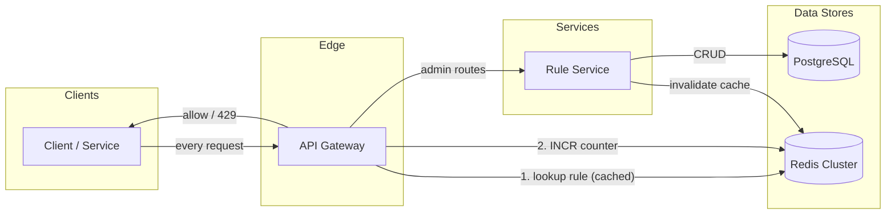
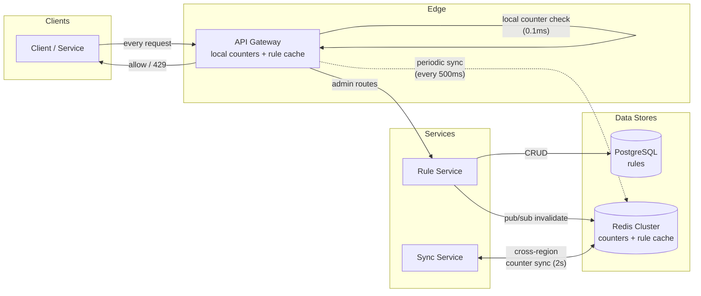

# Distributed Rate Limiter

Design a distributed rate limiting service that enforces request quotas across a multi-region fleet.

## 1. Requirements

### Functional Requirements
1. **FR1**: Admin should be able to create and manage rate limiting rules based on different identities — IP address, API key, client key, caller service, etc.
2. **FR2**: On every API request, rate limiting should be evaluated and enforced
3. **FR3**: For throttled requests, return informational headers — `Retry-After`, `X-RateLimit-Limit`, `X-RateLimit-Remaining`, `X-RateLimit-Reset`

### Non-Functional Requirements (LSDARO)
1. **NFR1 — Latency**: Rate limit evaluation must complete in &lt; 10ms (inline on every request)
2. **NFR2 — Scale**: Support 1M requests per second across millions of unique keys
3. **NFR3 — Durability**: Rate limit rules must be durably stored; counters are ephemeral (reset every window) — loss of a window's count is acceptable
4. **NFR4 — Availability**: Rate limiter failure must not block legitimate traffic (fail-open by default); 99.99% uptime
5. **NFR5 — Resiliency**: System must degrade gracefully under component failures — Redis down, rule store unavailable, network partition between regions
6. **NFR6 — Observability**: Expose rejection rates, top throttled clients, counter accuracy drift, and per-rule hit rates for operators — see [§5.6 Observability](#56-observability)

### Out of Scope
- DDoS protection / WAF — rate limiting is application-layer; network-layer flood mitigation (SYN floods, amplification) is a separate edge-infra concern
- Billing / monetization tiers — we expose configurable limits, not pricing logic
- Request queuing / retry orchestration — we reject (429) or allow; queuing throttled requests for later replay is the caller's responsibility

## 2. Core Entities

```
Rule       — defines a rate limit: identity type, threshold, time window, algorithm
Client     — the identity being rate-limited (IP, API key, service name, user id)
Counter    — runtime state tracking requests made by a Client against a Rule in the current window
```

:::info Why Counter, not Request
Request is the input to the `checkLimit` call — it's not a stored entity. Counter is what we actually read and write on every request: "how many requests has this client made in this window?" It's the hot-path data structure.
:::

## 3. API / Interface

### Admin APIs (CRUD — cold path)

```
POST   /v1/rules                → create a new rate limit rule
PUT    /v1/rules/:ruleId        → update an existing rule
GET    /v1/rules                → list all rules
GET    /v1/rules/:ruleId        → get a specific rule
DELETE /v1/rules/:ruleId        → delete a rule
```

**Create Rule request body:**
```json
{
  "identityType": "api_key",
  "limit": 100,
  "windowSeconds": 60,
  "algorithm": "sliding_window",
  "action": "reject"
}
```

### Client API (hot path — inline on every request)

```
POST /v1/check
{
  "identityType": "api_key",
  "identityValue": "sk-abc123",
  "resource": "/api/v1/orders"
}
```

**Allowed (200):**
```
HTTP/1.1 200 OK
X-RateLimit-Limit: 100
X-RateLimit-Remaining: 42
X-RateLimit-Reset: 1697051400
```

**Throttled (429):**
```
HTTP/1.1 429 Too Many Requests
Retry-After: 2
X-RateLimit-Limit: 100
X-RateLimit-Remaining: 0
X-RateLimit-Reset: 1697051400
```

:::tip Integration model
In practice, this `POST /v1/check` is rarely called as a standalone HTTP API. It's embedded as:
- **Sidecar / middleware** — interceptor in the API gateway or service mesh (Envoy, Kong, Istio)
- **Library** — in-process SDK that talks to the backing store directly

The API contract is the same either way — the interface above defines the logical contract regardless of deployment model.
:::

## 4. High-Level Design

### Placement Decision

| Option | How | Pros | Cons |
|--------|-----|------|------|
| Client-side | SDK in the caller | Zero server load | Trivially bypassed — can't trust the client |
| Per-pod (sidecar) | Each pod runs its own limiter | No network hop | Local counters only — 50 pods each see 1/50th of traffic; global accuracy requires shared store anyway |
| Dedicated service | Standalone service called per request | Clean separation; independent scaling | Extra hop; another service to operate; potential SPOF |
| **API Gateway + shared Redis** | Gateway plugin evaluates inline; counters in Redis | **No new infra; gateway already sees all traffic; global accuracy via shared store; ~1-2ms Redis RTT** | Coupled to gateway; Redis becomes a dependency |

**Decision: API Gateway with Redis-backed counters.** The gateway already intercepts every request — no additional network hop. Redis provides sub-ms counter operations and natural TTL-based expiry for time windows. A separate Rule Service manages CRUD (cold path).

:::staff[Placement: embed in the gateway, don't build a service]
The real choice here is about who owns the hot path. A dedicated limiter service is the "clean" answer, but it adds a network hop and a new tier-0 dependency to every request at 1M rps. Embedding the limiter as a gateway plugin reuses a chokepoint that already sees all traffic and already has an availability budget. What we give up: we're tied to the gateway's plugin model and release cadence, and traffic that skips the gateway (east-west service-to-service calls) isn't limited. Revisit if a large share of traffic to protect never goes through the gateway (move to a mesh sidecar or a shared library), or if several gateway products need the same quotas (pull the logic into a library they all share, keeping counters in the shared store).
:::

### Data Model

**Rule** (PostgreSQL — durable, low write volume, admin CRUD only)

| Field | Type | Description | Example |
|-------|------|-------------|---------|
| id | UUID | Primary key | `rule-001` |
| name | string | Human-readable label | `"API key — 100/min"` |
| identityType | enum | `ip` / `api_key` / `client_key` / `service` | `api_key` |
| limit | int | Max requests allowed per window | `100` |
| windowSeconds | int | Time window duration | `60` |
| algorithm | enum | `fixed_window` / `sliding_window` / `token_bucket` | `sliding_window` |
| action | enum | `reject` / `throttle` | `reject` |
| createdAt | timestamp | Rule creation time | `2024-10-01T09:00:00Z` |
| updatedAt | timestamp | Last modification time | `2024-10-11T08:30:00Z` |

**Counter** (Redis — ephemeral, one key per rule × client × window; TTL = windowSeconds, self-cleaning)

| Field | Type | Description | Example |
|-------|------|-------------|---------|
| key | string | `rl:{ruleId}:{identityValue}:{windowId}` | `rl:rule-001:sk-abc123:28284218` |
| value | int | Request count in current window | `42` |
| TTL | int | Auto-expires with the window | `60` |

- **Rule cache** in Redis — hot-path reads; refreshed on rule change via pub/sub invalidation

:::note Counter key design
`windowId` = `floor(now_epoch / windowSeconds)`. For a 60s window, all requests in the same minute hash to the same key. The key auto-expires via Redis TTL — no cleanup job needed.
:::

### Architecture



### How This Satisfies FRs

**FR1: Admin manages rate limit rules** — Admin calls Rule Service via API Gateway (`POST/PUT/GET/DELETE /v1/rules`). Rule Service persists to PostgreSQL and publishes a cache-invalidation event to Redis pub/sub. All gateway instances pick up the new rule within seconds.

**FR2: Rate limiting on every request** — API Gateway plugin intercepts every inbound request before routing to the backend:
1. Extract identity (IP, API key, etc.) from the request
2. Look up matching Rule from Redis cache (~0.5ms)
3. Build counter key: `rl:{ruleId}:{identityValue}:{windowId}`
4. Execute atomic `INCR` + `PTTL` on the counter key in Redis (~1ms)
5. If count &lt;= limit → allow; if count > limit → reject with 429
6. On first INCR (key doesn't exist), set TTL = windowSeconds

**FR3: Return rate limit headers** — Every response (200 or 429) includes headers computed from the INCR result:
- `X-RateLimit-Limit` = rule.limit
- `X-RateLimit-Remaining` = max(0, rule.limit - currentCount)
- `X-RateLimit-Reset` = (windowId + 1) × windowSeconds (epoch of next window)
- `Retry-After` = reset - now (only on 429)

### Algorithm Selection

See [Rate Limiting Algorithms](/patterns/rate-limiting) for the full breakdown — how each works, pseudocode + Java implementations, burst behavior (leaky vs token bucket), and scaling trade-offs.

| Algorithm | Memory | Accuracy | Burst Handling | Redis Cost | Fit for 1M rps |
|-----------|--------|----------|---------------|------------|-----------------|
| Fixed Window | O(1) | Poor (boundary burst) | 2× burst at edges | 1 INCR | Scales, but inaccurate |
| **Sliding Window Counter** | **O(1)** | **Good (~1-2% off)** | **Smoothed boundaries** | **1 GET + 1 INCR** | **Best default** |
| Sliding Window Log | O(N) | Perfect | No bursts | ZADD + ZREM + ZCARD | Memory explodes |
| Leaky Bucket | O(1) | Perfect | Queues (shaper) | Lua script | Wrong model for gating |
| **Token Bucket** | **O(1)** | **Good** | **Controlled bursts** | **Lua script** | **Best if bursts needed** |

**Decision: Sliding Window Counter as default; Token Bucket when burst tolerance is needed.** Both configurable per rule via the `algorithm` field.

- **Sliding Window Counter** — best balance: O(1) memory, 1 pipelined RTT, no boundary burst, ~1-2% approximation. Default for most rules.
- **Token Bucket** — when product needs burst capacity ("allow 100 burst, sustain 10/sec"). Used by Stripe, AWS.
- **Rejected:** Fixed Window (boundary burst), Leaky Bucket (shaper, not a limiter), Sliding Log (O(N) memory at scale).

:::note Atomicity
Both algorithms require **atomic read-modify-write** in Redis. Use a Lua script (single-threaded on Redis server) to avoid race conditions across concurrent gateway instances.
:::

:::note
This HLD is intentionally minimal — single Redis, single region. The deep dives below address the NFRs: multi-region accuracy, latency at scale, fail-open resilience, and rule propagation. The final architecture is at the end.
:::

## 5. Deep Dives

### 5.1 Latency & Counter Store

**Problem:** How do we evaluate rate limits in &lt; 10ms at 1M rps without sacrificing global accuracy?

#### Approaches

| Approach | How | Latency | Accuracy |
|----------|-----|---------|----------|
| **Redis only** | Every request does INCR in Redis | ~1-2ms (intra-AZ) | Perfect — single global counter |
| **Local only** | In-process `ConcurrentHashMap` in each gateway | ~0.1ms | Poor — each pod sees 1/Nth of traffic |
| **Hybrid (local + periodic sync)** | Local counter serves every request; background thread syncs delta to Redis every 500ms-1s | ~0.1ms hot path | Good — ~0.8-1.6% overshoot during sync interval |

#### Decision: Hybrid — local counters with periodic Redis sync

The gateway process maintains an in-process `ConcurrentHashMap<String, AtomicLong>` — zero network hop on the hot path. A background thread syncs accumulated deltas to Redis every 500ms.

**How it works:**

```
Hot path (per request, ~0.1ms):
  1. Extract identity from request
  2. Lookup rule from local rule cache
  3. AtomicLong.incrementAndGet() on local counter
  4. If localCount > threshold → reject (429)
  5. Return allow + headers

Background sync (every 500ms):
  1. For each dirty counter: INCRBY key delta (batched pipeline)
  2. GET global count from Redis
  3. Update local counter to reflect global state
  4. Reset delta accumulator
```

**Overshoot math:** With 50 gateway pods and 500ms sync interval on a 60s window with limit=1000:
- Each pod can admit up to `1000/50 = 20` requests between syncs
- 50 pods × 20 = 1000 admitted before sync corrects → exactly at limit
- Worst case: all pods sync at the same time and each admits 20 more → 1000 overshoot (2× limit for one sync cycle). Mitigated by jittering sync intervals across pods.

**Pod restart:** local counters reset to 0. On startup, pre-warm by fetching active counters from Redis for this pod's key space.

:::staff[Hybrid counters: trading exactness for a bounded error]
We give up exact enforcement on purpose. Overshoot is bounded by (pods × requests admitted per sync interval), so we can tune it with two settings we control (sync interval and jitter) instead of paying a Redis round trip on every request. Redis also stops being in the request path: it only sees background writes, so a slow Redis makes counts less fresh but never makes requests slower. The cost is that every pod becomes stateful for its sync window. Restarts and rolling deploys zero those local counters, so pre-warming before the readiness probe passes is required, not a nice-to-have. Revisit if a rule needs hard guarantees (paid quotas, abuse limits on login/OTP). Put those rules on the Redis-only path and accept the ~1-2ms cost for just that subset.
:::

#### Redis Memory Calculation

```
Key:    "rl:rule-001:sk-abc123:28284218"  → ~40 bytes
Value:  integer counter                    → 8 bytes
Redis overhead per key (dictEntry+SDS):    → ~80 bytes
                                           ≈ 128 bytes/key

Unique keys = clients × rules × 2 (current + previous window)
Example: 10M clients × 5 rules × 2 = 100M keys
Memory: 100M × 128 bytes ≈ 12.8 GB

Redis Cluster: 3 primaries × 1 replica = 6 nodes
  ~4.3 GB per primary shard (fits in 8-16 GB nodes)
```

:::staff[Memory sizing: an evicted counter silently resets a quota]
In a cache, an eviction costs you a miss. Here it hands that client a fresh quota, and nothing errors or logs it. So we size for peak key count with ~50% headroom (8-16 GB nodes for ~4.3 GB of data) and set `maxmemory-policy noeviction`. Then memory pressure shows up as failed writes, which trip the circuit breaker and page someone, instead of silent under-enforcement. `evicted_keys` must stay at 0, and "memory vs maxmemory" is a capacity alert, not a dashboard curiosity. Revisit the shard count when key cardinality grows (new identity types or rules multiply keys) rather than waiting for evictions.
:::

:::staff[Hot keys: solved by design, not by sharding]
The hybrid approach **already solves hot keys.** Each pod accumulates locally and syncs delta every 500ms. With 50 pods, Redis sees 50 × 2 = 100 ops/sec per key, not 100K. No sub-sharding needed unless you have thousands of pods. The point: write load on Redis grows with pod count × sync frequency, not with request rate. One design choice removes a whole class of bottleneck.
:::

### 5.2 Multi-Region Accuracy

**Problem:** We deploy across multiple regions (US-East, US-West, EU). A client with a global limit of 1000 req/min sends traffic to all regions. How do we enforce the global limit without cross-region latency on every request?

#### Approaches

| Approach | How | Latency | Accuracy |
|----------|-----|---------|----------|
| **Single global Redis** | All regions talk to one Redis in US-East | ~70-150ms cross-region | Perfect |
| **Per-region Redis, no sync** | Each region enforces `limit / num_regions` independently | ~1-2ms | Poor — static split doesn't match actual traffic distribution |
| **Per-region Redis + async sync** | Each region has local Redis; background sync merges counts across regions every 1-5s | ~1-2ms | Good — bounded overshoot proportional to sync interval |
| **CRDT counters** | G-Counter (grow-only CRDT) replicated across regions; merge = max per node | ~1-2ms | Good — eventually consistent, no coordination |

#### Decision: Per-region Redis + async cross-region sync

Each region runs its own [Redis Cluster](/building-blocks/redis) with local counters. A **sync service** in each region periodically pushes its region's deltas to other regions and pulls theirs.

**How it works:**

```
Region US-East:  local_count = 400
Region US-West:  local_count = 350
Region EU:       local_count = 200

Sync (every 2s):
  Each region publishes its delta to a cross-region Kafka topic
  Each region consumes others' deltas
  Global estimate = sum of all regional counts = 950

Enforcement:
  effective_count = local_count + sum(remote_counts)
  if effective_count > limit → reject
```

**Overshoot bound:** With 2s sync interval and 3 regions, worst case = `3 regions × (2s / 60s window) × 1000 limit = 100 requests` overshoot (~10%). Acceptable for rate limiting — we're not a financial ledger.

**Why not CRDTs?** G-Counters would work here, but add implementation complexity. The simple async-sync approach is functionally equivalent for our use case and easier to reason about. Revisit CRDTs if we need sub-second cross-region convergence.

:::staff[Multi-region: a known ~10% overshoot instead of global consistency]
**Key trade-off:** We accept ~10% cross-region overshoot in exchange for local-only latency (~1-2ms). A globally strict limit would require cross-region coordination on every request (~70-150ms), violating our &lt; 10ms NFR.

The Staff move is to state the error bound and make it a product contract ("limits are enforced within ~10%"), not to pretend we have global consistency. During a cross-region partition, each region keeps enforcing on its last-known remote counts, so overshoot grows with how long the partition lasts but enforcement never stops. Revisit if a customer-facing contract needs a tighter bound. First shorten the sync interval (2s to 1s halves drift) or pin those tenants to a home region, before reaching for CRDTs or global coordination.
:::

### 5.3 Availability & Fail-Open

**Problem:** Redis is down. Do we block all traffic (fail-closed) or allow all traffic (fail-open)?

#### Approaches

| Approach | Behavior on Redis failure | Risk |
|----------|--------------------------|------|
| **Fail-closed** | Reject all requests (503) | Legitimate users blocked — Redis outage becomes a full outage |
| **Fail-open (permissive)** | Allow all requests; rate limiting disabled | Abuse goes unthrottled during outage |
| **Fail-open with local fallback** | Switch to local-only counters; each pod enforces independently | Over-admits (50 pods × full limit = 50× actual limit) but not unlimited |

#### Decision: Fail-open with local fallback + circuit breaker

```
Normal mode:
  Gateway → local counter (0.1ms) → periodic sync to Redis (500ms)

Redis health check fails (3 consecutive timeouts):
  Circuit breaker OPENS
  → Switch to local-only mode
  → Each pod enforces full limit independently (permissive)
  → Alert fires for operators

Redis recovers:
  Circuit breaker half-opens → probe with single sync
  → Success → circuit closes → resume normal sync
  → Local counters re-warm from Redis global state
```

**Why permissive, not conservative?**

| Mode | Each pod enforces | Total admitted (50 pods) | Risk |
|------|-------------------|------------------------|------|
| Conservative: `limit / num_pods` | 1000/50 = 20 req/min | 1000 (correct) | Pod count is dynamic (autoscaling) — stale count → wrong per-pod limit. Under-admits, blocks paying customers. |
| **Permissive: full limit** | 1000 req/min per pod | 50,000 (50× over) | Over-admits during outage. But outage is rare + short (~seconds with Redis failover). |

:::staff[Fail-open vs fail-closed is a per-rule business decision]
**Decision: Permissive.** During a Redis outage (typically &lt; 10s with auto-failover), rate limiting is best-effort. Better to over-admit temporarily than to block legitimate traffic. This aligns with NFR4: "fail-open by default."

What we give up: during the outage we have no global enforcement, and nothing about it looks broken from outside. That is why breaker-open duration is a paging alert (see [§5.6](#56-observability)). Fail-open is the *default*, not a universal rule. Rules that protect security or cost (login/OTP brute force, expensive downstream calls with per-call vendor billing) should be able to opt into fail-closed, or into the conservative `limit / num_pods` mode. Revisit the default if outages last minutes rather than seconds, because then the 50× over-admit window stops being negligible.
:::

### 5.4 Rule Propagation

**Problem:** Admin updates a rule (e.g., changes limit from 100 to 200/min). How do all gateway instances pick up the change fast, without polling?

#### Approaches

| Approach | Propagation delay | Complexity |
|----------|-------------------|------------|
| **Polling** | Configurable (e.g., every 30s) | Simple but wasteful — 50 gateways polling every 30s = 100 queries/min for rules that change once a day |
| **Redis pub/sub** | ~1-2 seconds | Fire-and-forget — missed if pod is restarting during publish |
| **Pub/sub + TTL safety net** | ~1-2s normal, 60s worst case | Instant on happy path, bounded staleness guaranteed |

#### Decision: Redis pub/sub + TTL safety net + cold-start bootstrap

```
Rule update flow:
  1. Admin calls PUT /v1/rules/:ruleId
  2. Rule Service persists to PostgreSQL
  3. Rule Service publishes to Redis channel: "rules:changed"
     payload: { ruleId, version, action: "updated" }
  4. All gateway instances subscribe to "rules:changed"
  5. On receive: invalidate local rule cache entry → next request fetches fresh from Redis cache

Safety net:
  - Cached rules have TTL = 60s
  - Even if pub/sub misses (pod restart, network blip), stale rule auto-expires within 60s
  - Worst case: 60s of stale rule enforcement

Cold start:
  - On pod startup, load ALL active rules from Rule Service (HTTP call, not cache)
  - Populate local cache + subscribe to pub/sub channel
  - No dependency on cache state at startup
```

**Why not polling?** Rules change ~1-10 times per day. Polling every 30s means 99.97% of polls return "no change." Pub/sub is event-driven — zero cost when nothing changes, instant when something does.

:::staff[Rule propagation: fast path + correctness bound + bootstrap]
Each mechanism covers a gap the others leave. Pub/sub makes propagation fast but can drop messages. The 60s TTL puts a hard ceiling on staleness without relying on delivery. The cold-start load reads from the source of truth (Rule Service backed by PostgreSQL), so a new pod never starts from an empty or poisoned cache. The `version` field in the payload lets pods ignore out-of-order or duplicate events and makes version skew across pods measurable. What we give up: up to 60s of stale enforcement in the worst case, which is acceptable for quota tuning. Revisit if rules become an incident lever ("block this tenant *now*"). Then add an acknowledged push (each pod reports its applied version) or a durable log (Kafka) instead of fire-and-forget pub/sub.
:::

### 5.5 Final Architecture

After all deep dives, the system has evolved from a single Redis to a multi-region, hybrid-counter architecture:

<DesignPreview file="rate-limiter.vetora.yaml" height={600} title="Distributed Rate Limiter — Final Architecture (Vetora)" />



#### Component Summary

| Component | Role | Scaling |
|-----------|------|---------|
| **API Gateway** | Hot-path evaluation — local counter + rule cache | Stateless; scale horizontally with traffic |
| **Rule Service** | CRUD for rules; pub/sub invalidation on change | Low traffic; 2-3 pods sufficient |
| **Sync Service** | Background sync: local→Redis (500ms), cross-region (2s) | One per region; lightweight |
| **Redis Cluster** | Global counter store, rule cache, pub/sub channel | 3 primaries + 3 replicas; ~4.3 GB/shard |
| **PostgreSQL** | Durable rule storage | Single primary + read replica |

#### Latency Budget

```
Hot path (per request):
  Extract identity:           ~0.01ms
  Local rule cache lookup:    ~0.05ms
  Local counter increment:    ~0.05ms
  Compute headers:            ~0.01ms
  Total:                     ~0.12ms  ✅ well under 10ms

Background (not on hot path):
  Redis sync (every 500ms):   ~1-2ms per batch
  Cross-region sync (2s):     ~70-150ms (acceptable — async)
  Rule pub/sub propagation:   ~1-2ms
```

### 5.6 Observability

**Problem:** Several of this design's failure modes are silent by construction. Fail-open hides a Redis outage, local counters hide drift, and a pod running a stale rule looks exactly like a healthy one. Operators need to answer three questions at all times: *Are we enforcing at all? How accurately? Who is being throttled?* And the metrics needed to answer them must not cost more to run than the limiter.

For the generic layer model (USE / RED, SLIs/SLOs, burn-rate alerting, cardinality control), see [Observability](/foundations/observability). Below is what each layer means for *this* design.

#### What to Measure

| Layer | Metric | Why it matters | Alert |
|-------|--------|----------------|-------|
| **1. Infrastructure / System (USE)** | Gateway pod CPU, heap, GC pause p99 | Limiter runs in-process. A GC pause on the gateway adds directly to every request's latency | GC pause p99 > 50ms for 5 min |
| | Gateway pod restarts / OOMKills | Every restart zeroes local counters (thundering herd until pre-warm completes) | Restart rate spike per region (ticket); crash-loop (page) |
| | Network RTT / errors: gateway → Redis, region ↔ region | Sync depends on it; a cross-region partition grows overshoot | Cross-region RTT > 2× baseline for 5 min |
| **2. Dependencies (Cache / Queue / DB)** | Redis ops/sec + command latency **per shard** | Spots hash-slot imbalance and Lua scripts blocking the single thread | Shard p99 > 5ms, or one shard > 2× mean ops/sec |
| | Redis `used_memory` vs `maxmemory` | Headroom for key-count growth (new rules / identity types) | > 75% → ticket; > 90% → page |
| | Redis `evicted_keys` | **Must be 0.** An eviction silently resets a client's quota | Any non-zero → page |
| | Redis `slowlog` length, replica lag, failover events | Lua latency spikes; a lagging replica serves stale counts after failover | Sustained slowlog growth; any failover → notify |
| | Gateway → Redis connection-pool utilization + timeouts | Pool exhaustion and timeouts come *before* the breaker trips | Pool > 80% in use or timeouts rising |
| | Kafka consumer lag on the cross-region delta topic (merge worker) | Lag means stale remote counts, which pushes overshoot past the ~10% bound | Lag > 2 sync intervals (~4s) for 5 min |
| | PostgreSQL availability + replication lag; Rule Service RED | Cold path, but pod cold-start bootstrap depends on it | Bootstrap error rate > 1% |
| **3. Application / Service (RED)** | Limiter decision latency p99 (in-process histogram) | Our overhead on every request (budget ~0.12ms) | p99 > 1ms (SLO burn) |
| | Decisions/sec by outcome (allow / deny) **per rule** | Per-rule hit rate. A sudden deny spike means a bad rule or an attack | Deny rate on a rule > 3× its 1h baseline |
| | 429 rate at the edge (absolute + % of traffic) | User-visible impact of enforcement | Spike vs baseline; **also alert if it drops to ~0 while traffic is steady** |
| | Sync flush latency + failure rate (Sync Service → Redis Lua) | Failing flushes mean local counts drift away from the global count | Flush failures > 1% or flush p99 > 100ms |
| | Local-vs-global counter drift / overshoot % (sampled keys at window close) | Directly measures the accuracy NFR | Overshoot > 10% sustained 5 min |
| | **Circuit-breaker state** per pod (closed / half-open / open) | **Open = fail-open = NOT enforcing.** Traffic is unlimited and nothing errors | Open > 30s on > 10% of pods → page |
| | Rule version skew across pods + propagation delay (commit → applied) | Pods enforcing different versions of the same rule | Skew > 0 for > 60s; propagation p99 > 2s |
| **4. Business / Product** | Top-K throttled identities per rule (tenant / API key, hashed) | Separates abuse from a paying customer who has outgrown their quota | Same paying tenant in top-K > 1h → ticket to account team |
| | % of tenants near their limit (> 80% of quota) by tier | Capacity planning and pricing signal, not an operational page | Dashboard + weekly review |
| **5. Client / End-to-end** | Synthetic canary tenant: send `limit + N` requests, expect exactly ~N 429s | The only black-box proof that enforcement works end to end | Canary receives 0 429s → page |
| | Client retries before `X-RateLimit-Reset` (`Retry-After` ignored) | Clients ignoring back-off cause retry storms that look like attacks | Retry-before-reset ratio rising |
| | End-to-end gateway latency p99 (synthetic probe, limiter on vs off) | Confirms limiter overhead is invisible to callers | p99 regression > 1ms |

#### SLIs / SLOs

| SLI | SLO | Measured at |
|-----|-----|-------------|
| Limiter decision overhead | p99 &lt; 1ms, p50 &lt; 0.2ms | In-process histogram on gateway |
| Enforcement accuracy (admitted vs limit, for keys that hit their limit) | Overshoot ≤ ~10% for 99% of windows | Sync Service, sampled keys at window close |
| Enforcement coverage (pod-minutes with breaker closed) | ≥ 99.9% | Breaker-state gauge |
| Rule propagation delay (PostgreSQL commit → version applied on pod) | p99 &lt; 2s; hard max 60s (TTL) | Rule version gauge + commit timestamp |
| Gateway availability (non-429 5xx) | 99.99% | Edge |
| Limiter-caused 5xx | 0 — the limiter answers allow or 429, never an error | Gateway error classification |

#### Alerting Approach

- **Symptom-based + burn-rate on SLOs.** Page on fast burn (e.g., 14× budget over 1h), ticket on slow burn (e.g., 6× over 6h) for overhead, coverage, and availability. Causes (CPU, pool usage, Kafka lag) go on dashboards and tickets, not pages.
- **Fail-open is silent, so alert on its absence of signal.** When the breaker opens, requests succeed and latency looks *better*. The page therefore fires on **breaker-open duration**, on the 429 rate collapsing to ~0 with steady traffic, and on the canary tenant not being throttled. Breaker open means unlimited traffic, so it pages even though users see no errors.
- **Pages:** breaker open across the fleet, `evicted_keys` > 0, canary not throttled, availability burn. **Tickets:** drift creeping toward 10%, Kafka lag, rule version skew, Redis memory > 75%.
- **Tracing and logs at 1M rps:** don't create a span per decision. Add `rule_id` and `decision` as attributes on the existing gateway request span (sampled). Give Sync Service flushes and the merge worker their own spans. Log denies at a sampled rate with a hashed identity, and never log allows.

#### Deep Dive: Metric Cardinality for "Top Throttled Clients"

**Problem:** NFR6 asks for top throttled clients, but there are 10M identities × 5 rules. Labeling metrics by identity is the obvious way to get that answer, and it is also the fastest way to take down the metrics system.

**Approach A: Per-identity labeled metrics**
- How it works: `ratelimit_decisions_total` labeled by `rule`, `identity`, `outcome`, then `topk()` in the query layer.
- Pros: exact counts, trivial queries, arbitrary drill-down into any identity.
- Cons: up to 10M × 5 × 2 ≈ 100M active series. At ~1-3 KB per series in a Prometheus-style TSDB that is hundreds of GB, and every pod's scrape payload explodes. It also puts raw API keys or IPs (secrets / PII) into metric labels. The observability bill would exceed the cost of the limiter.

**Approach B: Aggregate metrics + streaming heavy-hitter sketch**
- How it works: metrics carry only bounded labels (`rule`, `outcome`, `region`, `pod`): 5 × 2 × 3 × 50 ≈ 1.5K series. Each gateway pod keeps a fixed-memory **Space-Saving** top-K (K ≈ 100) over *denied* identities, plus a **Count-Min Sketch** of deny counts. Every ~10s the pod ships its sketch and top-K candidates to the Sync Service. Count-Min sketches with the same dimensions merge by element-wise addition, so the merged sketch gives global counts for the union of candidates. The merged result goes to a bounded Redis sorted set per rule and minute, e.g. `topk:<ruleId>:<minute>`.
- Pros: bounded memory and series count no matter how many identities exist. Answers the question operators actually ask ("who is being throttled the most right now?"). Identities stay hashed and out of the TSDB.
- Cons: approximate. Count-Min only overestimates, and Space-Saving's error is bounded by N/K. An identity that is moderately busy on every pod but heavy globally can be missed by per-pod candidate lists (merging sketches reduces this but doesn't eliminate it). There is no long-tail drill-down from metrics.

**Decision: Approach B**, plus 1% sampled deny logs (hashed identity, `rule_id`) for long-tail forensics.

:::staff[Cardinality: answer "who" with sketches, not labels]
**Key trade-off:** we give up exact per-identity counts in exchange for a metrics footprint that stays at ~1.5K series whether we have 10K or 10M clients. Unbounded label values are the most common way observability takes production down, and a rate limiter, which exists to count a huge, attacker-controlled keyspace, is the worst place to make that mistake. **What we give up:** "how often was tenant X throttled last Tuesday?" for a tenant outside the top-K is answered from sampled logs, not a metric. **When to revisit:** if per-tenant throttle counts become customer-facing or feed billing, this stops being observability and becomes a data product. Emit decision events to Kafka and aggregate them in an OLAP store (Pinot / ClickHouse) rather than adding labels to metrics. Also raise K, or merge full sketches centrally, if known abusers keep going missing from the merged top-K.
:::

---

## 6. Bottlenecks & Failure Scenarios

| Scenario | Impact | Mitigation |
|----------|--------|------------|
| **Hot key saturation** | One client (e.g., `clientId=Walmart`) at 100K rps hammers a single Redis key | Hybrid approach already solves it — local counters absorb per-request writes, Redis sees ~100 ops/sec (50 pods × 2 syncs/sec). If 1000+ pods: sub-shard the key into N pieces, write to random sub-key, sum on read. |
| **Redis Cluster outage** | Can't sync counters or read rules from cache | [Circuit breaker](/patterns/circuit-breaker) trips → fail-open with local-only counters (permissive). Redis auto-failover recovers in ~seconds. |
| **Redis shard overload** | One shard receives disproportionate traffic; increased latency | Monitor per-shard ops/sec; rebalance hash slots across nodes. Hash tags can inadvertently co-locate too many keys — audit tag usage. |
| **Rule propagation lag** | Admin updates a rule; gateways enforce stale rule for up to 60s | Acceptable — eventual consistency. Pub/sub delivers in ~1-2s on happy path; 60s TTL is the worst-case safety net. |
| **Cross-region sync drift** | Regions enforce with stale remote counts; global limit over-admitted by ~10% | By design — we trade strict consistency for local latency. Tunable via sync interval (2s → 1s halves the drift). Not a financial ledger. |
| **Thundering herd on pod restart** | Pod restarts → local counters zeroed → admits freely for ~500ms until first Redis sync | Pre-warm on startup: fetch active counters from Redis before readiness probe passes. Gate traffic until warm. |
| **Lua script latency spike** | Complex Lua script (token bucket) blocks Redis single thread; all other commands queue | Keep Lua scripts minimal (~5 commands). Monitor Redis `slowlog`. If p99 spikes, switch hot rules to sliding window (simple INCR, no Lua). |
| **Counter key explosion** | Millions of unique clients × multiple rules × 2 windows = hundreds of millions of keys | TTL auto-cleans expired windows. Monitor `dbsize`; if approaching memory limit, shorten window or reduce rule count per identity. |

## 7. Trade-offs & Alternatives

| Decision | Chose | Over | Trade-off |
|----------|-------|------|-----------|
| Placement | API Gateway plugin | Dedicated service / sidecar | No extra hop; coupled to gateway vendor but no new infra |
| Default algorithm | Sliding Window Counter | Fixed Window / Token Bucket / Sliding Log | ~1-2% approximation for O(1) memory + no boundary burst |
| Burst algorithm | Token Bucket (per rule) | Sliding Window for all | Lua script complexity for explicit burst control |
| Counter store | Hybrid (local + periodic Redis sync) | Redis-only / local-only | 0.1ms hot path; ~0.8% overshoot during sync interval |
| Multi-region | Per-region Redis + async sync (2s) | Single global Redis / CRDTs | ~10% cross-region overshoot for local-only latency |
| Failure mode | Fail-open (permissive) | Fail-closed / conservative local | Over-admits during outage; better than blocking paying customers |
| Rule propagation | Redis pub/sub + 60s TTL | Polling / direct push | Event-driven (zero cost when idle); 60s worst-case staleness |
| Rule storage | PostgreSQL | Redis-only / config file | Durable, relational, auditable; low write volume |
| Counter durability | Ephemeral (TTL, no persistence) | AOF / disk-backed | Counters reset each window anyway; loss = brief over-admission |
| Observability cardinality | Bounded-label aggregate metrics + per-pod top-K / Count-Min sketch | Per-identity metric labels | ~1.5K series instead of ~100M; top-K is approximate, long-tail drill-down via sampled deny logs |

## 8. Related Concepts

- [Rate Limiting Algorithms](/patterns/rate-limiting) — fixed window, sliding window, sliding log, leaky bucket, token bucket — with pseudocode + Java implementations
- [Redis Cluster](/building-blocks/redis) — hash slots, key routing, hash tags, replication, failover
- [Sharding](/distributed-systems/sharding) — key lookup approaches, hot partition problem, sub-sharding
- [Partitioning](/distributed-systems/partitioning) — partition key design, skew from a key-design angle
- [Consistent Hashing](/distributed-systems/consistent-hashing) — ring-based distribution (used by Cassandra/DynamoDB, not Redis)
- [API Gateway](/building-blocks/api-gateway) — where the rate limiter plugin runs
- [Circuit Breaker](/patterns/circuit-breaker) — fail-fast when Redis is down
- [Bulkhead](/patterns/bulkhead) — isolating Redis pools for counters vs rule cache
- [Observability](/foundations/observability) — metric layers (USE / RED), SLIs/SLOs, burn-rate alerting, metric-cardinality control

## Appendix: Scale Assumptions

| Metric | Value |
|--------|-------|
| Peak throughput | 1M requests/sec |
| Unique client keys | 10M |
| Active rules | 5 |
| Counter keys (peak) | 10M × 5 × 2 windows = 100M |
| Memory per key | ~128 bytes (sliding window) / ~200 bytes (token bucket) |
| Total Redis memory | ~12.8 GB (sliding window) |
| Redis Cluster | 3 primaries + 3 replicas (~4.3 GB/shard) |
| Sync interval (local → Redis) | 500ms |
| Cross-region sync interval | 2s |
| Rule change frequency | ~1-10/day |
| Rule propagation (happy path) | ~1-2s (pub/sub) |
| Rule propagation (worst case) | 60s (TTL expiry) |
| Regions | 3 (US-East, US-West, EU) |
| Gateway pods per region | ~50 |
