# Top-K Heavy Hitters

Design a system that processes a massive stream of events (video views, search queries, product clicks) and answers: **"What are the top K most frequent items in a given time window?"**

## 1. Requirements

### Functional Requirements
1. **FR1**: Client can query the top K items (K ≤ 1000) for a given time window; each result includes the item ID and its count
2. **FR2**: Supported time windows: last 1 hour, last 1 day, last 1 month, all-time

### Non-Functional Requirements (LSDARO)
1. **NFR1 — Latency**: Query response within 50ms — forces precomputation; can't scan billions of counters on demand
2. **NFR2 — Scale**: Handle ~1M events/sec ingestion (YouTube-scale: 70B views/day ≈ 800K/sec); support billions of unique items (high cardinality)
3. **NFR3 — Durability**: No event should be lost from the count. Counts may be approximate but must not systematically under-count.
4. **NFR4 — Availability**: 99.9% uptime for reads; ingestion can briefly lag but must catch up
5. **NFR5 — Resiliency**: Failure of a processing node must not lose aggregation state; at-least-once counting with idempotent writes
6. **NFR6 — Observability**: Ingestion lag, count accuracy drift, query latency p99, processing throughput

### Out of Scope
- Arbitrary time ranges (e.g., "top K between 3pm and 7pm last Tuesday")
- Real-time streaming of top-K changes (push-based rank updates)
- Per-user or per-region top-K (only global)
- Arbitrary rank lookup for any item + scroll/pagination — this is a **Leaderboard** problem with different core challenges (full ranking of all items, real-time rank computation, pagination at arbitrary offset). See [Leaderboard](/problems/real-time/leaderboard) when available.
- Content or metadata of the items (we only track IDs and counts)
- User authentication — assume identity is resolved upstream

## 2. Core Entities

| Entity | Description |
|--------|-------------|
| **Event** | The raw input — `itemId`, `timestamp`. Produced by upstream services (video player, CDN, search frontend) into a Kafka topic. This is what the system counts. |
| **ItemCount** | Aggregated count — `itemId`, `count`, `windowType`, `windowId`. The intermediate state maintained by the stream processor (in-memory or spilled to RocksDB). One entry per item per window. |
| **TopKResult** | Precomputed ranked snapshot — `windowType`, `windowId`, `items: [{ itemId, count, rank }]`. What the query API serves. Separate from ItemCount because the 50ms SLA means we serve a cached snapshot, not a live query over billions of counters. |

:::staff[Why TopKResult is a separate entity from ItemCount]
At billions of unique items, querying ItemCount directly (`ORDER BY count DESC LIMIT K`) requires scanning or indexing the entire dataset — too slow for a 50ms SLA. The 50ms requirement **forces precomputation**: a background process periodically materializes the top K into a small, pre-ranked snapshot (TopKResult) that the API reads in O(1). This separation is the core architectural insight — the write path (Event → ItemCount) and the read path (TopKResult → API) are completely decoupled.
:::

## 3. API / Interface

### Ingestion Interface (Write Path)

Ingestion is **not a REST API** — at 800K events/sec, HTTP per-event overhead is prohibitive. The ingestion interface is a **Kafka topic**:

```
Topic:        view-events
Partition key: itemId
Message:      { "itemId": "vid-abc", "timestamp": "2026-10-13T01:23:45Z" }
Partitions:   ~64 (parallelism for consumers)
```

Upstream producers (video player service, CDN edge, search service) write directly to Kafka. Kafka handles backpressure, batching, and durability natively — no API layer needed.

:::info Why partition by itemId?
All events for the same item land on the same partition → the stream processor can aggregate per-item counts without cross-partition coordination. This is the same pattern as the rate limiter's [counter sync](/problems/real-time/rate-limiter#51-latency--counter-store) and live comments' [per-stream Redis Streams](/problems/real-time/live-comments#51-real-time-fan-out-at-scale).
:::

### Query API (Read Path)

```
GET /v1/top-k?k={K}&window={WINDOW}
```

| Param | Type | Values | Default | Description |
|-------|------|--------|---------|-------------|
| `k` | int | 1-1000 | 100 | Number of items to return |
| `window` | string | `1h`, `1d`, `1m`, `all` | `1h` | Time window |

Response: `200 OK`
```json
{
  "window": "1h",
  "windowStart": "2026-10-13T01:00:00Z",
  "windowEnd": "2026-10-13T02:00:00Z",
  "items": [
    { "rank": 1, "itemId": "vid-abc", "count": 4823910 },
    { "rank": 2, "itemId": "vid-xyz", "count": 3291004 }
  ]
}
```

`windowStart` / `windowEnd` tell the client exactly which tumbling window this snapshot covers — important because results are precomputed, not live counts. A query at 10:37 returns the 10:00-11:00 window's latest snapshot, not a sliding view from 9:37-10:37.

No pagination needed — results are capped at K ≤ 1000, which fits in a single response.

## 4. High-Level Design

### Data Model

**ViewCount** (PostgreSQL — durable, indexed, one row per item per hour)

| Field | Type | Description | Example |
|-------|------|-------------|---------|
| itemId | string | The item being counted (PK, composite) | `"vid-abc"` |
| windowHour | timestamptz | Truncated to hour boundary, UTC (PK, composite) | `2026-10-13T01:00:00Z` |
| count | bigint | Views in this hour | `48239` |

:::note Why hourly buckets?
Hours are the **finest granularity** we store. Larger windows (day, month, all-time) are computed by summing hourly rows: day = 24 rows per item, month = ~720 rows, all-time = all rows. This avoids maintaining separate tables per window type while keeping each row's count small enough that `INCRBY` conflicts are rare.
:::

:::note Index for window queries
The primary key `(itemId, windowHour)` serves point lookups for one item, but it **cannot serve a range on `windowHour`** because `windowHour` is the second column. Window queries need a secondary index that leads on it, e.g. `CREATE INDEX ON "ViewCount" ("windowHour") INCLUDE ("itemId", "count")` for index-only scans. It narrows the scan to the window's rows, but it still cannot avoid reading all of them (see the example query below).
:::

### Architecture

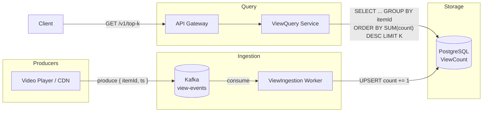

### How This Satisfies FRs

**FR1: Query top K** — Client calls `GET /v1/top-k?k=100&window=1h` → API Gateway → ViewQuery Service → queries PostgreSQL, summing hourly rows per item and ordering by the sum (`GROUP BY itemId ORDER BY SUM(count) DESC LIMIT K`) → returns the ranked list of `{ rank, itemId, count }`.

**FR2: Time windows** — Events flow from producers into Kafka; a ViewIngestion Worker consumes them, truncates each event's timestamp to the hour boundary and upserts into ViewCount. Window semantics are decided in [§5.3](#53-time-windows--late-events-fr2), so the ViewQuery Service derives a half-open range `[windowStart, windowEnd)` from the current time and sums the hourly rows inside it:

| `window` | `windowStart` | `windowEnd` | Hourly rows per item |
|----------|---------------|-------------|----------------------|
| `1h` | current hour | start + 1 hour | 1 |
| `1d` | current UTC day | start + 1 day | up to 24 |
| `1m` | current UTC month | start + 1 month | up to ~720 |
| `all` | none (no lower bound) | none | all |

#### Example: top 1000 items for `window=1d`

Request, at 2026-10-13T10:37Z:

```
GET /v1/top-k?k=1000&window=1d
```

**Step 1 — ViewQuery Service resolves the window.** `windowStart = 2026-10-13T00:00:00Z`, `windowEnd = 2026-10-14T00:00:00Z`. These are computed in the service and passed as bind parameters, and they are also returned to the client.

**Step 2 — Run the query.**

```sql
SELECT
  ROW_NUMBER() OVER (ORDER BY SUM(v."count") DESC, v."itemId") AS rank,
  v."itemId",
  SUM(v."count") AS count
FROM "ViewCount" v
WHERE v."windowHour" >= :windowStart   -- 2026-10-13T00:00:00Z
  AND v."windowHour" <  :windowEnd     -- 2026-10-14T00:00:00Z
GROUP BY v."itemId"
ORDER BY SUM(v."count") DESC, v."itemId"
LIMIT 1000;
```

**Step 3 — Return the result.**

```json
{
  "window": "1d",
  "windowStart": "2026-10-13T00:00:00Z",
  "windowEnd": "2026-10-14T00:00:00Z",
  "items": [
    { "rank": 1, "itemId": "vid-abc", "count": 61230455 },
    { "rank": 2, "itemId": "vid-xyz", "count": 48110902 }
  ]
}
```

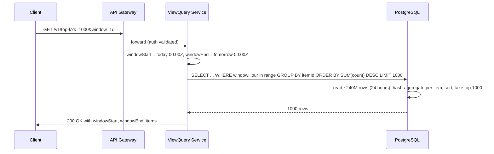

**Why this is the bottleneck:** with ~10M items active per hour, a day holds up to ~240M `ViewCount` rows. Postgres must read every one of them, hash-aggregate to one row per item, then sort the result, all before it can return 1000 rows. No index avoids this, because the sort key `SUM(count)` doesn't exist until query time. That takes seconds to minutes, against the 50ms budget (NFR1).

:::note
This HLD is intentionally minimal — a single PostgreSQL instance, no caching, no precomputation. The `1d`, `1m` and `all` queries scan hundreds of millions of rows, which is far too slow for the 50ms SLA (NFR1), and 800K writes/sec will overwhelm a single DB (NFR2). The deep dives below address these gaps.
:::

## 5. Deep Dives

### 5.1 Ingestion Throughput (NFR2 — Scale)

**Problem:** A single PostgreSQL instance handles ~5-10K writes/sec. We need 800K. That's 80-160× over capacity. How do we ingest at YouTube scale?

#### Approach A: Sharded PostgreSQL (direct per-event writes)

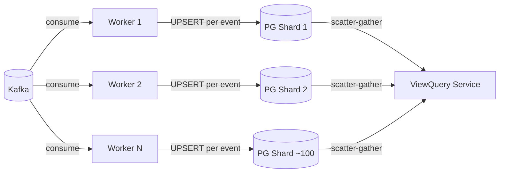

Shard ViewCount by `hash(itemId) % N` across ~100 Postgres instances. Each shard handles ~8K writes/sec.

**Pros:**
- Simple, durable, familiar SQL model
- Each shard is independently queryable

**Cons:**
- 100 Postgres instances — expensive and operationally heavy
- Each write is a random I/O `UPSERT` (read-modify-write on the index)
- Top-K query must scatter-gather across all shards — adds latency and complexity

#### Approach B: In-memory batching in the worker

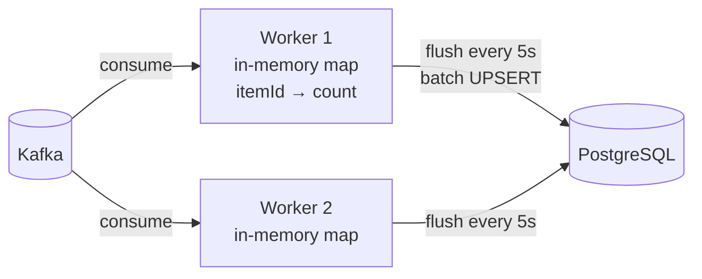

Buffer events in-memory in the ViewIngestion Worker. Aggregate counts locally per item for N seconds, then flush a single batch `UPSERT` per item to the DB.

```
800K events/sec × 5s window = 4M events
If 100K unique items in that window → flush 100K UPSERTs every 5s = 20K/sec
Two Postgres instances can handle that.
```

**Pros:**
- Massive write reduction (800K → 20K/sec)
- Fewer DB connections, lower contention

**Cons:**
- Worker crash loses up to 5s of in-memory counts
- Not exactly-once without careful Kafka offset management (must commit offsets only after DB flush succeeds)
- Manual implementation of windowing, watermarks, and recovery — reinventing a stream processor

#### Approach C: Stream processor (Flink)

A [stream processing](/building-blocks/stream-processing) framework reads from Kafka, aggregates counts in tumbling windows, and outputs hourly sums per item to the DB.

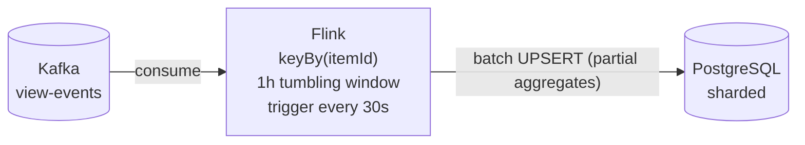

- Flink accumulates per-item counts in state (in-memory or RocksDB for large state)
- **Incremental triggers every 30s** emit partial aggregates instead of waiting for full window close — smooths write load
- 10M unique items per hour ÷ 30s trigger intervals = ~300K items per trigger = ~10K UPSERTs/sec → manageable on ~5 Postgres shards
- **Exactly-once** via Flink checkpointing: periodic snapshots of all operator state + Kafka consumer offsets. On failure, rewind to last checkpoint and replay.

**Pros:**
- Exactly-once semantics built in (checkpointing)
- Handles late events via watermarks
- Proven at scale — **YouTube, Netflix, Uber, LinkedIn, Spotify all use this pattern**
- Write amplification reduced by 80-100× (many events per item per window collapsed)

**Cons:**
- Flink is operationally complex (state management, checkpoints, RocksDB tuning)
- Bursty writes at trigger boundaries if jitter is not configured
- Learning curve for teams unfamiliar with stream processing

#### Approach D: Kafka → Redis (in-memory counters, skip the DB)

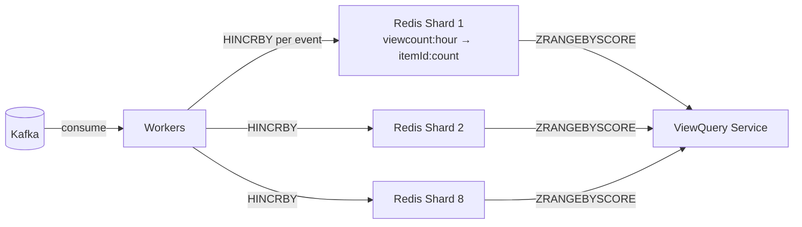

Use Redis `HINCRBY` for real-time counters:

```
HINCRBY viewcount:2026-10-13T01 vid-abc 1
```

**Pros:**
- ~100K ops/sec per Redis node. 8 shards handles 800K/sec.
- Sub-millisecond writes

**Cons:**
- Memory-bound: 4B items × 16 bytes = 64GB per window × 4 windows = 256GB — expensive
- No durability unless AOF is on (which reduces write throughput)
- Eviction = silent count loss (compare [rate limiter's eviction trap](/problems/real-time/rate-limiter#51-latency--counter-store))

#### Decision: Approach C — Flink with incremental triggers

| | A (Sharded PG) | B (Batching) | **C (Flink)** | D (Redis) |
|---|---|---|---|---|
| Writes/sec to storage | 800K | ~20K | **~10K** | 800K |
| Exactly-once | ❌ (app-level) | ❌ (manual) | **✅ (checkpoints)** | ❌ |
| Late event handling | ❌ | ❌ | **✅ (watermarks)** | ❌ |
| Operational complexity | High (100 PGs) | Low | **Medium** | Low |
| Memory cost | Low (disk) | Medium | Low (spills to RocksDB) | **Very high** (256GB) |
| Industry adoption | Rare at this scale | Common for moderate scale | **Universal at YouTube scale** | Common for approximate/ephemeral |

:::staff[The write reduction is the key insight]
At 800K events/sec, the naive approach (one DB write per event) is dead on arrival. The stream processor's job is to **collapse millions of events into thousands of aggregates** before they touch the database. Flink's 1h tumbling window with 30s triggers turns 800K writes/sec into ~10K writes/sec — an 80× reduction. This is why every company at YouTube scale uses a stream processor for ingestion, not direct DB writes. The exactly-once and late-event handling are bonuses; the write reduction is the must-have.
:::

**Key trade-off:** we accept Flink's operational complexity in exchange for 80× write reduction and exactly-once semantics.

**What we give up:** simplicity. Flink requires a dedicated cluster (or Kubernetes deployment), checkpoint storage, state backend tuning, and monitoring.

**When to revisit:** if the team can't operate Flink, [Kafka Streams](/building-blocks/stream-processing#kafka-streams-the-library-alternative) is a simpler alternative that runs inside a regular JVM app — at the cost of lower throughput ceiling and no built-in exactly-once across sinks.

### 5.2 Query Latency — Precomputation (NFR1 — 50ms)

**Problem:** Even with efficient ingestion, the query `SELECT itemId, SUM(count) ... GROUP BY itemId ORDER BY SUM(count) DESC LIMIT K` scans millions or billions of rows for day/month/all-time windows. This takes seconds, not 50ms.

#### Approach A: Indexed query on the DB

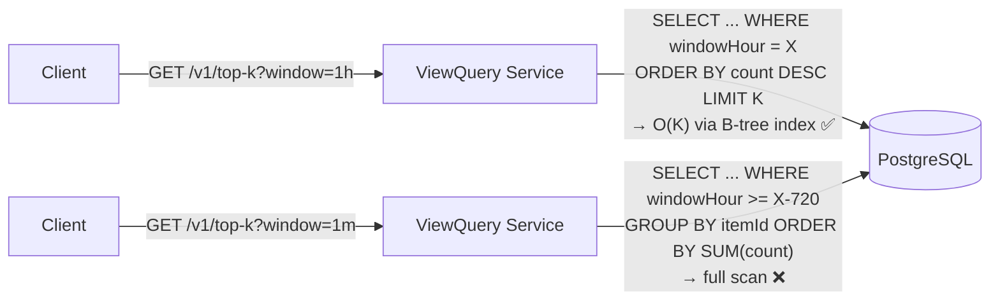

Add an index on `(count DESC)` for single-window queries. For `window=1h`, the B-tree index gives O(K) reads — fast.

For multi-hour windows (day, month, all-time), `SUM(count)` across rows requires a full scan + GROUP BY + sort. **The index can't help because the SUM is computed at query time.**

**Pros:**
- Simple — no additional infrastructure beyond the existing DB
- Works for single-window queries — O(K) via B-tree index

**Cons:**
- Fails the 50ms SLA for aggregated windows (day/month/all-time) — must scan millions of rows to compute `SUM(count)`
- Every query hits the DB directly — no isolation between read and write paths

#### Approach B: Materialized aggregate tables + cron

Instead of computing `SUM(count) GROUP BY itemId` at query time (scanning millions of rows), **pre-compute the sums** into separate tables that are always ready with a `count DESC` index.

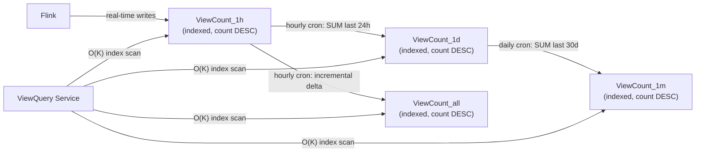

**Four tables, each with a `count DESC` index:**

| Table | Schema | Updated by | Query cost |
|-------|--------|-----------|-----------|
| `ViewCount_1h` | `(itemId, windowHour, count)` | Flink (real-time) | O(K) index scan ✅ |
| `ViewCount_1d` | `(itemId, windowDay, count)` | Hourly cron — sums last 24 hourly rows | O(K) index scan ✅ |
| `ViewCount_1m` | `(itemId, windowMonth, count)` | Daily cron — sums last 30 daily rows | O(K) index scan ✅ |
| `ViewCount_all` | `(itemId, count)` | Hourly cron — incremental delta | O(K) index scan ✅ |

Each cron aggregates **upward**: hourly → daily → monthly. All-time is incremental (adds the delta since last run, not a full recompute).

**How each cron job works:**

**Daily aggregation** (runs every hour):
1. Determine today's date boundary (e.g., 2026-10-13 00:00 to 2026-10-14 00:00)
2. Read all hourly rows from `ViewCount_1h` that fall within today
3. For each item, sum its hourly counts into one daily total
4. Write (or overwrite) that total into `ViewCount_1d` — the write is idempotent, so re-running the same hour is safe
5. Result: `ViewCount_1d` now has one row per item with today's running total, indexed by `count DESC`

**Monthly aggregation** (runs daily at 00:05 UTC, after the daily cron finishes):
1. Determine this month's date boundary (e.g., 2026-10-01 to 2026-11-01)
2. Read all daily rows from `ViewCount_1d` that fall within this month — at most 31 rows per item
3. For each item, sum its daily counts into one monthly total
4. Write (or overwrite) into `ViewCount_1m`
5. Result: `ViewCount_1m` has one row per item with this month's total

**All-time aggregation** (runs every hour, piggybacks on daily cron):
1. Load the checkpoint: "last time I ran was 09:00"
2. Read only the **new hourly rows** from `ViewCount_1h` since the checkpoint (e.g., 09:00 to 10:00) — NOT all historical data
3. For each item in those new rows, **add** the delta to the existing all-time count in `ViewCount_all`
4. Save the new checkpoint (10:00)
5. Result: `ViewCount_all` is incrementally updated. A full recompute would scan all history — this scans only 1 hour of data per run.

:::tip Why incremental for all-time?
The daily and monthly crons can afford to recompute their full window (24 or 31 rows per item) because the window is bounded. All-time has no bound — recomputing it means scanning every hourly row ever written. The incremental approach reads only the new data since the last run, keeping each invocation fast regardless of how much history exists.
:::

**Cron frequency rationale:** match frequency to **how fast the ranking changes** at each granularity. Hourly top-K swings wildly (viral spikes). Daily shifts over hours. Monthly barely moves day-to-day. Faster cron = fresher results but more DB load. The frequencies below balance freshness vs cost:

| Cron | Frequency | Reads per run | Staleness |
|------|-----------|--------------|-----------|
| Daily table | Every hour | ≤ 24 rows per item | ≤ 1 hour |
| Monthly table | Daily at 00:05 UTC | ≤ 31 rows per item | ≤ 1 day |
| All-time table | Every hour (incremental) | Only new hourly rows since last run | ≤ 1 hour |

**Query path after aggregation:**

```sql
-- Top 1000 today: O(K) index scan — no GROUP BY, no SUM
SELECT itemId, count
FROM   ViewCount_1d
WHERE  windowDay = '2026-10-13'
ORDER BY count DESC
LIMIT  1000;

-- Execution plan: Index Scan using idx_1d_count
-- Reads exactly 1000 index entries. No table scan. Done.
```

Compare with the HLD's query that scans 240M rows, groups, sorts, then takes 1000. This is the difference between seconds and milliseconds.

**Pros:**
- 50ms achieved for all windows — each query is an O(K) index scan
- No GROUP BY or SUM at query time — pre-aggregated
- Idempotent cron — safe to re-run on failure (`ON CONFLICT ... DO UPDATE`)
- Layered aggregation (hourly → daily → monthly) limits each cron's scan to a small multiple of rows per item

**Cons:**
- 4× write amplification — every event eventually touches 4 tables
- Cron latency — day/month tables can be up to 1 hour / 1 day stale
- Cron failure = stale results until the next successful run
- Still queries the DB on every API call — no read/write isolation; Flink writes and API reads compete on the same PostgreSQL instance

#### Approach C: Precompute top-K into Redis cache

A cron job periodically queries the DB (or the aggregate tables from Approach B), computes top K for each window, and writes the result to a Redis sorted set:

```
Key:    topk:1h:2026-10-13T01
Value:  sorted set with top 1000 { itemId → count }
TTL:    5 minutes
```

ViewQuery Service reads **only from Redis**, never from the DB at query time.

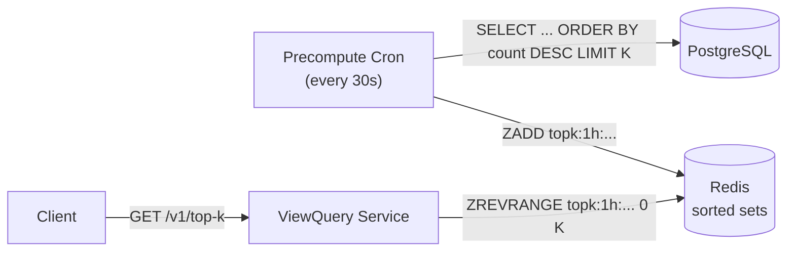

**Pros:**
- O(1) read latency (~1ms from Redis)
- DB is completely decoupled from the read path — DB can be slow without affecting queries
- Cache survives cron delays (TTL buffer)

**Cons:**
- Adds Redis as a dependency on the read path
- Thundering herd if cache expires before cron runs
- Stale by up to one cron interval (30s-1min)

**Thundering herd mitigation:** cron runs every 30s, TTL = 5 min. Old cache continues serving while new one is built. Multiple cron intervals can miss before the cache goes cold.

#### Approach D: Flink computes top-K in-stream → Redis

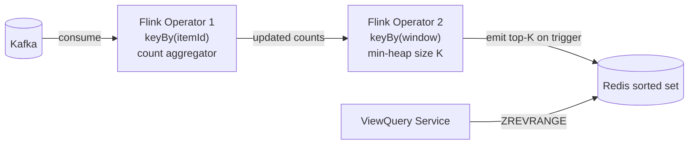

Flink maintains both the item counts AND the top-K result in its state. A second operator reads aggregated counts and maintains a min-heap of size K.

On each trigger:
1. Updated item count flows to the top-K operator
2. If count > min of heap → insert, evict smallest
3. Emit heap to Redis sorted set

**Pros:**
- Lowest staleness — top-K updated on every trigger (30s), not every cron run
- No DB scan at query time — results served from Redis
- No cron service to manage — Flink handles everything

**Cons:**
- Flink state for billions of items is large (64GB+) — needs RocksDB state backend
- The top-K aggregation is a second Flink operator, adding pipeline complexity
- Checkpoint size grows with state — longer checkpoint duration and recovery time

#### Approach E: Approximate counting — Count-Min Sketch + Min-Heap

Instead of exact counters for 4B items (~64GB), use a [Count-Min Sketch](/foundations/probabilistic-data-structures#count-min-sketch-cms--frequency-estimation) (~100MB) + a min-heap of size K (~16KB):

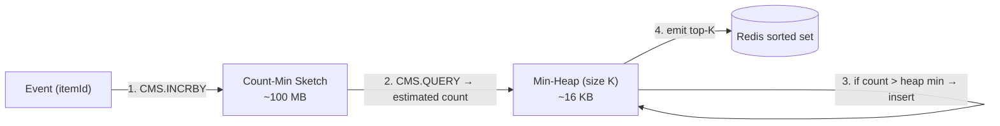

1. Event arrives → increment in CMS
2. Estimate count (returns an upper bound — CMS [never under-counts](/foundations/probabilistic-data-structures#count-min-sketch-cms--frequency-estimation))
3. If estimated count > minimum in the heap → insert/update in heap, evict smallest
4. Periodically emit heap as TopKResult to Redis

**Memory:** CMS with ε=0.001, δ=0.01 → ~100 MB. Heap of 1000 items → ~16 KB. **Total: ~100 MB vs ~64 GB for exact counters — a 640× reduction.**

**Error bound:** an item might enter the top-K with an inflated count due to hash collisions. But items genuinely in the top K have counts so large (millions) that the error (bounded by ε × N ≈ 0.001 × 70B = 70M per day) is proportionally small for truly popular items. The bottom of the top-K list is where approximation matters most.

**Pros:**
- 640× less memory (~100 MB vs ~64 GB for exact counters)
- Streams naturally inside Flink without RocksDB — fits in heap
- No DB scan — top-K maintained in-stream via the min-heap

**Cons:**
- Approximate — items near the K boundary may be wrong (hash collisions inflate counts)
- Can't enumerate all items from a CMS — only query specific items
- **Can't decrement** — complicates sliding windows (see §5.3)

#### Decision: Approach C (cron + Redis cache) for canonical results + Approach E (CMS) for live trending

| | A (Index) | B (Aggregate tables) | **C (Cron + Redis)** | D (Flink top-K) | **E (CMS + Heap)** |
|---|---|---|---|---|---|
| Query latency | O(K) for 1h; slow for day+ | O(K) all windows | **~1ms** | **~1ms** | **~1ms** |
| Freshness | Real-time | Up to 1h stale | Up to 30s stale | ~30s (trigger) | ~30s (trigger) |
| Accuracy | Exact | Exact | **Exact** | Exact | **Approximate** |
| DB load at query time | Full scan for day+ | O(K) | **None** | **None** | **None** |
| Memory for counts | 64GB (DB) | 64GB × 4 | 64GB (DB) + tiny cache | 64GB (Flink state) | **~100 MB** |

:::staff[Two layers: exact for canonical, approximate for live]
The industry pattern is **both, not either/or**. YouTube, Netflix, and Twitter all run an exact batch layer (hourly/daily) alongside an approximate real-time layer (CMS/sketches for "trending now"). The exact layer is the source of truth for "Top Videos This Month." The approximate layer powers the live dashboard that updates every 30 seconds. Serving both from a single system (exact only or approximate only) either sacrifices freshness or accuracy. Two layers — each optimized for its job — is simpler than one layer trying to do both.

**Key trade-off:** operational cost of two pipelines (exact cron + approximate Flink CMS) vs a single pipeline that compromises on either freshness or accuracy.

**What we give up:** simplicity. Two code paths, two monitoring targets, two failure modes.

**When to revisit:** if product only needs one view (e.g. "we don't need live trending, just daily charts"), drop the CMS layer and use only the cron + Redis approach.
:::

### 5.3 Time Windows & Late Events (FR2)

**Problem:** FR2 supports "last 1 hour." Does that mean the current tumbling window (9:00-10:00), or a sliding window from now (9:37-10:37)? And what happens when events arrive late?

#### Approach A: Tumbling windows

```mermaid
gantt
    title Tumbling Windows (non-overlapping)
    dateFormat HH:mm
    axisFormat %H:%M
    section Windows
    Window 1 (9-10)   :w1, 09:00, 60min
    Window 2 (10-11)  :w2, 10:00, 60min
    Window 3 (11-12)  :w3, 11:00, 60min
    section Query
    Query at 10:37 returns Window 2 :milestone, 10:37, 0min
```

Fixed, non-overlapping: 9:00-10:00, 10:00-11:00, etc. A query at 10:37 returns the 10:00-11:00 window.

**Pros:** Simple. One counter per item per window. No decrement logic. Flink's tumbling window is the most basic operator. CMS-compatible (no decrement needed).

**Cons:** At 10:59, the "last hour" window has 59 minutes of data. At 10:01, it has 1 minute. Results feel stale near window boundaries.

#### Approach B: Sliding windows (minute-grain increment/decrement)

```mermaid
gantt
    title Sliding Windows (overlapping, 1-min slide)
    dateFormat HH:mm
    axisFormat %H:%M
    section Windows
    9:35-10:35  :s1, 09:35, 60min
    9:36-10:36  :s2, 09:36, 60min
    9:37-10:37  :active, s3, 09:37, 60min
    9:38-10:38  :s4, 09:38, 60min
    section Query
    Query at 10:37 returns 9:37-10:37 :milestone, 10:37, 0min
```

A query at 10:37 returns 9:37-10:37. Always exactly 60 minutes of data.

**Implementation:** store at **minute granularity**. The Flink operator maintains a **circular buffer of 60 minute-aggregates** per item. On each new minute:

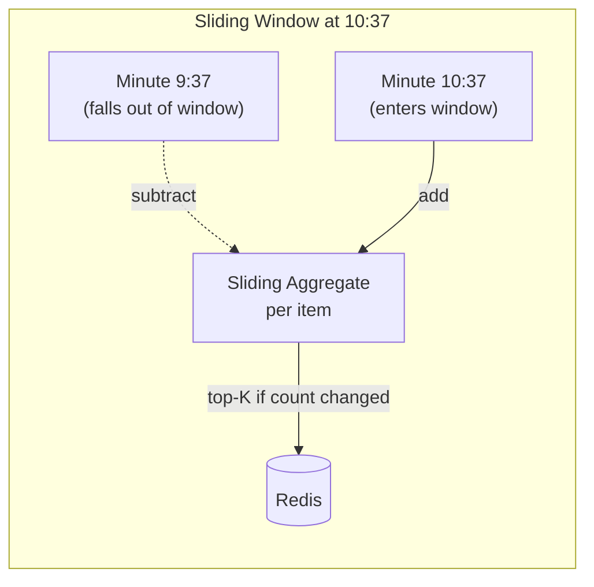

1. `new_minute` = counts from minute T (**increment**)
2. `old_minute` = counts from minute T-60 (**decrement**)
3. For each item: `sliding_count += new_minute[item] - old_minute[item]`
4. Items with zero count after decrement are evicted from the map

This is **O(items changed in one minute)**, not O(all items) — only items that had views in the new or expiring minute are touched.

**CMS problem:** Count-Min Sketch [doesn't support decrement](/foundations/probabilistic-data-structures#count-min-sketch-cms--frequency-estimation). Hash collisions make subtraction produce garbage. Options:

| Option | Memory | Accuracy |
|--------|--------|----------|
| Per-minute CMS snapshots (keep 60, subtract oldest) | 60 × 100MB = **6 GB** | Approximate |
| **Exact counters for active items only** | ~10M items × 16B = **~160 MB** | Exact |
| [Space-Saving](/foundations/probabilistic-data-structures#space-saving--heavy-hitters--top-k-tracking) (supports eviction, not time-expiry) | Small | Approximate |

:::staff[Sliding windows are cheaper than they look]
The sliding 1h window needs exact counters, not CMS, because CMS can't decrement. But exact counters for the 1h window cost **~160 MB** (only ~10M items active in any hour), while CMS for all 4B items costs ~100 MB. The per-item overhead is higher (16 bytes vs CMS's ~0.025 bytes), but the **working set is 400× smaller** because most items have zero views in any given hour. Items with zero count after decrement are evicted, so memory is bounded by the active set, not the total catalog.
:::

**Pros:** Always fresh — exactly 60 minutes of data regardless of when you query. Better UX for "trending now."

**Cons:** Minute-grain storage (60× more state than hourly). Increment/decrement logic. Not CMS-compatible (must use exact counters for the sliding window).

#### Decision: Sliding for 1h, tumbling for day/month/all-time

| Window | Type | Why |
|--------|------|-----|
| **1 hour** | **Sliding** | Users notice staleness at hour boundaries. "Trending now" should always feel fresh. |
| **1 day** | Tumbling (UTC day) | Nobody notices that "top today" resets at midnight vs rolling 24h. |
| **1 month** | Tumbling (UTC month) | Monthly rankings don't need minute-level freshness. |
| **All time** | Tumbling (cumulative) | No expiry, no decrement. CMS works perfectly. |

**Flink pipeline:**

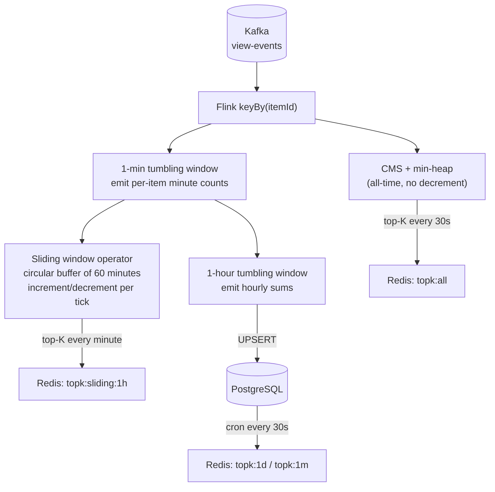

| Concern | 1h (sliding) | 1d / 1m (tumbling) | all-time |
|---------|-------------|-------------------|----------|
| Counting | Exact (circular buffer) | Exact (PostgreSQL) | Approximate (CMS) |
| Freshness | ~1 minute | ~30s (cron) | ~30s (trigger) |
| Memory | ~160 MB (active items) | On disk | ~100 MB |
| Decrement | ✅ (subtract old minute) | Not needed | Not needed |

#### Late Event Handling

Events can arrive late: a mobile client was offline, a CDN had network delays, a producer retried after a transient failure. An event with timestamp 9:58 arriving at 10:05 needs to be counted in the right window, not the current one.

**Flink handles this with [watermarks and allowed lateness](/building-blocks/stream-processing#watermarks):**

A **watermark** declares: "all events with timestamp ≤ W have arrived." Flink computes it as:

```
W = max(event_time seen so far) - allowed_out_of_orderness
```

With `allowed_out_of_orderness = 30s` and the latest event at 10:05:00, W = 10:04:30. Flink won't close the 10:04 minute-window until W passes 10:05.

**Three categories of late events:**

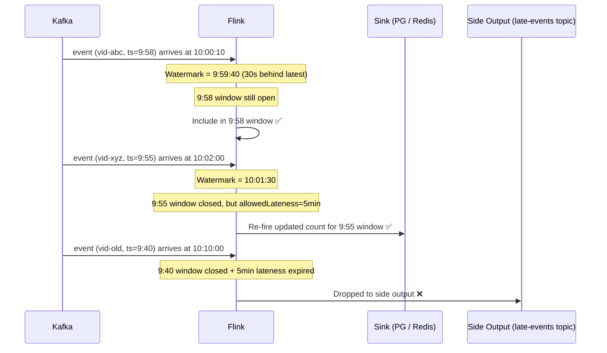

| Category | How late | What happens |
|----------|----------|--------------|
| **Within watermark tolerance** (≤ 30s) | Covered by watermark delay | Included in the correct window automatically |
| **Moderately late** (30s - 5min) | After watermark, within `allowedLateness` | Window state is retained. Late event triggers a **re-fire** with the updated count. |
| **Very late** (&gt; 5min) | After window + allowed lateness | Sent to a **side output** (Kafka `late-events` topic) for batch reconciliation |

**Side output reconciliation:**

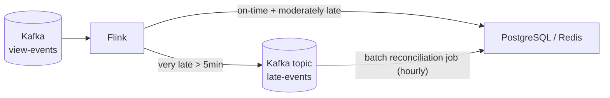

An hourly batch job reads `late-events`, aggregates them, and applies corrections to PostgreSQL. The cron job picks up corrected counts on its next run.

**Impact on each window type:**

| Window | Late event handling |
|--------|---------------------|
| **Sliding 1h** | Late event for minute T-3 updates the circular buffer (still in the 60-minute range). Sliding aggregate corrected on next tick. Events older than 60 min are irrelevant. |
| **Tumbling 1d / 1m** | Re-fired aggregates `UPSERT` to PostgreSQL (idempotent). Cron picks up corrected count within 30s. |
| **All-time CMS** | Late events are just added to CMS — CMS doesn't care about order, only increments. Very late events from the side output are replayed in batch. |

**Watermark tightness trade-off:**

| Setting | Tight (5s) | Medium (30s) | Loose (60s) |
|---------|-----------|-------------|-------------|
| Window closes | 5s after last expected event | 30s after | 60s after |
| Result freshness | Results available almost immediately | Slight delay | Delayed by up to 60s |
| Late event drops | More events to side output | Balanced | Fewer drops |
| State held | Less | Moderate | More (windows stay open longer) |

**Decision:** 30s watermark delay + 5 min allowed lateness.

:::staff[Allowed lateness is a state management decision, not an accuracy decision]
Setting allowed lateness to infinity would never drop an event, but Flink would retain **every window's state forever** — at 10M items per minute, that's unbounded memory growth. The 5-minute lateness bounds state while the side output + hourly batch reconciliation ensures completeness. Very late events aren't lost — they're just processed on a different timeline. The real-time layer prioritizes bounded memory and low latency; the batch layer prioritizes completeness. This is the Lambda architecture applied to windowed counting.
:::

### 5.4 Failure Recovery (NFR5 — Resiliency)

**Problem:** A Flink TaskManager crashes mid-window. It was holding in-memory counts for millions of items. How do we recover without losing or double-counting events?

#### Flink's checkpoint-based recovery

1. Flink periodically snapshots **all operator state** (item counts, CMS, heap) + **Kafka consumer offsets** to durable storage (S3/HDFS)
2. On failure, the JobManager restarts the failed TaskManager
3. The new TaskManager loads state from the last checkpoint
4. Kafka consumer rewinds to the checkpointed offset
5. Events between the checkpoint and the crash are **replayed** — but since the state was also rewound, they are counted exactly once

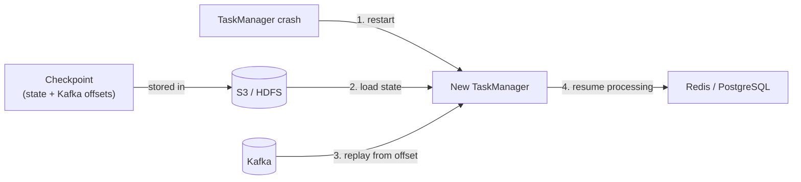

**Checkpoint interval trade-off:**

| Interval | Recovery time | Checkpoint cost |
|----------|-------------|-----------------|
| 10 seconds | Replay ~10s of events | High (frequent snapshots of large state) |
| 1 minute | Replay ~1 min of events | Moderate |
| 5 minutes | Replay ~5 min of events | Low |

**Decision:** 1-minute checkpoint interval. At 800K events/sec, a crash replays ~48M events, which Flink processes in ~60s. Total recovery: checkpoint load (~10s) + replay (~60s) ≈ **~70s downtime** for the affected partition. During this time, the cron + Redis cache continues serving (slightly stale) results — queries are unaffected.

:::staff[Decouple ingestion failure from query availability]
The cron + Redis cache architecture means ingestion can fail for minutes without any query degradation. The cache has a 5-minute TTL, and the last-computed top-K is still valid (top videos don't change dramatically in 70 seconds). This is why the two-layer architecture (§5.2) pays off beyond just performance — it's also a resiliency mechanism. Compare with a system where queries hit the DB directly: a Flink crash that stops writes makes the DB stale, and there's no cache to mask it.
:::

#### Exactly-once to the sink

Flink's exactly-once guarantee covers **internal state**. Writing to external sinks (PostgreSQL, Redis) requires additional care:

| Sink | Exactly-once strategy |
|------|----------------------|
| **PostgreSQL** | Idempotent UPSERTs keyed on `(itemId, windowHour)`. Replaying the same aggregate twice overwrites with the same value. |
| **Redis sorted set** | `ZADD` is idempotent (same score for same member = no-op). Safe to replay. |

Both sinks are naturally idempotent for this workload — a replayed aggregate produces the same result as the original.

### 5.5 Final Architecture

The final design combines an exact canonical pipeline with a low-latency live pipeline. Flink reduces the event stream into windowed counts, PostgreSQL stores durable aggregates, scheduled precomputation publishes canonical rankings, and Redis serves small pre-ranked snapshots within the 50ms SLO. Very-late events flow through a durable reconciliation path rather than being dropped.

<DesignPreview file="top-k.vetora.yaml" height={700} title="Top-K Heavy Hitters — Final Architecture (Vetora)" />

---

## 6. Bottlenecks & Failure Scenarios

| Scenario | Impact | Mitigation |
|----------|--------|------------|
| **Flink TaskManager crash** | Affected partition stops processing; ~70s recovery | Checkpoint-based recovery; Redis cache masks staleness during replay (§5.4) |
| **Hot item (viral video)** | One Kafka partition gets disproportionate traffic → one Flink subtask overloaded | Flink's keyBy distributes by itemId; a single hot item is one key on one subtask. Monitor subtask lag; if critical, use salted keys with secondary aggregation. |
| **Kafka consumer lag** | Ingestion falls behind; counts are stale | Alert on consumer lag (§NFR6); scale Flink parallelism; increase Kafka partitions |
| **PostgreSQL shard overloaded** | Flink trigger writes fail or slow down | Backpressure propagates through Flink; events buffer in Kafka. Increase shards or batch size. |
| **Cron job failure** | Redis cache becomes stale (up to TTL) | TTL = 5 min provides buffer for multiple missed cron runs. Alert on cron staleness. Redundant cron instances. |
| **Redis failure** | Queries return errors (read path down) | Redis Sentinel / Cluster with replicas; fallback to direct DB query (slower, degraded) |
| **CMS hash collision spike** | Approximate counts over-estimate for some items; wrong items enter top-K | Monitor CMS error rate (compare approximate vs exact for sampled items); increase CMS width (more memory) |
| **Checkpoint storage (S3) failure** | Flink can't checkpoint; recovery window grows | Alert on checkpoint failures; dual-write checkpoints to backup storage |
| **Clock skew across producers** | Events assigned to wrong hourly window | Flink watermarks handle bounded out-of-order events; configure allowed lateness |

## 7. Trade-offs & Alternatives

| Decision | What we chose | Alternative | Why we chose it | When to revisit |
|----------|--------------|-------------|-----------------|-----------------|
| **Ingestion** | Flink with 30s triggers (§5.1) | Direct DB writes / Kafka Streams | 80× write reduction + exactly-once | If team can't operate Flink → Kafka Streams |
| **Query serving** | Cron-precomputed Redis cache (§5.2) | Direct DB query / Flink in-stream top-K | O(1) reads, DB decoupled from read path | If 30s staleness is unacceptable → Flink in-stream |
| **Live trending** | CMS + min-heap in Flink (§5.2) | Exact counters in Flink state | 640× less memory, streams without RocksDB | If approximate counts cause product issues → exact |
| **Windows** | Tumbling for all (§5.3) | Sliding for 1h, tumbling for day/month | CMS compatible, simpler implementation | If product demands sub-hour freshness for "last 1 hour" |
| **Counting** | Approximate (CMS) for live + exact (DB) for canonical | Exact only or approximate only | Each layer optimized for its job | If only one view is needed, drop the other layer |
| **Storage** | Sharded PostgreSQL | Cassandra / Druid / ClickHouse | Familiar, ACID, good for moderate shard count | If shard count exceeds ~20 → consider Druid/ClickHouse for OLAP |
| **Recovery** | 1-min checkpoints (§5.4) | Shorter/longer intervals | ~70s recovery balances cost and downtime | If recovery time SLO is stricter → shorter interval (more checkpoint cost) |

## 8. Related Concepts

- [Stream Processing (Flink / Kafka Streams)](/building-blocks/stream-processing) — Flink architecture, windowing, checkpointing, exactly-once semantics
- [Probabilistic Data Structures](/foundations/probabilistic-data-structures) — Count-Min Sketch, HyperLogLog, Space-Saving, Bloom filters
- [Kafka](/building-blocks/kafka) — event ingestion, partitioning, consumer groups, offset management
- [Redis](/building-blocks/redis) — sorted sets for top-K cache, Pub/Sub for invalidation
- [PostgreSQL](/building-blocks/postgresql) — durable aggregate storage, indexing for top-K queries
- [Sharding](/distributed-systems/sharding) — database sharding for write throughput
- [Partitioning](/distributed-systems/partitioning) — Kafka partitioning by itemId, time-based DB partitioning
- [Observability](/foundations/observability) — consumer lag, checkpoint health, CMS accuracy monitoring
- [Rate Limiting](/patterns/rate-limiting) — uses similar per-key counting and sliding window patterns

---

## Appendix: Scale Assumptions

<StatGrid stats={[
  {value: '70B', label: 'View events / day', accent: 'blue'},
  {value: '~800K/s', label: 'Peak ingest', detail: '70B ÷ 86,400', accent: 'purple'},
  {value: '~80×', label: 'Flink write reduction', detail: '→ ~10K UPSERTs/sec', accent: 'green'},
  {value: '~70s', label: 'Crash recovery', detail: 'Checkpoint load + replay', accent: 'amber'},
]} />

| Parameter | Value | Derivation |
|-----------|-------|------------|
| Events per day | 70B | YouTube Shorts scale |
| Events per second (peak) | ~800K | 70B ÷ 86,400 |
| Unique items (all time) | ~4B | ~1M new videos/day × 10 years |
| Unique items per hour | ~10M | Active subset |
| Exact counter memory (all items) | ~64 GB | 4B × (8B id + 8B count) |
| CMS memory (ε=0.001, δ=0.01) | ~100 MB | w=2718, d=5, 8 bytes per cell |
| Min-heap memory (K=1000) | ~16 KB | 1000 × (8B id + 8B count) |
| Flink write reduction | ~80× | 800K events/sec → ~10K UPSERTs/sec |
| PostgreSQL shards | ~5-10 | 10K writes/sec ÷ ~2K/shard |
| Checkpoint interval | 1 minute | Balance recovery time vs cost |
| Recovery time on crash | ~70s | Checkpoint load (~10s) + replay (~60s) |
| Cron precompute interval | 30 seconds | Balance freshness vs DB load |
| Redis cache TTL | 5 minutes | Buffer for missed cron runs |
| Kafka partitions | 64 | Parallelism for Flink consumers |
| Kafka retention | 7 days | Replay buffer for recovery |
